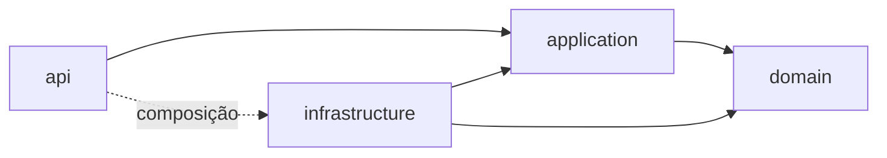
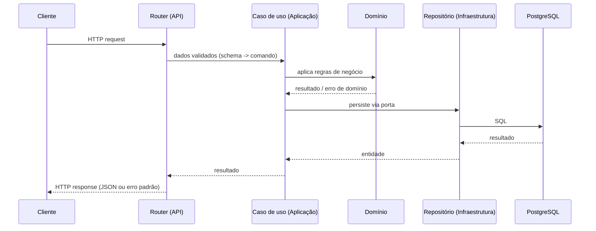

# Visão geral da arquitetura

## Estilo

Aplicação única implantável, organizada em **4 camadas: API, Aplicação, Domínio e
Infraestrutura** (decisão humana; ver [ADR 0002](adr/0002-arquitetura-em-camadas.md)).

## Responsabilidade de cada camada

| Camada | Responsabilidade | NÃO pode conter |
|---|---|---|
| **API** (`raizes.api`) | Tradução HTTP: routers, schemas Pydantic de entrada/saída, dependências, tradução de erros para o formato padrão do roteiro, middleware. | Regra de negócio; acesso direto a banco (`infrastructure.db`). |
| **Aplicação** (`raizes.application`) | Casos de uso (orquestração) e **portas** (Protocols) que a infraestrutura implementa. | FastAPI, SQLAlchemy, detalhes HTTP ou de banco. |
| **Domínio** (`raizes.domain`) | Entidades, value objects e regras de negócio. | Qualquer dependência de framework (FastAPI, Pydantic, SQLAlchemy, Starlette) ou de outras camadas. |
| **Infraestrutura** (`raizes.infrastructure`) | Implementações técnicas: configuração, logs, banco, gateways externos. | Regra de negócio. |

## Regra de dependência

- `api` depende de `application`; `application` depende de `domain`; `domain` não depende de ninguém.
- `infrastructure` depende de `application` e `domain`, pois **implementa as portas** definidas
  na aplicação (inversão de dependência).
- A **composição** (injeção da implementação concreta) acontece apenas em `main.py` e
  `api/dependencies.py`; é a única exceção em que a API enxerga a infraestrutura de banco.
- A regra é **verificada automaticamente** por `tests/architecture/test_layers.py`
  (análise de imports com `ast`), em `make test` e na CI.

## Organização interna (proposta da IA, aguardando validação humana)

Dentro de cada camada, um **subpacote por módulo de negócio**, por exemplo:
`domain/pedidos`, `application/pedidos`, `api/v1/pedidos.py`,
`infrastructure/db/repositories/pedidos.py`. Isso mantém as fronteiras entre domínios e permite
extrair um módulo no futuro. Status: **proposta, não decidida pelo humano**.

## Módulos de negócio planejados (ainda não implementados)

Derivados do estudo de caso:

| Módulo | Responsabilidade |
|---|---|
| Identidade e acesso | Autenticação, papéis (cliente, atendente, gerente, matriz) e autorização. |
| Unidades | Cadastro de unidades, formato de operação (cozinha completa/reduzida) e região. |
| Cardápio | Produtos por unidade, com disponibilidade local e sazonal (ex.: período junino) e variações regionais. |
| Estoque | Controle de estoque por unidade e baixa/reposição ligadas aos pedidos. |
| Pedidos | Criação e ciclo de vida do pedido nos canais app, totem, balcão, pick-up e web (enum `canalPedido`: `APP`, `TOTEM`, `BALCAO`, `PICKUP`, `WEB`), com acompanhamento de status. |
| Pagamentos | Integração com gateway externo via porta/adapter, idempotência e tolerância a falhas. |
| Clientes e consentimento (LGPD) | Dados do cliente, consentimento explícito, anonimização e direitos do titular. |
| Fidelidade | Acúmulo de pontos, descontos progressivos e campanhas segmentadas. |
| Auditoria | Rastro de operações sensíveis (cancelamentos, descontos, ajustes) e de acessos a dados pessoais. |
| Relatórios da matriz | Vendas por unidade/região, produtos mais consumidos e visões financeiras consolidadas. |

## Fluxo de uma requisição

## Camada analítica

Além da API transacional, o projeto tem uma camada analítica (Data Warehouse com margem para
Lakehouse: DuckDB + Parquet, outbox, Kimball e dbt). Ela é alimentada por eventos de domínio
gravados na `outbox_eventos` na mesma transação dos casos de uso e vive em `analytics/`, fora das
camadas da API. Detalhes em [docs/dados/](../dados/README.md) e nos
[ADR 0007](adr/0007-visao-analitica.md), [ADR 0008](adr/0008-plataforma-analitica.md), [ADR 0009](adr/0009-nomenclatura-e-contratos-de-dados.md) (dicionário e contratos de dados) e [ADR 0010](adr/0010-idioma-portugues.md) (nomenclatura e contrato da API em português; código Python e variáveis de ambiente em inglês).

## Preocupações transversais já presentes

- **Configuração por ambiente (12-factor):** variáveis de ambiente lidas por `pydantic-settings`;
  senha como `SecretStr`; `.env` local gerado por `make setup`.
- **Logs JSON** em stdout, com `request_id` em todas as linhas.
- **X-Request-ID:** gerado se ausente, devolvido no header e injetado no log.
- **Erro padrão do roteiro** ([ADR 0011](adr/0011-formato-de-erro.md)): toda resposta de erro (domínio,
  aplicação, validação, HTTP e falhas inesperadas) sai como `application/json` com `error`,
  `message`, `details`, `timestamp`, `path` e `requestId`; o schema `ErroPadrao` é registrado no OpenAPI.
- **Health checks:** `GET /health/live` (processo) e `GET /health/ready` (checa o banco via porta).
- **Migrações Alembic:** aplicadas na inicialização do contêiner; URL do banco vinda das settings.
- **Outbox de eventos de domínio:** `DomainEvent` (domínio), porta `OutboxWriter` (aplicação) e
  `SqlAlchemyOutboxWriter` (infraestrutura) gravam eventos na tabela `outbox_eventos` dentro da
  transação do caso de uso, para alimentar o analítico. Eventos não carregam dados pessoais em claro.
