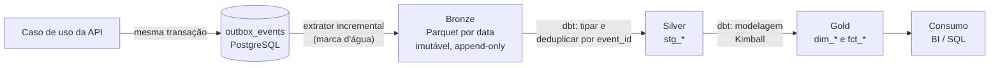

# Arquitetura de dados

Visão da camada analítica do projeto: um Data Warehouse com margem para virar Lakehouse
([ADR 0007](../arquitetura/adr/0007-visao-analitica.md), [ADR 0008](../arquitetura/adr/0008-plataforma-analitica.md) e [ADR 0009](../arquitetura/adr/0009-nomenclatura-e-contratos-de-dados.md)).
Nomes e tipos dos objetos: [dicionário de dados](dicionario-de-dados.md). Contratos de dados: [`contracts/`](../../contracts/README.md).
Como rodar: [analytics/README.md](../../analytics/README.md).

> Convenção de autoria deste documento: as seções marcadas com
> **proposta da IA — aguardando validação do autor** ainda não foram validadas pelo humano.
> A modelagem dimensional de negócio é de autoria humana (ver [matriz de barramento](matriz-de-barramento.md)).

## Por que uma camada analítica numa rede de lanchonetes

Justificativa do autor: "não é uma empresa de tecnologia, mas dados são essenciais para qualquer
empresa". A matriz da Raízes do Nordeste precisa de vendas por unidade e região, produtos mais
consumidos, relatórios financeiros, auditoria de operações sensíveis e campanhas segmentadas. O
objetivo não é desvirtuar o projeto (a API segue sendo o núcleo), e sim trazer a visão pessoal do
arquiteto escolhido para a solução.

**Fora do escopo desta entrega:** dashboards/BI prontos, orquestrador (Airflow etc.), streaming,
object storage em nuvem, modelos de ML, modelagem dimensional de negócio (autoria humana, a fazer)
e qualquer dado real de clientes. A entrega é a **fundação**: outbox, ingestão, camadas, dbt e a
dimensão de data (`dim_date`).

## OLTP × OLAP: por que separar

| | OLTP (PostgreSQL, atendido pela API) | OLAP (DuckDB + Parquet, atendido pela análise) |
|---|---|---|
| Carga | muitas escritas pequenas e leituras pontuais, baixa latência | poucas leituras grandes, agregações sobre milhões de linhas |
| Modelo | normalizado, integridade transacional | dimensional (estrela), desnormalizado, histórico |
| Prioridade | disponibilidade no horário de pico | custo de leitura analítica e rastreabilidade |
| Risco se misturar | relatório pesado derruba o pedido no almoço | análise depende de esquema transacional que muda |

Separar protege a API (requisito de alta disponibilidade do estudo de caso) e permite evoluir cada
lado com a tecnologia adequada.

## Fluxo de dados

1. O caso de uso confirma o negócio e grava o evento de domínio na `outbox_events` **na mesma
   transação**: ou ambos existem, ou nenhum.
2. O extrator (`analytics/ingestion/extract_outbox.py`) lê as linhas com `sequence_id` maior que a
   marca d'água e grava Parquet no bronze; só então avança a marca d'água.
3. O dbt lê o bronze, tipa e deduplica (silver) e modela a estrela (gold).
4. O consumo é SQL sobre o arquivo DuckDB (`data/warehouse/raizes.duckdb`) ou BI conectado a ele.

Tudo o que é gerado (`data/`) fica fora do git.

## Camadas e convenções

> **Proposta da IA — aguardando validação do autor**

| Camada | O que é | Onde | Nomes |
|---|---|---|---|
| Bronze | arquivos brutos, imutáveis, append-only, particionados por data de captura (UTC) | `data/lake/bronze/<tabela>/dt=AAAA-MM-DD/<run_id>.parquet` | nome da tabela de origem |
| Silver | dado tipado, deduplicado, sem PII em claro | schema `silver` do DuckDB | `stg_*` (e `int_*` se houver etapa intermediária) |
| Gold | modelo dimensional (estrela Kimball) pronto para consumo | schema `gold` | `dim_*` e `fct_*` |

- **Inglês, `snake_case`** em tabelas, colunas, modelos dbt, seeds, campos de eventos e variáveis de ambiente (ADR 0009, decisão D-033); a documentação segue em português e os **valores** dos dados (ex.: "Natal", "janeiro") também. Convenções completas e glossário pt → en em [dicionario-de-dados.md](dicionario-de-dados.md).
- **Chaves substitutas:** as dimensões de negócio têm chave substituta inteira própria
  (`<entidade>_sk`), independente da chave natural (`<entidade>_id`); as fatos referenciam só chaves
  substitutas (`<dimensão>_sk`). `dim_date` usa `date_key` no formato AAAAMMDD (chave inteligente,
  usual em calendário).
- **Membro desconhecido (-1):** toda dimensão de negócio tem a linha `-1` ("desconhecido / não
  informado"). A fato nunca guarda chave nula: o que não for resolvido aponta para -1. Isso
  mantém `inner join` seguro e torna a falta de dado visível em vez de silenciosa. `dim_date` não
  precisa do -1: a data é obrigatória e coberta pelo intervalo (um teste `relationships` na fato
  deve garantir isso).
- **Datas:** o armazenamento (outbox, bronze, silver) guarda instantes em **UTC**, o que evita
  ambiguidade de horário de verão/fuso e permite reprocessar de qualquer lugar. A **dimensão de
  data usa a data civil em America/Recife**, porque o negócio pensa em "vendas de hoje" no horário
  das unidades (a meia-noite de Recife ocorre às 03:00 UTC). A conversão acontece ao carregar a
  fato: `cast(occurred_at at time zone 'America/Recife' as date)`.
- **Eventos:** nome estável em `snake_case` (`order_created`), `schema_version` inteiro; mudança
  incompatível de payload exige nova versão.

## LGPD no analítico

> **Proposta da IA — aguardando validação do autor**

Princípio da diretoria: "Conhecer o cliente é importante, mas respeitar sua privacidade é obrigatório."

- **Nenhum dado pessoal direto em silver/gold** (nome, CPF, e-mail, telefone, endereço, data de nascimento).
- **Pseudonimização do cliente:** a chave de cliente no analítico é
  `HMAC-SHA256(ANALYTICS_PSEUDONYM_KEY, customer_id)`. A chave é gerada localmente por `make setup`,
  fica só no `.env` e **nunca é versionada**. Sem a chave não se refaz o vínculo; trocar a chave
  desfaz o vínculo de todos os registros (útil como "botão de anonimização total").
- **Idade -> faixa etária:** o analítico guarda a faixa (ex.: 18-24), nunca a data de nascimento.
- **Consentimento:** análises individualizadas (campanhas segmentadas, perfil por cliente) só
  usam clientes com consentimento vigente. Sem consentimento, o cliente entra apenas em
  **agregados anônimos** (ex.: total por unidade e dia), sem a chave pseudonimizada.
- **Regra para os eventos (inegociável):** eventos de domínio **não carregam PII em claro**. Usam
  identificadores internos e atributos já derivados (faixa etária, flag de consentimento). Isso vale
  porque o bronze é **imutável** e guarda o payload integralmente: um dado pessoal em claro no
  evento seria permanente no lake. A regra está na docstring de `DomainEvent`.
- **Direito de eliminação:** o analítico só guarda dado pseudonimizado, e a pseudonimização é
  determinística. Para eliminar um titular: (a) apagar/anonimizar o cliente no OLTP; (b) calcular o
  HMAC do `customer_id` e localizar seus registros; (c) expurgar esses registros do bronze,
  reescrevendo apenas os arquivos afetados; (d) reprocessar silver e gold. Isso só é viável porque
  silver e gold são **reconstruíveis a partir do bronze** (`dbt build` do zero). O expurgo é a
  única exceção legítima à imutabilidade do bronze e deve ser auditado. Alternativamente, a rotação
  de `ANALYTICS_PSEUDONYM_KEY` torna irrecuperável o vínculo de todos os titulares.
- **Segredos:** nada disso é impresso em log; o verificador de segredos do repositório continua valendo ([ADR 0005](../arquitetura/adr/0005-protecao-de-credenciais-e-dados-pessoais.md)).

## Caminho para Lakehouse

> **Proposta da IA — aguardando validação do autor**

| Fase | Armazenamento / motor | O que muda |
|---|---|---|
| 1. Hoje | DuckDB + Parquet em disco local | Entrega atual. |
| 2. Object storage | S3/MinIO + formato de tabela aberto (**Apache Iceberg**) | O lake sai do disco; ganha transações ACID, evolução de esquema e viagem no tempo. |
| 3. Motor distribuído | Trino ou Spark sobre o Iceberg | Os modelos dbt são reaproveitados trocando o adapter. |
| 4. Streaming e ML | Kafka/Debezium (CDC) no lugar do extrator batch; features de ML a partir do gold/silver | A outbox evolui para CDC; novos consumidores além do DW. |

**O que torna a migração barata:** (1) formatos abertos: Parquet é lido por qualquer motor e o
Iceberg é um padrão aberto; (2) dbt é agnóstico ao motor: os modelos são SQL e o motor é só o
adapter configurado no perfil; (3) bronze imutável: o que veio da origem nunca é alterado, então
qualquer camada nova pode ser reconstruída do zero a partir dele; (4) o contrato de eventos
(`event_type` + `schema_version`, formalizado em [`contracts/`](../../contracts/README.md)) independe de como são transportados.
