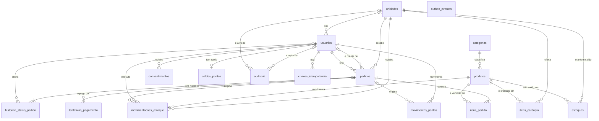
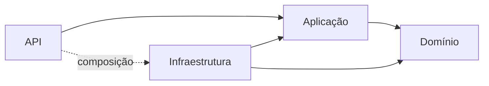
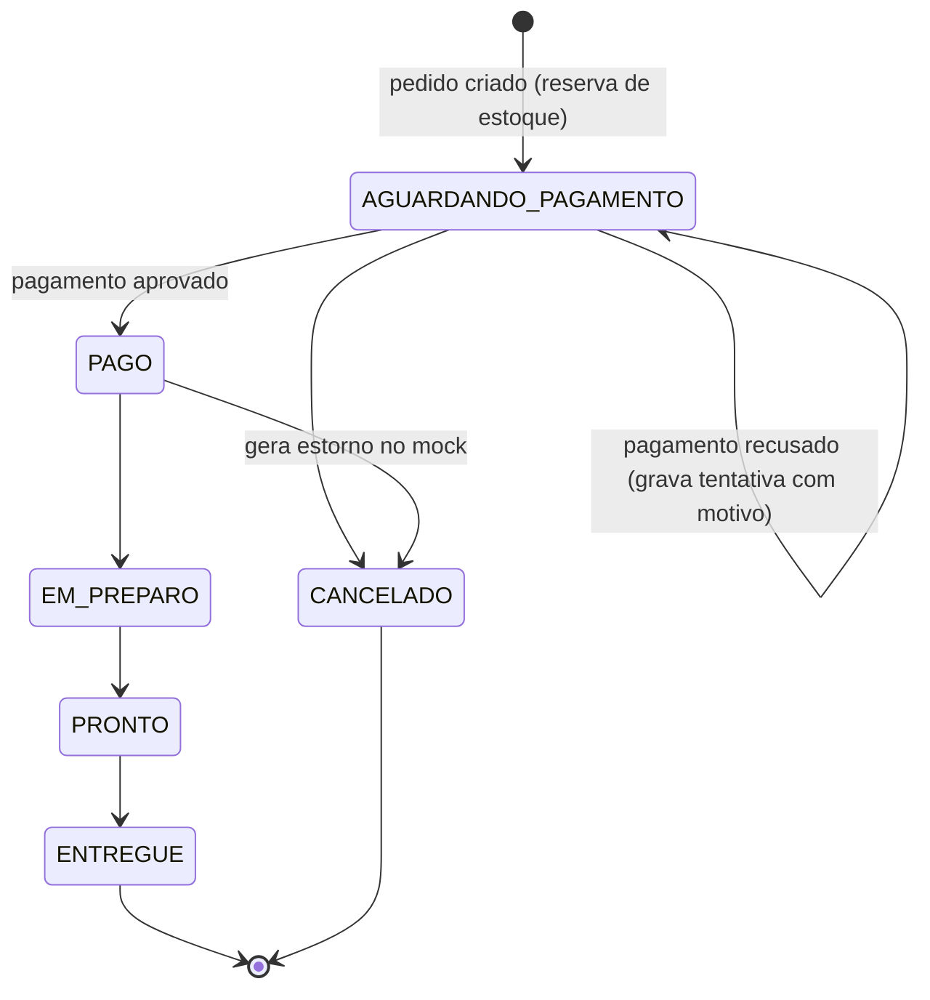

<!--
ESQUELETO DO DOCUMENTO PRINCIPAL (fonte em Markdown → .docx → PDF único)

Estrutura = "Documento principal" do roteiro geral (init/roteiro.md) + seções obrigatórias
do roteiro da trilha (init/roteiro_trilha_backend.md). Cada seção traz:
  - EXIGE: o que o roteiro pede (com a linha);
  - FONTE: o artefato do repositório que alimenta a seção;
  - STATUS: ⬜ a escrever · ✏️ rascunho · ✅ revisado pelo autor;
  - AUTORIA: quem redige o texto final (🧑 autor · 🤖 rascunho da IA revisado pelo autor).
Os comentários HTML não saem no documento final.
A numeração das figuras e tabelas segue a ordem de aparição neste arquivo; as figuras que vierem
dos arquivos de docs/modelagem/ (3.1, 3.4 e 3.5) devem ser numeradas na montagem final.
-->

# Capa e folha de rosto

<!--
EXIGE: curso, disciplina, nome, RU, polo de apoio, semestre e professor (roteiro geral, "Capa e Sumário").
FONTE: docs/entrega/capa.local.yaml (privado). STATUS: ⬜ AUTORIA: 🧑
Nome do arquivo final: <RU>_Projeto_Back_End.PDF (RT p. 13).
-->

# Sumário

<!-- Gerado automaticamente na conversão. -->

# 1 Introdução e objetivos

<!--
EXIGE: contexto do estudo de caso, objetivos do projeto, principais usuários e relevância do sistema
(roteiro geral); foco no negócio e numa API que suporte múltiplos canais (RT p. 4).
FONTE: docs/requisitos/README.md §1 e §2; init/roteiro.md (estudo de caso).
STATUS: ⬜ AUTORIA: 🧑 (texto autoral, recomendado escrever com a própria voz)
-->

## 1.1 Contexto

<!-- ROTEIRO PARA O AUTOR:
1. Quem é a Raízes do Nordeste: rede de lanchonetes nordestinas em expansão, com matriz (franqueadora) e unidades em várias cidades (docs/requisitos/README.md §1; estudo de caso em init/roteiro.md).
2. Unidades não idênticas: formatos diferentes (cozinha completa ou reduzida) e produtos sazonais, em especial no período junino.
3. Múltiplos canais de pedido (aplicativo, totem, balcão, retirada rápida e web) e o que o cliente espera: ver o cardápio da unidade, pedir, acompanhar o status.
4. Necessidades da matriz: padronização, rastreabilidade e auditoria de operações sensíveis.
5. Pressões do caso: programa de fidelização com consentimento (LGPD), picos de demanda sem falha e pagamento por serviço externo.
6. Por que o foco é o back-end: a regra de negócio, os dados e a segurança, e não as telas (RT p. 4).
-->

## 1.2 Objetivos do projeto

<!-- ROTEIRO PARA O AUTOR:
1. Objetivo geral: uma API REST que feche o fluxo crítico pedido → pagamento (mock) → status (docs/requisitos/README.md §1).
2. Objetivos específicos: estoque integrado ao pedido, controle de acesso por perfil, rastreabilidade por canal (canalPedido), trilha de auditoria e tratamento mínimo de LGPD.
3. Objetivo de documentação: separar o que foi implementado (MVP) do que ficou como proposta, com justificativa (RT p. 14 e L545).
4. Objetivo de reprodutibilidade: do clone ao Swagger funcionando com poucos comandos (RNF-14).
5. Critério de sucesso: o que o autor considera "entregue" (fluxo crítico executável e testado).
-->

## 1.3 Principais usuários

<!-- ROTEIRO PARA O AUTOR:
1. Os cinco perfis de acesso e o que cada um faz: CLIENTE, ATENDENTE, COZINHA, GERENTE e ADMIN (docs/requisitos/README.md §2; D-039).
2. Quem enxerga o quê: GERENTE restrito à própria unidade, ADMIN com visão da rede inteira.
3. Os "usuários" não humanos da API: os canais (app, totem, balcão, pick-up, web) e o gateway de pagamento mock.
4. Relação com a seção 2.1 deste documento, sem repetir a tabela.
-->

## 1.4 Relevância e visão do autor

<!-- Espaço para a visão analítica (D-017): dados como ativo de uma rede que não é empresa de tecnologia. -->

<!-- ROTEIRO PARA O AUTOR:
1. Relevância do sistema para a rede: padronização entre unidades, rastreabilidade e resistência ao horário de pico.
2. A tese do autor (D-017): a rede não é uma empresa de tecnologia, mas dados são essenciais a qualquer empresa.
3. Como a API publica eventos de domínio (outbox) que alimentam o Data Warehouse, sem expor dados pessoais identificados (RF-22; Apêndice B).
4. Ponte para a proposta final à Raízes (D-037): construir × comprar, com honestidade sobre o que vale desenvolver sob medida.
5. Diferença entre o que pontua no roteiro (a API) e o que é o diferencial do autor (a visão analítica, D-036).
-->

# 2 Análise e requisitos

<!--
EXIGE: RF e RNF de back-end com foco em regras, persistência, integrações e segurança (RT p. 5–6);
multicanalidade com canalPedido (L104–L114); priorização implementado × proposto com justificativa (L447, L545).
FONTE: docs/requisitos/README.md (RF-01..RF-22, RNF-01..RNF-15, RN-01..RN-14).
STATUS: ✏️ AUTORIA: 🤖 → 🧑
-->

Este capítulo traduz o estudo de caso em requisitos de back-end, isto é, em requisitos sobre dados, regras de negócio, integrações e segurança, e não sobre telas. A rastreabilidade completa de cada requisito com o roteiro, com as decisões de projeto e com os critérios de avaliação está em `docs/requisitos/` no repositório; as tabelas deste documento trazem uma versão condensada.

## 2.1 Atores e perfis de acesso

O sistema distingue cinco perfis, associados a um único usuário (um perfil por usuário). A autorização é verificada pelo perfil e, no caso do gerente, também pela unidade de lotação: o gerente atua apenas na própria unidade, ao passo que o administrador atua sobre toda a rede. A Tabela 1 resume o escopo e as permissões de cada perfil.

**Tabela 1 — Perfis de acesso, escopo e permissões**

| Perfil | Escopo | Permissões principais |
|---|---|---|
| `CLIENTE` | Os próprios dados | Cadastrar-se e autenticar-se; consultar o cardápio; criar pedido; consultar e cancelar o próprio pedido enquanto aguarda pagamento; solicitar pagamento e nova tentativa; consultar saldo e extrato de pontos; registrar e revogar consentimentos; consultar os próprios dados pessoais |
| `ATENDENTE` | Unidade de lotação | Criar pedido em nome do cliente (canais `BALCAO` e `TOTEM`); consultar pedidos da unidade; marcar o pedido como entregue; cancelar pedido já pago |
| `COZINHA` | Unidade de lotação | Consultar pedidos da unidade; avançar o pedido de pago a em preparo e de em preparo a pronto |
| `GERENTE` | Somente a própria unidade | Executar as funções de atendente e de cozinha; gerir o cardápio da unidade; registrar entrada de estoque; cancelar pedido pago; consultar a auditoria da unidade |
| `ADMIN` | Rede inteira | Cadastrar e alterar unidades; gerir o catálogo da rede; consultar pedidos, estoque (somente consulta) e auditoria de qualquer unidade; gerir usuários e perfis |

Fonte: elaborado pelo autor, com apoio de IA (ver Apêndice A).

## 2.2 Requisitos funcionais

Os requisitos funcionais foram priorizados pelo método MoSCoW (ver seção 2.6): `M` (Must) para o indispensável, `S` (Should) para o que agrega valor e é integrado ao fluxo, e `C` (Could) para o que é apenas documentado. A coluna "Entrega" distingue o que foi implementado na API (MVP) do que ficou como regra documentada (conceitual) ou modelado sem código (D-057). As rotas citadas são indicativas; o contrato definitivo está na seção 4.

**Tabela 2 — Requisitos funcionais**

| ID | Requisito | Prioridade | Entrega | Justificativa |
|---|---|---|---|---|
| RF-01 | Cadastro de cliente (`POST /usuarios`), com nome, e-mail e senha obrigatórios; data de nascimento opcional e condicionada a consentimento; sem CPF nem telefone | M | Modelado (não implementado, D-057) | Obrigatório no roteiro; minimização de dados (LGPD) |
| RF-02 | Login com emissão de JWT (`POST /auth/login`) | M | MVP | Autenticação por token é mínimo do MVP |
| RF-03 | Autorização por perfil, com escopo de unidade para o gerente | M | MVP | O MVP exige ao menos uma regra de autorização por perfil |
| RF-04 | Gestão de unidades (`/unidades`): o administrador cadastra e altera, os demais consultam | M | Modelado (não implementado, D-057) | Rede com matriz e unidades é o núcleo do caso |
| RF-05 | Catálogo da rede (`/produtos`): produtos, categorias, preço de referência e indicação de produto sazonal | M | Modelado (não implementado, D-057) | Padronização da franquia com variação controlada |
| RF-06 | Cardápio por unidade: oferta, disponibilidade, período sazonal e preço local opcional | M | Modelado (não implementado, D-057) | Cada unidade oferta um subconjunto do catálogo, com sazonalidade |
| RF-07 | Criar pedido (`POST /pedidos`) com `canalPedido` obrigatório (`APP`, `TOTEM`, `BALCAO`, `PICKUP`, `WEB`); aceita o header `Idempotency-Key` | M | MVP (implementado, sem idempotência, D-057) | Multicanalidade é requisito obrigatório; a idempotência evita pedido duplicado em retentativa |
| RF-08 | Listar e consultar pedidos, com filtros `canalPedido`, `status` e unidade, e paginação; o cliente vê só os próprios pedidos | M | MVP | Filtro por canal é requisito mínimo; isolamento de dados |
| RF-09 | Atualizar o status do pedido conforme a máquina de estados da seção 3.6 | M | MVP | Parte do fluxo crítico; garante transições válidas |
| RF-10 | Cancelar pedido (`POST /pedidos/{id}/cancelamento`) | M | Modelado (não implementado, D-057) | Operação sensível e auditável; devolve a reserva e estorna o pagamento |
| RF-11 | Solicitar pagamento ao gateway mock e registrar a tentativa e o payload de retorno | M | MVP (implementado, sem idempotência, D-057) | Obrigatório: representar o envio e o retorno do pagamento |
| RF-12 | Nova tentativa de pagamento após recusa, mantendo o pedido aguardando pagamento | M | MVP | Cobre o cenário de falha do mock e evita perder a venda |
| RF-13 | Trilha de auditoria de ações sensíveis, consultável pelo administrador e, na própria unidade, pelo gerente | M | MVP | Critério de avaliação e requisito da matriz |
| RF-14 | Registrar e revogar consentimento por finalidade, com base legal, data e versão do termo | M | MVP (implementado: registrar, revogar e listar, D-057) | Exigência explícita de LGPD no roteiro |
| RF-15 | Consultar os próprios dados pessoais (direito de acesso do titular) | S | Modelado (não implementado, D-057) | LGPD, art. 18 |
| RF-16 | Estoque por produto e unidade: entrada somente pelo gerente (o administrador apenas consulta), reserva na criação do pedido, baixa e devolução; 409 quando o saldo for insuficiente | S | Modelado (não implementado, D-057) | Restrição de venda por indisponibilidade; evita vender o que não existe no pico |
| RF-17 | Fidelidade: acúmulo automático de 1 ponto por R$ 1,00 no pagamento aprovado, apenas com consentimento da finalidade `FIDELIDADE`; saldo e extrato | S | Modelado (não implementado, D-057) | Fidelização com consentimento é requisito do caso |
| RF-18 | Resgate de pontos como desconto: múltiplos de 100 pontos (100 pontos = R$ 5,00), limitado a 50% do valor dos itens | S | Modelado (não implementado, D-057) | O roteiro lista "pontos e resgate simples" entre os itens obrigatórios |
| RF-19 | Campanhas e promoções como regra documentada | C | Conceitual | O roteiro aceita "ao menos como regra/documentação" |
| RF-20 | Expiração do pedido não pago em 15 minutos, com devolução da reserva | C | Conceitual | Libera estoque reservado; a tarefa agendada não pontua diretamente |
| RF-21 | Anonimização de cliente inativo há dois anos | C | Conceitual | Estratégia de retenção "quando aplicável" |
| RF-22 | Publicação de eventos de domínio no outbox transacional (por exemplo `pedido_criado`, `pagamento_aprovado`) | S | MVP | Sustenta a visão analítica sem acoplar a API ao Data Warehouse |

Fonte: elaborado pelo autor, com apoio de IA (ver Apêndice A).

**Recorte da implementação (D-057).** A prioridade MoSCoW expressa o valor para o negócio; a coluna Entrega mostra o que foi codificado. O código cobre só a fatia vertical exigida pelo roteiro (fluxo A: pedido, pagamento mock e status, com autenticação, estoque, auditoria, consentimento e outbox). Os demais requisitos estão especificados, modelados no DER e nos casos de uso, e seriam atendidos por produtos de prateleira ou por evolução do código, conforme a análise construir × comprar.

## 2.3 Requisitos não funcionais

Os requisitos não funcionais cobrem segurança, privacidade, observabilidade, desempenho, consistência e qualidade. Para cada um, a Tabela 3 informa o critério de aceite e a forma de verificação. A meta de disponibilidade (RNF-09) é documentada, mas não medida no MVP; a meta de desempenho (RNF-08) é documentada e não medida no MVP (D-057).

**Tabela 3 — Requisitos não funcionais**

| ID | Requisito | Prioridade | Critério de aceite | Verificação |
|---|---|---|---|---|
| RNF-01 | Senha armazenada com hash Argon2id | M | Nenhuma senha em claro no banco | Teste unitário do serviço de hash; inspeção do banco |
| RNF-02 | JWT de acesso com 60 minutos de validade; segredo em variável de ambiente | M | Token expirado retorna 401; nenhum segredo no repositório | Teste de integração; verificação de segredos na CI |
| RNF-03 | Respostas 401, 403 e 404 corretas | M | Sem token ou token inválido: 401; perfil sem permissão ou colaborador de outra unidade: 403; cliente acessando pedido de outro cliente: 404 | Cenários negativos em Postman e testes de integração |
| RNF-04 | Minimização, finalidade, base legal e consentimento por dado pessoal | M | Apenas os dados do inventário (seção 5.1); consentimento versionado | Revisão do esquema; testes de consentimento |
| RNF-05 | Respostas sem exposição indevida de dados | M | Nenhuma resposta traz hash de senha; cliente não acessa dados de outro cliente | Testes de contrato; cenário negativo |
| RNF-06 | Logs estruturados em JSON com `requestId`, sem dados pessoais | M | Toda requisição com `requestId`, o mesmo do corpo de erro | Teste que captura logs; busca de padrões de dados pessoais |
| RNF-07 | Auditoria de ações sensíveis com retenção de um ano | M | Registro com autor, ação, alvo, unidade, canal, instante e `requestId` | Teste de integração por ação auditada |
| RNF-08 | p95 inferior a 300 ms a 50 requisições por segundo na criação e consulta de pedido | S | Medição com k6 em Docker Compose, com dados de teste | Script k6 versionado e relatório (documentado, sem medição no MVP, D-057) |
| RNF-09 | Disponibilidade de 99,5% no horário de funcionamento; healthchecks `/health/live` e `/health/ready`; API sem estado em memória | S | Meta documentada, não medida no MVP | Teste dos healthchecks; revisão da arquitetura |
| RNF-10 | Pagamento com timeout de 3 s, até duas novas tentativas apenas em caso de timeout, e idempotência | M | Com `tok_timeout`, o pedido permanece aguardando pagamento; repetir a chamada não duplica a cobrança | Teste de integração com o mock (idempotência modelada, não implementada, D-057) |
| RNF-11 | Transação única para pedido, reserva de estoque, auditoria e outbox, com bloqueio de linha | M | Falha em qualquer etapa desfaz tudo; reservas concorrentes nunca deixam saldo negativo | Teste de integração com concorrência |
| RNF-12 | OpenAPI/Swagger refletindo os endpoints reais | M | Todos os endpoints expostos aparecem em `/docs` | Geração automática pelo framework |
| RNF-13 | Erro padrão com `error`, `message`, `details`, `timestamp`, `path` e `requestId` | M | Todas as respostas 4xx e 5xx no formato | Testes de contrato por status de erro |
| RNF-14 | Reprodutibilidade por Docker Compose e README | M | Do clone ao Swagger com poucos comandos, sem segredos no repositório | Execução limpa na CI e pelo examinador |
| RNF-15 | Testes unitários, de integração e coleção Postman com dez ou mais cenários | M | Mínimo de seis cenários positivos e quatro negativos | Execução da suíte na CI; coleção versionada |

Fonte: elaborado pelo autor, com apoio de IA (ver Apêndice A).

## 2.4 Regras de negócio

As regras de negócio concentram-se no ciclo de vida do pedido, no estoque, na fidelidade e na formação do preço. A Tabela 4 as resume; a máquina de estados correspondente é apresentada na seção 3.6.

**Tabela 4 — Regras de negócio**

| ID | Regra |
|---|---|
| RN-01 | O pedido nasce em `AGUARDANDO_PAGAMENTO`. A recusa do pagamento mantém esse estado e grava a tentativa com o motivo. |
| RN-02 | O cancelamento só é possível a partir de `AGUARDANDO_PAGAMENTO` ou de `PAGO`; a partir de `PAGO`, gera estorno no mock. Depois do início do preparo, não se cancela. |
| RN-03 | Qualquer outra transição de status retorna 409. `ENTREGUE` e `CANCELADO` são estados finais. |
| RN-04 | O estado `PAGO` resulta apenas do pagamento aprovado, nunca de chamada manual. A cozinha conduz `PAGO` → `EM_PREPARO` → `PRONTO`; o atendente, `PRONTO` → `ENTREGUE`; o cliente cancela o próprio pedido em `AGUARDANDO_PAGAMENTO`; atendente e gerente, na própria unidade, cancelam em `AGUARDANDO_PAGAMENTO` (por exemplo, pedido de balcão abandonado) e em `PAGO`. |
| RN-05 | Na criação do pedido, a quantidade de cada item é reservada no estoque da unidade, na mesma transação e com bloqueio de linha. Saldo insuficiente resulta em 409 e nenhum pedido é criado. |
| RN-06 | A reserva é devolvida em cancelamento e expiração; o pagamento aprovado converte a reserva em baixa. No cancelamento de pedido `PAGO`, os itens ainda não preparados voltam ao saldo disponível por uma movimentação de ajuste positivo. |
| RN-07 | O pedido não pago em 15 minutos é cancelado e devolve a reserva (regra documentada; a tarefa agendada é evolução). |
| RN-08 | O acúmulo de pontos ocorre apenas no pagamento aprovado e apenas com consentimento ativo da finalidade `FIDELIDADE`. |
| RN-09 | O cancelamento de pedido pago estorna os pontos acumulados; os pontos resgatados são devolvidos no cancelamento ou na expiração. |
| RN-10 | Aplica-se o preço local da unidade, se existir, ou o preço de referência da rede. O preço é congelado no item do pedido no momento da criação. |
| RN-11 | `canalPedido` é obrigatório na criação e imutável depois dela. |
| RN-12 | Só se pede produto ofertado e disponível no cardápio da unidade, dentro do período sazonal quando houver. |
| RN-13 | A repetição de uma `Idempotency-Key` com o mesmo corpo devolve o resultado original, sem novo pedido nem nova cobrança; a mesma chave com corpo diferente resulta em 422, e com a requisição original ainda em processamento, em 409. |
| RN-14 | O cliente cria pedidos nos canais `APP`, `WEB` e `PICKUP`; atendente e gerente criam em `BALCAO` e `TOTEM`, este operado por uma conta de dispositivo lotada na unidade. Combinação inválida de perfil e canal resulta em 422. |

Fonte: elaborado pelo autor, com apoio de IA (ver Apêndice A).

## 2.5 Multicanalidade

O estudo de caso prevê pedidos feitos por aplicativo, totem, balcão, retirada rápida e web. Na API, o canal é um dado de domínio do pedido, representado pelo campo `canalPedido`, e não um detalhe de infraestrutura. O campo é obrigatório no corpo de `POST /pedidos`, é validado como enumeração fechada (`APP`, `TOTEM`, `BALCAO`, `PICKUP`, `WEB`) e é imutável após a criação (RN-11). Quando ausente, inválido ou incompatível com o perfil de quem cria o pedido (RN-14), a API responde 422 no formato de erro padrão, com o detalhe apontando o campo `canalPedido`; o código 400 fica reservado a corpo JSON malformado.

O canal acompanha o pedido durante todo o ciclo de vida: aparece nos registros de auditoria de criação, mudança de status e cancelamento e no conteúdo dos eventos do outbox. A listagem de pedidos aceita o filtro `canalPedido`, combinável com `status`, unidade e paginação, como em `GET /pedidos?canalPedido=TOTEM&status=AGUARDANDO_PAGAMENTO&page=1&limit=10`. Na camada analítica, o mesmo valor alimenta a dimensão de canal do Data Warehouse, o que permite comparar canais digitais e presenciais (Apêndice B).

## 2.6 Priorização do MVP (MoSCoW) e trade-offs

O método MoSCoW classifica requisitos em quatro grupos: Must (indispensável), Should (importante, mas não bloqueante), Could (desejável) e Won't (fora do escopo desta entrega). Como conceito, a técnica obriga a justificar o que fica de fora, e não apenas o que entra, o que a torna adequada a um projeto com prazo e cota de trabalho limitados. Neste projeto, Must é o que, se ausente, impede o fluxo crítico, a segurança ou a LGPD; Should é implementado de forma mínima quando integrado ao fluxo (no recorte D-057, entre os Should, só o outbox, RF-22); Could é documentado como regra ou evolução.

O fluxo crítico escolhido foi pedido → pagamento mock → status, por concentrar as exigências do roteiro: canal, validação, erro padrão, integração com o mock em sucesso e falha, e auditoria. O estoque entra integrado a esse fluxo, com reserva na mesma transação, o que atende ao caminho alternativo previsto no roteiro e responde ao risco do horário de pico. Os critérios de decisão foram o prazo, o peso do item na avaliação (a implementação da API vale 25 pontos; segurança e LGPD, 15) e o risco, já que cada integração adicional amplia a superfície de falha. A Tabela 5 registra o que permaneceu conceitual e o motivo.

**Tabela 5 — Itens conceituais, evolução e justificativa**

| Item | Situação | Motivo |
|---|---|---|
| Campanhas (RF-19) | Conceitual | O roteiro aceita regra documentada; a implementação exigiria um motor de regras |
| Expiração agendada (RF-20) | Regra documentada | Exige tarefa agendada e infraestrutura adicional; risco baixo no MVP |
| Anonimização de inativos (RF-21) | Conceitual | Não há base real de clientes inativos para demonstrar; custo alto para peso baixo |
| Refresh token, webhook de pagamento, captura de mudanças (CDC) | Evolução | Prazo e risco; as versões síncronas atendem ao roteiro |
| Data Warehouse e Lakehouse | Base pronta, congelada até fechar a API | Não pontua diretamente |

Fonte: elaborado pelo autor, com apoio de IA (ver Apêndice A).

Ficam fora do escopo (Won't) o front-end (aplicativo, totem e web), a entrega e logística, a emissão fiscal, o gateway de pagamento real, a gestão financeira de franquias e o suporte a múltiplos idiomas.

# 3 Modelagem e arquitetura

<!--
EXIGE: casos de uso, DER, arquitetura em camadas, diagrama de classes; sequência/atividade recomendado
(RT p. 6–7). DER compatível com o banco usado na API (L288–L290).
FONTE: docs/modelagem/ (der.md pronto; casos de uso, classes, sequência e estados a produzir);
docs/arquitetura/visao-geral.md e ADRs.
STATUS: ✏️ (3.2, 3.3, 3.6 e 3.7 rascunhadas; 3.1, 3.4 e 3.5 aguardam docs/modelagem/)
-->

## 3.1 Diagrama e descrição dos casos de uso

<!-- Seguir o modelo de descrição do anexo do roteiro (RT p. 19). -->

Esta seção apresenta os atores, os casos de uso do fluxo crítico e a descrição de cada um.

<!-- INSERIR: conteúdo de docs/modelagem/casos-de-uso.md -->

## 3.2 Modelo de dados (DER)

<!-- FONTE: docs/modelagem/der.md. STATUS: ✏️ AUTORIA: 🤖 → 🧑 -->

O modelo entidade-relacionamento (DER) descreve as tabelas do banco transacional, seus atributos e a cardinalidade das relações. O banco é o PostgreSQL, o mesmo usado pela API, e o modelo está em terceira forma normal (3FN): cada fato é gravado em um único lugar, e as restrições de chave, unicidade e verificação (`PRIMARY KEY`, `UNIQUE`, `CHECK`) protegem a consistência mesmo sob escritas concorrentes. O modelo analítico (Data Warehouse) é dimensional e desnormalizado de propósito; os dois modelos têm finalidades opostas e se comunicam apenas pelo outbox, nunca por acesso direto ao banco transacional (Apêndice B).

Adotaram-se as seguintes convenções: chave primária `id` do tipo UUID, chaves estrangeiras no padrão `id_<entidade>`, valores monetários em `numeric(10,2)`, instantes em `timestamptz` com sufixo `_em` e enumerações como `varchar` com `CHECK`. A Figura 1 mostra a visão geral das entidades e relações; os atributos de cada tabela estão no dicionário físico do repositório (`docs/modelagem/der.md`).

**Figura 1 — Visão geral do DER do banco transacional**



Fonte: elaborado pelo autor, com apoio de IA (ver Apêndice A).

A tabela `outbox_eventos` não possui chave estrangeira: guarda o identificador do agregado como texto, para não acoplar o log de eventos ao esquema transacional. As demais tabelas se organizam em três contextos, descritos na Tabela 6.

**Tabela 6 — Principais tabelas por contexto**

| Contexto | Tabela | Papel |
|---|---|---|
| Identidade, LGPD e transversais | `unidades` | Cada loja da rede, com formato e situação; raiz do escopo do gerente e do cardápio |
| | `usuarios` | Todas as pessoas que acessam a API, com um perfil por usuário e unidade de lotação para os colaboradores; sem CPF nem telefone |
| | `consentimentos` | Histórico de concessões e revogações por finalidade, com base legal e versão do termo |
| | `auditoria` | Trilha de ações sensíveis, com autor, perfil, ação, recurso, unidade, canal e `requestId` |
| | `chaves_idempotencia` | Resposta guardada de requisições `POST` com `Idempotency-Key` |
| | `outbox_eventos` | Eventos de domínio gravados na mesma transação do caso de uso |
| Catálogo e estoque | `categorias`, `produtos` | Catálogo da rede, com preço de referência |
| | `itens_cardapio` | Subconjunto do catálogo ofertado por unidade, com disponibilidade, preço local e período sazonal |
| | `estoques` | Saldo por produto e unidade, com quantidade disponível e reservada |
| | `movimentacoes_estoque` | Razão de estoque: entradas, reservas, liberações, baixas e ajustes |
| Pedido, pagamento e fidelidade | `pedidos` | Cabeçalho do pedido: canal imutável, status, valores e resgate de pontos |
| | `itens_pedido` | Linhas do pedido, com preço unitário congelado |
| | `historico_status_pedido` | Histórico de cada mudança de status |
| | `tentativas_pagamento` | Cada solicitação ao gateway mock, com resultado e retorno |
| | `saldos_pontos`, `movimentos_pontos` | Saldo e razão de pontos de fidelidade |

Fonte: elaborado pelo autor, com apoio de IA (ver Apêndice A).

No contexto de identidade, um `usuario` pode estar lotado em uma `unidade` (relação opcional, obrigatória para atendente, cozinha e gerente), registra muitos `consentimentos` e é autor opcional de registros de `auditoria`. No contexto de catálogo, uma `categoria` classifica muitos `produtos`, e cada `unidade` oferta produtos por meio de `itens_cardapio`, com um registro por par unidade-produto. No contexto de pedido, uma `unidade` recebe muitos `pedidos`; cada pedido tem ao menos um item em `itens_pedido`, ao menos um registro em `historico_status_pedido` e zero ou mais `tentativas_pagamento`. O cliente do pedido é opcional, para admitir o pedido de balcão sem identificação.

Alguns conceitos orientam o desenho e merecem registro:

- **Terceira forma normal e desnormalização intencional.** O modelo admite duas exceções deliberadas à 3FN. A primeira é o **preço congelado**: `itens_pedido.valor_preco_unitario` copia o preço do cardápio no momento da criação, de modo que reajustes posteriores não alterem pedidos já feitos (RN-10); os totais gravados são protegidos por `CHECK` de consistência. A segunda são os **saldos materializados** (`estoques` e `saldos_pontos`), que poderiam ser calculados pela soma do razão, mas cuja leitura direta é mais barata no horário de pico.
- **Saldo e razão.** Cada quantidade controlada é modelada por duas tabelas. O saldo é um estado atualizado no lugar e passível de bloqueio; o razão (`movimentacoes_estoque`, `movimentos_pontos`) recebe apenas inserções e explica cada variação. O saldo responde "quanto há agora"; o razão, "por quê", e permite auditar e reconstruir o saldo.
- **Tabelas append-only.** `movimentacoes_estoque`, `movimentos_pontos`, `historico_status_pedido`, `consentimentos` e `auditoria` só recebem `INSERT`. Correções são novas linhas, nunca `UPDATE` ou `DELETE`, o que confere imutabilidade e prova histórica. A garantia é reforçada por privilégio: o papel da aplicação não recebe permissão de alteração nem de exclusão nessas tabelas, salvo o expurgo da auditoria após um ano, feito por papel de manutenção.
- **Bloqueio de linha.** Na criação do pedido, a transação executa `SELECT ... FOR UPDATE` na linha de `estoques` de cada item, em ordem determinística de produto para evitar impasses (*deadlocks*), confere a quantidade disponível e reserva. Reservas concorrentes do mesmo item se serializam nessa linha, e os `CHECK >= 0` funcionam como última barreira. Optou-se pelo bloqueio pessimista porque a disputa por itens populares no pico é esperada, e repetir transações (abordagem otimista) custaria mais.
- **Idempotência.** `chaves_idempotencia` torna o `POST` repetível: a chave é única por combinação de chave, escopo e usuário, e o hash SHA-256 do corpo detecta reuso indevido. A chave é gravada na mesma transação do pedido; assim, ou ambos existem, ou nenhum. A restrição `UNIQUE (id_pedido, numero_tentativa)` e um índice único parcial sobre tentativas efetivadas impedem cobrança dupla no próprio banco.
- **Integridade referencial.** Todas as chaves estrangeiras usam `ON DELETE RESTRICT`. Não há exclusão física de cliente: aplica-se anonimização, que preserva pedidos, razões e auditoria.

O dicionário físico completo, com tipos, restrições e índices de cada tabela, as regras garantidas no banco em contraste com as garantidas na aplicação e a rastreabilidade entre tabelas, requisitos e eventos estão em `docs/modelagem/der.md` no repositório.

## 3.3 Arquitetura em camadas

<!-- FONTE: docs/arquitetura/visao-geral.md; ADR 0002. STATUS: ✏️ AUTORIA: 🤖 → 🧑 -->

A API é uma aplicação única, implantada como uma unidade, organizada em quatro camadas: API, Aplicação, Domínio e Infraestrutura. A camada de API (`raizes.api`) traduz o protocolo HTTP: contém os roteadores, os esquemas de entrada e saída, as dependências de autenticação, o tratamento de erros no formato padrão e os *middlewares*; não contém regra de negócio nem acesso direto ao banco. A camada de Aplicação (`raizes.application`) reúne os casos de uso, que orquestram o trabalho, e as portas, interfaces (*Protocols*) que a infraestrutura implementa; não conhece o framework web nem o banco. A camada de Domínio (`raizes.domain`) contém entidades, objetos de valor e regras de negócio, sem dependência de framework. A camada de Infraestrutura (`raizes.infrastructure`) contém a configuração, os logs, o acesso ao banco e os gateways externos, e implementa as portas definidas pela aplicação.

A regra de dependência determina que a API depende da Aplicação, a Aplicação depende do Domínio e o Domínio não depende de nenhuma outra camada. A Infraestrutura depende da Aplicação e do Domínio porque implementa as portas, o que caracteriza a inversão de dependência: o caso de uso conhece uma interface, e a implementação concreta é escolhida fora dele. A composição, isto é, a injeção da implementação concreta, ocorre apenas em `main.py` e em `api/dependencies.py`, a única exceção em que a API enxerga a infraestrutura de banco. A Figura 2 representa essas relações.

**Figura 2 — Camadas e sentido das dependências**



Fonte: elaborado pelo autor, com apoio de IA (ver Apêndice A).

A regra é verificada automaticamente pelo teste `tests/architecture/test_layers.py`, que analisa os imports de cada módulo com o módulo `ast` da biblioteca padrão; o teste é executado em `make test` e na integração contínua, de modo que uma violação de dependência quebra a construção. A escolha por camadas explícitas, em lugar de um monólito modular, foi decisão do autor (D-007). As justificativas são a separação clara de responsabilidades, a possibilidade de testar o domínio sem framework nem banco e a verificabilidade da regra de dependência; o custo é um número maior de arquivos e de indireções do que em uma estrutura plana. Microsserviços foram descartados por terem complexidade operacional desproporcional ao escopo. Dentro de cada camada, adota-se um subpacote por módulo de negócio (por exemplo `domain/pedidos` e `application/pedidos`), para manter as fronteiras entre domínios e permitir a extração futura de um módulo (D-008).

## 3.4 Diagrama de classes do domínio

Esta seção apresenta as entidades do domínio, seus atributos, operações e relacionamentos.

<!-- INSERIR: conteúdo de docs/modelagem/classes.md -->

## 3.5 Diagrama de sequência: pedido → pagamento → status

Esta seção apresenta a interação entre cliente, API, banco e gateway de pagamento no fluxo crítico.

<!-- INSERIR: conteúdo de docs/modelagem/sequencia.md -->

## 3.6 Diagrama de estados do pedido

<!-- FONTE: docs/requisitos/README.md §5.1. STATUS: ✏️ AUTORIA: 🤖 → 🧑 -->

O pedido percorre uma máquina de estados com seis estados e transições controladas pela camada de domínio. Ele nasce em `AGUARDANDO_PAGAMENTO`, com a reserva de estoque já efetuada. A recusa do pagamento não altera o estado: o pedido permanece aguardando, e a tentativa fica registrada com o motivo, de modo que o cliente possa tentar novamente (RN-01). O pagamento aprovado leva a `PAGO`; a partir daí o pedido segue para `EM_PREPARO`, `PRONTO` e `ENTREGUE`. O cancelamento é possível a partir de `AGUARDANDO_PAGAMENTO` e de `PAGO`, caso em que gera estorno no mock; depois do início do preparo, não se cancela (RN-02). `ENTREGUE` e `CANCELADO` são estados finais, e qualquer transição não prevista resulta em 409 (RN-03).

**Figura 3 — Diagrama de estados do pedido**



Fonte: elaborado pelo autor, com apoio de IA (ver Apêndice A).

Cada transição tem um responsável definido (RN-04). A transição para `PAGO` decorre exclusivamente do resultado do pagamento e não pode ser invocada manualmente. A equipe de cozinha conduz `PAGO` → `EM_PREPARO` → `PRONTO`, e o atendente conduz `PRONTO` → `ENTREGUE`. O cliente cancela o próprio pedido apenas em `AGUARDANDO_PAGAMENTO`, enquanto atendente e gerente cancelam pedidos em `AGUARDANDO_PAGAMENTO` e em `PAGO`. O gerente atua somente na própria unidade. Cada mudança de status é gravada em `historico_status_pedido` e na trilha de auditoria.

## 3.7 Tecnologias e persistência

<!-- FONTE: ADRs 0001, 0003, 0004, 0008; D-016. STATUS: ✏️ AUTORIA: 🤖 → 🧑 -->

A Tabela 7 lista as tecnologias empregadas, com a versão efetivamente travada nos arquivos de dependência do repositório e o papel de cada uma. As versões das imagens e das bibliotecas são fixas (ADR 0004), para que o examinador obtenha o mesmo comportamento da máquina do autor.

**Tabela 7 — Tecnologias, versões e papéis**

| Tecnologia | Versão | Papel e justificativa |
|---|---|---|
| Python | 3.14 (imagem `python:3.14.10-slim`) | Linguagem da API. O autor tem base em Python e em dados, e o ecossistema cobre web, banco e testes |
| FastAPI | 0.162.0 | Framework web. Gera o OpenAPI automaticamente (Swagger em `/docs`), o que facilita a avaliação, e integra a validação por Pydantic |
| Pydantic | 2.14.2 | Validação de entrada e saída e leitura de configuração |
| SQLAlchemy | 2.1.6 | Mapeamento objeto-relacional e acesso ao banco, com o driver psycopg 3 (3.3.6) |
| Alembic | 1.20.1 | Migrações versionadas do esquema, aplicadas na inicialização do contêiner |
| PostgreSQL | 17 (imagem `postgres:17.11-alpine`) | Banco transacional. Oferece transações ACID, bloqueio por linha para a reserva de estoque sob concorrência e JSONB para os payloads de pagamento e de eventos |
| Docker Compose | v2 ou superior | Ambiente canônico: sobe API, banco e gateway mock com os mesmos comandos em qualquer máquina |
| pytest | 9.2.0 | Testes unitários, de arquitetura e de integração |
| ruff e mypy | 0.17.3 e 2.4.1 | Verificação de estilo e de tipos, executada na integração contínua |
| DuckDB | 1.5.6 | Motor analítico embarcado, sobre arquivos Parquet, para o Data Warehouse |
| dbt-core e dbt-duckdb | 1.12.6 e 1.11.1 | Transformações das camadas bronze, silver e gold do Data Warehouse |

Fonte: elaborado pelo autor, com apoio de IA (ver Apêndice A).

A escolha de Python com FastAPI foi do autor, a partir de recomendação da IA (D-006); as versões de Python e PostgreSQL foram definidas pela IA como detalhe de implementação (D-016). Alternativas como Java com Spring Boot, TypeScript com NestJS e C# com ASP.NET Core foram consideradas. O custo conhecido da escolha é o desempenho bruto inferior ao de plataformas compiladas, mitigável por escala horizontal, já que a API não guarda estado de sessão em memória. O PostgreSQL foi preferido a MySQL, SQL Server e bancos de documentos pela integridade transacional exigida por pedidos, estoque e pagamentos. A camada analítica é independente da API e alimentada exclusivamente pelo outbox (Apêndice B).

<!-- PENDENTE: confirmar as versões da tabela após a implementação dos módulos de negócio (bibliotecas de hash Argon2id e de JWT ainda não constam nas dependências) e a versão do Docker Compose usada pelo examinador. -->

# 4 API e endpoints

<!--
EXIGE: organização por recurso (RT p. 7), checklist por endpoint (L194), regras mínimas (L209),
campos e padrões do contrato com canalPedido e erro padronizado (L220–L248); usar o template do anexo (L628).
FONTE: docs/api/ (a produzir) + OpenAPI gerado pela API.
STATUS: ✏️ (4.1 e 4.2 rascunhadas; 4.3 depende da implementação)
-->

## 4.1 Organização por recurso

<!-- FONTE: docs/api/README.md; docs/requisitos/README.md §3. STATUS: ✏️ -->

A API é organizada por recurso, com rotas no plural e em português, conforme o roteiro e o ADR 0010. Os campos JSON usam `camelCase` em português (`canalPedido`, `clienteId`, `unidadeId`, `produtoId`, `quantidade`, `formaPagamento`, `precoUnitario`, `criadoEm`), e as enumerações usam maiúsculas sem acento (`AGUARDANDO_PAGAMENTO`). Cada requisição recebe um identificador de rastreio no header `X-Request-ID`, gerado quando ausente e devolvido na resposta; o mesmo valor aparece nos logs e no campo `requestId` do corpo de erro. A Tabela 8 relaciona os recursos previstos e o requisito que cada um atende.

**Tabela 8 — Recursos da API (rotas indicativas)**

| Recurso | Finalidade | Requisitos |
|---|---|---|
| `/auth` | Autenticação e emissão de JWT | RF-02 |
| `/usuarios` | Cadastro de cliente e consulta dos próprios dados | RF-01, RF-15 |
| `/unidades` | Gestão de unidades e cardápio por unidade | RF-04, RF-06 |
| `/produtos` | Catálogo da rede | RF-05 |
| `/pedidos` | Criação, consulta, mudança de status e cancelamento; solicitação de pagamento em `/pedidos/{id}/pagamentos` | RF-07 a RF-12 |
| `/estoques` | Saldo e entrada de estoque | RF-16 |
| `/fidelidade` | Saldo, extrato e resgate de pontos | RF-17, RF-18 |
| `/consentimentos` | Registro e revogação de consentimento | RF-14 |
| `/auditoria` | Consulta da trilha de auditoria | RF-13 |

Fonte: elaborado pelo autor, com apoio de IA (ver Apêndice A).


A especificação OpenAPI é gerada automaticamente pela aplicação em execução e fica disponível em `/docs` (Swagger) e em `/openapi.json`, de modo que a documentação reflete os endpoints realmente implementados (RNF-12).

## 4.2 Padrões do contrato (paginação, filtros, erro padrão)

<!-- FONTE: docs/api/README.md; ADR 0011; D-034 e D-035. STATUS: ✏️ -->

As listagens são paginadas pelos parâmetros `page` e `limit`, nos nomes do roteiro, como em `?page=1&limit=10`. Os filtros são combináveis: a listagem de pedidos aceita `canalPedido`, `status` e unidade, e a visibilidade do resultado depende do perfil, de modo que o cliente vê apenas os próprios pedidos, o pessoal da unidade vê os pedidos da unidade e o administrador vê a rede inteira. Um exemplo de consulta é `GET /pedidos?canalPedido=APP&status=AGUARDANDO_PAGAMENTO&page=1&limit=10`, acompanhada do header `Authorization: Bearer <token>`.

Os códigos de status seguem o conjunto exigido pelo roteiro, resumido na Tabela 9.

**Tabela 9 — Códigos de status utilizados**

| Código | Uso |
|---|---|
| 200, 201, 204 | Sucesso, criação e resposta sem conteúdo |
| 400 | Corpo JSON malformado |
| 422 | Falha de validação: campo ausente ou valor inválido, inclusive `canalPedido` |
| 401 | Sem token ou token inválido ou expirado |
| 403 | Perfil sem permissão ou colaborador de outra unidade |
| 404 | Recurso inexistente ou pedido de outro cliente (a existência não é revelada) |
| 409 | Conflito ou violação de regra de negócio (transição inválida, estoque insuficiente, requisição idempotente em processamento) |
| 500 | Falha inesperada, sem vazamento de detalhes internos |
| 504 | Timeout esgotado no gateway de pagamento; o pedido permanece aguardando pagamento |

Fonte: elaborado pelo autor, com apoio de IA (ver Apêndice A).

Toda resposta de erro, de qualquer status 4xx ou 5xx e inclusive de rota inexistente e método não permitido, usa o mesmo formato JSON, definido pelo roteiro da trilha e adotado em lugar do RFC 9457 (D-035; ADR 0011). O campo `error` traz um código em maiúsculas (`ESTOQUE_INSUFICIENTE`, `VALIDACAO_FALHOU`, `NAO_AUTENTICADO`, entre outros); `message` descreve a falha; `details` lista os campos com problema, no formato `{field, issue}`; `timestamp` e `path` situam a requisição; e `requestId` correlaciona a resposta com os logs. Nas falhas de validação, o caminho do campo é normalizado para uma notação como `itens[0].quantidade`. O esquema `ErroPadrao` é registrado no OpenAPI, de modo que o Swagger documenta o padrão. A Figura 4 mostra a resposta a uma criação de pedido com `canalPedido` inválido.

**Figura 4 — Exemplo de resposta 422 para `canalPedido` inválido**

```json
{
  "error": "VALIDACAO_FALHOU",
  "message": "Os dados enviados são inválidos.",
  "details": [
    {
      "field": "canalPedido",
      "issue": "Valor inválido. Valores aceitos: APP, TOTEM, BALCAO, PICKUP, WEB"
    }
  ],
  "timestamp": "2026-11-21T12:00:00Z",
  "path": "/pedidos",
  "requestId": "9f2c0d6e1b7a4c58"
}
```

Fonte: elaborado pelo autor, com apoio de IA (ver Apêndice A).

<!-- PENDENTE: a mensagem exata de `message` e de `issue` do exemplo é ilustrativa; substituir pela resposta real da API após a implementação (as mensagens de validação do Pydantic permanecem em inglês no campo issue, conforme o ADR 0011). -->

## 4.3 Endpoints do fluxo crítico

<!-- Seguir o template do anexo do roteiro (RT p. 21) e o checklist por endpoint (L194). Depende da implementação. -->

A preencher após a implementação.

# 5 LGPD, privacidade e segurança no back-end

<!--
EXIGE: dados coletados, finalidade, base legal, registro do consentimento; hash de senha, token,
autorização por perfil, logs de acesso a dados sensíveis, retenção/anonimização (RT p. 9).
FONTE: docs/requisitos/README.md §7; RNF-01..RNF-07.
STATUS: ✏️ AUTORIA: 🤖 → 🧑
-->

O tratamento de dados pessoais segue a Lei nº 13.709/2018 (LGPD), em especial as bases legais do art. 7º. As bases e os prazos apresentados a seguir constituem o desenho técnico do projeto; em uma implantação real, seriam confirmados com a assessoria jurídica da rede.

## 5.1 Inventário de dados pessoais

O princípio orientador é a minimização: coleta-se apenas o necessário a cada finalidade, e o sistema não registra CPF nem telefone. Os dados opcionais dependem de consentimento. A Tabela 10 relaciona cada dado, sua finalidade, a base legal, a obrigatoriedade e o prazo de retenção.

**Tabela 10 — Inventário de dados pessoais**

| Dado pessoal | Finalidade | Base legal | Obrigatório | Retenção |
|---|---|---|---|---|
| Nome | Identificar o cliente e atender o pedido | Execução de contrato (art. 7º, V) | Sim | Enquanto a conta existir; anonimizado após dois anos de inatividade |
| E-mail | Login e comunicação sobre o pedido | Execução de contrato (art. 7º, V) | Sim | Igual ao nome |
| Hash da senha (Argon2id) | Autenticação | Execução de contrato (art. 7º, V) | Sim | Enquanto a conta existir; nunca exposto |
| Data de nascimento | Campanhas segmentadas por perfil | Consentimento (art. 7º, I), finalidade própria | Não | Até a revogação ou a anonimização |
| Histórico de pedidos | Prestação do serviço, garantia e obrigações fiscais e contábeis | Execução de contrato e obrigação legal (art. 7º, V e II) | Sim, se houver pedido | Conforme a obrigação legal vigente; no Data Warehouse, apenas pseudonimizado |
| Pontos de fidelidade | Programa de fidelização | Consentimento (art. 7º, I), finalidade `FIDELIDADE` | Não | Enquanto houver consentimento; debitados na revogação |
| Registros de auditoria de acesso | Segurança, rastreabilidade e prevenção a fraude | Legítimo interesse (art. 7º, IX) e obrigação legal | Sim (gerado pelo sistema) | Um ano |

Fonte: elaborado pelo autor, com apoio de IA (ver Apêndice A).

Por minimização, a tabela de auditoria também não guarda o endereço IP: o identificador do usuário, o perfil e o `requestId` respondem à pergunta sobre quem executou a ação e permitem correlacionar o registro com os logs técnicos. Se uma investigação de fraude exigir a rede de origem, o caminho previsto é guardar um IP truncado ou com hash, com base legal e prazo próprios.

## 5.2 Consentimento

O consentimento é registrado por finalidade (`FIDELIDADE`, `MARKETING` e `DATA_NASCIMENTO`) pelo endpoint `/consentimentos`. Cada registro guarda a finalidade, a base legal, a data e a versão do termo aceito. A revogação é tão simples quanto a concessão e consiste em um novo registro, sem apagar o histórico; a tabela `consentimentos` é append-only. O consentimento vigente é o último registro por usuário e finalidade: se for de concessão, vale; se for de revogação ou se não houver registro, não vale. O acúmulo de pontos e o uso da data de nascimento consultam esse estado (RN-08). A revogação da finalidade `FIDELIDADE` debita o saldo de pontos por meio de um movimento específico.

## 5.3 Autenticação, autorização e proteção das respostas

A senha é armazenada apenas como hash Argon2id com salt, nunca em claro (RNF-01). A autenticação usa JWT de acesso com validade de 60 minutos e segredo mantido em variável de ambiente; o refresh token é apenas conceitual (RNF-02). A autorização é feita por perfil e, para o gerente, pela unidade, e o cliente só acessa os próprios dados. A API distingue o 401, para ausência ou invalidade do token, do 403, para perfil sem permissão ou unidade alheia (RNF-03). As respostas nunca incluem o hash da senha nem dados de outros clientes (RNF-05), e a verificação ocorre por testes de contrato e por cenários negativos, como o de um cliente que tenta ler o pedido de outro. Nenhuma credencial é versionada: o arquivo `.env` é ignorado pelo git, o `.env.example` contém apenas valores fictícios e um verificador de segredos roda no pre-commit e na integração contínua (ADR 0005).

## 5.4 Logs e trilha de auditoria

Os logs técnicos são estruturados em JSON, com `requestId` em todas as linhas, e não carregam dados pessoais (RNF-06). A trilha de auditoria é distinta dos logs: registra, na mesma transação do caso de uso, quem executou qual ação sobre qual recurso, em que unidade, por qual canal e com qual `requestId`, e cobre criação e cancelamento de pedido, mudança de status, ajuste de estoque e acesso a dados pessoais de terceiros. Os campos de contexto não contêm dados pessoais. A consulta é permitida ao administrador e, restrita à própria unidade, ao gerente (RF-13, RNF-07). Distingue-se também do outbox: a auditoria responde a "quem fez o quê" e atende ao controle e à prestação de contas; o outbox registra fatos de negócio em formato versionado, para integração e análise.

## 5.5 Retenção, anonimização e pseudonimização analítica

A auditoria é retida por um ano, com expurgo por rotina de manutenção. O cliente inativo há dois anos tem nome e e-mail anonimizados, preservando-se os agregados de pedidos (RF-21, regra documentada); não há exclusão física de usuário, o que protege a integridade de pedidos, razões e auditoria. Pedidos e movimentos financeiros seguem a obrigação legal aplicável.

No Data Warehouse, o identificador do cliente é transformado por HMAC-SHA256, com chave mantida fora do repositório, antes de chegar à camada analítica, e os payloads do outbox não carregam nome, e-mail nem data de nascimento. O cliente nunca aparece identificado nessa camada, e existem membros especiais para cliente não identificado e anonimizado.

# 6 Entrega técnica

<!--
EXIGE: repositório público com histórico de commits, README reprodutível, OpenAPI/Swagger,
coleção Postman, DER compatível com o banco (RT p. 9–10); MVP mínimo (L291–L313); evidências (L315–L330).
FONTE: README.md, docker-compose, migrations, /docs da API, git log.
STATUS: ✏️ (6.1 e 6.2 rascunhadas; 6.3 e 6.4 dependem da implementação)
-->

## 6.1 Repositório e organização do código

<!-- FONTE: README.md (Estrutura de pastas). STATUS: ✏️ -->

O código-fonte é versionado em repositório público, com histórico de commits, e não contém credenciais. A organização das pastas reflete a arquitetura em camadas e separa a API da camada analítica, conforme a Tabela 11.

**Tabela 11 — Organização do repositório**

| Pasta | Conteúdo |
|---|---|
| `src/raizes/api/` | Camada de API: roteadores, esquemas, dependências, tratamento de erros e *middlewares* |
| `src/raizes/application/` | Camada de Aplicação: casos de uso e portas |
| `src/raizes/domain/` | Camada de Domínio: regras de negócio, sem frameworks |
| `src/raizes/infrastructure/` | Camada de Infraestrutura: configuração, logs e banco, implementando as portas |
| `src/raizes/main.py` | Composição da aplicação |
| `migrations/` | Migrações Alembic |
| `contracts/` | Contratos de dados (esquemas JSON de eventos e contratos de dados) |
| `analytics/` | Pipeline do Data Warehouse (ingestão, dbt e testes) |
| `tests/` | Testes unitários, de arquitetura (`architecture/`) e de integração (`integration/`) |
| `scripts/` | Scripts auxiliares, entre eles a geração do `.env` e a verificação de segredos |
| `docs/` | Documentação: requisitos, modelagem, arquitetura (ADRs), dados, API, testes e uso de IA |
| `.github/workflows/` | Integração contínua |

Fonte: elaborado pelo autor, com apoio de IA (ver Apêndice A).

## 6.2 Como executar (resumo do README)

<!-- FONTE: README.md e Makefile. STATUS: ✏️ -->

O Docker é o ambiente canônico: o que roda na máquina do examinador é o mesmo que roda na integração contínua. São pré-requisitos o Docker Engine com Docker Compose v2, `make`, `git` e `python3`, este último apenas para os scripts auxiliares. A reprodução se resume a três comandos, executados na raiz do repositório depois do clone:

```bash
make setup   # cria o .env com senha aleatória do banco e ativa o hook de pre-commit
make up      # constrói a imagem, sobe banco e API e aplica as migrações
make test    # executa os testes unitários e de arquitetura, sem banco
```

Depois de `make up`, o Swagger fica em `http://localhost:${API_PORT}/docs`, o OpenAPI em `/openapi.json` e os healthchecks em `/health/live` e `/health/ready`; a porta `API_PORT` vem do `.env`. Os testes de integração contra o PostgreSQL real são executados por `make test-integration`, e `make lint` e `make typecheck` verificam estilo e tipos. O arquivo `.env` é gerado localmente e nunca é versionado; `make clean` remove o volume do banco, necessário caso o `.env` seja recriado. As versões de imagens e dependências são travadas, e as migrações são aplicadas automaticamente ao iniciar o contêiner da API.

<!-- PENDENTE: confirmar o fluxo completo (inclusive a subida do gateway mock no Compose e a coleção Postman) quando a implementação estiver pronta e após execução limpa do zero. -->

## 6.3 Fluxo crítico entregue

<!-- Depende da implementação. Cobrir: pedido → pagamento mock → status, com evidências (RT p. 10). -->

## 6.4 Evidências de funcionamento

<!-- Depende da implementação. Capturas do Swagger, respostas da coleção Postman, saída dos testes (RT p. 10–11). -->

# 7 Plano de testes e evidências

<!--
EXIGE: ≥10 cenários (mín. 6 positivos e 4 negativos) com entrada e saída esperada (RT p. 11);
coberturas obrigatórias (L363); formato recomendado (L399); evidência executável (L336).
FONTE: docs/testes/ (a produzir), coleção Postman, testes automatizados, relatório k6.
STATUS: ⬜ (depende da implementação)
-->

## 7.1 Estratégia de validação

<!-- Depende da implementação. -->

## 7.2 Cenários de teste

<!-- Depende da implementação. -->

## 7.3 Evidências de execução

<!-- Depende da implementação. -->

## 7.4 Teste de carga (desempenho no pico)

<!-- Depende da implementação. Meta: p95 < 300 ms a 50 req/s (RNF-08). -->

# 8 Conclusão

<!--
EXIGE (RT p. 13): o que foi implementado e o que ficou como proposta, com as prioridades;
como DER/Classes/Casos de Uso se conectam aos endpoints e ao fluxo crítico; como o pagamento mock
foi tratado; validações e erros padronizados; cuidados de segurança/LGPD; como os testes evidenciam
o funcionamento. Roteiro geral: lições aprendidas, desafios e evoluções futuras.
Ponte para a proposta final à Raízes (D-037): construir × comprar.
STATUS: ⬜ AUTORIA: 🧑 (texto autoral)
-->

<!-- ROTEIRO PARA O AUTOR (a trilha pede que a conclusão cubra todos os itens abaixo):
1. O que foi implementado e o que ficou como proposta, com as prioridades e a justificativa (seção 2.6; tabela de entrega dos RFs; RT p. 13).
2. Como o DER, o diagrama de classes e os casos de uso se conectam aos endpoints e ao fluxo crítico pedido → pagamento → status (seções 3.1 a 3.5 e 4; RT p. 13).
3. Como o pagamento mock foi tratado: serviço HTTP separado, tokens de teste, timeout de 3 s, novas tentativas só em timeout, idempotência, recusa que mantém o pedido aguardando (RF-11, RF-12, RNF-10; D-041, D-042).
4. Quais validações e erros foram padronizados: erro padrão do roteiro, 400 e 422, 401, 403, 404, 409, `canalPedido` obrigatório (seção 4.2; D-035).
5. Principais cuidados de segurança e LGPD: Argon2id, JWT, autorização por perfil e unidade, minimização, consentimento versionado, auditoria, pseudonimização no DW (seção 5).
6. Como os testes evidenciam o funcionamento: cenários positivos e negativos, coleção Postman, testes de integração, teste de carga (seção 7, a preencher após a implementação).
7. Lições aprendidas, desafios e evoluções futuras (webhook de pagamento, expiração agendada, CDC, Lakehouse), inclusive o uso de IA como par de arquitetura e o que o autor aprendeu decidindo (Apêndice A).
8. Ponte para a proposta final à Raízes (D-037): o que vale construir sob medida e o que vale comprar de prateleira.
-->

# Referências

<!-- ABNT NBR 6023. Registrar só o que foi efetivamente usado. -->

<!-- PENDENTE: referências ainda não compiladas. Candidatas, a confirmar pelo autor conforme o uso real no texto: Lei nº 13.709/2018 (LGPD); documentação oficial de FastAPI, SQLAlchemy, Alembic e PostgreSQL; obra de Kimball sobre modelagem dimensional (Apêndice B). -->

# Apêndice A — Declaração de uso de inteligência artificial

<!--
EXIGE (RT p. 4): ferramenta utilizada, prompts e trechos aproveitados, no final do documento.
FONTE: docs/uso-de-ia/ (README, 01-infraestrutura.md, decisoes.md, conversas/).
STATUS: ✏️ AUTORIA: 🤖 → 🧑
-->

Este apêndice declara o uso de inteligência artificial no projeto, conforme exigido pelo roteiro: a ferramenta utilizada, os prompts e os trechos aproveitados. As evidências completas do processo estão no repositório, em `docs/uso-de-ia/`.

## A.1 Ferramenta, modelos, plano e ambiente

A ferramenta utilizada foi o Claude Code, da Anthropic, em uma sessão principal com o modelo Claude Opus 5.5, que atuou como par de arquitetura do autor: explicou conceitos, apresentou opções com vantagens e desvantagens, especificou tarefas e revisou resultados. O trabalho mecânico, sob especificação escrita, foi delegado a subagentes dos modelos Claude Sonnet 5.5 (tarefas intermediárias, como código e documentos) e Claude Haiku 5.5 (coleta de dados e tarefas de menor custo). A divisão foi decisão do autor, motivada pela cota limitada do plano contratado: o modelo mais caro foi reservado para decisões e revisão. O plano utilizado foi o Claude Pro, de assinatura individual. A ferramenta foi usada dentro do Visual Studio Code, por meio da extensão oficial (versão 2.1.314), e pela linha de comando (CLI, versão 2.1.316), em ambiente Linux. Não se registram dados que identifiquem a máquina ou a conta do autor (`docs/uso-de-ia/01-infraestrutura.md`).

**Tabela 12 — Ferramenta e modelos de IA utilizados**

| Item | Detalhe | Papel |
|---|---|---|
| Claude Code (CLI 2.1.316; extensão para VS Code 2.1.314) | Plano Claude Pro | Ambiente de uso da IA |
| Claude Opus 5.5 | Sessão principal | Par de arquitetura: opções, especificação das tarefas e revisão |
| Claude Sonnet 5.5 | Subagente | Trabalho braçal sob especificação: código, scripts e documentos |
| Claude Haiku 5.5 | Subagente | Coleta de dados e tarefas mecânicas de menor custo |

Fonte: elaborado pelo autor, com apoio de IA (ver Apêndice A).

## A.2 Método de trabalho e registro de decisões

O método seguido foi o de que o humano decide e a IA propõe. Para cada escolha relevante, a IA apresentou opções com seus conceitos e consequências, e o autor escolheu, aprovou ou rejeitou. Cada decisão foi registrada em um log (`docs/uso-de-ia/decisoes.md`), com data, descrição e origem, classificada em três categorias: humana (🧑), quando o autor definiu sem proposta prévia ou escolheu algo diferente do recomendado pela IA; conjunta (🤝), quando a IA propôs ou recomendou e o autor escolheu ou aprovou explicitamente; e da IA (🤖), quando a IA decidiu um detalhe de implementação dentro do escopo delegado, que permanece pendente de validação humana até ser marcado como revisado. A Tabela 13 mostra a contagem por origem na data desta redação.

**Tabela 13 — Decisões registradas, por origem**

| Origem | Quantidade |
|---|---|
| 🧑 Humana | 14 |
| 🤝 Conjunta | 20 |
| 🤖 IA | 19 |
| Mista (🧑 formato e 🤖 capa privada) | 1 |
| **Total** | **54** |

Fonte: elaborado pelo autor, com apoio de IA (ver Apêndice A), a partir de `docs/uso-de-ia/decisoes.md`.

<!-- PENDENTE: atualizar a contagem da Tabela 13 na versão final, pois o log continua recebendo decisões; as decisões 🤖 ainda sem validação humana devem ser revistas pelo autor antes da entrega. -->

Há registros em que o autor divergiu da recomendação da IA, como a opção por camadas explícitas em vez do monólito modular recomendado (D-007) e a opção por nomenclatura inteiramente em português em vez da combinação de API em português e dados em inglês (D-034).

## A.3 Prompts

As transcrições completas das conversas, inclusive dos prompts enviados aos subagentes, são exportadas automaticamente por um hook do Claude Code e ficam em `docs/uso-de-ia/conversas/`, com redação automática de dados pessoais. A Tabela 14 traz três exemplos representativos de prompts do autor, parafraseados a partir do registro de decisões.

**Tabela 14 — Exemplos de prompts do autor (parafraseados)**

| Contexto | Prompt (paráfrase) | Resultado |
|---|---|---|
| Arquitetura | O autor pediu que a organização do código tivesse camadas explícitas (API, aplicação, domínio e infraestrutura), em lugar do monólito modular que a IA havia recomendado | Decisão D-007; ADR 0002 |
| Idioma do contrato | O autor pediu que rotas, campos, enumerações e objetos de banco ficassem todos em português, porque o roteiro escreve o contrato nesse idioma e o corretor procurará esses nomes | Decisão D-034; ADR 0010 |
| Segurança | O autor estabeleceu como requisito que, de maneira nenhuma, credenciais ou dados sensíveis fossem expostos no repositório público, e a IA propôs a solução técnica | Decisão D-012 (requisito) e D-013 (solução); ADR 0005 |

Fonte: elaborado pelo autor, com apoio de IA (ver Apêndice A).

## A.4 Trechos aproveitados

A Tabela 15 reproduz o inventário de artefatos produzidos com apoio de IA, com o responsável pela produção, quem especificou e o estado da revisão humana.

**Tabela 15 — Inventário de artefatos produzidos com apoio de IA**

| Artefato | Produzido por | Especificado por | Revisão humana |
|---|---|---|---|
| `init/roteiro.md` (transcrição do PDF do roteiro; mantida só localmente, D-055) | Subagentes, com revisor | Humano | Pendente |
| `docs/uso-de-ia/01-infraestrutura.md` | Subagente Haiku 5.5 | Opus 5.5 | Pendente |
| `tools/registro_ia/` (exportador e testes) | Subagente Sonnet 5.5, com ajuste do Opus 5.5 | Opus 5.5, a pedido do humano | Pendente |
| `.claude/settings.json`, `.gitignore`, README e `decisoes.md` de `docs/uso-de-ia/` | Opus 5.5 | Humano | Pendente |
| Estrutura inicial da API, documentos de arquitetura, ADRs 0001 a 0006, verificador de segredos e integração contínua | Subagente Sonnet 5.5, revisado pelo Opus 5.5 | Opus 5.5, com as decisões do humano | Pendente |
| Fundação analítica: outbox, `analytics/`, dbt, `docs/dados/`, ADRs 0007 e 0008 | Subagente Sonnet 5.5 | Opus 5.5, com as decisões do humano (D-017 a D-021) | Pendente |
| `docs/dados/matriz-de-barramento.md` (estrutura e insumos; o conteúdo é do humano) | Subagente Sonnet 5.5 (estrutura) | Humano (D-022) | Preenchida com escolhas do humano (D-028, D-029) e boas práticas definidas pela IA a pedido dele (D-030 a D-032) |
| Renomeação de objetos de dados, `docs/dados/dicionario-de-dados.md`, `contracts/`, contratos dbt e ADR 0009 | Subagente Sonnet 5.5, revisado pelo Opus 5.5 | Humano (D-033); mapa de nomes e convenções pelo Opus 5.5 | Pendente |
| `docs/requisitos/README.md` (RF/RNF com MoSCoW, regras de negócio, LGPD, pagamento mock e priorização) | Subagente Sonnet 5.5, revisado pelo Opus 5.5 | Escopo pelo humano (D-038 a D-045); detalhes pela IA a pedido dele (D-046) | Pendente |
| `docs/modelagem/der.md` (DER do banco transacional) | Subagente Sonnet 5.5, revisado pelo Opus 5.5 | Estrutura pelo humano (D-047 a D-049); tipos e restrições pela IA (D-051, D-052) | Pendente |
| `docs/entrega/` (esqueleto e rascunhos deste documento) | Opus 5.5 e subagentes | Humano (D-053) | Pendente |

Fonte: elaborado pelo autor, com apoio de IA (ver Apêndice A), a partir de `docs/uso-de-ia/README.md`.

<!-- PENDENTE: o inventário reflete o README de uso de IA na data da redação; atualizar a coluna "Revisão humana" conforme o autor revisar cada item e acrescentar os artefatos produzidos depois (modelagem de casos de uso, classes e sequência, e as demais seções deste documento). -->

## A.5 O que não foi delegado à IA

As decisões de escopo foram do autor: a trilha, o fluxo crítico, a priorização MoSCoW, os perfis de acesso e as regras de estoque, pagamento e minimização de dados foram escolhidos por ele a partir de opções apresentadas pela IA, e as propostas de detalhe técnico da IA só foram incorporadas depois de validação explícita (D-050). A modelagem dimensional do Data Warehouse (dimensões, fatos e matriz de barramento) é de autoria do autor, que decidiu seu conteúdo e usou a IA apenas para a estrutura e a execução mecânica. A revisão dos artefatos também é do autor: nenhum item do inventário é considerado concluído sem sua revisão. Os textos autorais deste documento, a introdução, a conclusão e o Apêndice B, são redigidos pelo autor.

# Apêndice B — Visão analítica: do banco transacional ao Data Warehouse

<!--
Diferencial do autor (D-017; não pontua diretamente, D-036). Outbox, medallion, Kimball, matriz de barramento.
FONTE: docs/dados/, analytics/, ADRs 0007–0008.
STATUS: ⬜ AUTORIA: 🧑 (modelagem dimensional é autoria do humano)
-->

<!-- ROTEIRO PARA O AUTOR:
1. A tese (D-017, ADR 0007): dados como ativo de uma rede que não é empresa de tecnologia, e por que isso orienta a modelagem desde o início.
2. Por que separar OLTP e OLAP: finalidades opostas, normalização (3FN) × modelo dimensional; usar a comparação da seção 3.2 e de docs/modelagem/der.md §1.
3. A ponte entre os dois mundos: o outbox transacional (RF-22, D-019), gravado na mesma transação do caso de uso, sem dados pessoais em claro; por que não acesso direto nem CDC no MVP.
4. A plataforma (ADR 0008, D-018): DuckDB e Parquet, com caminho de evolução para Lakehouse (object storage, Iceberg, Trino ou Spark).
5. A arquitetura medallion bronze, silver e gold com dbt-core (D-021) e o que cada camada faz.
6. A modelagem de Kimball (D-020): processos de negócio, granularidade, dimensões conformadas e a matriz de barramento (docs/dados/matriz-de-barramento.md); incluir um diagrama em estrela, de sua autoria.
7. Privacidade na camada analítica: pseudonimização por HMAC do cliente, membros especiais para não identificado e anonimizado (D-029, D-031, D-051).
8. O paralelo saldo + razão no OLTP com snapshot periódico + fato transacional no DW (D-048), e o que ficou congelado até fechar a API (D-036).
-->

# Apêndice C — Diagramas complementares

<!-- Diagramas UML extras (componentes, implantação), se necessários (roteiro geral, "Materiais suplementares"). -->
