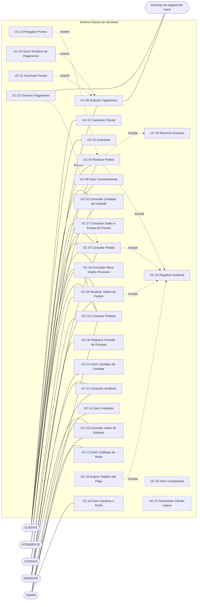
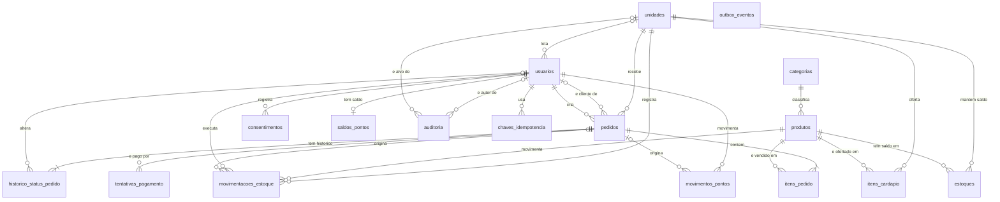
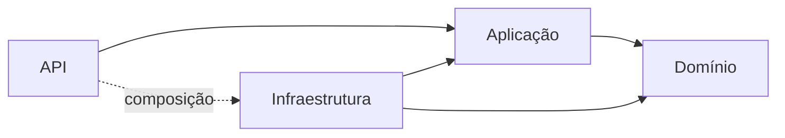
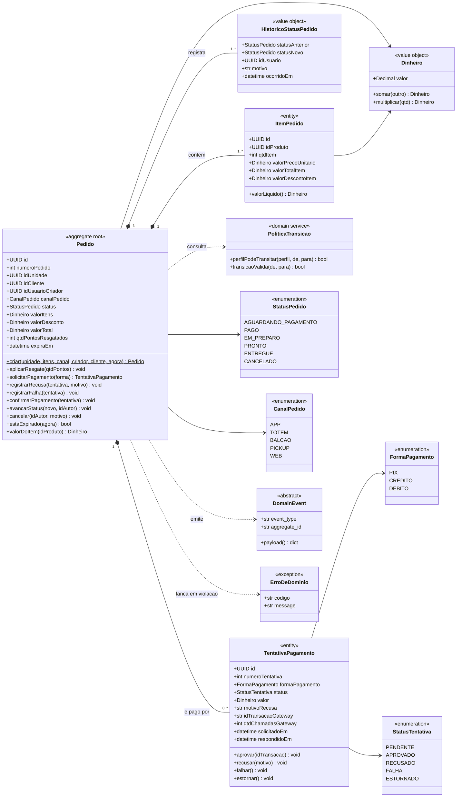
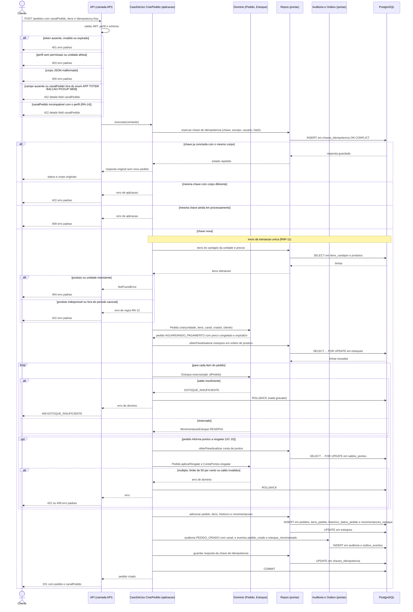
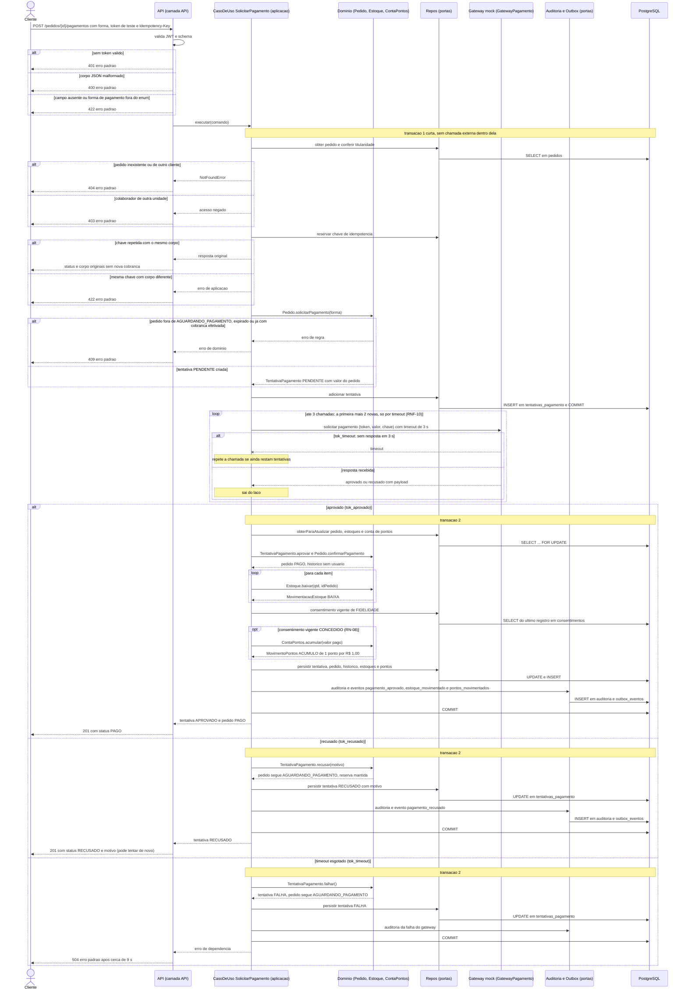
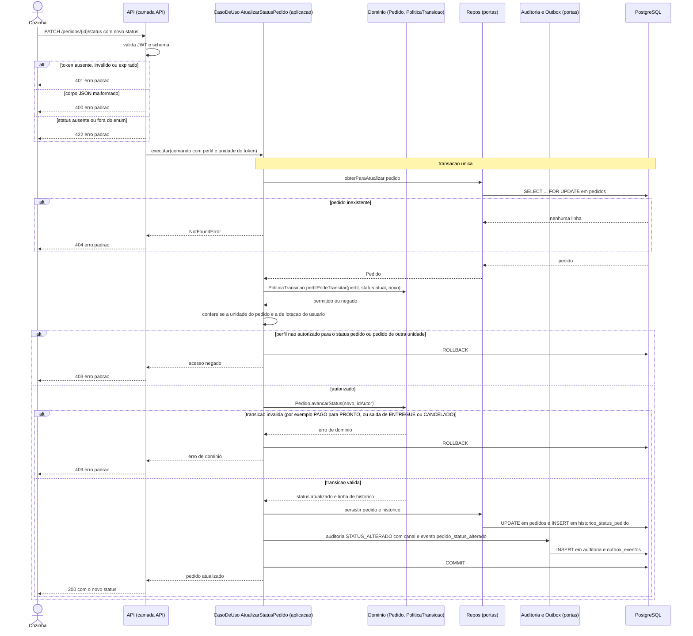
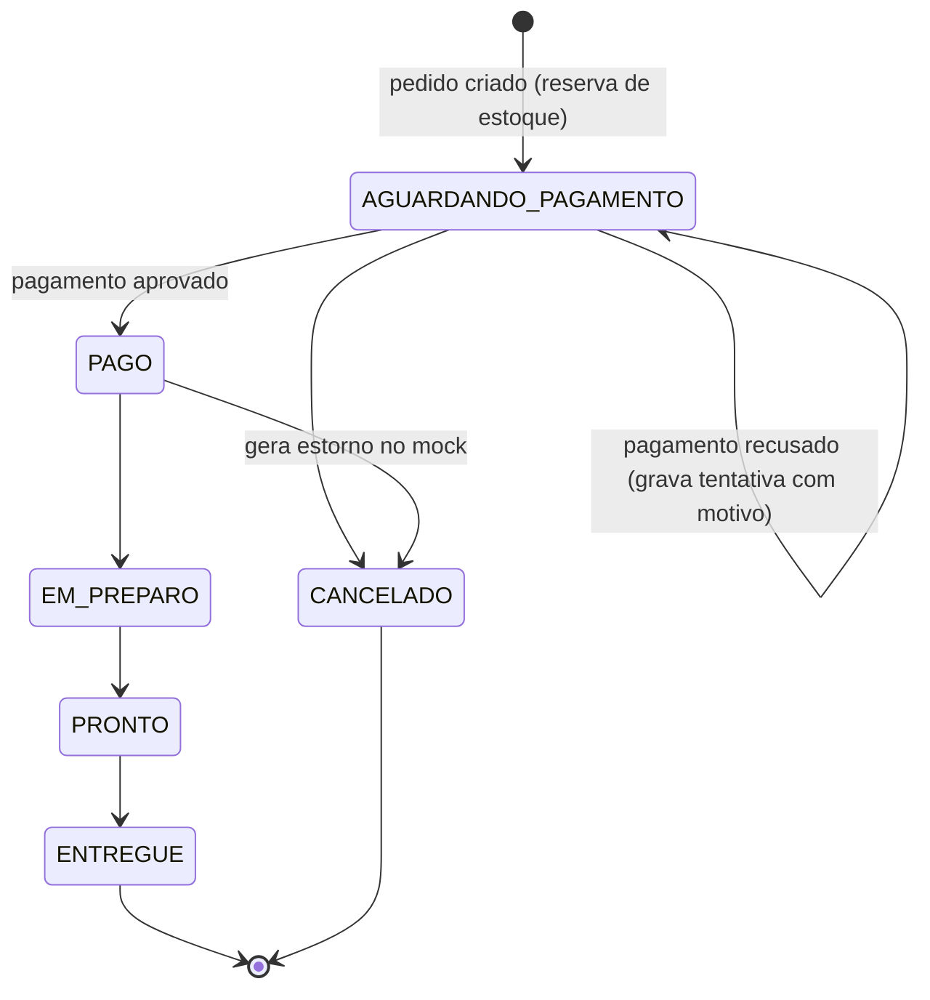
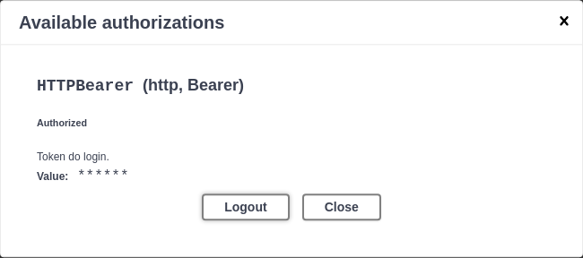

<!--
ESQUELETO DO DOCUMENTO PRINCIPAL (fonte em Markdown → .docx → PDF único)

Estrutura = "Documento principal" do roteiro geral (init/roteiro.md) + seções obrigatórias
do roteiro da trilha (init/roteiro_trilha_backend.md). Cada seção traz:
  - EXIGE: o que o roteiro pede (com a linha);
  - FONTE: o artefato do repositório que alimenta a seção;
  - STATUS: ⬜ a escrever · ✏️ rascunho · ✅ revisado pelo autor;
  - AUTORIA: quem redige o texto final (🧑 autor · 🤖 rascunho da IA revisado pelo autor).
Os comentários HTML não saem no documento final.
A numeração das figuras e tabelas segue a ordem de aparição neste arquivo; as figuras que vierem
dos arquivos de docs/modelagem/ (3.1, 3.4 e 3.5) devem ser numeradas na montagem final.
-->
<!-- Renumerar figuras e tabelas na montagem final. -->

# Capa e folha de rosto

<!--
EXIGE: curso, disciplina, nome, RU, polo de apoio, semestre e professor (roteiro geral, "Capa e Sumário").
FONTE: docs/entrega/capa.local.yaml (privado). STATUS: ⬜ AUTORIA: 🧑
Nome do arquivo final: <RU>_Projeto_Back_End.PDF (RT p. 13).
-->

# Sumário

<!-- Gerado automaticamente na conversão. -->

# 1 Introdução e objetivos

<!--
EXIGE: contexto do estudo de caso, objetivos do projeto, principais usuários e relevância do sistema
(roteiro geral); foco no negócio e numa API que suporte múltiplos canais (RT p. 4).
FONTE: docs/requisitos/README.md §1 e §2; init/roteiro.md (estudo de caso).
STATUS: ✅ AUTORIA: 🧑 (texto autoral, recomendado escrever com a própria voz)
-->

## 1.1 Contexto

<!-- AUTORIA: resumo do autor, completado pela IA com os fatos do estudo de caso exigidos pelo roteiro (D-061). -->

A Rede Raízes do Nordeste começou com uma operação simples e, agora, está em expansão, transformando parte de suas operações em regime de franquia. Com o crescimento, a rede passa a ter uma matriz e unidades em diferentes cidades, que não são idênticas entre si: há unidades com cozinha completa e outras em formato reduzido, e o cardápio varia conforme a unidade e a época do ano, como no período junino.

Os pedidos chegam por vários canais (aplicativo, totem, balcão, retirada rápida e web), o programa de fidelização exige o consentimento do cliente, conforme a LGPD, os horários de pico não podem interromper a operação e o pagamento é processado por um serviço externo. Nesse cenário, o foco deste trabalho é o back-end, porque é nele que ficam as regras de negócio, os dados e a segurança que sustentam todos os canais.

## 1.2 Objetivos do projeto

<!-- AUTORIA: texto do autor, com revisão de forma pela IA; o primeiro parágrafo resume o objetivo técnico exigido pelo roteiro (D-061). -->

O objetivo técnico deste trabalho é entregar uma API REST que feche o fluxo crítico da rede, composto por pedido, pagamento simulado e atualização de status, com controle de acesso por perfil, identificação do canal de cada pedido, controle de estoque, trilha de auditoria e cuidados mínimos de LGPD, de forma reproduzível e testada.

Além disso, o trabalho busca mostrar como é possível fazer algo grandioso com a IA nos dias atuais, sabendo que, muito provavelmente, diversas ferramentas já disponíveis no mercado podem alavancar o negócio sem que a empresa precise se desgastar com um grande projeto de tecnologia personalizada. Por fim, o trabalho dá ênfase aos dados gerados pela empresa e traz uma visão analítica para os gestores do negócio, com a implementação de um Data Warehouse, como ponto de partida para uma cultura orientada por dados.

## 1.3 Principais usuários

<!-- AUTORIA: redigido pela IA a pedido do autor (D-061). -->

Os usuários do sistema correspondem aos cinco perfis de acesso descritos na seção 2.1. O cliente faz pedidos pelos canais digitais (aplicativo, web e retirada rápida), acompanha o status e gerencia os próprios consentimentos. O atendente registra pedidos no balcão e no totem da sua unidade e entrega os pedidos prontos. A cozinha recebe os pedidos pagos e informa o andamento do preparo. O gerente acompanha a operação e a auditoria da própria unidade, e o administrador da matriz tem visão de toda a rede.

Além das pessoas, a API atende usuários não humanos: os canais de venda, que consomem o mesmo contrato, e o gateway de pagamento, com o qual a API troca solicitações e respostas.

## 1.4 Relevância e visão do autor

<!-- AUTORIA: texto do autor, com revisão de forma pela IA (D-061). -->

Dando continuidade aos objetivos, a ideia que este trabalho leva aos gestores da Raízes do Nordeste é que hoje é possível fazer um projeto personalizado de ponta a ponta, de maneira segura, com os avanços da IA. Porém, isso demanda muita maturidade dos processos, e uma empresa em crescimento geralmente está amadurecendo enquanto se expande. Por isso, o objetivo é mostrar que consigo cumprir os objetivos técnicos, mas também registrar a minha experiência, ainda que pequena, sobre o mercado: muitas empresas, principalmente as menores, não dispõem de um orçamento alto para um desenvolvimento personalizado e acabam optando por parceiros que entregam ferramentas mais aderentes ao seu setor, que permitem alguma personalização, mas não muita.

De modo geral, uma análise de mercado mostra que, em diversos setores, uma solução inovadora aparece apenas quando a empresa tem capacidade de também se assumir como uma empresa de tecnologia, o que demanda uma mudança de cultura muito forte ou parcerias estratégicas para produzir essa mudança. Além disso, quero mostrar a minha visão do mundo de dados: os processos são tão importantes quanto as ferramentas, talvez até mais, e precisam estar bem definidos antes de qualquer implementação. A gestão e a análise dos dados permitem uma visão mais holística do negócio e trazem inúmeras possibilidades de melhoria, que vão sustentar o crescimento acelerado da rede Raízes do Nordeste.

# 2 Análise e requisitos

<!--
EXIGE: RF e RNF de back-end com foco em regras, persistência, integrações e segurança (RT p. 5–6);
multicanalidade com canalPedido (L104–L114); priorização implementado × proposto com justificativa (L447, L545).
FONTE: docs/requisitos/README.md (RF-01..RF-22, RNF-01..RNF-15, RN-01..RN-14).
STATUS: ✏️ AUTORIA: 🤖 → 🧑
-->

Este capítulo traduz o estudo de caso em requisitos de back-end, isto é, em requisitos sobre dados, regras de negócio, integrações e segurança, e não sobre telas. A rastreabilidade completa de cada requisito com o roteiro, com as decisões de projeto e com os critérios de avaliação está em `docs/requisitos/` no repositório; as tabelas deste documento trazem uma versão condensada.

## 2.1 Atores e perfis de acesso

O sistema distingue cinco perfis, associados a um único usuário (um perfil por usuário). A autorização é verificada pelo perfil e, no caso do gerente, também pela unidade de lotação: o gerente atua apenas na própria unidade, ao passo que o administrador atua sobre toda a rede. A Tabela 1 resume o escopo e as permissões de cada perfil.

**Tabela 1 — Perfis de acesso, escopo e permissões**

| Perfil | Escopo | Permissões principais |
|---|---|---|
| `CLIENTE` | Os próprios dados | Cadastrar-se e autenticar-se; consultar o cardápio; criar pedido; consultar e cancelar o próprio pedido enquanto aguarda pagamento; solicitar pagamento e nova tentativa; consultar saldo e extrato de pontos; registrar e revogar consentimentos; consultar os próprios dados pessoais |
| `ATENDENTE` | Unidade de lotação | Criar pedido em nome do cliente (canais `BALCAO` e `TOTEM`); consultar pedidos da unidade; marcar o pedido como entregue; cancelar pedido já pago |
| `COZINHA` | Unidade de lotação | Consultar pedidos da unidade; avançar o pedido de pago a em preparo e de em preparo a pronto |
| `GERENTE` | Somente a própria unidade | Executar as funções de atendente e de cozinha; gerir o cardápio da unidade; registrar entrada de estoque; cancelar pedido pago; consultar a auditoria da unidade |
| `ADMIN` | Rede inteira | Cadastrar e alterar unidades; gerir o catálogo da rede; consultar pedidos, estoque (somente consulta) e auditoria de qualquer unidade; gerir usuários e perfis |

Fonte: elaborado pelo autor, com apoio de IA (ver Apêndice A).

## 2.2 Requisitos funcionais

Os requisitos funcionais foram priorizados pelo método MoSCoW (ver seção 2.6): `M` (Must) para o indispensável, `S` (Should) para o que agrega valor e é integrado ao fluxo, e `C` (Could) para o que é apenas documentado. A coluna "Entrega" distingue o que foi implementado na API (MVP) do que ficou como regra documentada (conceitual) ou modelado sem código (D-057). As rotas citadas são indicativas; o contrato definitivo está na seção 4.

**Tabela 2 — Requisitos funcionais**

| ID | Requisito | Prioridade | Entrega | Justificativa |
|---|---|---|---|---|
| RF-01 | Cadastro de cliente (`POST /usuarios`), com nome, e-mail e senha obrigatórios; data de nascimento opcional e condicionada a consentimento; sem CPF nem telefone | M | Modelado (não implementado, D-057) | Obrigatório no roteiro; minimização de dados (LGPD) |
| RF-02 | Login com emissão de JWT (`POST /auth/login`) | M | MVP | Autenticação por token é mínimo do MVP |
| RF-03 | Autorização por perfil, com escopo de unidade para o gerente | M | MVP | O MVP exige ao menos uma regra de autorização por perfil |
| RF-04 | Gestão de unidades (`/unidades`): o administrador cadastra e altera, os demais consultam | M | Modelado (não implementado, D-057) | Rede com matriz e unidades é o núcleo do caso |
| RF-05 | Catálogo da rede (`/produtos`): produtos, categorias, preço de referência e indicação de produto sazonal | M | Modelado (não implementado, D-057) | Padronização da franquia com variação controlada |
| RF-06 | Cardápio por unidade: oferta, disponibilidade, período sazonal e preço local opcional | M | Modelado (não implementado, D-057) | Cada unidade oferta um subconjunto do catálogo, com sazonalidade |
| RF-07 | Criar pedido (`POST /pedidos`) com `canalPedido` obrigatório (`APP`, `TOTEM`, `BALCAO`, `PICKUP`, `WEB`); aceita o header `Idempotency-Key` | M | MVP (implementado, sem idempotência, D-057) | Multicanalidade é requisito obrigatório; a idempotência evita pedido duplicado em retentativa |
| RF-08 | Listar e consultar pedidos, com filtros `canalPedido`, `status` e unidade, e paginação; o cliente vê só os próprios pedidos | M | MVP | Filtro por canal é requisito mínimo; isolamento de dados |
| RF-09 | Atualizar o status do pedido conforme a máquina de estados da seção 3.6 | M | MVP | Parte do fluxo crítico; garante transições válidas |
| RF-10 | Cancelar pedido (`POST /pedidos/{id}/cancelamento`) | M | Modelado (não implementado, D-057) | Operação sensível e auditável; devolve a reserva e estorna o pagamento |
| RF-11 | Solicitar pagamento ao gateway mock e registrar a tentativa e o payload de retorno | M | MVP (implementado, sem idempotência, D-057) | Obrigatório: representar o envio e o retorno do pagamento |
| RF-12 | Nova tentativa de pagamento após recusa, mantendo o pedido aguardando pagamento | M | MVP | Cobre o cenário de falha do mock e evita perder a venda |
| RF-13 | Trilha de auditoria de ações sensíveis, consultável pelo administrador e, na própria unidade, pelo gerente | M | MVP | Critério de avaliação e requisito da matriz |
| RF-14 | Registrar e revogar consentimento por finalidade, com base legal, data e versão do termo | M | MVP (implementado: registrar, revogar e listar, D-057) | Exigência explícita de LGPD no roteiro |
| RF-15 | Consultar os próprios dados pessoais (direito de acesso do titular) | S | Modelado (não implementado, D-057) | LGPD, art. 18 |
| RF-16 | Estoque por produto e unidade: entrada somente pelo gerente (o administrador apenas consulta), reserva na criação do pedido, baixa e devolução; 409 quando o saldo for insuficiente | S | Parcial: reserva, baixa e 409 no fluxo do pedido; entrada e consulta modeladas (D-057) | Restrição de venda por indisponibilidade; evita vender o que não existe no pico |
| RF-17 | Fidelidade: acúmulo automático de 1 ponto por R$ 1,00 no pagamento aprovado, apenas com consentimento da finalidade `FIDELIDADE`; saldo e extrato | S | Modelado (não implementado, D-057) | Fidelização com consentimento é requisito do caso |
| RF-18 | Resgate de pontos como desconto: múltiplos de 100 pontos (100 pontos = R$ 5,00), limitado a 50% do valor dos itens | S | Modelado (não implementado, D-057) | O roteiro lista "pontos e resgate simples" entre os itens obrigatórios |
| RF-19 | Campanhas e promoções como regra documentada | C | Conceitual | O roteiro aceita "ao menos como regra/documentação" |
| RF-20 | Expiração do pedido não pago em 15 minutos, com devolução da reserva | C | Conceitual | Libera estoque reservado; a tarefa agendada não pontua diretamente |
| RF-21 | Anonimização de cliente inativo há dois anos | C | Conceitual | Estratégia de retenção "quando aplicável" |
| RF-22 | Publicação de eventos de domínio no outbox transacional (por exemplo `pedido_criado`, `pagamento_aprovado`) | S | MVP | Sustenta a visão analítica sem acoplar a API ao Data Warehouse |

Fonte: elaborado pelo autor, com apoio de IA (ver Apêndice A).

**Recorte da implementação (D-057).** A prioridade MoSCoW expressa o valor para o negócio; a coluna Entrega mostra o que foi codificado. O código cobre só a fatia vertical exigida pelo roteiro (fluxo A: pedido, pagamento mock e status, com autenticação, estoque, auditoria, consentimento e outbox). Os demais requisitos estão especificados, modelados no DER e nos casos de uso, e seriam atendidos por produtos de prateleira ou por evolução do código, conforme a análise construir × comprar.

## 2.3 Requisitos não funcionais

Os requisitos não funcionais cobrem segurança, privacidade, observabilidade, desempenho, consistência e qualidade. Para cada um, a Tabela 3 informa o critério de aceite e a forma de verificação. A meta de disponibilidade (RNF-09) é documentada, mas não medida no MVP; a meta de desempenho (RNF-08) é documentada e não medida no MVP (D-057).

**Tabela 3 — Requisitos não funcionais**

| ID | Requisito | Prioridade | Critério de aceite | Verificação |
|---|---|---|---|---|
| RNF-01 | Senha armazenada com hash Argon2id | M | Nenhuma senha em claro no banco | Teste unitário do serviço de hash; inspeção do banco |
| RNF-02 | JWT de acesso com 60 minutos de validade; segredo em variável de ambiente | M | Token expirado retorna 401; nenhum segredo no repositório | Teste de integração; verificação de segredos na CI |
| RNF-03 | Respostas 401, 403 e 404 corretas | M | Sem token ou token inválido: 401; perfil sem permissão ou colaborador de outra unidade: 403; cliente acessando pedido de outro cliente: 404 | Cenários negativos em Postman e testes de integração |
| RNF-04 | Minimização, finalidade, base legal e consentimento por dado pessoal | M | Apenas os dados do inventário (seção 5.1); consentimento versionado | Revisão do esquema; testes de consentimento |
| RNF-05 | Respostas sem exposição indevida de dados | M | Nenhuma resposta traz hash de senha; cliente não acessa dados de outro cliente | Testes de contrato; cenário negativo |
| RNF-06 | Logs estruturados em JSON com `requestId`, sem dados pessoais | M | Toda requisição com `requestId`, o mesmo do corpo de erro | Teste que captura logs; busca de padrões de dados pessoais |
| RNF-07 | Auditoria de ações sensíveis com retenção de um ano | M | Registro com autor, ação, alvo, unidade, canal, instante e `requestId` | Teste de integração por ação auditada |
| RNF-08 | p95 inferior a 300 ms a 50 requisições por segundo na criação e consulta de pedido | S | Medição com k6 em Docker Compose, com dados de teste | Script k6 versionado e relatório (documentado, sem medição no MVP, D-057) |
| RNF-09 | Disponibilidade de 99,5% no horário de funcionamento; healthchecks `/health/live` e `/health/ready`; API sem estado em memória | S | Meta documentada, não medida no MVP | Teste dos healthchecks; revisão da arquitetura |
| RNF-10 | Pagamento com timeout de 3 s, até duas novas tentativas apenas em caso de timeout, e idempotência | M | Com `tok_timeout`, o pedido permanece aguardando pagamento; repetir a chamada não duplica a cobrança | Teste de integração com o mock (idempotência modelada, não implementada, D-057) |
| RNF-11 | Transação única para pedido, reserva de estoque, auditoria e outbox, com bloqueio de linha | M | Falha em qualquer etapa desfaz tudo; reservas concorrentes nunca deixam saldo negativo | Teste de integração com concorrência |
| RNF-12 | OpenAPI/Swagger refletindo os endpoints reais | M | Todos os endpoints expostos aparecem em `/docs` | Geração automática pelo framework |
| RNF-13 | Erro padrão com `error`, `message`, `details`, `timestamp`, `path` e `requestId` | M | Todas as respostas 4xx e 5xx no formato | Testes de contrato por status de erro |
| RNF-14 | Reprodutibilidade por Docker Compose e README | M | Do clone ao Swagger com poucos comandos, sem segredos no repositório | Execução limpa na CI e pelo examinador |
| RNF-15 | Testes unitários, de integração e coleção Postman com dez ou mais cenários | M | Mínimo de seis cenários positivos e quatro negativos | Execução da suíte na CI; coleção versionada |

Fonte: elaborado pelo autor, com apoio de IA (ver Apêndice A).

## 2.4 Regras de negócio

As regras de negócio concentram-se no ciclo de vida do pedido, no estoque, na fidelidade e na formação do preço. A Tabela 4 as resume; a máquina de estados correspondente é apresentada na seção 3.6.

**Tabela 4 — Regras de negócio**

| ID | Regra |
|---|---|
| RN-01 | O pedido nasce em `AGUARDANDO_PAGAMENTO`. A recusa do pagamento mantém esse estado e grava a tentativa com o motivo. |
| RN-02 | O cancelamento só é possível a partir de `AGUARDANDO_PAGAMENTO` ou de `PAGO`; a partir de `PAGO`, gera estorno no mock. Depois do início do preparo, não se cancela. |
| RN-03 | Qualquer outra transição de status retorna 409. `ENTREGUE` e `CANCELADO` são estados finais. |
| RN-04 | O estado `PAGO` resulta apenas do pagamento aprovado, nunca de chamada manual. A cozinha conduz `PAGO` → `EM_PREPARO` → `PRONTO`; o atendente, `PRONTO` → `ENTREGUE`; o cliente cancela o próprio pedido em `AGUARDANDO_PAGAMENTO`; atendente e gerente, na própria unidade, cancelam em `AGUARDANDO_PAGAMENTO` (por exemplo, pedido de balcão abandonado) e em `PAGO`. |
| RN-05 | Na criação do pedido, a quantidade de cada item é reservada no estoque da unidade, na mesma transação e com bloqueio de linha. Saldo insuficiente resulta em 409 e nenhum pedido é criado. |
| RN-06 | A reserva é devolvida em cancelamento e expiração; o pagamento aprovado converte a reserva em baixa. No cancelamento de pedido `PAGO`, os itens ainda não preparados voltam ao saldo disponível por uma movimentação de ajuste positivo. |
| RN-07 | O pedido não pago em 15 minutos é cancelado e devolve a reserva (regra documentada; a tarefa agendada é evolução). |
| RN-08 | O acúmulo de pontos ocorre apenas no pagamento aprovado e apenas com consentimento ativo da finalidade `FIDELIDADE`. |
| RN-09 | O cancelamento de pedido pago estorna os pontos acumulados; os pontos resgatados são devolvidos no cancelamento ou na expiração. |
| RN-10 | Aplica-se o preço local da unidade, se existir, ou o preço de referência da rede. O preço é congelado no item do pedido no momento da criação. |
| RN-11 | `canalPedido` é obrigatório na criação e imutável depois dela. |
| RN-12 | Só se pede produto ofertado e disponível no cardápio da unidade, dentro do período sazonal quando houver. |
| RN-13 | A repetição de uma `Idempotency-Key` com o mesmo corpo devolve o resultado original, sem novo pedido nem nova cobrança; a mesma chave com corpo diferente resulta em 422, e com a requisição original ainda em processamento, em 409. |
| RN-14 | O cliente cria pedidos nos canais `APP`, `WEB` e `PICKUP`; atendente e gerente criam em `BALCAO` e `TOTEM`, este operado por uma conta de dispositivo lotada na unidade. Combinação inválida de perfil e canal resulta em 422. |

Fonte: elaborado pelo autor, com apoio de IA (ver Apêndice A).

## 2.5 Multicanalidade

O estudo de caso prevê pedidos feitos por aplicativo, totem, balcão, retirada rápida e web. Na API, o canal é um dado de domínio do pedido, representado pelo campo `canalPedido`, e não um detalhe de infraestrutura. O campo é obrigatório no corpo de `POST /pedidos`, é validado como enumeração fechada (`APP`, `TOTEM`, `BALCAO`, `PICKUP`, `WEB`) e é imutável após a criação (RN-11). Quando ausente, inválido ou incompatível com o perfil de quem cria o pedido (RN-14), a API responde 422 no formato de erro padrão, com o detalhe apontando o campo `canalPedido`; o código 400 fica reservado a corpo JSON malformado.

O canal acompanha o pedido durante todo o ciclo de vida: aparece nos registros de auditoria de criação, mudança de status e cancelamento e no conteúdo dos eventos do outbox. A listagem de pedidos aceita o filtro `canalPedido`, combinável com `status`, unidade e paginação, como em `GET /pedidos?canalPedido=TOTEM&status=AGUARDANDO_PAGAMENTO&page=1&limit=10`. Na camada analítica, o mesmo valor alimenta a dimensão de canal do Data Warehouse, o que permite comparar canais digitais e presenciais (Apêndice B).

## 2.6 Priorização do MVP (MoSCoW) e trade-offs

O método MoSCoW classifica requisitos em quatro grupos: Must (indispensável), Should (importante, mas não bloqueante), Could (desejável) e Won't (fora do escopo desta entrega). Como conceito, a técnica obriga a justificar o que fica de fora, e não apenas o que entra, o que a torna adequada a um projeto com prazo e cota de trabalho limitados. Neste projeto, Must é o que, se ausente, impede o fluxo crítico, a segurança ou a LGPD; Should é implementado de forma mínima quando integrado ao fluxo (no recorte D-057, entre os Should, só o outbox, RF-22); Could é documentado como regra ou evolução.

O fluxo crítico escolhido foi pedido → pagamento mock → status, por concentrar as exigências do roteiro: canal, validação, erro padrão, integração com o mock em sucesso e falha, e auditoria. O estoque entra integrado a esse fluxo, com reserva na mesma transação, o que atende ao caminho alternativo previsto no roteiro e responde ao risco do horário de pico. Os critérios de decisão foram o prazo, o peso do item na avaliação (a implementação da API vale 25 pontos; segurança e LGPD, 15) e o risco, já que cada integração adicional amplia a superfície de falha. A Tabela 5 registra o que permaneceu conceitual e o motivo.

**Tabela 5 — Itens conceituais, evolução e justificativa**

| Item | Situação | Motivo |
|---|---|---|
| Campanhas (RF-19) | Conceitual | O roteiro aceita regra documentada; a implementação exigiria um motor de regras |
| Expiração agendada (RF-20) | Regra documentada | Exige tarefa agendada e infraestrutura adicional; risco baixo no MVP |
| Anonimização de inativos (RF-21) | Conceitual | Não há base real de clientes inativos para demonstrar; custo alto para peso baixo |
| Refresh token, webhook de pagamento, captura de mudanças (CDC) | Evolução | Prazo e risco; as versões síncronas atendem ao roteiro |
| Data Warehouse e Lakehouse | Base pronta, congelada até fechar a API | Não pontua diretamente |

Fonte: elaborado pelo autor, com apoio de IA (ver Apêndice A).

Ficam fora do escopo (Won't) o front-end (aplicativo, totem e web), a entrega e logística, a emissão fiscal, o gateway de pagamento real, a gestão financeira de franquias e o suporte a múltiplos idiomas.

# 3 Modelagem e arquitetura

<!--
EXIGE: casos de uso, DER, arquitetura em camadas, diagrama de classes; sequência/atividade recomendado
(RT p. 6–7). DER compatível com o banco usado na API (L288–L290).
FONTE: docs/modelagem/ (der.md pronto; casos de uso, classes, sequência e estados a produzir);
docs/arquitetura/visao-geral.md e ADRs.
STATUS: ✏️ (3.2, 3.3, 3.6 e 3.7 rascunhadas; 3.1, 3.4 e 3.5 aguardam docs/modelagem/)
-->

**Modelagem completa, implementação mínima.** Os modelos deste capítulo descrevem a solução completa especificada nos requisitos, inclusive a idempotência das requisições (`Idempotency-Key`), o cancelamento, a fidelidade e a gestão de catálogo e estoque. O código entregue implementa só a fatia vertical exigida pelo roteiro (fluxo A), por decisão do autor (D-057): os elementos modelados e não implementados estão indicados na coluna "Entrega" da Tabela 2 e permanecem como especificação pronta para evolução ou para orientar a avaliação de produtos de mercado.

## 3.1 Diagrama e descrição dos casos de uso

<!-- Seguir o modelo de descrição do anexo do roteiro (RT p. 19). -->

Esta seção apresenta os atores, o diagrama de casos de uso e a descrição dos 27 casos de uso identificados a partir dos requisitos. Os seis casos de uso do fluxo implementado no MVP (UC-02, UC-04, UC-05, UC-06, UC-09 e UC-11) são descritos em detalhe, no modelo de descrição do roteiro da trilha; os demais são apresentados de forma resumida, na Tabela 7.

A Figura 1 mostra o diagrama de casos de uso. Os atores humanos ficam à esquerda (CLIENTE, ATENDENTE e COZINHA) e à direita (GERENTE e ADMIN); o gateway de pagamento, ator externo, aparece à direita. Os casos de uso com borda tracejada são conceituais (RF-19 a RF-21), documentados sem código no MVP. As setas tracejadas com rótulo representam relações de inclusão (`include`, obrigatória) e de extensão (`extend`, condicional).

Para não sobrecarregar o diagrama, o GERENTE, que executa tudo o que o ATENDENTE e a COZINHA executam, mas somente na própria unidade (RN-04), aparece ligado apenas aos casos de uso que lhe são exclusivos ou que divide com o ADMIN. Pelo mesmo motivo, a autenticação (UC-02) é pré-condição de todos os casos de uso, exceto o cadastro (UC-01), e só a ligação do CLIENTE foi desenhada.

**Figura 1 — Diagrama de casos de uso do sistema**



Fonte: elaborado pelo autor, com apoio de IA (ver Apêndice A).

Notas de leitura do diagrama:

- UC-21 (Acumular Pontos) estende UC-05: ocorre somente quando o pagamento é aprovado e há consentimento vigente de FIDELIDADE (RN-08).
- UC-10 (Resgatar Pontos) estende UC-04, quando o pedido informa pontos a resgatar (RF-18).
- UC-22 (Estornar Pagamento) estende UC-07, quando o pedido cancelado estava pago (RN-02).
- UC-23 (Reservar Estoque) é incluído por UC-04, e UC-24 (Registrar Auditoria) é incluído por UC-04, UC-06, UC-07 e UC-26. As inclusões ocorrem sempre na mesma transação do caso de uso que as inclui (RNF-11).
- A publicação de eventos no outbox (RF-22) faz parte de cada caso de uso que altera estado. Não é um caso de uso com ator e aparece nos diagramas de sequência da seção 3.5.

**Atores e herança de permissões.** Os atores são os cinco perfis de acesso, cada um associado a um único usuário, e o gateway de pagamento, ator externo. A Tabela 6 resume o escopo de cada um. A herança é cumulativa e restrita à unidade: o GERENTE reúne as funções de ATENDENTE e de COZINHA na própria unidade, e o ADMIN administra a rede inteira, sem fazer transições de status (RN-04).

**Tabela 6 — Atores, escopo e permissões**

| Ator | Escopo | Permissões principais |
|---|---|---|
| `CLIENTE` | Os próprios dados e pedidos | Cadastrar-se e autenticar-se; criar pedido pelos canais APP, WEB e PICKUP; cancelar o próprio pedido enquanto aguarda pagamento; solicitar pagamento; consultar saldo e extrato de pontos; registrar e revogar consentimentos |
| `ATENDENTE` | Unidade de lotação | Criar pedido em nome do cliente (canais BALCAO e TOTEM); consultar pedidos da unidade; conduzir PRONTO → ENTREGUE; cancelar pedido da unidade |
| `COZINHA` | Unidade de lotação | Consultar pedidos da unidade; conduzir PAGO → EM_PREPARO → PRONTO |
| `GERENTE` | Somente a própria unidade | Executar as funções de atendente e de cozinha; gerir o cardápio da unidade; registrar entrada de estoque; cancelar pedido; consultar a auditoria da unidade |
| `ADMIN` | Rede inteira | Cadastrar e alterar unidades; gerir o catálogo da rede e os usuários; consultar pedidos, estoque (somente consulta) e auditoria de qualquer unidade; não faz transição de status |
| Gateway de pagamento (mock) | Externo | Serviço HTTP separado; o resultado é determinado pelo token de teste (`tok_aprovado`, `tok_recusado`, `tok_timeout`) |

Fonte: elaborado pelo autor, com apoio de IA (ver Apêndice A).

**Descrição dos casos de uso detalhados.** Os casos de uso seguem o modelo de descrição do roteiro, com os campos Descrição, Ator principal, Demais atores, Pré-condições, Pós-condições, Fluxo base, Fluxo alternativo e Regras de negócio. Como o modelo prevê apenas um fluxo alternativo, os erros HTTP são registrados nele, marcados como [Exceção 4xx]. Os códigos seguem a Tabela 12 (seção 4.2), e todas as respostas de erro usam o formato padrão (RNF-13; D-035).

### UC-02 – Autenticar

**Descrição.** Autenticação por e-mail e senha, com emissão de um JWT de acesso (RF-02), usado em todas as chamadas seguintes. A autorização por perfil e por unidade (RF-03) é aplicada a partir das informações contidas no token.

**Ator principal.** Qualquer usuário cadastrado (CLIENTE, ATENDENTE, COZINHA, GERENTE ou ADMIN).

**Demais atores.** Não há.

**Pré-condições.** O usuário existe, está ativo e não foi anonimizado.

**Pós-condições.** É devolvido um JWT com validade de 60 minutos, contendo o identificador do usuário, o perfil e a unidade de lotação (RNF-02). Nada é gravado no banco, pois a API não mantém estado em memória (RNF-09).

**Fluxo base.**

1. O usuário envia `POST /auth/login` com e-mail e senha.
2. A API valida o corpo da requisição.
3. O caso de uso localiza o usuário pelo e-mail e confere o hash Argon2id da senha.
4. O caso de uso verifica que a conta está ativa.
5. O caso de uso emite o JWT.
6. A API responde 200 com o token, o tipo e a validade.

**Fluxo alternativo.**

- 2a. [Exceção 400] Corpo JSON malformado. [Exceção 422] Campo ausente.
- 3a. [Exceção 401] E-mail inexistente ou senha incorreta. A mensagem é a mesma nos dois casos, para não revelar quais e-mails estão cadastrados.
- 4a. [Exceção 401] Conta inativa ou anonimizada.
- Em chamadas posteriores: [Exceção 401] token ausente, inválido ou expirado (RNF-03); [Exceção 403] perfil sem permissão ou unidade alheia.

**Regras de negócio.**

- A senha é armazenada como hash Argon2id, com salt (RNF-01).
- 401 significa não autenticado; 403 significa autenticado, mas sem permissão (RNF-03).
- Senha e token não aparecem em logs (RNF-06).

### UC-04 – Realizar Pedido

**Descrição.** Criação de um pedido em uma unidade, por um canal (`canalPedido`), com reserva de estoque na mesma transação (RF-07 e RF-16). O pedido nasce em AGUARDANDO_PAGAMENTO e é o primeiro passo do fluxo crítico pedido → pagamento → status.

**Ator principal.** CLIENTE (canais APP, WEB e PICKUP) ou ATENDENTE e GERENTE, em nome do cliente (canais BALCAO e TOTEM; D-050).

**Demais atores.** Não há.

**Pré-condições.**

1. Usuário autenticado (UC-02).
2. A unidade existe e está ativa; se informado, o cliente existe e tem perfil CLIENTE.
3. Cada produto está ofertado e disponível no cardápio da unidade (UC-03).

**Pós-condições.**

1. Em uma única transação (RNF-11) são gravados: o pedido em AGUARDANDO_PAGAMENTO, com o canal imutável; os itens, com preço congelado; a linha de histórico de status; a reserva no saldo e o movimento RESERVA; a auditoria PEDIDO_CRIADO; e os eventos `pedido_criado` e `estoque_movimentado` no outbox.
2. A expiração do pedido é a data de criação acrescida de 15 minutos (RN-07).
3. A resposta à chave `Idempotency-Key` fica guardada por 24 horas.

**Fluxo base.**

1. O usuário envia `POST /pedidos` com a unidade, o canal (`canalPedido`), os itens (produto e quantidade) e, opcionalmente, o cliente (obrigatório quando quem cria é o ATENDENTE e há identificação) e os pontos a resgatar.
2. A API valida o token, o perfil e o corpo, inclusive os valores aceitos para `canalPedido`.
3. O caso de uso consulta a chave de idempotência e a registra como em processamento.
4. O caso de uso abre a transação e carrega os itens do cardápio da unidade.
5. O domínio define o preço de cada item (local ou de referência), congela-o no item do pedido e calcula o valor dos itens.
6. Os produtos são ordenados de forma determinística, e as linhas de estoque são travadas com `SELECT ... FOR UPDATE` (UC-23).
7. O domínio reserva a quantidade de cada item.
8. Se houver pontos a resgatar, aplica-se o UC-10, como extensão.
9. O domínio cria o pedido em AGUARDANDO_PAGAMENTO, com a data de expiração.
10. O caso de uso grava pedido, itens, histórico, movimentações, auditoria (UC-24) e eventos, guarda a resposta da chave de idempotência e confirma a transação.
11. A API responde 201 com o pedido, o `canalPedido` e o cabeçalho `Location`.

**Fluxo alternativo.**

- 2a. [Exceção 401] Token ausente, inválido ou expirado.
- 2b. [Exceção 403] Perfil sem permissão para criar pedido (COZINHA e ADMIN), ou ATENDENTE e GERENTE criando pedido para unidade que não é a sua.
- 2c. [Exceção 400] Corpo JSON malformado. [Exceção 422] `canalPedido` ausente ou lista de itens vazia.
- 2d. [Exceção 422] `canalPedido` fora do conjunto aceito (APP, TOTEM, BALCAO, PICKUP, WEB), com detalhe no campo `canalPedido`; quantidade menor que 1. Nenhuma transação é aberta.
- 2e. [Exceção 422] Canal incompatível com o perfil (RN-14): o CLIENTE usa somente APP, WEB e PICKUP; o ATENDENTE e o GERENTE, somente BALCAO e TOTEM.
- 3a. Repetição da mesma chave com o mesmo corpo, com resposta já guardada: devolve a resposta original, sem novo pedido nem nova reserva (RN-13).
- 3b. [Exceção 422] Mesma chave com corpo diferente.
- 3c. [Exceção 409] Mesma chave ainda em processamento pela requisição original (RN-13; D-054).
- 4a. [Exceção 404] Unidade ou produto inexistente.
- 4b. [Exceção 422] Produto não ofertado, indisponível ou fora do período sazonal na unidade (RN-12).
- 7a. [Exceção 409] Saldo insuficiente em algum item (RN-05), com o código `ESTOQUE_INSUFICIENTE`. A transação inteira é desfeita, e nenhum pedido, reserva ou registro de auditoria é gravado.
- 8a. [Exceção 422] Resgate inválido (UC-10).
- 10a. Falha em qualquer gravação: desfazimento total das quatro frentes (pedido, estoque, auditoria e outbox).

**Regras de negócio.**

- O canal é obrigatório na criação e imutável depois (RN-11).
- Perfil e canal devem ser compatíveis (RN-14). O totem opera com uma conta de dispositivo de perfil ATENDENTE, lotada na unidade, e o cliente pode ser identificado opcionalmente.
- A repetição de `Idempotency-Key` com o mesmo corpo devolve o resultado original (RN-13).
- Só se pede produto ofertado, disponível e dentro do período sazonal (RN-12).
- O preço é congelado no item no momento da criação (RN-10).
- A reserva ocorre na criação, na mesma transação, com bloqueio de linha. Saldo insuficiente gera 409 e nenhum pedido (RN-05 e RN-06).
- O pedido nasce em AGUARDANDO_PAGAMENTO (RN-01).

### UC-05 – Solicitar Pagamento

**Descrição.** Solicitação de pagamento de um pedido ao gateway mock, com registro da tentativa e do retorno (RF-11), nova tentativa após recusa (RF-12, UC-20) e acúmulo de pontos (UC-21). Cobre os resultados aprovado, recusado e timeout.

**Ator principal.** CLIENTE, nos próprios pedidos.

**Demais atores.** Gateway de pagamento (mock).

**Pré-condições.**

1. Usuário autenticado e dono do pedido.
2. O pedido está em AGUARDANDO_PAGAMENTO e não expirou.
3. Não existe tentativa aprovada para o pedido.

**Pós-condições.**

1. Aprovado: a tentativa fica com status APROVADO; o pedido passa a PAGO, com histórico registrado como mudança do sistema; a reserva é convertida em baixa; os pontos são acumulados, se houver consentimento vigente de FIDELIDADE; a auditoria e os eventos são gravados.
2. Recusado: a tentativa fica RECUSADO, com o motivo; o pedido permanece em AGUARDANDO_PAGAMENTO (RN-01).
3. Timeout esgotado: a tentativa fica FALHA; o pedido permanece em AGUARDANDO_PAGAMENTO, e nada é baixado.

**Fluxo base (aprovado).**

1. O cliente envia `POST /pedidos/{id}/pagamentos` com a forma de pagamento (PIX, CREDITO ou DEBITO) e o token de teste.
2. A API valida o token, o corpo e a titularidade do pedido.
3. O caso de uso verifica a chave de idempotência; a repetição devolve a resposta guardada.
4. O caso de uso confere que o pedido está em AGUARDANDO_PAGAMENTO e grava uma tentativa PENDENTE com o valor do pedido.
5. O caso de uso chama o gateway pela porta `GatewayPagamento`, com timeout de 3 segundos e a chave de idempotência.
6. O gateway responde aprovado, com o identificador da transação e o payload.
7. Em nova transação, o caso de uso trava o pedido, e o domínio marca a tentativa como APROVADO e o pedido como PAGO.
8. O domínio converte a reserva em baixa no estoque.
9. Se houver consentimento vigente de FIDELIDADE, acumula-se 1 ponto por R$ 1,00 pago (UC-21, extensão).
10. O caso de uso grava auditoria e eventos e confirma a transação.
11. A API responde 201 com a tentativa e o status PAGO.

**Fluxo alternativo.**

- 2a. [Exceção 401] Token ausente ou inválido.
- 2b. [Exceção 403] Requisição de colaborador: no MVP, somente o cliente solicita pagamento.
- 2c. [Exceção 404] Pedido inexistente ou pertencente a outro cliente, para não revelar sua existência (RNF-03).
- 2d. [Exceção 400] Corpo JSON malformado. [Exceção 422] Campo ausente ou forma de pagamento fora do conjunto aceito.
- 3a. Repetição da mesma chave com o mesmo corpo: devolve a resposta original, sem nova cobrança (RN-13). Corpo diferente: [Exceção 422].
- 4a. [Exceção 409] Pedido fora de AGUARDANDO_PAGAMENTO (já pago, cancelado ou em preparo), expirado, ou com tentativa já efetivada.
- 5a. **Timeout** (`tok_timeout`): sem resposta em 3 segundos, a chamada é repetida até duas vezes, apenas por timeout, num total de três chamadas (cerca de 9 segundos). Esgotadas as tentativas, a tentativa fica FALHA, o pedido permanece em AGUARDANDO_PAGAMENTO, e a API responde 504 no formato padrão (RNF-10; D-051). A recusa não é repetida automaticamente.
- 6a. **Recusado** (`tok_recusado`): o gateway devolve o motivo; a tentativa fica RECUSADO; o pedido permanece em AGUARDANDO_PAGAMENTO, e a reserva é mantida. A API responde 201 com o status RECUSADO e o motivo, e o cliente pode repetir com outra forma de pagamento ou outro token (UC-20).
- 7a. Se, entre a chamada ao gateway e a gravação, o pedido deixou de estar em AGUARDANDO_PAGAMENTO (por exemplo, por cancelamento), a tentativa é gravada com o resultado do gateway, e a divergência é registrada na auditoria para conciliação.
- 9a. Sem consentimento vigente de FIDELIDADE, o pagamento é concluído normalmente, sem acúmulo de pontos.

**Regras de negócio.**

- O pedido só passa a PAGO pelo resultado do pagamento, nunca por chamada manual (RN-04).
- A idempotência evita cobrança duplicada, e um índice único parcial impede duas cobranças efetivadas no mesmo pedido (RN-13).
- Uma recusa mantém o pedido em AGUARDANDO_PAGAMENTO (RN-01).
- O timeout é de 3 segundos, com até duas novas tentativas somente em caso de timeout (RNF-10).
- A reserva só é devolvida em cancelamento ou expiração; uma recusa isolada não a devolve (RN-06).
- O pagamento aprovado converte a reserva em baixa (RN-06). Acumula-se 1 ponto por R$ 1,00, somente com consentimento de FIDELIDADE vigente (RN-08).
- A tentativa nunca guarda número de cartão, validade, código de segurança nem token do cliente.

### UC-06 – Atualizar Status do Pedido

**Descrição.** Avanço do pedido pela máquina de estados (RF-09). A COZINHA conduz PAGO → EM_PREPARO → PRONTO; o ATENDENTE conduz PRONTO → ENTREGUE; o GERENTE executa as duas etapas na própria unidade (RN-04).

**Ator principal.** COZINHA.

**Demais atores.** ATENDENTE (PRONTO → ENTREGUE) e GERENTE (ambas as etapas, na própria unidade).

**Pré-condições.**

1. Usuário autenticado, com perfil e unidade de lotação.
2. O pedido pertence à unidade do usuário.

**Pós-condições.**

1. O status do pedido é atualizado; é gravada uma linha no histórico (quem, quando, status anterior e novo), a auditoria STATUS_ALTERADO, com o canal do pedido, e o evento de mudança de status no outbox.
2. Em caso de falha (403, 404 ou 409), nada é alterado.

**Fluxo base.**

1. O usuário envia `PATCH /pedidos/{id}/status` com o novo status.
2. A API valida o token e o corpo.
3. O caso de uso carrega o pedido com bloqueio de linha.
4. O caso de uso verifica se o perfil e a unidade do usuário permitem a transição solicitada.
5. O domínio valida a transição na máquina de estados e atualiza o status.
6. O caso de uso grava histórico, auditoria (UC-24) e eventos e confirma a transação.
7. A API responde 200 com o pedido atualizado.

**Fluxo alternativo.**

- 2a. [Exceção 401] Token ausente ou inválido.
- 2b. [Exceção 400] Corpo JSON malformado. [Exceção 422] Status ausente ou fora do conjunto aceito.
- 3a. [Exceção 404] Pedido inexistente.
- 4a. [Exceção 403] Perfil não autorizado para o status solicitado (por exemplo, COZINHA pedindo ENTREGUE, ou qualquer perfil pedindo PAGO), ou pedido de outra unidade, inclusive de GERENTE de outra unidade.
- 5a. [Exceção 409] Transição inválida na máquina de estados (por exemplo, PAGO → PRONTO, ou qualquer saída de ENTREGUE ou CANCELADO).

**Regras de negócio.**

- Quem executa cada transição: a COZINHA, PAGO → EM_PREPARO → PRONTO; o ATENDENTE, PRONTO → ENTREGUE; o GERENTE, ambas, na própria unidade (RN-04).
- A verificação de perfil e unidade precede a verificação de transição: 403 tem prioridade sobre 409.
- Qualquer outra transição retorna 409. ENTREGUE e CANCELADO são estados finais (RN-03).
- O canal do pedido acompanha a auditoria e não é alterado (RN-11).

### UC-09 – Gerir Consentimento

**Descrição.** Registro e revogação de consentimento do titular, por finalidade (RF-14 e LGPD): FIDELIDADE, MARKETING e DATA_NASCIMENTO. Cada ação grava um novo registro, e a revogação não apaga o histórico. O consentimento vigente é o último registro de cada usuário e finalidade.

**Ator principal.** CLIENTE, sobre os próprios consentimentos.

**Demais atores.** Não há.

**Pré-condições.** Usuário autenticado com perfil CLIENTE.

**Pós-condições.**

1. É gravado um novo registro em `consentimentos`, com finalidade, ação (CONCEDIDO ou REVOGADO), base legal, versão do termo e instante.
2. Na revogação de FIDELIDADE, os pontos são debitados com o movimento REVOGACAO (D-050), e o acúmulo deixa de ocorrer.
3. São gravados a auditoria e o evento `consentimento_registrado` no outbox, sem dado pessoal.

**Fluxo base (conceder).**

1. O cliente envia a concessão, com a finalidade e a versão do termo.
2. A API valida o token, o perfil e o corpo.
3. O caso de uso consulta o consentimento vigente da finalidade.
4. O domínio cria o registro CONCEDIDO, com a base legal da finalidade (consentimento, art. 7º, I, da LGPD).
5. O caso de uso grava o registro, a auditoria e o outbox, e confirma a transação.
6. A API responde 201 com o consentimento registrado.

**Fluxo alternativo.**

- 2a. [Exceção 401] Token ausente ou inválido. [Exceção 403] Perfil diferente de CLIENTE, ou tentativa de registrar em nome de outro titular.
- 2b. [Exceção 400] Corpo JSON malformado. [Exceção 422] Finalidade ausente ou desconhecida (conjunto fechado de três valores), ou versão do termo vazia.
- 3a. [Exceção 409] Concessão de finalidade já concedida, ou revogação de finalidade sem consentimento vigente.
- Revogação: o fluxo é o mesmo, com registro REVOGADO. Se a finalidade for FIDELIDADE, o caso de uso debita o saldo de pontos com REVOGACAO na mesma transação.

**Regras de negócio.**

- Cada consentimento guarda finalidade, base legal, data e versão do termo (RNF-04).
- A revogação é um novo registro, tão simples quanto a concessão, e debita o saldo de pontos de fidelidade (D-050).
- O acúmulo de pontos e o uso da data de nascimento consultam o consentimento vigente (RN-08).

### UC-11 – Consultar Auditoria

**Descrição.** Consulta da trilha de auditoria de ações sensíveis (RF-13): quem fez o quê, em qual recurso, em que unidade e canal, quando, com o `requestId` correspondente. A retenção é de um ano (RNF-07).

**Ator principal.** GERENTE, somente da própria unidade.

**Demais atores.** ADMIN, com visão da rede inteira.

**Pré-condições.** Usuário autenticado com perfil GERENTE ou ADMIN.

**Pós-condições.** O histórico não é alterado, pois a trilha é somente de inserção. Consultas a dados pessoais de terceiros geram, elas mesmas, um registro (`DADOS_PESSOAIS_ACESSADOS`, LGPD).

**Fluxo base.**

1. O usuário envia `GET /auditoria`, com filtros opcionais.
2. A API valida o token e os parâmetros.
3. O caso de uso aplica o escopo: o ADMIN vê toda a rede; o GERENTE tem o filtro de unidade forçado para a sua.
4. O caso de uso consulta a trilha paginada, do registro mais recente ao mais antigo.
5. A API responde 200 com os registros, sem dados pessoais no campo de detalhes.

**Fluxo alternativo.**

- 2a. [Exceção 401] Token ausente ou inválido.
- 2b. [Exceção 403] Perfil diferente de GERENTE ou ADMIN; GERENTE que solicita explicitamente outra unidade.
- 2c. [Exceção 422] Parâmetro de filtro inválido (data inválida ou intervalo com início posterior ao fim).
- 4a. Resultado vazio: 200 com lista vazia.

**Regras de negócio.**

- O GERENTE só vê a auditoria da própria unidade (RF-03 e RF-13).
- Cada registro traz autor, ação, alvo, unidade, canal, instante e `requestId`, e não é excluído antes de um ano (RNF-07).
- O campo de detalhes não contém dado pessoal (RNF-05).

### Casos de uso não detalhados

A Tabela 7 resume os demais casos de uso. Entre eles, UC-15 está implementado, e a reserva e a baixa de estoque (UC-23) ocorrem dentro do fluxo do pedido. Os demais estão modelados, mas não implementados no MVP (D-057), e UC-25 a UC-27 são conceituais (RF-19 a RF-21). As descrições completas estão em `docs/modelagem/casos-de-uso.md`, no repositório.

**Tabela 7 — Casos de uso não detalhados (resumo)**

| UC | Ator | Objetivo | RF |
|---|---|---|---|
| UC-01 Cadastrar Cliente | CLIENTE (visitante) | Criar a conta de cliente com nome, e-mail e senha; data de nascimento opcional e condicionada a consentimento | RF-01 |
| UC-03 Consultar Cardápio da Unidade | CLIENTE, ATENDENTE, GERENTE, ADMIN | Listar os itens ofertados pela unidade, com preço vigente e indicação de sazonalidade | RF-06 |
| UC-07 Cancelar Pedido | CLIENTE, ATENDENTE, GERENTE | Cancelar pedido antes do preparo, com devolução da reserva e, se pago, estorno | RF-10 |
| UC-08 Registrar Entrada de Estoque | GERENTE | Repor o saldo disponível de um produto na própria unidade | RF-16 |
| UC-10 Resgatar Pontos | CLIENTE | Usar pontos de fidelidade como desconto no pedido (extensão de UC-04) | RF-18 |
| UC-12 Gerir Unidades | ADMIN (os demais consultam) | Cadastrar e alterar unidades da rede | RF-04, RF-03 |
| UC-13 Gerir Catálogo da Rede | ADMIN | Manter produtos, categorias, preço de referência e indicação de produto sazonal | RF-05 |
| UC-14 Gerir Cardápio da Unidade | GERENTE (própria unidade) | Definir oferta, disponibilidade, período sazonal e preço local dos itens | RF-06 |
| UC-15 Consultar Pedidos | CLIENTE, ATENDENTE, COZINHA, GERENTE, ADMIN | Listar e consultar pedidos com filtros de canal, status e unidade, com paginação; o cliente vê somente os seus | RF-08 |
| UC-16 Consultar Saldo de Estoque | GERENTE, ADMIN | Consultar o saldo disponível e o reservado por produto e unidade | RF-16 |
| UC-17 Consultar Saldo e Extrato de Pontos | CLIENTE | Ver o saldo e o extrato de pontos de fidelidade | RF-17 |
| UC-18 Consultar Meus Dados Pessoais | CLIENTE | Exercer o direito de acesso do titular (LGPD, art. 18) | RF-15 |
| UC-19 Gerir Usuários e Perfis | ADMIN | Criar colaboradores, definir perfil e unidade de lotação, ativar e desativar contas | RF-03 |
| UC-20 Nova Tentativa de Pagamento | CLIENTE; gateway | Repetir o pagamento após recusa, com outra forma ou token, enquanto o pedido aguarda pagamento (extensão de UC-05) | RF-12 |
| UC-21 Acumular Pontos | Sistema (disparado pelo pagamento aprovado) | Creditar 1 ponto por R$ 1,00 pago, com consentimento vigente de FIDELIDADE (extensão de UC-05) | RF-17 |
| UC-22 Estornar Pagamento | Sistema; gateway | Solicitar o estorno ao mock quando um pedido pago é cancelado (extensão de UC-07) | RF-10 |
| UC-23 Reservar Estoque | Sistema (inclusão de UC-04) | Reservar a quantidade de cada item na mesma transação do pedido, com bloqueio de linha | RF-16 |
| UC-24 Registrar Auditoria | Sistema (inclusão) | Gravar autor, ação, recurso, unidade, canal e `requestId` de toda ação sensível, na transação do caso de uso | RF-13, RF-22 |
| UC-25 Gerir Campanhas (conceitual) | ADMIN | Definir tipos, vigência, unidades e público de campanhas e promoções; documentado, sem código | RF-19 |
| UC-26 Expirar Pedido não Pago (conceitual) | Sistema (tarefa agendada) | Cancelar pedido não pago em 15 minutos e devolver a reserva; regra documentada | RF-20 |
| UC-27 Anonimizar Cliente Inativo (conceitual) | Sistema | Anonimizar nome e e-mail de cliente inativo há dois anos, preservando os agregados; documentado | RF-21 |

Fonte: elaborado pelo autor, com apoio de IA (ver Apêndice A).


## 3.2 Modelo de dados (DER)

<!-- FONTE: docs/modelagem/der.md. STATUS: ✏️ AUTORIA: 🤖 → 🧑 -->

O modelo entidade-relacionamento (DER) descreve as tabelas do banco transacional, seus atributos e a cardinalidade das relações. O banco é o PostgreSQL, o mesmo usado pela API, e o modelo está em terceira forma normal (3FN): cada fato é gravado em um único lugar, e as restrições de chave, unicidade e verificação (`PRIMARY KEY`, `UNIQUE`, `CHECK`) protegem a consistência mesmo sob escritas concorrentes. O modelo analítico (Data Warehouse) é dimensional e desnormalizado de propósito; os dois modelos têm finalidades opostas e se comunicam apenas pelo outbox, nunca por acesso direto ao banco transacional (Apêndice B).

Adotaram-se as seguintes convenções: chave primária `id` do tipo UUID, chaves estrangeiras no padrão `id_<entidade>`, valores monetários em `numeric(10,2)`, instantes em `timestamptz` com sufixo `_em` e enumerações como `varchar` com `CHECK`. A Figura 2 mostra a visão geral das entidades e relações; os atributos de cada tabela estão no dicionário físico do repositório (`docs/modelagem/der.md`).

**Figura 2 — Visão geral do DER do banco transacional**



Fonte: elaborado pelo autor, com apoio de IA (ver Apêndice A).

A tabela `outbox_eventos` não possui chave estrangeira: guarda o identificador do agregado como texto, para não acoplar o log de eventos ao esquema transacional. As demais tabelas se organizam em três contextos, descritos na Tabela 8.

**Tabela 8 — Principais tabelas por contexto**

| Contexto | Tabela | Papel |
|---|---|---|
| Identidade, LGPD e transversais | `unidades` | Cada loja da rede, com formato e situação; raiz do escopo do gerente e do cardápio |
| | `usuarios` | Todas as pessoas que acessam a API, com um perfil por usuário e unidade de lotação para os colaboradores; sem CPF nem telefone |
| | `consentimentos` | Histórico de concessões e revogações por finalidade, com base legal e versão do termo |
| | `auditoria` | Trilha de ações sensíveis, com autor, perfil, ação, recurso, unidade, canal e `requestId` |
| | `chaves_idempotencia` | Resposta guardada de requisições `POST` com `Idempotency-Key` |
| | `outbox_eventos` | Eventos de domínio gravados na mesma transação do caso de uso |
| Catálogo e estoque | `categorias`, `produtos` | Catálogo da rede, com preço de referência |
| | `itens_cardapio` | Subconjunto do catálogo ofertado por unidade, com disponibilidade, preço local e período sazonal |
| | `estoques` | Saldo por produto e unidade, com quantidade disponível e reservada |
| | `movimentacoes_estoque` | Razão de estoque: entradas, reservas, liberações, baixas e ajustes |
| Pedido, pagamento e fidelidade | `pedidos` | Cabeçalho do pedido: canal imutável, status, valores e resgate de pontos |
| | `itens_pedido` | Linhas do pedido, com preço unitário congelado |
| | `historico_status_pedido` | Histórico de cada mudança de status |
| | `tentativas_pagamento` | Cada solicitação ao gateway mock, com resultado e retorno |
| | `saldos_pontos`, `movimentos_pontos` | Saldo e razão de pontos de fidelidade |

Fonte: elaborado pelo autor, com apoio de IA (ver Apêndice A).

No contexto de identidade, um `usuario` pode estar lotado em uma `unidade` (relação opcional, obrigatória para atendente, cozinha e gerente), registra muitos `consentimentos` e é autor opcional de registros de `auditoria`. No contexto de catálogo, uma `categoria` classifica muitos `produtos`, e cada `unidade` oferta produtos por meio de `itens_cardapio`, com um registro por par unidade-produto. No contexto de pedido, uma `unidade` recebe muitos `pedidos`; cada pedido tem ao menos um item em `itens_pedido`, ao menos um registro em `historico_status_pedido` e zero ou mais `tentativas_pagamento`. O cliente do pedido é opcional, para admitir o pedido de balcão sem identificação.

Alguns conceitos orientam o desenho e merecem registro:

- **Terceira forma normal e desnormalização intencional.** O modelo admite duas exceções deliberadas à 3FN. A primeira é o **preço congelado**: `itens_pedido.valor_preco_unitario` copia o preço do cardápio no momento da criação, de modo que reajustes posteriores não alterem pedidos já feitos (RN-10); os totais gravados são protegidos por `CHECK` de consistência. A segunda são os **saldos materializados** (`estoques` e `saldos_pontos`), que poderiam ser calculados pela soma do razão, mas cuja leitura direta é mais barata no horário de pico.
- **Saldo e razão.** Cada quantidade controlada é modelada por duas tabelas. O saldo é um estado atualizado no lugar e passível de bloqueio; o razão (`movimentacoes_estoque`, `movimentos_pontos`) recebe apenas inserções e explica cada variação. O saldo responde "quanto há agora"; o razão, "por quê", e permite auditar e reconstruir o saldo.
- **Tabelas append-only.** `movimentacoes_estoque`, `movimentos_pontos`, `historico_status_pedido`, `consentimentos` e `auditoria` só recebem `INSERT`. Correções são novas linhas, nunca `UPDATE` ou `DELETE`, o que confere imutabilidade e prova histórica. A garantia é reforçada por privilégio: o papel da aplicação não recebe permissão de alteração nem de exclusão nessas tabelas, salvo o expurgo da auditoria após um ano, feito por papel de manutenção.
- **Bloqueio de linha.** Na criação do pedido, a transação executa `SELECT ... FOR UPDATE` na linha de `estoques` de cada item, em ordem determinística de produto para evitar impasses (*deadlocks*), confere a quantidade disponível e reserva. Reservas concorrentes do mesmo item se serializam nessa linha, e os `CHECK >= 0` funcionam como última barreira. Optou-se pelo bloqueio pessimista porque a disputa por itens populares no pico é esperada, e repetir transações (abordagem otimista) custaria mais.
- **Idempotência.** `chaves_idempotencia` torna o `POST` repetível: a chave é única por combinação de chave, escopo e usuário, e o hash SHA-256 do corpo detecta reuso indevido. A chave é gravada na mesma transação do pedido; assim, ou ambos existem, ou nenhum. A restrição `UNIQUE (id_pedido, numero_tentativa)` e um índice único parcial sobre tentativas efetivadas impedem cobrança dupla no próprio banco.
- **Integridade referencial.** Todas as chaves estrangeiras usam `ON DELETE RESTRICT`. Não há exclusão física de cliente: aplica-se anonimização, que preserva pedidos, razões e auditoria.

O dicionário físico completo, com tipos, restrições e índices de cada tabela, as regras garantidas no banco em contraste com as garantidas na aplicação e a rastreabilidade entre tabelas, requisitos e eventos estão em `docs/modelagem/der.md` no repositório.

## 3.3 Arquitetura em camadas

<!-- FONTE: docs/arquitetura/visao-geral.md; ADR 0002. STATUS: ✏️ AUTORIA: 🤖 → 🧑 -->

A API é uma aplicação única, implantada como uma unidade, organizada em quatro camadas: API, Aplicação, Domínio e Infraestrutura. A camada de API (`raizes.api`) traduz o protocolo HTTP: contém os roteadores, os esquemas de entrada e saída, as dependências de autenticação, o tratamento de erros no formato padrão e os *middlewares*; não contém regra de negócio nem acesso direto ao banco. A camada de Aplicação (`raizes.application`) reúne os casos de uso, que orquestram o trabalho, e as portas, interfaces (*Protocols*) que a infraestrutura implementa; não conhece o framework web nem o banco. A camada de Domínio (`raizes.domain`) contém entidades, objetos de valor e regras de negócio, sem dependência de framework. A camada de Infraestrutura (`raizes.infrastructure`) contém a configuração, os logs, o acesso ao banco e os gateways externos, e implementa as portas definidas pela aplicação.

A regra de dependência determina que a API depende da Aplicação, a Aplicação depende do Domínio e o Domínio não depende de nenhuma outra camada. A Infraestrutura depende da Aplicação e do Domínio porque implementa as portas, o que caracteriza a inversão de dependência: o caso de uso conhece uma interface, e a implementação concreta é escolhida fora dele. A composição, isto é, a injeção da implementação concreta, ocorre apenas em `main.py` e em `api/dependencies.py`, a única exceção em que a API enxerga a infraestrutura de banco. A Figura 3 representa essas relações.

**Figura 3 — Camadas e sentido das dependências**



Fonte: elaborado pelo autor, com apoio de IA (ver Apêndice A).

A regra é verificada automaticamente pelo teste `tests/architecture/test_layers.py`, que analisa os imports de cada módulo com o módulo `ast` da biblioteca padrão; o teste é executado em `make test` e na integração contínua, de modo que uma violação de dependência quebra a construção. A escolha por camadas explícitas, em lugar de um monólito modular, foi decisão do autor (D-007). As justificativas são a separação clara de responsabilidades, a possibilidade de testar o domínio sem framework nem banco e a verificabilidade da regra de dependência; o custo é um número maior de arquivos e de indireções do que em uma estrutura plana. Microsserviços foram descartados por terem complexidade operacional desproporcional ao escopo. Dentro de cada camada, adota-se um subpacote por módulo de negócio (por exemplo `domain/pedidos` e `application/pedidos`), para manter as fronteiras entre domínios e permitir a extração futura de um módulo (D-008).

## 3.4 Diagrama de classes do domínio

Esta seção apresenta as entidades do domínio, seus atributos, operações e relacionamentos. O diagrama é apresentado em duas partes. A Figura 4 mostra o núcleo do fluxo crítico: o agregado Pedido, seus componentes e as regras de transição, pagamento e estorno. A Figura 5 mostra a camada de aplicação, com os casos de uso e as portas que a infraestrutura implementa. Os demais agregados (catálogo, estoque, identidade, fidelidade, consentimento e auditoria) seguem o mesmo padrão e estão em `docs/modelagem/classes.md`.

Os estereótipos seguem a convenção `<<aggregate root>>` (raiz de agregado), `<<entity>>`, `<<value object>>`, `<<enumeration>>` e `<<domain service>>`. Os nomes de domínio estão em português, coerentes com o contrato da API e com o DER. No código Python, os identificadores são em inglês (por exemplo, `Pedido` corresponde a `Order`), conforme o ADR 0010.

**Figura 4 — Núcleo do domínio: Pedido, pagamento e regras de transição**



Fonte: elaborado pelo autor, com apoio de IA (ver Apêndice A).

O núcleo concentra as regras nos métodos da raiz. `Pedido.criar` aplica o par perfil e canal, congela o preço, define a expiração de 15 minutos e calcula o total. `Pedido.avancarStatus` e `Pedido.cancelar` aplicam a máquina de estados, e `Pedido.confirmarPagamento` só aceita o pagamento a partir de AGUARDANDO_PAGAMENTO, sem tentativa efetivada anterior. A permissão por perfil e unidade não fica no pedido: é decidida pelo caso de uso, com apoio do serviço de domínio `PoliticaTransicao`, e a violação dessa permissão resulta em 403. A violação da máquina de estados resulta em 409. A separação entre as duas situações é uma decisão de projeto.

**Figura 5 — Camada de aplicação e portas, com inversão de dependência**

```mermaid
classDiagram
    direction LR

    namespace API {
        class PedidosRouter {
            +post_pedidos(corpo, idempotencyKey) Resposta
            +post_pagamentos(idPedido, corpo) Resposta
            +patch_status(idPedido, corpo) Resposta
            +post_cancelamento(idPedido, corpo) Resposta
        }
        class TradutorDeErros {
            +traduzir(erro) ErroPadrao
        }
    }

    namespace Aplicacao {
        class CriarPedido {
            +executar(comando) Pedido
        }
        class SolicitarPagamento {
            +executar(comando) TentativaPagamento
        }
        class AtualizarStatusPedido {
            +executar(comando) Pedido
        }
        class CancelarPedido {
            +executar(comando) Pedido
        }
        class RegistrarEntradaEstoque {
            +executar(comando) Estoque
        }
        class GerirConsentimento {
            +executar(comando) Consentimento
        }
        class UnidadeDeTrabalho {
            <<interface>>
            +commit() void
            +rollback() void
        }
        class RepositorioPedidos {
            <<interface>>
            +obter(id) Pedido
            +obterParaAtualizar(id) Pedido
            +adicionar(pedido) void
            +listar(filtro) list
        }
        class RepositorioEstoques {
            <<interface>>
            +obterParaAtualizar(idUnidade, idProdutos) list
            +salvar(estoque) void
        }
        class RepositorioContasPontos {
            <<interface>>
            +obterParaAtualizar(idUsuario) ContaPontos
        }
        class RepositorioConsentimentos {
            <<interface>>
            +historico(idUsuario, finalidade) list
            +adicionar(consentimento) void
        }
        class RepositorioIdempotencia {
            <<interface>>
            +reservar(chave, escopo, idUsuario, hash) EstadoChave
            +guardarResposta(chave, status, corpo) void
        }
        class GatewayPagamento {
            <<interface>>
            +solicitar(pedido, forma, token, chave) RespostaGateway
            +estornar(idTransacao, chave) RespostaGateway
        }
        class OutboxWriter {
            <<interface>>
            +add(events) void
        }
        class RegistradorAuditoria {
            <<interface>>
            +registrar(registro) void
        }
        class ApplicationError {
            <<exception>>
        }
    }

    namespace Dominio {
        class Pedido
        class Estoque
        class ContaPontos
        class TentativaPagamento
        class PoliticaTransicao
        class DomainEvent
        class RegistroAuditoria
        class ErroDeDominio
    }

    namespace Infraestrutura {
        class RepositorioPedidosSqlAlchemy
        class RepositorioEstoquesSqlAlchemy
        class RepositorioContasPontosSqlAlchemy
        class RepositorioConsentimentosSqlAlchemy
        class RepositorioIdempotenciaSqlAlchemy
        class UnidadeDeTrabalhoSqlAlchemy
        class GatewayPagamentoHttp {
            -timeout 3 s
            -novasTentativasPorTimeout 2
        }
        class SqlAlchemyOutboxWriter
        class RegistradorAuditoriaSqlAlchemy
    }

    PedidosRouter ..> CriarPedido : usa
    PedidosRouter ..> SolicitarPagamento : usa
    PedidosRouter ..> AtualizarStatusPedido : usa
    PedidosRouter ..> CancelarPedido : usa
    PedidosRouter ..> TradutorDeErros : erros
    TradutorDeErros ..> ErroDeDominio : traduz
    TradutorDeErros ..> ApplicationError : traduz

    CriarPedido ..> RepositorioPedidos
    CriarPedido ..> RepositorioEstoques
    CriarPedido ..> RepositorioContasPontos
    CriarPedido ..> RepositorioIdempotencia
    CriarPedido ..> OutboxWriter
    CriarPedido ..> RegistradorAuditoria
    CriarPedido ..> UnidadeDeTrabalho
    CriarPedido ..> Pedido
    CriarPedido ..> Estoque

    SolicitarPagamento ..> RepositorioPedidos
    SolicitarPagamento ..> RepositorioEstoques
    SolicitarPagamento ..> RepositorioContasPontos
    SolicitarPagamento ..> RepositorioConsentimentos
    SolicitarPagamento ..> RepositorioIdempotencia
    SolicitarPagamento ..> GatewayPagamento
    SolicitarPagamento ..> OutboxWriter
    SolicitarPagamento ..> RegistradorAuditoria
    SolicitarPagamento ..> UnidadeDeTrabalho
    SolicitarPagamento ..> TentativaPagamento
    SolicitarPagamento ..> ContaPontos

    AtualizarStatusPedido ..> RepositorioPedidos
    AtualizarStatusPedido ..> PoliticaTransicao
    AtualizarStatusPedido ..> OutboxWriter
    AtualizarStatusPedido ..> RegistradorAuditoria

    CancelarPedido ..> RepositorioPedidos
    CancelarPedido ..> RepositorioEstoques
    CancelarPedido ..> GatewayPagamento
    CancelarPedido ..> OutboxWriter
    CancelarPedido ..> RegistradorAuditoria

    RegistrarEntradaEstoque ..> RepositorioEstoques
    RegistrarEntradaEstoque ..> RegistradorAuditoria
    RegistrarEntradaEstoque ..> OutboxWriter

    GerirConsentimento ..> RepositorioConsentimentos
    GerirConsentimento ..> RepositorioContasPontos
    GerirConsentimento ..> RegistradorAuditoria

    RegistradorAuditoria ..> RegistroAuditoria
    OutboxWriter ..> DomainEvent

    RepositorioPedidosSqlAlchemy ..|> RepositorioPedidos
    RepositorioEstoquesSqlAlchemy ..|> RepositorioEstoques
    RepositorioContasPontosSqlAlchemy ..|> RepositorioContasPontos
    RepositorioConsentimentosSqlAlchemy ..|> RepositorioConsentimentos
    RepositorioIdempotenciaSqlAlchemy ..|> RepositorioIdempotencia
    UnidadeDeTrabalhoSqlAlchemy ..|> UnidadeDeTrabalho
    GatewayPagamentoHttp ..|> GatewayPagamento
    SqlAlchemyOutboxWriter ..|> OutboxWriter
    RegistradorAuditoriaSqlAlchemy ..|> RegistradorAuditoria
```



Fonte: elaborado pelo autor, com apoio de IA (ver Apêndice A).

Na Figura 5, as setas de dependência apontam para as abstrações da aplicação. As implementações concretas da infraestrutura é que apontam para elas, pela relação de realização (`..|>`). Essa é a inversão de dependência descrita na seção 3.3. Nenhuma classe de caso de uso conhece SQLAlchemy, HTTP ou o gateway real. A injeção das implementações concretas ocorre somente em `main.py` e em `api/dependencies.py`, e o teste `tests/architecture/test_layers.py` verifica a regra automaticamente. Trocar o gateway de pagamento significa trocar o adaptador, sem alterar o caso de uso `SolicitarPagamento`.

**Entidade, objeto de valor e agregado.** Uma entidade tem identidade própria que persiste no tempo: dois pedidos com os mesmos itens continuam sendo pedidos diferentes, e um pedido permanece o mesmo ao mudar de status. Um objeto de valor, como `Dinheiro` ou `PeriodoSazonal`, não tem identidade, é definido pelos seus atributos e é imutável. Um agregado é um grupo de objetos tratado como unidade de consistência, com uma raiz que é o único ponto de alteração: `Pedido` é a raiz de `ItemPedido`, `HistoricoStatusPedido` e `TentativaPagamento`, e protege invariantes como o total igual à soma dos itens menos o desconto, o canal imutável e a existência de uma única cobrança efetivada. Estoque e pontos são agregados próprios, mantidos fora do pedido de propósito, por serem linhas disputadas por muitos pedidos que exigem bloqueio isolado. Agregados se referenciam por identificador, e não por objeto. Na inversão de dependência, o caso de uso depende de uma abstração (a porta), e não da implementação, o que permite testar as regras com implementações em memória.

A Tabela 9 relaciona cada classe de domínio à tabela correspondente do DER, descrito na seção 3.2.

**Tabela 9 — Mapeamento entre classes de domínio e tabelas do DER**

| Classe de domínio | Tabela(s) do DER | Observação |
|---|---|---|
| `Unidade` | `unidades` | Raiz; `FormatoUnidade` corresponde ao `CHECK` de `formato` |
| `Usuario` | `usuarios` | Um perfil por usuário e lotação por perfil (D-049); a anonimização preenche `anonimizado_em` |
| `Categoria` | `categorias` | Parte do catálogo da rede |
| `Produto` | `produtos` | Catálogo da rede, com preço de referência |
| `ItemCardapio` | `itens_cardapio` | Oferta da unidade; `PeriodoSazonal` é objeto de valor sobre as datas de início e fim da sazonalidade |
| `Estoque` | `estoques` | Saldo com chave composta (unidade e produto); linha travada na reserva |
| `MovimentacaoEstoque` | `movimentacoes_estoque` | Razão somente de inserção; `TipoMovimentoEstoque` corresponde ao `CHECK` de `tipo` |
| `Pedido` | `pedidos` | Raiz do agregado; `CanalPedido` e `StatusPedido` correspondem a `CHECK`s; `numero_pedido` é gerado pelo banco |
| `ItemPedido` | `itens_pedido` | Parte do agregado; preço congelado |
| `HistoricoStatusPedido` | `historico_status_pedido` | Objeto de valor somente de inserção |
| `TentativaPagamento` | `tentativas_pagamento` | Parte do agregado `Pedido`; `FormaPagamento` e `StatusTentativa` correspondem a `CHECK`s |
| `Consentimento` | `consentimentos` | Somente de inserção; vigente é o último registro por usuário e finalidade |
| `ContaPontos` | `saldos_pontos` | Saldo materializado (D-048); nome de domínio diferente do nome da tabela |
| `MovimentoPontos` | `movimentos_pontos` | Razão somente de inserção; `TipoMovimentoPontos` corresponde ao `CHECK` de `tipo` |
| `RegistroAuditoria` | `auditoria` | Somente de inserção; retenção de um ano |
| `Dinheiro` | colunas `numeric(10,2)` | Objeto de valor sem tabela própria |
| `DomainEvent` e subclasses | `outbox_eventos` | Gravados pela porta `OutboxWriter` na transação do caso de uso |
| (sem classe de domínio) | `chaves_idempotencia` | Porta `RepositorioIdempotencia`; detalhe de protocolo HTTP, e não conceito de negócio |

Fonte: elaborado pelo autor, com apoio de IA (ver Apêndice A).


## 3.5 Diagrama de sequência: pedido → pagamento → status

Esta seção apresenta a interação entre cliente, API, banco e gateway de pagamento no fluxo crítico. Os participantes são identificados pela camada a que pertencem: a API conversa somente com o caso de uso; o caso de uso orquestra o domínio e as portas; a infraestrutura implementa as portas e acessa o PostgreSQL. Os erros saem no formato padrão (RNF-13). Os três diagramas cobrem o fluxo crítico, da criação do pedido à atualização do status.

**Figura 6 — Diagrama de sequência da criação do pedido (UC-04)**



Fonte: elaborado pelo autor, com apoio de IA (ver Apêndice A).

A leitura do diagrama começa pelas validações que ocorrem antes de qualquer transação: token, perfil, esquema e canal, em que o canal fora do conjunto aceito ou incompatível com o perfil resulta em 422. Em seguida, a chave de idempotência decide entre devolver a resposta guardada, rejeitar um corpo divergente ou prosseguir. Dentro da transação única, os itens são precificados, as linhas de estoque são travadas em ordem determinística e as reservas são feitas pelo domínio. Se o saldo for insuficiente, ocorre `ROLLBACK` e a resposta é 409 com o código `ESTOQUE_INSUFICIENTE`. Caso contrário, pedido, itens, movimentações, auditoria, eventos e a resposta da chave são gravados juntos e confirmados por um único `COMMIT`, o que garante a atomicidade exigida pelo RNF-11.

**Figura 7 — Diagrama de sequência da solicitação de pagamento (UC-05)**



Fonte: elaborado pelo autor, com apoio de IA (ver Apêndice A).

O pagamento envolve duas transações curtas e uma chamada externa entre elas. Na primeira, o sistema confere a titularidade e a idempotência e registra a tentativa PENDENTE, confirmando-a antes de chamar o gateway, para que nenhum bloqueio de linha fique retido durante a espera. A chamada ao gateway tem timeout de 3 segundos e é repetida até duas vezes, somente em caso de timeout (RNF-10). Conforme o resultado, a segunda transação confirma o pagamento (pedido PAGO, baixa de estoque e, se houver consentimento de FIDELIDADE, acúmulo de pontos), registra a recusa (com o pedido mantido em AGUARDANDO_PAGAMENTO) ou registra a falha por timeout, que resulta em 504.

**Figura 8 — Diagrama de sequência da atualização de status pela cozinha (UC-06)**



Fonte: elaborado pelo autor, com apoio de IA (ver Apêndice A).

O diagrama mostra que a verificação de permissão (perfil e unidade) precede a validação da máquina de estados: um perfil sem autorização para o status solicitado recebe 403, mesmo quando a transição também seria inválida. O pedido é carregado com bloqueio de linha, de modo que atualizações concorrentes se serializam. Uma transição válida grava a atualização do pedido e do histórico, a auditoria STATUS_ALTERADO e o evento no outbox, todos na mesma transação. Uma transição inválida, como PAGO para PRONTO, resulta em 409 e em `ROLLBACK`.


## 3.6 Diagrama de estados do pedido

<!-- FONTE: docs/requisitos/README.md §5.1. STATUS: ✏️ AUTORIA: 🤖 → 🧑 -->

O pedido percorre uma máquina de estados com seis estados e transições controladas pela camada de domínio. Ele nasce em `AGUARDANDO_PAGAMENTO`, com a reserva de estoque já efetuada. A recusa do pagamento não altera o estado: o pedido permanece aguardando, e a tentativa fica registrada com o motivo, de modo que o cliente possa tentar novamente (RN-01). O pagamento aprovado leva a `PAGO`; a partir daí o pedido segue para `EM_PREPARO`, `PRONTO` e `ENTREGUE`. O cancelamento é possível a partir de `AGUARDANDO_PAGAMENTO` e de `PAGO`, caso em que gera estorno no mock; depois do início do preparo, não se cancela (RN-02). `ENTREGUE` e `CANCELADO` são estados finais, e qualquer transição não prevista resulta em 409 (RN-03).

**Figura 9 — Diagrama de estados do pedido**



Fonte: elaborado pelo autor, com apoio de IA (ver Apêndice A).

Cada transição tem um responsável definido (RN-04). A transição para `PAGO` decorre exclusivamente do resultado do pagamento e não pode ser invocada manualmente. A equipe de cozinha conduz `PAGO` → `EM_PREPARO` → `PRONTO`, e o atendente conduz `PRONTO` → `ENTREGUE`. O cliente cancela o próprio pedido apenas em `AGUARDANDO_PAGAMENTO`, enquanto atendente e gerente cancelam pedidos em `AGUARDANDO_PAGAMENTO` e em `PAGO`. O gerente atua somente na própria unidade. Cada mudança de status é gravada em `historico_status_pedido` e na trilha de auditoria.

## 3.7 Tecnologias e persistência

<!-- FONTE: ADRs 0001, 0003, 0004, 0008; D-016. STATUS: ✏️ AUTORIA: 🤖 → 🧑 -->

A Tabela 10 lista as tecnologias empregadas, com a versão efetivamente travada nos arquivos de dependência do repositório e o papel de cada uma. As versões das imagens e das bibliotecas são fixas (ADR 0004), para que o examinador obtenha o mesmo comportamento da máquina do autor.

**Tabela 10 — Tecnologias, versões e papéis**

| Tecnologia | Versão | Papel e justificativa |
|---|---|---|
| Python | 3.14 (imagem `python:3.14.10-slim`) | Linguagem da API. O autor tem base em Python e em dados, e o ecossistema cobre web, banco e testes |
| FastAPI | 0.162.0 | Framework web. Gera o OpenAPI automaticamente (Swagger em `/docs`), o que facilita a avaliação, e integra a validação por Pydantic |
| Pydantic | 2.14.2 | Validação de entrada e saída e leitura de configuração |
| SQLAlchemy | 2.1.6 | Mapeamento objeto-relacional e acesso ao banco, com o driver psycopg 3 (3.3.6) |
| Alembic | 1.20.1 | Migrações versionadas do esquema, aplicadas na inicialização do contêiner |
| argon2-cffi | 25.1.0 | Hash Argon2id das senhas (RNF-01) |
| PyJWT | 2.15.1 | Emissão e validação do JWT de acesso (RNF-02) |
| httpx | 0.28.1 | Cliente HTTP da chamada ao gateway de pagamento mock, com timeout e novas tentativas |
| PostgreSQL | 17 (imagem `postgres:17.11-alpine`) | Banco transacional. Oferece transações ACID, bloqueio por linha para a reserva de estoque sob concorrência e JSONB para os payloads de pagamento e de eventos |
| Docker Compose | v2 ou superior (validado com a v5.5.1) | Ambiente canônico: sobe API, banco e gateway mock com os mesmos comandos em qualquer máquina. O gateway mock e a API usam a mesma imagem Python 3.14.10 |
| pytest | 9.2.0 | Testes unitários, de arquitetura e de integração |
| ruff e mypy | 0.17.3 e 2.4.1 | Verificação de estilo e de tipos, executada na integração contínua |
| DuckDB | 1.5.6 | Motor analítico embarcado, sobre arquivos Parquet, para o Data Warehouse |
| dbt-core e dbt-duckdb | 1.12.6 e 1.11.1 | Transformações das camadas bronze, silver e gold do Data Warehouse |

Fonte: elaborado pelo autor, com apoio de IA (ver Apêndice A).

A escolha de Python com FastAPI foi do autor, a partir de recomendação da IA (D-006); as versões de Python e PostgreSQL foram definidas pela IA como detalhe de implementação (D-016). Alternativas como Java com Spring Boot, TypeScript com NestJS e C# com ASP.NET Core foram consideradas. O custo conhecido da escolha é o desempenho bruto inferior ao de plataformas compiladas, mitigável por escala horizontal, já que a API não guarda estado de sessão em memória. O PostgreSQL foi preferido a MySQL, SQL Server e bancos de documentos pela integridade transacional exigida por pedidos, estoque e pagamentos. A camada analítica é independente da API e alimentada exclusivamente pelo outbox (Apêndice B).

# 4 API e endpoints

<!--
EXIGE: organização por recurso (RT p. 7), checklist por endpoint (L194), regras mínimas (L209),
campos e padrões do contrato com canalPedido e erro padronizado (L220–L248); usar o template do anexo (L628).
FONTE: docs/api/ (a produzir) + OpenAPI gerado pela API.
STATUS: ✏️ (4.1 a 4.3 redigidas; exemplos reais da API)
-->

## 4.1 Organização por recurso

<!-- FONTE: docs/api/README.md; docs/requisitos/README.md §3. STATUS: ✏️ -->

A API é organizada por recurso, com rotas no plural e em português, conforme o roteiro e o ADR 0010. Os campos JSON usam `camelCase` em português (`canalPedido`, `clienteId`, `unidadeId`, `produtoId`, `quantidade`, `formaPagamento`, `precoUnitario`, `criadoEm`), e as enumerações usam maiúsculas sem acento (`AGUARDANDO_PAGAMENTO`). Cada requisição recebe um identificador de rastreio no header `X-Request-ID`, gerado quando ausente e devolvido na resposta; o mesmo valor aparece nos logs e no campo `requestId` do corpo de erro. A Tabela 11 relaciona os recursos previstos e o requisito que cada um atende.

**Tabela 11 — Recursos da API (rotas indicativas)**

| Recurso | Finalidade | Requisitos |
|---|---|---|
| `/auth` | Autenticação e emissão de JWT | RF-02 |
| `/usuarios` | Cadastro de cliente e consulta dos próprios dados | RF-01, RF-15 |
| `/unidades` | Gestão de unidades e cardápio por unidade | RF-04, RF-06 |
| `/produtos` | Catálogo da rede | RF-05 |
| `/pedidos` | Criação, consulta, mudança de status e cancelamento; solicitação de pagamento em `/pedidos/{id}/pagamentos` | RF-07 a RF-12 |
| `/estoques` | Saldo e entrada de estoque | RF-16 |
| `/fidelidade` | Saldo, extrato e resgate de pontos | RF-17, RF-18 |
| `/consentimentos` | Registro e revogação de consentimento | RF-14 |
| `/auditoria` | Consulta da trilha de auditoria | RF-13 |

Fonte: elaborado pelo autor, com apoio de IA (ver Apêndice A).


A especificação OpenAPI é gerada automaticamente pela aplicação em execução e fica disponível em `/docs` (Swagger) e em `/openapi.json`, de modo que a documentação reflete os endpoints realmente implementados (RNF-12).

## 4.2 Padrões do contrato (paginação, filtros, erro padrão)

<!-- FONTE: docs/api/README.md; ADR 0011; D-034 e D-035. STATUS: ✏️ -->

As listagens são paginadas pelos parâmetros `page` e `limit`, nos nomes do roteiro, como em `?page=1&limit=10`. Os filtros são combináveis: a listagem de pedidos aceita `canalPedido`, `status` e unidade, e a visibilidade do resultado depende do perfil, de modo que o cliente vê apenas os próprios pedidos, o pessoal da unidade vê os pedidos da unidade e o administrador vê a rede inteira. Um exemplo de consulta é `GET /pedidos?canalPedido=APP&status=AGUARDANDO_PAGAMENTO&page=1&limit=10`, acompanhada do header `Authorization: Bearer <token>`.

Os códigos de status seguem o conjunto exigido pelo roteiro, resumido na Tabela 12.

**Tabela 12 — Códigos de status utilizados**

| Código | Uso |
|---|---|
| 200, 201, 204 | Sucesso, criação e resposta sem conteúdo |
| 400 | Corpo JSON malformado |
| 422 | Falha de validação: campo ausente ou valor inválido, inclusive `canalPedido` |
| 401 | Sem token ou token inválido ou expirado |
| 403 | Perfil sem permissão ou colaborador de outra unidade |
| 404 | Recurso inexistente ou pedido de outro cliente (a existência não é revelada) |
| 409 | Conflito ou violação de regra de negócio (transição inválida, estoque insuficiente, pagamento já efetuado ou em andamento) |
| 500 | Falha inesperada, sem vazamento de detalhes internos |
| 504 | Timeout esgotado no gateway de pagamento; o pedido permanece aguardando pagamento |

Fonte: elaborado pelo autor, com apoio de IA (ver Apêndice A).

Toda resposta de erro, de qualquer status 4xx ou 5xx e inclusive de rota inexistente e método não permitido, usa o mesmo formato JSON, definido pelo roteiro da trilha e adotado em lugar do RFC 9457 (D-035; ADR 0011). O campo `error` traz um código em maiúsculas (`ESTOQUE_INSUFICIENTE`, `VALIDACAO_FALHOU`, `NAO_AUTENTICADO`, entre outros); `message` descreve a falha; `details` lista os campos com problema, no formato `{field, issue}`; `timestamp` e `path` situam a requisição; e `requestId` correlaciona a resposta com os logs. Nas falhas de validação, o caminho do campo é normalizado para uma notação como `itens[0].quantidade`. O esquema `ErroPadrao` é registrado no OpenAPI, de modo que o Swagger documenta o padrão. A Figura 10 mostra a resposta real da API a uma criação de pedido com `canalPedido` inválido; a mensagem de `issue` vem do Pydantic e permanece em inglês (ADR 0011).

**Figura 10 — Resposta 422 real para `canalPedido` inválido**

```json
{
  "error": "VALIDACAO_FALHOU",
  "message": "Um ou mais campos da requisição são inválidos.",
  "details": [
    {
      "field": "canalPedido",
      "issue": "Input should be 'APP', 'TOTEM', 'BALCAO', 'PICKUP' or 'WEB'"
    }
  ],
  "timestamp": "2026-11-22T18:38:46Z",
  "path": "/api/v1/pedidos",
  "requestId": "572c8553bc3f4c17960615a819945cb6"
}
```

Fonte: elaborado pelo autor, com apoio de IA (ver Apêndice A).

## 4.3 Endpoints do fluxo crítico

Os endpoints do fluxo A (pedido, pagamento e status) e a consulta de auditoria seguem o modelo do anexo do roteiro: finalidade, método e rota, autenticação e perfis, parâmetros, request, response, códigos de status e formato de erro. Todas as rotas de negócio ficam sob o prefixo `/api/v1`, e todos os exemplos são respostas reais da API em execução, com os dados da carga inicial (`make seed`): o `accessToken` aparece abreviado, os e-mails pertencem ao domínio reservado `@exemplo.com` e a senha de demonstração é fictícia. A descrição completa de todos os endpoints, inclusive consentimentos e health checks, está em `docs/api/README.md`, e o Swagger (`/docs`) reflete os mesmos contratos. A Tabela 13 resume os endpoints.

**Tabela 13 — Endpoints do fluxo crítico**

| Método e rota | Perfis | Sucesso | Erros principais |
|---|---|---|---|
| `POST /api/v1/auth/login` | Público | 200 | 401, 422 |
| `POST /api/v1/pedidos` | CLIENTE (`APP`, `WEB`, `PICKUP`); ATENDENTE e GERENTE da unidade (`BALCAO`, `TOTEM`) | 201 | 401, 403, 404, 409 `ESTOQUE_INSUFICIENTE`, 422 |
| `GET /api/v1/pedidos` | CLIENTE (os seus), colaborador (a sua unidade), ADMIN (todos) | 200 | 401, 422 |
| `POST /api/v1/pedidos/{id}/pagamentos` | CLIENTE dono do pedido | 201 | 401, 403, 404, 409, 422, 504 |
| `PATCH /api/v1/pedidos/{id}/status` | COZINHA, ATENDENTE, GERENTE | 200 | 401, 403, 404, 409 `TRANSICAO_INVALIDA`, 422 |
| `GET /api/v1/auditoria` | ADMIN, GERENTE (a sua unidade) | 200 | 401, 403, 422 |

Fonte: elaborado pelo autor, com apoio de IA (ver Apêndice A).

**Autenticação — Login**

- Finalidade: autentica o usuário e emite o JWT usado nas demais chamadas.
- Método/Rota: `POST /api/v1/auth/login`
- Auth/Permissão: (X) público | Perfis: todos
- Parâmetros: Path: nenhum | Query: nenhum
- Request (JSON): `{"email": "cliente@exemplo.com", "senha": "Demo@2026"}` (senha fictícia de demonstração) <!-- segredos:permitir -->
- Response 200 (JSON): `{"accessToken": "eyJ...", "tokenType": "bearer", "expiresIn": 3600}`
- Status codes: 200; 401 credenciais inválidas; 422 corpo inválido.
- Erros (padrão): 401 com `error` `NAO_AUTENTICADO` e `message` "E-mail ou senha inválidos.".

**Pedidos — Criar pedido**

- Finalidade: cria o pedido em `AGUARDANDO_PAGAMENTO` e reserva o estoque na mesma transação.
- Método/Rota: `POST /api/v1/pedidos`
- Auth/Permissão: (X) JWT | Perfis: CLIENTE (`APP`, `WEB`, `PICKUP`); ATENDENTE e GERENTE da unidade (`BALCAO`, `TOTEM`)
- Parâmetros: Path: nenhum | Query: nenhum
- Request (JSON):

```json
{
  "unidadeId": "00000000-0000-4000-8000-000000000101",
  "canalPedido": "APP",
  "itens": [
    {"produtoId": "00000000-0000-4000-8000-000000000301", "quantidade": 2}
  ]
}
```

- Response 201 (JSON):

```json
{
  "id": "cd7d06be-f5d9-4213-829a-be1184d5c4a7",
  "numeroPedido": 1,
  "unidadeId": "00000000-0000-4000-8000-000000000101",
  "clienteId": "00000000-0000-4000-8000-000000000401",
  "canalPedido": "APP",
  "status": "AGUARDANDO_PAGAMENTO",
  "itens": [
    {
      "produtoId": "00000000-0000-4000-8000-000000000301",
      "quantidade": 2,
      "precoUnitario": "12.00",
      "valorTotalItem": "24.00"
    }
  ],
  "valorItens": "24.00",
  "valorDesconto": "0.00",
  "valorTotal": "24.00",
  "expiraEm": "2026-11-22T18:53:46.145495Z",
  "criadoEm": "2026-11-22T18:38:46.145495Z"
}
```

- Status codes: 201; 401; 403; 404; 409 `ESTOQUE_INSUFICIENTE`; 422 (`canalPedido` ausente, inválido ou incompatível com o perfil).
- Erros (padrão): a Figura 10 mostra o 422 de `canalPedido` inválido. A Figura 11 mostra o 409 de estoque insuficiente (carne de sol, com 5 unidades pedidas e 2 disponíveis).

**Figura 11 — Resposta 409 real para estoque insuficiente**

```json
{
  "error": "ESTOQUE_INSUFICIENTE",
  "message": "Não há quantidade suficiente para um ou mais itens.",
  "details": [
    {"field": "produtoId", "issue": "produto 00000000-0000-4000-8000-000000000304: disponível 2"}
  ],
  "timestamp": "2026-11-22T18:38:46Z",
  "path": "/api/v1/pedidos",
  "requestId": "6ac2d4444ea34045b978278160272f79"
}
```

Fonte: elaborado pelo autor, com apoio de IA (ver Apêndice A).

**Pedidos — Listar pedidos (filtro `canalPedido`)**

- Finalidade: lista pedidos paginados, filtráveis por `canalPedido`, `status` e `unidadeId`, no escopo do perfil.
- Método/Rota: `GET /api/v1/pedidos`
- Auth/Permissão: (X) JWT | Perfis: CLIENTE (só os seus); COZINHA, ATENDENTE e GERENTE (só a sua unidade); ADMIN (todos)
- Parâmetros: Path: nenhum | Query: `canalPedido`, `status`, `unidadeId`, `page` (padrão 1), `limit` (padrão 10, máximo 100). Exemplo: `GET /api/v1/pedidos?canalPedido=PICKUP&page=1&limit=10`
- Request (JSON): sem corpo.
- Response 200 (JSON): `{"items": [ <pedido> ], "page": 1, "limit": 10, "total": 1}`, em que cada pedido tem o formato da criação, por exemplo com `"canalPedido": "PICKUP"` e `"status": "PAGO"`.
- Status codes: 200; 401; 422 (valor de filtro inválido).
- Erros (padrão): 422 com `field` `query.canalPedido` e `issue` "Input should be 'APP', 'TOTEM', 'BALCAO', 'PICKUP' or 'WEB'".

**Pagamentos — Solicitar pagamento**

- Finalidade: solicita o pagamento ao gateway mock; aprovado, o pedido vira `PAGO` e o estoque reservado é baixado.
- Método/Rota: `POST /api/v1/pedidos/{id}/pagamentos`
- Auth/Permissão: (X) JWT | Perfis: CLIENTE dono do pedido
- Parâmetros: Path: `id` (UUID do pedido) | Query: nenhum
- Request (JSON): `{"formaPagamento": "PIX", "tokenPagamento": "tok_aprovado"}` (formas: `PIX`, `CREDITO`, `DEBITO`; tokens de teste: `tok_aprovado`, `tok_recusado`, `tok_timeout`)
- Response 201 (JSON), pagamento aprovado:

```json
{
  "tentativa": {
    "id": "60df392b-7b2d-4b3f-9462-7c374afeac66",
    "numeroTentativa": 1,
    "formaPagamento": "PIX",
    "status": "APROVADO",
    "valor": "12.00",
    "motivoRecusa": null,
    "qtdChamadasGateway": 1,
    "idTransacaoGateway": "txn_39ac1ce23aed4d60",
    "solicitadoEm": "2026-11-22T18:39:02.039468Z",
    "respondidoEm": "2026-11-22T18:39:02.057284Z"
  },
  "statusPedido": "PAGO"
}
```

- Com `tok_recusado`, a resposta também é 201, mas a tentativa vem com `status` `RECUSADO`, `motivoRecusa` preenchido e `statusPedido` `AGUARDANDO_PAGAMENTO`; a reserva de estoque é mantida.
- Status codes: 201; 401; 403; 404; 409 `PEDIDO_FORA_DE_AGUARDANDO_PAGAMENTO`; 422; 504 `TEMPO_ESGOTADO` (gateway sem resposta em 3 s, após 2 novas chamadas; o pedido permanece aguardando pagamento).
- Erros (padrão): 409 com `message` "O pedido não está aguardando pagamento." e `details` `[{"field": "status", "issue": "PAGO"}]`; 504 com `message` "O gateway de pagamento não respondeu a tempo.".

**Pedidos — Atualizar status**

- Finalidade: avança o status do pedido pela máquina de estados (RN-03), conforme o perfil (RN-04).
- Método/Rota: `PATCH /api/v1/pedidos/{id}/status`
- Auth/Permissão: (X) JWT | Perfis: COZINHA (`PAGO` para `EM_PREPARO` e `PRONTO`); ATENDENTE e GERENTE (`PRONTO` para `ENTREGUE`; GERENTE só na própria unidade)
- Parâmetros: Path: `id` (UUID do pedido) | Query: nenhum
- Request (JSON): `{"status": "EM_PREPARO"}` (`motivo` é opcional)
- Response 200 (JSON): o pedido com o novo `status`, no mesmo formato da criação (por exemplo, `"status": "EM_PREPARO"`).
- Status codes: 200; 401; 403 (perfil sem permissão ou transição que o perfil não pode solicitar); 404; 409 `TRANSICAO_INVALIDA`; 422.
- Erros (padrão): 409 com `message` "Transição de EM_PREPARO para EM_PREPARO não é permitida." e `details` `[{"field": "status", "issue": "EM_PREPARO -> EM_PREPARO"}]`. O perfil é verificado antes da máquina de estados, de modo que a tentativa da cozinha de marcar `ENTREGUE` devolve 403, e não 409.

**Auditoria — Consultar trilha**

- Finalidade: consulta a trilha de auditoria, do registro mais recente ao mais antigo, sem dados pessoais nos `detalhes`.
- Método/Rota: `GET /api/v1/auditoria`
- Auth/Permissão: (X) JWT | Perfis: ADMIN (toda a rede), GERENTE (só a sua unidade)
- Parâmetros: Path: nenhum | Query: `acao`, `tipoRecurso`, `page`, `limit`. Exemplo: `GET /api/v1/auditoria?acao=PEDIDO_CRIADO&limit=1`
- Request (JSON): sem corpo.
- Response 200 (JSON):

```json
{
  "items": [
    {
      "id": "e89514cf-6098-4888-8a73-21b1d9e4ed14",
      "ocorridoEm": "2026-11-22T18:39:01.966094Z",
      "usuarioId": "00000000-0000-4000-8000-000000000401",
      "perfil": "CLIENTE",
      "acao": "PEDIDO_CRIADO",
      "tipoRecurso": "PEDIDO",
      "idRecurso": "a9d1a04f-33d2-4051-824f-54df8784d69b",
      "unidadeId": "00000000-0000-4000-8000-000000000101",
      "canalPedido": "WEB",
      "idRequisicao": "19fa3e4733cd413e9bebf1336f853ae3",
      "detalhes": {"qtdItens": 1, "valorTotal": "12.00", "numeroPedido": 3}
    }
  ],
  "page": 1,
  "limit": 1,
  "total": 3
}
```

- Status codes: 200; 401; 403 (CLIENTE, COZINHA e ATENDENTE); 422.
- Erros (padrão): 403 com `error` `SEM_PERMISSAO` e `message` "Você não tem permissão para esta operação.".

# 5 LGPD, privacidade e segurança no back-end

<!--
EXIGE: dados coletados, finalidade, base legal, registro do consentimento; hash de senha, token,
autorização por perfil, logs de acesso a dados sensíveis, retenção/anonimização (RT p. 9).
FONTE: docs/requisitos/README.md §7; RNF-01..RNF-07.
STATUS: ✏️ AUTORIA: 🤖 → 🧑
-->

O tratamento de dados pessoais segue a Lei nº 13.709/2018 (LGPD), em especial as bases legais do art. 7º. As bases e os prazos apresentados a seguir constituem o desenho técnico do projeto; em uma implantação real, seriam confirmados com a assessoria jurídica da rede.

## 5.1 Inventário de dados pessoais

O princípio orientador é a minimização: coleta-se apenas o necessário a cada finalidade, e o sistema não registra CPF nem telefone. Os dados opcionais dependem de consentimento. A Tabela 14 relaciona cada dado, sua finalidade, a base legal, a obrigatoriedade e o prazo de retenção.

**Tabela 14 — Inventário de dados pessoais**

| Dado pessoal | Finalidade | Base legal | Obrigatório | Retenção |
|---|---|---|---|---|
| Nome | Identificar o cliente e atender o pedido | Execução de contrato (art. 7º, V) | Sim | Enquanto a conta existir; anonimizado após dois anos de inatividade |
| E-mail | Login e comunicação sobre o pedido | Execução de contrato (art. 7º, V) | Sim | Igual ao nome |
| Hash da senha (Argon2id) | Autenticação | Execução de contrato (art. 7º, V) | Sim | Enquanto a conta existir; nunca exposto |
| Data de nascimento | Campanhas segmentadas por perfil | Consentimento (art. 7º, I), finalidade própria | Não | Até a revogação ou a anonimização |
| Histórico de pedidos | Prestação do serviço, garantia e obrigações fiscais e contábeis | Execução de contrato e obrigação legal (art. 7º, V e II) | Sim, se houver pedido | Conforme a obrigação legal vigente; no Data Warehouse, apenas pseudonimizado |
| Pontos de fidelidade | Programa de fidelização | Consentimento (art. 7º, I), finalidade `FIDELIDADE` | Não | Enquanto houver consentimento; debitados na revogação |
| Registros de auditoria de acesso | Segurança, rastreabilidade e prevenção a fraude | Legítimo interesse (art. 7º, IX) e obrigação legal | Sim (gerado pelo sistema) | Um ano |

Fonte: elaborado pelo autor, com apoio de IA (ver Apêndice A).

Por minimização, a tabela de auditoria também não guarda o endereço IP: o identificador do usuário, o perfil e o `requestId` respondem à pergunta sobre quem executou a ação e permitem correlacionar o registro com os logs técnicos. Se uma investigação de fraude exigir a rede de origem, o caminho previsto é guardar um IP truncado ou com hash, com base legal e prazo próprios.

## 5.2 Consentimento

O consentimento é registrado por finalidade (`FIDELIDADE`, `MARKETING` e `DATA_NASCIMENTO`) pelo endpoint `/consentimentos`. Cada registro guarda a finalidade, a base legal, a data e a versão do termo aceito. A revogação é tão simples quanto a concessão e consiste em um novo registro, sem apagar o histórico; a tabela `consentimentos` é append-only. O consentimento vigente é o último registro por usuário e finalidade: se for de concessão, vale; se for de revogação ou se não houver registro, não vale. O acúmulo de pontos e o uso da data de nascimento consultam esse estado (RN-08). A revogação da finalidade `FIDELIDADE` debita o saldo de pontos por meio de um movimento específico.

## 5.3 Autenticação, autorização e proteção das respostas

A senha é armazenada apenas como hash Argon2id com salt, nunca em claro (RNF-01). A autenticação usa JWT de acesso com validade de 60 minutos e segredo mantido em variável de ambiente; o refresh token é apenas conceitual (RNF-02). A autorização é feita por perfil e, para o gerente, pela unidade, e o cliente só acessa os próprios dados. A API distingue o 401, para ausência ou invalidade do token, do 403, para perfil sem permissão ou unidade alheia (RNF-03). As respostas nunca incluem o hash da senha nem dados de outros clientes (RNF-05), e a verificação ocorre por testes de contrato e por cenários negativos, como o de um cliente que tenta ler o pedido de outro. Nenhuma credencial é versionada: o arquivo `.env` é ignorado pelo git, o `.env.example` contém apenas valores fictícios e um verificador de segredos roda no pre-commit e na integração contínua (ADR 0005).

## 5.4 Logs e trilha de auditoria

Os logs técnicos são estruturados em JSON, com `requestId` em todas as linhas, e não carregam dados pessoais (RNF-06). A trilha de auditoria é distinta dos logs: registra, na mesma transação do caso de uso, quem executou qual ação sobre qual recurso, em que unidade, por qual canal e com qual `requestId`, e cobre criação e cancelamento de pedido, mudança de status, ajuste de estoque e acesso a dados pessoais de terceiros. Os campos de contexto não contêm dados pessoais. A consulta é permitida ao administrador e, restrita à própria unidade, ao gerente (RF-13, RNF-07). Distingue-se também do outbox: a auditoria responde a "quem fez o quê" e atende ao controle e à prestação de contas; o outbox registra fatos de negócio em formato versionado, para integração e análise.

## 5.5 Retenção, anonimização e pseudonimização analítica

A auditoria é retida por um ano, com expurgo por rotina de manutenção. O cliente inativo há dois anos tem nome e e-mail anonimizados, preservando-se os agregados de pedidos (RF-21, regra documentada); não há exclusão física de usuário, o que protege a integridade de pedidos, razões e auditoria. Pedidos e movimentos financeiros seguem a obrigação legal aplicável.

No Data Warehouse, o identificador do cliente é transformado por HMAC-SHA256, com chave mantida fora do repositório, antes de chegar à camada analítica, e os payloads do outbox não carregam nome, e-mail nem data de nascimento. O cliente nunca aparece identificado nessa camada, e existem membros especiais para cliente não identificado e anonimizado.

# 6 Entrega técnica

<!--
EXIGE: repositório público com histórico de commits, README reprodutível, OpenAPI/Swagger,
coleção Postman, DER compatível com o banco (RT p. 9–10); MVP mínimo (L291–L313); evidências (L315–L330).
FONTE: README.md, docker-compose, migrations, /docs da API, git log.
STATUS: ✏️ (6.3 e 6.4 escritas; faltam as capturas do Swagger, do autor)
-->

## 6.1 Repositório e organização do código

<!-- FONTE: README.md (Estrutura de pastas). STATUS: ✏️ -->

O código-fonte é versionado em repositório público (https://github.com/rfelribeiro/raizes-do-nordeste-backend), com histórico de commits, e não contém credenciais. A documentação da API fica disponível no Swagger (`http://localhost:${API_PORT}/docs`, com a API em execução) e a coleção Postman, em `postman/raizes-mvp.postman_collection.json`. A organização das pastas reflete a arquitetura em camadas e separa a API da camada analítica, conforme a Tabela 15.

**Tabela 15 — Organização do repositório**

| Pasta | Conteúdo |
|---|---|
| `src/raizes/api/` | Camada de API: roteadores, esquemas, dependências, tratamento de erros e *middlewares* |
| `src/raizes/application/` | Camada de Aplicação: casos de uso e portas |
| `src/raizes/domain/` | Camada de Domínio: regras de negócio, sem frameworks |
| `src/raizes/infrastructure/` | Camada de Infraestrutura: configuração, logs e banco, implementando as portas |
| `src/raizes/main.py` | Composição da aplicação |
| `migrations/` | Migrações Alembic |
| `contracts/` | Contratos de dados (esquemas JSON de eventos e contratos de dados) |
| `analytics/` | Pipeline do Data Warehouse (ingestão, dbt e testes) |
| `tests/` | Testes unitários, de arquitetura (`architecture/`) e de integração (`integration/`) |
| `scripts/` | Scripts auxiliares, entre eles a geração do `.env` e a verificação de segredos |
| `docs/` | Documentação: requisitos, modelagem, arquitetura (ADRs), dados, API, testes e uso de IA |
| `.github/workflows/` | Integração contínua |

Fonte: elaborado pelo autor, com apoio de IA (ver Apêndice A).

## 6.2 Como executar (resumo do README)

<!-- FONTE: README.md e Makefile. STATUS: ✏️ -->

O Docker é o ambiente canônico: o que roda na máquina do examinador é o mesmo que roda na integração contínua. São pré-requisitos o Docker Engine com Docker Compose v2, `make`, `git` e `python3`, este último apenas para os scripts auxiliares. A reprodução se resume a três comandos, executados na raiz do repositório depois do clone:

```bash
make setup   # cria o .env com senha aleatória do banco e ativa o hook de pre-commit
make up      # constrói a imagem, sobe banco e API e aplica as migrações
make test    # executa os testes unitários e de arquitetura, sem banco
```

Depois de `make up`, o Swagger fica em `http://localhost:${API_PORT}/docs`, o OpenAPI em `/openapi.json` e os healthchecks em `/health/live` e `/health/ready`; a porta `API_PORT` vem do `.env`. Os testes de integração contra o PostgreSQL real são executados por `make test-integration`, e `make lint` e `make typecheck` verificam estilo e tipos. O arquivo `.env` é gerado localmente e nunca é versionado; `make clean` remove o volume do banco, necessário caso o `.env` seja recriado. As versões de imagens e dependências são travadas, e as migrações são aplicadas automaticamente ao iniciar o contêiner da API.

O fluxo completo de execução, validado a partir de um ambiente limpo, acrescenta a carga inicial e a coleção de testes. O `make up` também sobe o serviço `gateway-mock`, o gateway de pagamento de mentira, que roda como contêiner separado no Compose e responde à API por HTTP. Em seguida, `make migrate` aplica as migrações, `make seed` carrega os dados fictícios de demonstração (unidades, cardápio, estoques e sete usuários de perfis distintos) e `make postman` executa a coleção ponta a ponta com o newman, em contêiner, contra a API e o gateway mock reais:

```bash
make up        # banco, API e gateway mock
make migrate   # migrações (também aplicadas ao iniciar a API)
make seed      # carga inicial de demonstração (idempotente)
make postman   # coleção Postman via newman
```

## 6.3 Fluxo crítico entregue

O fluxo crítico implementado é o do pedido até o status: o cliente faz login, cria o pedido, paga por um gateway mock e o pedido avança até a entrega, com cada passo auditado. Como decidido na priorização do MVP (D-057), a implementação cobre apenas essa fatia vertical, com persistência real em PostgreSQL, e o restante do sistema permanece modelado e documentado. A sequência é: `POST /api/v1/auth/login`, `POST /api/v1/pedidos`, `POST /api/v1/pedidos/{id}/pagamentos` e `PATCH /api/v1/pedidos/{id}/status`, além da consulta (`GET /pedidos`, com filtro por `canalPedido`), do consentimento (`/consentimentos`) e da auditoria (`GET /auditoria`).

O pagamento é feito em um serviço HTTP separado, o gateway mock, que decide pelo valor do `tokenPagamento`: `tok_aprovado` aprova, `tok_recusado` recusa e `tok_timeout` simula a demora. A API chama o gateway fora da transação do banco, com limite de 3 segundos e duas novas tentativas; esgotadas as tentativas, responde 504. A Tabela 16 resume as regras exercitadas pelo fluxo e onde cada uma é verificada.

**Tabela 16 — Regras cobertas pelo fluxo crítico**

| Regra | Comportamento implementado | Verificação (cenário) |
|---|---|---|
| RN-12 e RN-14 | `canalPedido` obrigatório e compatível com o perfil (cliente: APP, WEB, PICKUP; atendente e gerente: BALCAO, TOTEM) | T15, T17 |
| Preço e total | Preço do cardápio da unidade, congelado no item; total calculado pela API | T02 |
| RNF-11 | Reserva de estoque na criação, com bloqueio de linha ordenado; sem venda acima do saldo (409 `ESTOQUE_INSUFICIENTE`) | T21 |
| UC-05 (aprovado) | Pagamento aprovado: pedido PAGO e baixa do estoque reservado | T06 |
| UC-05 (recusado) | Pagamento recusado: tentativa registrada com o motivo, pedido segue AGUARDANDO_PAGAMENTO e a reserva é mantida | T05 |
| RN-03 e RN-04 | Máquina de estados do pedido e quem faz cada transição (cozinha: EM_PREPARO e PRONTO; atendente: ENTREGUE); transição inválida retorna 409 `TRANSICAO_INVALIDA` | T07, T14, T22 |
| RNF-03 e RNF-05 | 401 sem token, 403 por perfil ou unidade, 404 para pedido alheio (sem revelar a existência) | T12, T13, T20 |
| RF-13 | Auditoria na mesma transação da ação (`PEDIDO_CRIADO`, `STATUS_ALTERADO`, `PAGAMENTO_APROVADO`, `PAGAMENTO_RECUSADO`, `CONSENTIMENTO_REGISTRADO`) | T10 |
| RF-22 | Eventos de domínio gravados na outbox, na mesma transação, para alimentar o Data Warehouse | Testes de integração da outbox |
| RF-14 | Consentimento de fidelidade registrado, revogado e listado pelo próprio cliente | T09 |

Fonte: elaborado pelo autor, com apoio de IA (ver Apêndice A).

## 6.4 Evidências de funcionamento

As evidências são de três tipos. A primeira é a saída do newman: a coleção `postman/raizes-mvp.postman_collection.json` foi executada duas vezes seguidas, sem reiniciar o banco, e as duas execuções passaram por inteiro, com 34 requisições e 33 asserções, sem nenhuma falha. A repetição prova que a coleção não depende de estado anterior. A segunda é a saída do pytest: 375 testes unitários e de arquitetura (`make test`) e 83 testes de integração contra o PostgreSQL real (`make test-integration`) passaram, 458 no total. Os resumos, sem tokens, estão em `docs/testes/evidencias/newman-resumo.txt` e `docs/testes/evidencias/pytest-resumo.txt`.

A terceira é a execução nominal dos cenários, que ficam nomeados na coleção e mapeados na Tabela 17: o fluxo feliz está em `P01 - Cliente cria pedido APP (201)`, `P06 - Pagamento aprovado tok_aprovado (201, pedido PAGO)` e `P07`, `P08` e `P09` (status até ENTREGUE); o pagamento negado, em `P04 - Pagamento recusado tok_recusado (201, pedido segue aguardando)`; a auditoria, em `P13 - Auditoria: admin encontra PEDIDO_CRIADO do pedido (200)`; e os erros, em `N01` a `N12`, sempre validando o erro padrão completo (`error`, `message`, `details`, `timestamp`, `path` e `requestId`).

As capturas de tela do Swagger local (`http://localhost:${API_PORT}/docs`), mostrando os endpoints do fluxo e uma resposta de cada tipo, estão em `docs/testes/evidencias/` e foram geradas pelo script `scripts/evidencias/capturar_swagger.py` (navegador headless em contêiner, sem tokens visíveis), como mostram as Figuras 12 a 19.

**Figura 12 — Swagger local (`/docs`): todos os endpoints da API, agrupados por tag**


Fonte: elaborado pelo autor, com apoio de IA (ver Apêndice A).

**Figura 13 — Autorização no Swagger com o token do cliente de demonstração (valor mascarado pela interface)**



Fonte: elaborado pelo autor, com apoio de IA (ver Apêndice A).

**Figura 14 — `POST /api/v1/pedidos` com canal APP: resposta 201 e pedido em AGUARDANDO_PAGAMENTO**


Fonte: elaborado pelo autor, com apoio de IA (ver Apêndice A).

**Figura 15 — `POST /api/v1/pedidos` sem `canalPedido`: resposta 422 no erro padrão**


Fonte: elaborado pelo autor, com apoio de IA (ver Apêndice A).

**Figura 16 — `POST /api/v1/pedidos` com quantidade acima do estoque: resposta 409 `ESTOQUE_INSUFICIENTE`**


Fonte: elaborado pelo autor, com apoio de IA (ver Apêndice A).

**Figura 17 — `POST /api/v1/pedidos/{id}/pagamentos` com `tok_recusado`: 201 com tentativa RECUSADO e pedido ainda em AGUARDANDO_PAGAMENTO**


Fonte: elaborado pelo autor, com apoio de IA (ver Apêndice A).

**Figura 18 — `POST /api/v1/pedidos/{id}/pagamentos` com `tok_aprovado`: 201 com tentativa APROVADO e pedido PAGO**


Fonte: elaborado pelo autor, com apoio de IA (ver Apêndice A).

**Figura 19 — `GET /api/v1/auditoria` com o token do administrador: registros `PEDIDO_CRIADO`**


Fonte: elaborado pelo autor, com apoio de IA (ver Apêndice A).

# 7 Plano de testes e evidências

<!--
EXIGE: ≥10 cenários (mín. 6 positivos e 4 negativos) com entrada e saída esperada (RT p. 11);
coberturas obrigatórias (L363); formato recomendado (L399); evidência executável (L336).
FONTE: docs/testes/, coleção Postman, testes automatizados.
STATUS: ✏️ (7.4 documentado, não medido: D-057)
-->

## 7.1 Estratégia de validação

A validação segue uma pirâmide de quatro níveis. Na base, os testes unitários de domínio e aplicação (`tests/unit/`) verificam a máquina de estados, as políticas por perfil, a reserva de estoque, o cliente do gateway e o formato do erro padrão, sem banco. Ao lado, os testes de arquitetura (`tests/architecture/`) garantem a regra de camadas. Acima, os testes de integração (`tests/integration/`) exercitam rotas, casos de uso, transações, auditoria, outbox e concorrência de estoque contra um PostgreSQL real, em um banco separado com sufixo `_teste`, de modo que o banco de desenvolvimento nunca é tocado; nesse nível, o gateway de pagamento é substituído por um falso. No topo, a coleção Postman executa o fluxo ponta a ponta via HTTP contra a API real, o banco real e o gateway mock real do Compose, e é a evidência executável pedida pelo roteiro.

Os comandos são `make test`, `make test-integration` e, com o ambiente de pé e a carga carregada, `make postman`. A coleção é repetível: cada execução cria pedidos novos e os tokens são obtidos pela própria pasta de autenticação. O plano completo e o passo a passo estão em `docs/testes/README.md`.

## 7.2 Cenários de teste

A Tabela 17 lista 23 cenários, 10 positivos e 13 negativos (o mínimo do roteiro é 6 e 4), com a requisição correspondente na coleção. Cobrem login com token válido, acesso sem token (401) e perfil sem permissão (403); campo obrigatório ausente e quantidade negativa (422); pedido válido (201), produto inexistente (404) e estoque insuficiente (409); pagamento aprovado e recusado, com status coerente; e auditoria de ação sensível.

**Tabela 17 — Cenários de teste (T01 a T23)**

| ID | Cenário | Endpoint | Pré-condição | Entrada | Esperado (status + pontos do response) | Evidência (nome na coleção) |
|---|---|---|---|---|---|---|
| T01 | Login válido | `POST /auth/login` | Carga inicial | E-mail e senha de demonstração | 200; `accessToken`, `tokenType` bearer, `expiresIn` 3600 | `Login cliente (200)` |
| T02 | Cliente cria pedido válido | `POST /pedidos` | Token do cliente | `canalPedido` APP, 1 item | 201; `status` AGUARDANDO_PAGAMENTO, total calculado | `P01 - Cliente cria pedido APP (201)` |
| T03 | Listar por canal | `GET /pedidos?canalPedido=APP` | Pedido de T02 | Filtro APP | 200; só pedidos APP, com paginação | `P02 - Listar pedidos com canalPedido=APP (200)` |
| T04 | Consultar o próprio pedido | `GET /pedidos/{id}` | Pedido de T02 | `id` | 200; pedido com itens | `P03 - Cliente obtem o proprio pedido (200)` |
| T05 | Pagamento recusado | `POST /pedidos/{id}/pagamentos` | Pedido aguardando pagamento | `tok_recusado` | 201; tentativa RECUSADA com motivo; pedido segue AGUARDANDO_PAGAMENTO | `P04 - Pagamento recusado tok_recusado (201, pedido segue aguardando)` e `P05` |
| T06 | Pagamento aprovado | `POST /pedidos/{id}/pagamentos` | Pedido aguardando pagamento | `tok_aprovado` | 201; `statusPedido` PAGO | `P06 - Pagamento aprovado tok_aprovado (201, pedido PAGO)` |
| T07 | Avanço de status | `PATCH /pedidos/{id}/status` | Pedido PAGO | EM_PREPARO, PRONTO, ENTREGUE | 200 em cada passo | `P07`, `P08` e `P09` |
| T08 | Pedido de balcão pelo atendente | `POST /pedidos` | Token do atendente | `canalPedido` BALCAO | 201 | `P10 - Atendente cria pedido BALCAO na unidade 1 (201)` |
| T09 | Consentimento | `POST` e `GET /consentimentos` | Token do cliente | Finalidade MARKETING | 201 e 200; vigente por finalidade | `P11` e `P12` |
| T10 | Ação sensível audita | `GET /auditoria` | Pedido de T02 | `acao=PEDIDO_CRIADO` | 200; registro com o `id` do pedido | `P13 - Auditoria: admin encontra PEDIDO_CRIADO do pedido (200)` |
| T11 | Senha errada | `POST /auth/login` | n/a | Senha incorreta | 401; erro padrão | `N - Login com senha errada (401)` |
| T12 | Sem token | `POST /pedidos` | Nenhuma | Sem `Authorization` | 401 | `N01 - Criar pedido sem token (401)` |
| T13 | Perfil sem permissão | `POST /pedidos` | Token da cozinha | Pedido válido | 403 | `N02 - Cozinha cria pedido (403)` |
| T14 | Cliente muda status | `PATCH /pedidos/{id}/status` | Token do cliente | EM_PREPARO | 403 | `N03 - Cliente tenta mudar status (403)` |
| T15 | Campo obrigatório ausente | `POST /pedidos` | Token do cliente | Sem `canalPedido` | 422; `details[].field` = `canalPedido` | `N04 - canalPedido ausente (422)` |
| T16 | Quantidade negativa | `POST /pedidos` | Token do cliente | `quantidade` -1 | 422; `details[].field` na quantidade | `N11 - Quantidade negativa (422)` |
| T17 | Canal incompatível | `POST /pedidos` | Token do cliente | `canalPedido` BALCAO | 422 | `N05 - Canal incompativel: cliente com BALCAO (422)` |
| T18 | Produto inexistente | `POST /pedidos` | Token do cliente | `produtoId` desconhecido | 404 | `N12 - Produto inexistente (404)` |
| T19 | Pedido inexistente | `GET /pedidos/{id}` | Token do cliente | UUID desconhecido | 404 | `N06 - Pedido inexistente (404)` |
| T20 | Pedido de outro cliente | `GET /pedidos/{id}` | Token do cliente 2 | `id` alheio | 404 | `N07 - Cliente2 obtem pedido do cliente (404)` |
| T21 | Estoque insuficiente | `POST /pedidos` | Estoque da carne de sol: 2 | `quantidade` 3 | 409 `ESTOQUE_INSUFICIENTE` | `N08 - Quantidade acima do estoque (409 ESTOQUE_INSUFICIENTE)` |
| T22 | Transição inválida | `PATCH /pedidos/{id}/status` | Pedido ENTREGUE | PRONTO | 409 `TRANSICAO_INVALIDA` | `N09 - Cozinha pede PRONTO em pedido ENTREGUE: transicao invalida (409)` |
| T23 | Pagar pedido já pago | `POST /pedidos/{id}/pagamentos` | Pedido PAGO | `tok_aprovado` | 409 | `N10 - Pagar pedido ja pago (409)` |

Fonte: elaborado pelo autor, com apoio de IA (ver Apêndice A).

Todos os negativos validam o erro padrão completo (`error`, `message`, `details`, `timestamp`, `path` e `requestId`). O mapeamento de cada cenário ao teste de integração equivalente está em `docs/testes/README.md`.

## 7.3 Evidências de execução

Em 22/11/2026, com o ambiente subido do zero (`make up`, `make migrate`, `make seed`), a Tabela 18 reúne os resultados. O `make postman` foi executado duas vezes seguidas, sem reiniciar o banco, e ambas passaram sem falhas, o que confirma a repetibilidade da coleção.

**Tabela 18 — Resultados da execução**

| Comando | Resultado |
|---|---|
| `make postman` (execução 1) | 34 requisições, 33 asserções, 0 falhas |
| `make postman` (execução 2) | 34 requisições, 33 asserções, 0 falhas |
| `make test` | 375 aprovados (unitários e arquitetura) |
| `make test-integration` | 83 aprovados (PostgreSQL real, banco `_teste`) |

Fonte: elaborado pelo autor, com apoio de IA (ver Apêndice A).

Os resumos ficam em `docs/testes/evidencias/` e as capturas do Swagger, produzidas pelo autor, na mesma pasta.

## 7.4 Teste de carga (desempenho no pico)

O teste de carga está **documentado, mas não foi medido no MVP**, por decisão do autor (D-057): o esforço de implementação concentrou-se na fatia mínima do fluxo A, e medir desempenho de uma aplicação executada em um computador pessoal, em contêineres, produziria números pouco representativos do ambiente de produção.

A meta é a do RNF-08: p95 de latência abaixo de 300 ms com 50 requisições por segundo no horário de pico. Seria medida com o k6, em um script com executor de taxa constante de chegada (`constant-arrival-rate`, 50 iterações por segundo, por alguns minutos, após aquecimento), cada iteração fazendo login, criando um pedido e consultando-o, e com o critério de aceite declarado em `thresholds` (`http_req_duration: ['p(95)<300']`, além de uma taxa de falhas baixa em `http_req_failed`). O resultado seria registrado em `docs/testes/evidencias/` com a configuração da máquina, e o pagamento seria feito contra o gateway mock, para que a medição fosse da API e do banco.

# 8 Conclusão

<!--
EXIGE (RT p. 13): o que foi implementado e o que ficou como proposta, com as prioridades;
como DER/Classes/Casos de Uso se conectam aos endpoints e ao fluxo crítico; como o pagamento mock
foi tratado; validações e erros padronizados; cuidados de segurança/LGPD; como os testes evidenciam
o funcionamento. Roteiro geral: lições aprendidas, desafios e evoluções futuras.
Ponte para a proposta final à Raízes (D-037): construir × comprar.
STATUS: ✅ AUTORIA: 🧑 (texto autoral)
-->

<!-- AUTORIA: parágrafos técnicos redigidos pela IA a partir do que foi implementado; lições, evoluções e fechamento são do autor (D-061). -->

Este trabalho entregou uma API REST que fecha o fluxo crítico da Rede Raízes do Nordeste: pedido, pagamento simulado e atualização de status, com persistência real em PostgreSQL. Foram implementados o login com JWT, a autorização por perfil e por unidade, a criação de pedidos com `canalPedido` obrigatório e reserva de estoque, a consulta de pedidos com filtros e paginação, a máquina de estados do pedido, o pagamento por um gateway simulado, a trilha de auditoria, o registro de consentimentos e a publicação de eventos de domínio para o Data Warehouse. Os demais requisitos, como cadastro de clientes, gestão de catálogo e estoque, cancelamento e fidelidade, foram especificados e modelados, mas não implementados, por decisão consciente de escopo (D-057): a prioridade MoSCoW registra o valor de cada requisito para o negócio, e a coluna "Entrega" da Tabela 2 mostra o que foi codificado.

Os modelos se conectam diretamente ao código. As tabelas do DER são as da migração do banco; as classes do domínio (`Order`, `Stock`, `Consent`) concentram as regras de negócio sem depender de framework; e cada caso de uso detalhado corresponde a um endpoint: Realizar Pedido a `POST /pedidos`, Solicitar Pagamento a `POST /pedidos/{id}/pagamentos` e Atualizar Status a `PATCH /pedidos/{id}/status`. Os diagramas de sequência descrevem a mesma ordem de passos que o código executa, inclusive o bloqueio de linhas do estoque e o pagamento em duas transações curtas.

O pagamento foi tratado como um serviço HTTP separado no Docker Compose, que responde conforme um token de teste: aprovado, recusado ou sem resposta. A API aguarda no máximo 3 segundos, repete a chamada até duas vezes apenas em caso de tempo esgotado e, se não houver resposta, registra a falha e devolve 504. A recusa mantém o pedido aguardando pagamento e permite nova tentativa, e a chamada externa acontece fora de qualquer transação aberta no banco.

Todas as respostas de erro seguem o mesmo formato JSON definido pelo roteiro, com `error`, `message`, `details`, `timestamp`, `path` e `requestId`. Os códigos foram padronizados: 400 para corpo que não é JSON válido, 422 para campo ausente ou inválido (como `canalPedido`), 401 sem autenticação, 403 sem permissão, 404 para recurso inexistente ou pedido de outro cliente, 409 para estoque insuficiente ou transição de status inválida, e 504 quando o gateway não responde.

Na segurança e na LGPD, as senhas são guardadas com Argon2id, o acesso usa JWT com validade de 60 minutos, e cada operação confere o perfil e a unidade de quem a solicita. A coleta de dados pessoais é mínima, sem CPF nem telefone; os consentimentos são registrados por finalidade, com versão do termo e sem apagar o histórico; a auditoria e os logs não guardam dados pessoais; e os eventos enviados ao Data Warehouse levam apenas identificadores, pseudonimizados na camada analítica.

O funcionamento é comprovado por testes em três níveis: testes unitários das regras de domínio, testes de integração contra um PostgreSQL real (incluindo a disputa simultânea pelo último item em estoque) e uma coleção Postman com cenários positivos e negativos, executada de ponta a ponta contra a API e o gateway simulado. Todos rodam também na integração contínua do repositório, e o teste de carga ficou documentado como evolução.

<!-- AUTORIA: texto do autor, com revisão de forma pela IA (D-061). -->

O maior desafio deste trabalho foi interpretar o quanto a API precisava estar funcional. Essa dificuldade talvez venha do fato de eu não atuar no dia a dia com back-end, já que minha experiência está na área de dados. Com o auxílio da IA, porém, poucos prompts e perguntas bem colocadas permitiram tomar decisões mais direcionadas. O trabalho dá margem para que, com tempo, se construa uma solução realmente rentável: com o contexto apresentado e o apoio da IA, seria possível criar pequenos módulos e comercializá-los a partir do que foi desenvolvido. Ainda assim, optei pelo lado didático e concentrei o esforço nas decisões e no formato de apresentação, apoiado na experiência que já tenho no mercado de tecnologia, na área de análise de dados. Atualmente, atuo como Tech Lead de dois produtos de dados que utilizam ferramentas como Azure SQL Database, Azure Analysis Services e Dedicated SQL Pool. Muitas das ferramentas usadas neste trabalho foram adotadas apenas para fins didáticos, sem experiência profissional prévia com elas. A crescente adoção do PostgreSQL pelas empresas, principalmente por sua capacidade de atender cenários de busca vetorial e de uso com IA, foi um fator decisivo na escolha da arquitetura.

<!-- AUTORIA: frase técnica de evolução redigida pela IA; o restante do parágrafo seguinte é do autor (D-061). -->

No plano técnico, as evoluções naturais são os itens que já estão modelados: idempotência das requisições, cancelamento, fidelidade, expiração automática de pedidos não pagos, confirmação de pagamento por webhook e a evolução do Data Warehouse para uma arquitetura Lakehouse.

Se eu apresentasse esta proposta aos gestores da Raízes do Nordeste, porém, começaria pelos processos, mesmo que eles gostassem do desenho da solução. O motivo é simples: no papel, tudo funciona, mas mudar a cultura e a forma como as pessoas trabalham é muito mais complexo do que ajustar uma ferramenta. Além disso, mudanças em projetos de tecnologia custam caro, e a própria implantação tem um custo. Meu papel seria o de facilitador: oferecer aos gestores um leque de opções, entre soluções próprias e de mercado, para aplicar processos bem definidos de maneira mais eficiente e sustentar o crescimento da rede. Fica uma reflexão: uma nova franquia receberia o suporte adequado enquanto toda a rede ainda está aprendendo a usar a solução recém-implantada? A tecnologia costuma ser a última coisa a ser aprendida e, muitas vezes, a que mais dificulta o sucesso de um negócio.

Em síntese, o sucesso da Raízes do Nordeste depende mais da maturidade dos seus processos e da sua operação do que da tecnologia que estará por trás, sustentando tudo.


# Referências

<!-- ABNT NBR 6023. -->

ALEMBIC. **Alembic documentation**. [*S. l.*]: SQLAlchemy authors, 2026. Disponível em: https://alembic.sqlalchemy.org/. Acesso em: 22 nov. 2026.

BRASIL. Lei nº 13.709, de 14 de agosto de 2018. Lei Geral de Proteção de Dados Pessoais (LGPD). **Diário Oficial da União**: seção 1, Brasília, DF, 15 ago. 2018. Disponível em: https://www.planalto.gov.br/ccivil_03/_ato2015-2018/2018/lei/l13709.htm. Acesso em: 22 nov. 2026.

CENTRO UNIVERSITÁRIO INTERNACIONAL UNINTER. **Projeto multidisciplinar**: orientações e estudo de caso – Rede "Raízes do Nordeste". Curitiba: UNINTER, 2026. Material didático da disciplina (citado como RG).

CENTRO UNIVERSITÁRIO INTERNACIONAL UNINTER. **Roteiro de atividade prática de projeto multidisciplinar**: trilha back-end. Curitiba: UNINTER, 2026. Material didático da disciplina (citado como RT).

FASTAPI. **FastAPI documentation**. [*S. l.*], 2026. Disponível em: https://fastapi.tiangolo.com/. Acesso em: 22 nov. 2026.

KIMBALL, Ralph; ROSS, Margy. **The data warehouse toolkit**: the definitive guide to dimensional modeling. 3. ed. Indianapolis: Wiley, 2013.

SQLALCHEMY. **SQLAlchemy 2.0 documentation**. [*S. l.*], 2026. Disponível em: https://docs.sqlalchemy.org/en/20/. Acesso em: 22 nov. 2026.

THE POSTGRESQL GLOBAL DEVELOPMENT GROUP. **PostgreSQL 17 documentation**. [*S. l.*], 2026. Disponível em: https://www.postgresql.org/docs/17/. Acesso em: 22 nov. 2026.

# Apêndice A — Declaração de uso de inteligência artificial

<!--
EXIGE (RT p. 4): ferramenta utilizada, prompts e trechos aproveitados, no final do documento.
FONTE: docs/uso-de-ia/ (README, 01-infraestrutura.md, decisoes.md, conversas/).
STATUS: ✏️ AUTORIA: 🤖 → 🧑
-->

Este apêndice declara o uso de inteligência artificial no projeto, conforme exigido pelo roteiro: a ferramenta utilizada, os prompts e os trechos aproveitados. As evidências completas do processo estão no repositório, em `docs/uso-de-ia/`.

## A.1 Ferramenta, modelos, plano e ambiente

A ferramenta utilizada foi o Claude Code, da Anthropic, em uma sessão principal com o modelo Claude Opus 5.5, que atuou como par de arquitetura do autor: explicou conceitos, apresentou opções com vantagens e desvantagens, especificou tarefas e revisou resultados. O trabalho mecânico, sob especificação escrita, foi delegado a subagentes dos modelos Claude Sonnet 5.5 (tarefas intermediárias, como código e documentos) e Claude Haiku 5.5 (coleta de dados e tarefas de menor custo). A divisão foi decisão do autor, motivada pela cota limitada do plano contratado: o modelo mais caro foi reservado para decisões e revisão. O plano utilizado foi o Claude Pro, de assinatura individual. A ferramenta foi usada dentro do Visual Studio Code, por meio da extensão oficial (versão 2.1.314), e pela linha de comando (CLI, versão 2.1.316), em ambiente Linux. Não se registram dados que identifiquem a máquina ou a conta do autor (`docs/uso-de-ia/01-infraestrutura.md`).

**Tabela 19 — Ferramenta e modelos de IA utilizados**

| Item | Detalhe | Papel |
|---|---|---|
| Claude Code (CLI 2.1.316; extensão para VS Code 2.1.314) | Plano Claude Pro | Ambiente de uso da IA |
| Claude Opus 5.5 | Sessão principal | Par de arquitetura: opções, especificação das tarefas e revisão |
| Claude Sonnet 5.5 | Subagente | Trabalho braçal sob especificação: código, scripts e documentos |
| Claude Haiku 5.5 | Subagente | Coleta de dados e tarefas mecânicas de menor custo |

Fonte: elaborado pelo autor, com apoio de IA (ver Apêndice A).

## A.2 Método de trabalho e registro de decisões

O método seguido foi o de que o humano decide e a IA propõe. Para cada escolha relevante, a IA apresentou opções com seus conceitos e consequências, e o autor escolheu, aprovou ou rejeitou. Cada decisão foi registrada em um log (`docs/uso-de-ia/decisoes.md`), com data, descrição e origem, classificada em três categorias: humana (🧑), quando o autor definiu sem proposta prévia ou escolheu algo diferente do recomendado pela IA; conjunta (🤝), quando a IA propôs ou recomendou e o autor escolheu ou aprovou explicitamente; e da IA (🤖), quando a IA decidiu um detalhe de implementação dentro do escopo delegado, que permanece pendente de validação humana até ser marcado como revisado. A Tabela 20 mostra a contagem por origem na data desta redação.

**Tabela 20 — Decisões registradas, por origem**

| Origem | Quantidade |
|---|---|
| 🧑 Humana | 15 |
| 🤝 Conjunta | 22 |
| 🤖 IA | 23 |
| Mista (🧑 formato e 🤖 capa privada) | 1 |
| **Total** | **61** |

Fonte: elaborado pelo autor, com apoio de IA (ver Apêndice A), a partir de `docs/uso-de-ia/decisoes.md`.

<!-- PENDENTE (autor): contagem de 2026-11-22 (D-000 a D-060, 61 decisões). Antes da entrega, validar as decisões 🤖 ainda pendentes (D-011, D-013 a D-016, D-022, D-023, D-025, D-027, D-030 a D-032, D-058 a D-060) e recontar. -->

Há registros em que o autor divergiu da recomendação da IA, como a opção por camadas explícitas em vez do monólito modular recomendado (D-007) e a opção por nomenclatura inteiramente em português em vez da combinação de API em português e dados em inglês (D-034).

## A.3 Prompts

As transcrições completas das conversas, inclusive dos prompts enviados aos subagentes, são exportadas automaticamente por um hook do Claude Code e ficam em `docs/uso-de-ia/conversas/`, com redação automática de dados pessoais. A Tabela 21 traz três exemplos representativos de prompts do autor, parafraseados a partir do registro de decisões.

**Tabela 21 — Exemplos de prompts do autor (parafraseados)**

| Contexto | Prompt (paráfrase) | Resultado |
|---|---|---|
| Arquitetura | O autor pediu que a organização do código tivesse camadas explícitas (API, aplicação, domínio e infraestrutura), em lugar do monólito modular que a IA havia recomendado | Decisão D-007; ADR 0002 |
| Idioma do contrato | O autor pediu que rotas, campos, enumerações e objetos de banco ficassem todos em português, porque o roteiro escreve o contrato nesse idioma e o corretor procurará esses nomes | Decisão D-034; ADR 0010 |
| Segurança | O autor estabeleceu como requisito que, de maneira nenhuma, credenciais ou dados sensíveis fossem expostos no repositório público, e a IA propôs a solução técnica | Decisão D-012 (requisito) e D-013 (solução); ADR 0005 |

Fonte: elaborado pelo autor, com apoio de IA (ver Apêndice A).

## A.4 Trechos aproveitados

A Tabela 22 reproduz o inventário de artefatos produzidos com apoio de IA, com o responsável pela produção, quem especificou e o estado da revisão humana.

**Tabela 22 — Inventário de artefatos produzidos com apoio de IA**

| Artefato | Produzido por | Especificado por | Revisão humana |
|---|---|---|---|
| `init/roteiro.md` (transcrição do PDF do roteiro; mantida só localmente, D-055) | Subagentes, com revisor | Humano | Pendente |
| `docs/uso-de-ia/01-infraestrutura.md` | Subagente Haiku 5.5 | Opus 5.5 | Pendente |
| `tools/registro_ia/` (exportador e testes) | Subagente Sonnet 5.5, com ajuste do Opus 5.5 | Opus 5.5, a pedido do humano | Pendente |
| `.claude/settings.json`, `.gitignore`, README e `decisoes.md` de `docs/uso-de-ia/` | Opus 5.5 | Humano | Pendente |
| Estrutura inicial da API, documentos de arquitetura, ADRs 0001 a 0006, verificador de segredos e integração contínua | Subagente Sonnet 5.5, revisado pelo Opus 5.5 | Opus 5.5, com as decisões do humano | Pendente |
| Fundação analítica: outbox, `analytics/`, dbt, `docs/dados/`, ADRs 0007 e 0008 | Subagente Sonnet 5.5 | Opus 5.5, com as decisões do humano (D-017 a D-021) | Pendente |
| `docs/dados/matriz-de-barramento.md` (estrutura e insumos; o conteúdo é do humano) | Subagente Sonnet 5.5 (estrutura) | Humano (D-022) | Preenchida com escolhas do humano (D-028, D-029) e boas práticas definidas pela IA a pedido dele (D-030 a D-032) |
| Renomeação de objetos de dados, `docs/dados/dicionario-de-dados.md`, `contracts/`, contratos dbt e ADR 0009 | Subagente Sonnet 5.5, revisado pelo Opus 5.5 | Humano (D-033); mapa de nomes e convenções pelo Opus 5.5 | Pendente |
| `docs/requisitos/README.md` (RF/RNF com MoSCoW, regras de negócio, LGPD, pagamento mock e priorização) | Subagente Sonnet 5.5, revisado pelo Opus 5.5 | Escopo pelo humano (D-038 a D-045); detalhes pela IA a pedido dele (D-046) | Pendente |
| `docs/modelagem/der.md` (DER do banco transacional) | Subagente Sonnet 5.5, revisado pelo Opus 5.5 | Estrutura pelo humano (D-047 a D-049); tipos e restrições pela IA (D-051, D-052) | Pendente |
| `docs/entrega/` (esqueleto e rascunhos deste documento) | Opus 5.5 e subagentes | Humano (D-053) | Pendente |
| `docs/modelagem/` (casos de uso, classes, sequência) | Subagente Sonnet 5.5, revisado pelo Opus 5.5 | Opus 5.5, com as decisões do humano (D-050, D-054) | Pendente |
| Implementação do fluxo A: migração, domínio, segurança, casos de uso, rotas, gateway mock, testes (`src/`, `migrations/`, `tests/`, `scripts/seed.py`) | Subagentes Sonnet 5.5 em worktrees paralelas, revisados e integrados pelo Opus 5.5 | Opus 5.5 (`docs/implementacao/plano-mvp.md`), com o recorte do humano (D-057) | Pendente |
| Coleção Postman (`postman/`), plano de testes e evidências (`docs/testes/`) | Subagente Sonnet 5.5, revisado pelo Opus 5.5 | Opus 5.5, a partir do roteiro | Pendente |
| `docs/api/` e seções 3.1, 3.4, 3.5, 4.3, 6.3, 6.4 e 7 deste documento | Subagentes Sonnet 5.5 e Haiku 5.5, revisados pelo Opus 5.5 | Opus 5.5 | Pendente |

Fonte: elaborado pelo autor, com apoio de IA (ver Apêndice A), a partir de `docs/uso-de-ia/README.md`.

<!-- PENDENTE: o inventário reflete o README de uso de IA na data da redação; atualizar a coluna "Revisão humana" conforme o autor revisar cada item e acrescentar os artefatos produzidos depois (modelagem de casos de uso, classes e sequência, e as demais seções deste documento). -->

## A.5 O que não foi delegado à IA

As decisões de escopo foram do autor: a trilha, o fluxo crítico, a priorização MoSCoW, os perfis de acesso e as regras de estoque, pagamento e minimização de dados foram escolhidos por ele a partir de opções apresentadas pela IA, e as propostas de detalhe técnico da IA só foram incorporadas depois de validação explícita (D-050). A modelagem dimensional do Data Warehouse (dimensões, fatos e matriz de barramento) é de autoria do autor, que decidiu seu conteúdo e usou a IA apenas para a estrutura e a execução mecânica. A revisão dos artefatos também é do autor: nenhum item do inventário é considerado concluído sem sua revisão. Os textos autorais deste documento, a introdução, a conclusão e o Apêndice B, são redigidos pelo autor.

# Apêndice B — Visão analítica: do banco transacional ao Data Warehouse

<!--
Diferencial do autor (D-017; não pontua diretamente, D-036). Outbox, medallion, Kimball, matriz de barramento.
FONTE: docs/dados/, analytics/, ADRs 0007–0008.
STATUS: ⬜ AUTORIA: 🧑 (modelagem dimensional é autoria do humano)
-->

<!-- ROTEIRO PARA O AUTOR:
1. A tese (D-017, ADR 0007): dados como ativo de uma rede que não é empresa de tecnologia, e por que isso orienta a modelagem desde o início.
2. Por que separar OLTP e OLAP: finalidades opostas, normalização (3FN) × modelo dimensional; usar a comparação da seção 3.2 e de docs/modelagem/der.md §1.
3. A ponte entre os dois mundos: o outbox transacional (RF-22, D-019), gravado na mesma transação do caso de uso, sem dados pessoais em claro; por que não acesso direto nem CDC no MVP.
4. A plataforma (ADR 0008, D-018): DuckDB e Parquet, com caminho de evolução para Lakehouse (object storage, Iceberg, Trino ou Spark).
5. A arquitetura medallion bronze, silver e gold com dbt-core (D-021) e o que cada camada faz.
6. A modelagem de Kimball (D-020): processos de negócio, granularidade, dimensões conformadas e a matriz de barramento (docs/dados/matriz-de-barramento.md); incluir um diagrama em estrela, de sua autoria.
7. Privacidade na camada analítica: pseudonimização por HMAC do cliente, membros especiais para não identificado e anonimizado (D-029, D-031, D-051).
8. O paralelo saldo + razão no OLTP com snapshot periódico + fato transacional no DW (D-048), e o que ficou congelado até fechar a API (D-036).
-->

# Apêndice C — Diagramas complementares

<!-- Diagramas UML extras (componentes, implantação), se necessários (roteiro geral, "Materiais suplementares"). -->
