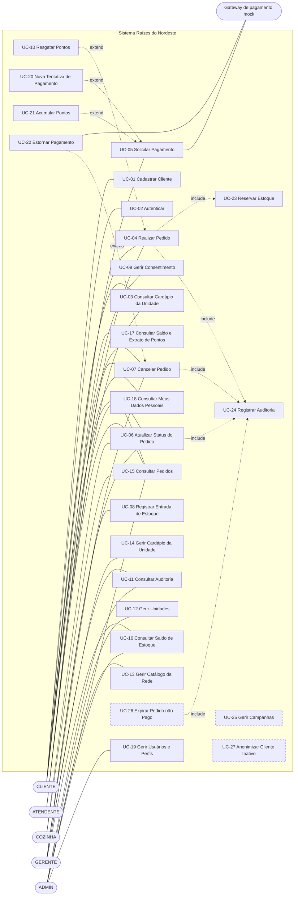

# Casos de uso

Legenda de origem: 🧑 humana · 🤝 conjunta (a IA propôs, o humano escolheu) · 🤖 IA (pendente de validação). Decisões em [`decisoes.md`](../uso-de-ia/decisoes.md). Requisitos (RF, RN, RNF) em [`requisitos/README.md`](../requisitos/README.md); tabelas em [`der.md`](der.md). Este documento atende o item 4.1 do roteiro da trilha (diagrama de casos de uso e descrição de feature).

## 1. Diagrama de casos de uso

**Atores** (D-039 🤝): CLIENTE, ATENDENTE, COZINHA, GERENTE e ADMIN, mais o ator externo **Gateway de pagamento (mock)** (D-041 🤝). CLIENTE, ATENDENTE e COZINHA ficam à esquerda; GERENTE, ADMIN e o gateway ficam à direita. Casos de uso com borda tracejada são **conceituais** (RF-19 a RF-21: documentados, sem código no MVP). Setas pontilhadas com rótulo são relações `include` (obrigatória) e `extend` (condicional; a seta sai do caso que estende e chega ao caso estendido).

Simplificações do desenho: o GERENTE realiza tudo o que ATENDENTE e COZINHA realizam (RN-04), mas só na própria unidade; para não poluir o diagrama, as setas do GERENTE aparecem só nos casos de uso que são exclusivos dele ou que ele divide com o ADMIN, e a regra de herança está na seção 2. Todo ator precisa se autenticar (UC-02), mas só uma seta (a do CLIENTE) foi desenhada, para não poluir.

Notas do diagrama:

- **UC-02 Autenticar** é pré-condição de todos os outros casos de uso, exceto UC-01 (cadastro); por isso só o CLIENTE aparece ligado a ele no desenho, como representante de todos os atores (🤖 D1).
- **UC-21 Acumular Pontos** é um `extend` de UC-05: só ocorre quando o pagamento é aprovado **e** há consentimento vigente de FIDELIDADE (RN-08).
- **UC-10 Resgatar Pontos** é um `extend` de UC-04: só ocorre quando o pedido informa pontos a resgatar (RF-18).
- **UC-22 Estornar Pagamento** é um `extend` de UC-07: só ocorre quando o pedido cancelado estava PAGO (RN-02); o gateway recebe o pedido de estorno.
- **UC-23** e **UC-24** são `include` porque acontecem sempre, na mesma transação do caso de uso que os inclui (RNF-11).
- A publicação de eventos no outbox (RF-22) é parte de cada caso de uso que muda o estado e não é um caso de uso com ator; aparece nos fluxos e nos diagramas de [sequência](sequencia.md).

## 2. Atores e herança de permissões

| Ator | Escopo | Observação |
|---|---|---|
| CLIENTE | Os próprios dados e pedidos | Cria pedidos pelos canais APP, WEB e PICKUP (RN-14) |
| ATENDENTE | Unidade de lotação | Cria pedido em nome do cliente (BALCAO, TOTEM) |
| COZINHA | Unidade de lotação | Só avança PAGO → EM_PREPARO → PRONTO |
| GERENTE | Somente a própria unidade | Realiza tudo o que ATENDENTE e COZINHA realizam, mais cardápio da unidade, estoque e auditoria da unidade |
| ADMIN | Rede inteira | Gere unidades, catálogo, usuários; consulta pedidos, estoque e auditoria de qualquer unidade; **não** faz transição de status (RN-04) |
| Gateway de pagamento (mock) | Externo | Serviço HTTP separado; resultado determinado por token de teste (`tok_aprovado`, `tok_recusado`, `tok_timeout`) |

## 3. Convenções das descrições

- O formato segue o **modelo de descrição de caso de uso** do roteiro da trilha (UC 1 – Cadastrar Cliente), com os mesmos campos e na mesma ordem. Como o modelo só tem "Fluxo alternativo", as **exceções** (erros HTTP) ficam nele, marcadas como `[Exceção 4xx]`.
- Códigos de erro: **400** corpo JSON malformado; **401** sem token ou token inválido/expirado; **403** perfil ou unidade sem permissão; **404** recurso inexistente; **409** conflito de regra de negócio (RN-03, RN-05); **422** erro de validação (campo ausente, valor inválido, canal fora do enum ou incompatível com o perfil; D-054); **504** timeout do gateway. Todos saem no erro padrão `{error, message, details[{field, issue}], timestamp, path, requestId}` (RNF-13, D-035 🤝). O `error` de estoque (`ESTOQUE_INSUFICIENTE`) já existe no código; os demais valores de `error` citados são propostas (🤖 D2).
- "Origem das informações" aponta as tabelas do [DER](der.md) e os requisitos. Em "Usuários responsáveis" consta o ator dono da regra. "Pendências" lista apenas o que depende de validação.

## 4. Descrições detalhadas

### UC-01 – Cadastrar Cliente

**Descrição**

Cadastro de um novo cliente (RF-01), que passa a poder autenticar-se, fazer pedidos e acumular pontos. Coleta apenas o mínimo (minimização, D-044): nome, e-mail e senha; data de nascimento é opcional e só com consentimento.

**Ator principal**

CLIENTE (visitante ainda sem conta, em qualquer canal digital).

**Demais atores**

N/C

**Pré-condições**

1. O e-mail informado ainda não está cadastrado (sem diferenciar maiúsculas de minúsculas).

**Pós-condições**

1. Um usuário com perfil CLIENTE, sem unidade de lotação, é gravado em `usuarios`, com a senha em hash Argon2id (RNF-01).
2. A resposta devolve o cliente criado, sem o hash da senha (RNF-05).
3. Uma data de nascimento só é guardada se o cliente também registrar o consentimento DATA_NASCIMENTO (UC-09).

**Origem das informações**

1. Corpo de `POST /usuarios`;
2. Tabela `usuarios` (DER 3.2);
3. LGPD: seção 7 dos requisitos.

**Usuários responsáveis**

CLIENTE (titular dos dados).

**Pendências**

Política de força mínima da senha não definida nos requisitos (🤖 D3).

**Fluxo base**

1. Cliente envia `POST /usuarios` com *NOME, *E-MAIL e *SENHA (e, opcionalmente, DATA DE NASCIMENTO); [RN-01.1]
2. API valida o formato do corpo e dos campos; [RN-01.2]
3. Caso de uso verifica que o e-mail não existe; [RN-01.3]
4. Domínio cria o usuário com perfil CLIENTE; o serviço de segurança gera o hash Argon2id da senha;
5. Caso de uso grava o usuário, a auditoria e o evento no outbox na mesma transação;
6. API responde 201 com os dados do cliente (sem senha).

**Fluxo alternativo**

- 2a. [Exceção 400] Corpo JSON malformado. [Exceção 422] Campo obrigatório ausente, com `details[{field, issue}]`.
- 2b. [Exceção 422] E-mail com formato inválido, senha fora da política, ou data de nascimento enviada sem consentimento DATA_NASCIMENTO registrado.
- 3a. [Exceção 409] E-mail já cadastrado.

**Regras de negócio**

- RN-01.1. Não se coleta CPF nem telefone (D-044, RNF-04).
- RN-01.2. A senha nunca é guardada nem devolvida em claro (RNF-01, RNF-05).
- RN-01.3. O e-mail é único sem diferenciar maiúsculas de minúsculas (`uq_usuarios_email_lower`).
- Cadastro público cria apenas perfil CLIENTE; os demais perfis são criados pelo ADMIN (UC-19).

### UC-02 – Autenticar

**Descrição**

Login com e-mail e senha e emissão de um JWT de acesso (RF-02), usado em todas as chamadas seguintes. A autorização por perfil e unidade (RF-03) é aplicada a partir das informações do token.

**Ator principal**

Qualquer usuário cadastrado (CLIENTE, ATENDENTE, COZINHA, GERENTE ou ADMIN).

**Demais atores**

N/C

**Pré-condições**

1. O usuário existe, está ativo (`eh_ativo`) e não foi anonimizado.

**Pós-condições**

1. Um JWT de 60 minutos é devolvido, com identificador do usuário, perfil e unidade de lotação (RNF-02).
2. Nada é gravado no banco (a API é stateless, RNF-09).

**Origem das informações**

1. Corpo de `POST /auth/login`;
2. Tabela `usuarios` (DER 3.2);
3. Segredo do JWT em variável de ambiente (nunca no repositório).

**Usuários responsáveis**

Todos os perfis.

**Pendências**

Refresh token é apenas conceitual (RNF-02). Limite de tentativas de login não definido (🤖 D4).

**Fluxo base**

1. Usuário envia `POST /auth/login` com *E-MAIL e *SENHA;
2. API valida o corpo;
3. Caso de uso busca o usuário pelo e-mail e confere o hash Argon2id da senha; [RN-02.1]
4. Caso de uso verifica que a conta está ativa;
5. Caso de uso emite o JWT com validade de 60 minutos;
6. API responde 200 com `accessToken`, tipo e validade.

**Fluxo alternativo**

- 2a. [Exceção 400] Corpo JSON malformado. [Exceção 422] Campo ausente.
- 3a. [Exceção 401] E-mail inexistente ou senha incorreta; a mensagem é a mesma nos dois casos, para não revelar quais e-mails existem.
- 4a. [Exceção 401] Conta inativa ou anonimizada.
- Em chamadas posteriores: [Exceção 401] token ausente, inválido ou expirado (RNF-03); [Exceção 403] perfil sem permissão ou unidade alheia.

**Regras de negócio**

- RN-02.1. O hash é Argon2id com salt (RNF-01).
- RN-02.2. 401 significa "não autenticado" e 403 significa "autenticado, sem permissão" (RNF-03).
- RN-02.3. A senha e o token não aparecem em logs (RNF-06).

### UC-03 – Consultar Cardápio da Unidade

**Descrição**

Consulta dos itens que uma unidade oferece (RF-06): produto do catálogo da rede, disponibilidade, período sazonal e preço vigente (local, se existir, senão o de referência).

**Ator principal**

CLIENTE.

**Demais atores**

ATENDENTE, GERENTE e ADMIN (também consultam; o ATENDENTE, para atender no balcão).

**Pré-condições**

1. Usuário autenticado (UC-02), conforme 🤖 D5.
2. A unidade existe.

**Pós-condições**

1. Nenhuma alteração de estado; só leitura.

**Origem das informações**

1. `GET /unidades/{id}/cardapio`;
2. Tabelas `itens_cardapio`, `produtos`, `categorias`, `unidades` (DER 3.3 a 3.5).

**Usuários responsáveis**

GERENTE (dono do cardápio da unidade, UC-14).

**Pendências**

Leitura exigir ou não autenticação (🤖 D5).

**Fluxo base**

1. Usuário envia `GET /unidades/{id}/cardapio`;
2. API valida o token e o identificador;
3. Caso de uso busca a unidade e os itens do cardápio;
4. Domínio calcula, para cada item, o preço vigente e se está ofertável na data de hoje; [RN-03.1] [RN-03.2]
5. API responde 200 com a lista paginada, preços e indicação de sazonalidade.

**Fluxo alternativo**

- 2a. [Exceção 401] Token ausente ou inválido.
- 2b. [Exceção 400] Identificador de unidade malformado.
- 3a. [Exceção 404] Unidade inexistente.
- 4a. Itens indisponíveis ou fora do período sazonal não aparecem como pedíveis (aparecem marcados, não geram erro).

**Regras de negócio**

- RN-03.1 (RN-10). Preço vigente = preço local da unidade, se existir; senão, preço de referência da rede.
- RN-03.2 (RN-12). Só é pedível o produto ofertado, disponível e dentro do período sazonal, quando houver.

### UC-04 – Realizar Pedido

**Descrição**

Criação de um pedido em uma unidade, por um canal (`canalPedido`), com reserva de estoque na mesma transação (RF-07, RF-16). O pedido nasce em AGUARDANDO_PAGAMENTO. É o primeiro passo do fluxo crítico pedido → pagamento → status.

**Ator principal**

CLIENTE (canais APP, WEB e PICKUP) ou ATENDENTE e GERENTE (em nome do cliente, BALCAO e TOTEM; D-050, RN-14).

**Demais atores**

N/C

**Pré-condições**

1. Usuário autenticado (UC-02).
2. A unidade existe e está ativa; o cliente, se informado, existe e tem perfil CLIENTE.
3. Cada produto está ofertado e disponível no cardápio da unidade (UC-03).

**Pós-condições**

1. Existem, gravados numa só transação (RNF-11): o pedido em AGUARDANDO_PAGAMENTO com `canal_pedido` imutável; os itens com preço congelado; a linha de histórico de status; a reserva no saldo (`estoques.qtd_reservada`) e o razão `RESERVA` em `movimentacoes_estoque`; a auditoria `PEDIDO_CRIADO`; o evento `pedido_criado` (e `estoque_movimentado`) no outbox.
2. `expira_em` = criação + 15 minutos (RN-07).
3. A resposta da chave `Idempotency-Key` fica guardada por 24 h.

**Origem das informações**

1. Corpo de `POST /pedidos` e header `Idempotency-Key`;
2. Tabelas `pedidos`, `itens_pedido`, `itens_cardapio`, `estoques`, `movimentacoes_estoque`, `historico_status_pedido`, `chaves_idempotencia`, `auditoria`, `outbox_eventos`;
3. Token JWT (autor, perfil, unidade).

**Usuários responsáveis**

CLIENTE e ATENDENTE (operam); GERENTE (dono do estoque e do cardápio).

**Pendências**

N/C (perfil × canal definido na RN-14; chave em processamento definida na RN-13).

**Fluxo base**

1. Usuário envia `POST /pedidos` com *UNIDADE, *CANAL (`canalPedido`), *ITENS (produto e quantidade), CLIENTE (obrigatório quando quem cria é o ATENDENTE e há identificação) e, opcionalmente, PONTOS A RESGATAR; [RN-04.1]
2. API valida o token, o perfil e o corpo (schema), inclusive o enum de `canalPedido`;
3. Caso de uso consulta `chaves_idempotencia` pela chave, escopo e usuário e registra a chave como "em processamento"; [RN-04.2]
4. Caso de uso abre a transação e carrega os itens do cardápio da unidade; [RN-04.3]
5. Domínio define o preço de cada item (local ou de referência) e o congela em `itens_pedido`; calcula `valor_itens`; [RN-04.4]
6. Caso de uso ordena os produtos de forma determinística e trava as linhas de `estoques` com `SELECT ... FOR UPDATE` (UC-23, include); [RN-04.5]
7. Domínio reserva a quantidade de cada item (`Estoque.reservar`); [RN-04.5]
8. Se houver pontos a resgatar, aplica-se UC-10 (extend); [RN-04.6]
9. Domínio cria o pedido em AGUARDANDO_PAGAMENTO, com `expira_em`;
10. Caso de uso grava pedido, itens, histórico, movimentações, auditoria (UC-24, include) e outbox, guarda a resposta da idempotência e confirma a transação;
11. API responde 201 com o pedido, o `canalPedido` e o `Location`.

**Fluxo alternativo**

- 2a. [Exceção 401] Token ausente, inválido ou expirado.
- 2b. [Exceção 403] Perfil sem permissão de criar pedido (COZINHA, ADMIN), ou ATENDENTE/GERENTE criando pedido para unidade que não é a sua.
- 2c. [Exceção 400] Corpo JSON malformado. [Exceção 422] `canalPedido` ausente, lista de itens vazia.
- 2d. [Exceção 422] `canalPedido` fora do enum (`APP`, `TOTEM`, `BALCAO`, `PICKUP`, `WEB`), com `details[{field: "canalPedido", issue}]`; quantidade menor que 1. Nenhuma transação é aberta. [RN-04.1]
- 2e. [Exceção 422] Canal incompatível com o perfil (RN-14): CLIENTE só em APP, WEB e PICKUP; ATENDENTE e GERENTE só em BALCAO e TOTEM; `details[{field: "canalPedido", issue}]`.
- 3a. Repetição da mesma chave com o mesmo corpo e resposta já guardada: devolve a resposta original, sem novo pedido nem nova reserva (RN-13). [RN-04.2]
- 3b. [Exceção 422] Mesma chave com corpo diferente (`hash_requisicao` diverge).
- 3c. [Exceção 409] Mesma chave ainda em processamento pela requisição original (RN-13).
- 4a. [Exceção 404] Unidade ou produto inexistente.
- 4b. [Exceção 422] Produto não ofertado, indisponível ou fora do período sazonal na unidade (RN-12).
- 7a. [Exceção 409] Saldo insuficiente em algum item (RN-05): `error` = `ESTOQUE_INSUFICIENTE`; toda a transação é desfeita e nenhum pedido, reserva ou auditoria é gravado.
- 8a. [Exceção 422] Resgate inválido (ver UC-10).
- 10a. Falha em qualquer gravação: rollback total das quatro frentes (pedido, estoque, auditoria, outbox).

**Regras de negócio**

- RN-04.1 (RN-11, RT p. 5). `canalPedido` é obrigatório na criação e imutável depois.
- RN-04.7 (RN-14). Perfil × canal: CLIENTE em APP, WEB e PICKUP; ATENDENTE e GERENTE em BALCAO e TOTEM (o totem usa uma conta de dispositivo de perfil ATENDENTE lotada na unidade; o cliente pode ser identificado opcionalmente).
- RN-04.2 (RN-13). `Idempotency-Key` repetida com o mesmo corpo devolve o resultado original.
- RN-04.3 (RN-12). Só se pede produto ofertado, disponível e no período sazonal.
- RN-04.4 (RN-10). O preço é congelado no item no momento da criação.
- RN-04.5 (RN-05, RN-06). Reserva na criação, na mesma transação, com bloqueio de linha; saldo insuficiente gera 409 e nenhum pedido.
- RN-04.6 (RN-01). O pedido nasce em AGUARDANDO_PAGAMENTO.

### UC-05 – Solicitar Pagamento

**Descrição**

Solicitação de pagamento de um pedido ao gateway mock, com registro da tentativa e do retorno (RF-11), nova tentativa após recusa (RF-12, UC-20) e acúmulo de pontos (UC-21). Cobre os resultados aprovado, recusado e timeout.

**Ator principal**

CLIENTE (nos próprios pedidos).

**Demais atores**

Gateway de pagamento (mock).

**Pré-condições**

1. Usuário autenticado e dono do pedido.
2. O pedido está em AGUARDANDO_PAGAMENTO e não expirou.
3. Não existe tentativa APROVADA para o pedido.

**Pós-condições**

1. **Aprovado:** `tentativas_pagamento` com status APROVADO; pedido em PAGO (histórico com `id_usuario` nulo, mudança do sistema); reserva convertida em baixa (`BAIXA` em `movimentacoes_estoque`); pontos acumulados se houver consentimento vigente de FIDELIDADE; auditoria; eventos `pagamento_aprovado` e correlatos no outbox.
2. **Recusado:** tentativa RECUSADO com `motivo_recusa`; o pedido **continua em AGUARDANDO_PAGAMENTO** (RN-01); evento de recusa no outbox.
3. **Timeout esgotado:** tentativa FALHA; pedido continua em AGUARDANDO_PAGAMENTO; nada é baixado.

**Origem das informações**

1. Corpo de `POST /pedidos/{id}/pagamentos` (forma de pagamento e token de teste) e `Idempotency-Key`;
2. Tabelas `pedidos`, `tentativas_pagamento`, `estoques`, `movimentacoes_estoque`, `consentimentos`, `saldos_pontos`, `movimentos_pontos`, `historico_status_pedido`, `auditoria`, `outbox_eventos`;
3. Resposta do gateway mock (status e payload).

**Usuários responsáveis**

CLIENTE; GERENTE (acompanha as recusas da unidade).

**Pendências**

Código HTTP da resposta de recusa (🤖 D8). Uma linha de tentativa por `POST`, com as chamadas por timeout dentro dela (`qtd_chamadas_gateway`), e duas transações curtas, sem segurar a transação durante a chamada externa, foram definidas na D-054.

**Fluxo base** (aprovado)

1. Cliente envia `POST /pedidos/{id}/pagamentos` com *FORMA DE PAGAMENTO (PIX, CREDITO ou DEBITO) e o token de teste;
2. API valida o token, o corpo e a propriedade do pedido; [RN-05.1]
3. Caso de uso verifica a chave de idempotência (repetição devolve a resposta guardada); [RN-05.2]
4. Caso de uso confere que o pedido está em AGUARDANDO_PAGAMENTO e grava uma tentativa PENDENTE com o valor do pedido; [RN-05.3]
5. Caso de uso chama o gateway pela porta `GatewayPagamento`, com timeout de 3 s e a chave de idempotência; [RN-05.4]
6. Gateway responde aprovado, com `id_transacao_gateway` e payload;
7. Em nova transação, o caso de uso trava o pedido, e o domínio marca a tentativa como APROVADO e o pedido como PAGO (`Pedido.confirmarPagamento`);
8. Domínio converte a reserva em baixa no estoque (`Estoque.baixar`); [RN-06]
9. Se há consentimento vigente de FIDELIDADE, acumula 1 ponto por R$ 1,00 pago (UC-21, extend); [RN-08]
10. Caso de uso grava auditoria e eventos no outbox e confirma a transação;
11. API responde 201 com a tentativa e o status do pedido (PAGO).

**Fluxo alternativo**

- 2a. [Exceção 401] Token ausente ou inválido.
- 2b. [Exceção 403] Colaborador solicitando pagamento (só o CLIENTE dono paga neste MVP).
- 2c. [Exceção 404] Pedido inexistente (também usado quando o pedido pertence a outro cliente, para não revelar existência; RNF-03).
- 2d. [Exceção 400] Corpo JSON malformado. [Exceção 422] Campo ausente ou forma de pagamento fora do enum.
- 3a. Repetição da mesma chave com o mesmo corpo: devolve a resposta original, sem nova cobrança (RN-13). Corpo diferente: [Exceção 422].
- 4a. [Exceção 409] Pedido fora de AGUARDANDO_PAGAMENTO (já pago, cancelado, em preparo...), expirado, ou já com tentativa efetivada.
- 6a. **Recusado** (`tok_recusado`): o gateway devolve o motivo; a tentativa fica RECUSADO com `motivo_recusa`; o pedido permanece em AGUARDANDO_PAGAMENTO e a reserva é mantida; a API responde 201 com `status` RECUSADO e o motivo; o cliente pode repetir com outra forma ou token (UC-20, RF-12). [RN-05.5]
- 5a. **Timeout** (`tok_timeout`): sem resposta em 3 s, repete-se a chamada até 2 vezes, apenas por timeout (total de 3 chamadas, cerca de 9 s); esgotadas, a tentativa fica FALHA, o pedido permanece em AGUARDANDO_PAGAMENTO e a API responde **504** no erro padrão (RNF-10, D-051). Recusa **não** é repetida automaticamente. [RN-05.4]
- 9a. Sem consentimento vigente de FIDELIDADE: o pagamento é concluído normalmente, sem acúmulo de pontos.
- 7a. [Exceção 409] Se, entre a chamada e a gravação, o pedido deixou de estar em AGUARDANDO_PAGAMENTO (por exemplo, foi cancelado): a tentativa é gravada com o resultado do gateway e a divergência é auditada para conciliação (🤖 D12).

**Regras de negócio**

- RN-05.1 (RN-04). PAGO só acontece pelo resultado do pagamento, nunca por chamada manual.
- RN-05.2 (RN-13). A idempotência evita cobrança duplicada; o índice parcial `uq_tentativas_pagamento_pedido_efetivada` impede duas cobranças efetivadas no mesmo pedido.
- RN-05.3 (RN-01). Uma recusa mantém o pedido em AGUARDANDO_PAGAMENTO.
- RN-05.4 (RNF-10). Timeout de 3 s; até 2 novas tentativas só em caso de timeout; o pedido nunca fica em estado inconsistente.
- RN-05.5 (RN-06). A reserva só é devolvida por cancelamento ou expiração; recusa isolada não a devolve.
- RN-06. Pagamento aprovado converte reserva em baixa. RN-08. 1 ponto por R$ 1,00, só com consentimento FIDELIDADE vigente.
- A tentativa nunca guarda cartão, validade, CVV nem token do cliente (DER 3.11).

### UC-06 – Atualizar Status do Pedido

**Descrição**

Avanço do pedido pela máquina de estados (RF-09): a COZINHA leva PAGO → EM_PREPARO → PRONTO; o ATENDENTE leva PRONTO → ENTREGUE; o GERENTE faz ambos na própria unidade (RN-04).

**Ator principal**

COZINHA.

**Demais atores**

ATENDENTE (PRONTO → ENTREGUE) e GERENTE (ambos, só na própria unidade).

**Pré-condições**

1. Usuário autenticado com perfil e unidade de lotação.
2. O pedido pertence à unidade do usuário.

**Pós-condições**

1. `pedidos.status` atualizado; linha em `historico_status_pedido` com quem, quando e o status anterior e novo; auditoria `STATUS_ALTERADO` (com o canal do pedido); evento de mudança de status no outbox (🤖 `pedido_status_alterado`).
2. Em falha (403, 404, 409), nada é alterado.

**Origem das informações**

1. Corpo de `PATCH /pedidos/{id}/status`;
2. Tabelas `pedidos`, `historico_status_pedido`, `auditoria`, `outbox_eventos`; token (perfil e unidade).

**Usuários responsáveis**

COZINHA, ATENDENTE e GERENTE.

**Pendências**

`PATCH` com status CANCELADO ou PAGO (🤖 D13).

**Fluxo base**

1. Usuário envia `PATCH /pedidos/{id}/status` com *NOVO STATUS;
2. API valida o token e o corpo;
3. Caso de uso carrega o pedido (com bloqueio de linha);
4. Caso de uso verifica se o perfil e a unidade do usuário permitem a transição pedida; [RN-06.1]
5. Domínio valida a transição na máquina de estados e atualiza o status (`Pedido.avancarStatus`); [RN-06.2]
6. Caso de uso grava histórico, auditoria (UC-24, include) e outbox e confirma;
7. API responde 200 com o pedido atualizado.

**Fluxo alternativo**

- 2a. [Exceção 401] Token ausente ou inválido.
- 2b. [Exceção 400] Corpo JSON malformado. [Exceção 422] Status ausente ou fora do enum.
- 3a. [Exceção 404] Pedido inexistente.
- 4a. [Exceção 403] Perfil não autorizado para o status pedido (por exemplo, COZINHA pedindo ENTREGUE; CLIENTE; ADMIN; qualquer um pedindo PAGO) ou pedido de outra unidade (inclusive GERENTE de outra unidade).
- 5a. [Exceção 409] Transição inválida pela máquina de estados (por exemplo, PAGO → PRONTO, ou qualquer saída de ENTREGUE ou CANCELADO).

**Regras de negócio**

- RN-06.1 (RN-04). Quem faz cada transição: COZINHA, PAGO → EM_PREPARO → PRONTO; ATENDENTE, PRONTO → ENTREGUE; GERENTE, ambos na própria unidade. A checagem de perfil e unidade vem **antes** da checagem de transição (403 antes de 409).
- RN-06.2 (RN-03). Qualquer outra transição retorna 409; ENTREGUE e CANCELADO são finais.
- O canal do pedido (RN-11) acompanha a auditoria; não é alterado.

### UC-07 – Cancelar Pedido

**Descrição**

Cancelamento de um pedido antes do preparo (RF-10, RN-02), com devolução da reserva e, se estava PAGO, estorno do pagamento (UC-22) e dos pontos acumulados (RN-09). É operação sensível e auditada.

**Ator principal**

CLIENTE (o próprio pedido, em AGUARDANDO_PAGAMENTO).

**Demais atores**

ATENDENTE e GERENTE (pedidos em AGUARDANDO_PAGAMENTO, por exemplo de balcão abandonado, ou PAGO, na própria unidade); Gateway de pagamento (estorno).

**Pré-condições**

1. Usuário autenticado e com permissão sobre o pedido (RN-04).
2. O pedido está em AGUARDANDO_PAGAMENTO ou PAGO.

**Pós-condições**

1. Pedido CANCELADO (estado final) com motivo no histórico; auditoria `PEDIDO_CANCELADO` com o canal; evento de cancelamento no outbox (🤖 `pedido_cancelado`).
2. Reserva devolvida (`LIBERACAO`) quando o pedido estava em AGUARDANDO_PAGAMENTO; no pedido PAGO a baixa já ocorreu e os itens não foram preparados, então a quantidade volta ao saldo disponível com movimentação `AJUSTE_POSITIVO`, motivo "cancelamento do pedido <numero>" (RN-06).
3. Pontos resgatados no pedido devolvidos (`ESTORNO_RESGATE`); pontos acumulados estornados (`ESTORNO_ACUMULO`) se o pedido PAGO os havia gerado (RN-09).
4. Se PAGO, a tentativa aprovada fica ESTORNADO.

**Origem das informações**

1. `POST /pedidos/{id}/cancelamento`, com motivo;
2. Tabelas `pedidos`, `tentativas_pagamento`, `estoques`, `movimentacoes_estoque`, `movimentos_pontos`, `saldos_pontos`, `historico_status_pedido`, `auditoria`, `outbox_eventos`; resposta do gateway.

**Usuários responsáveis**

CLIENTE, ATENDENTE, GERENTE.

**Pendências**

Falha do estorno no gateway (🤖 D15).

**Fluxo base**

1. Usuário envia `POST /pedidos/{id}/cancelamento` com *MOTIVO;
2. API valida o token e o corpo;
3. Caso de uso carrega o pedido com bloqueio de linha e verifica perfil, unidade e titularidade; [RN-07.1]
4. Domínio valida que o status permite cancelar e muda para CANCELADO (`Pedido.cancelar`); [RN-07.2]
5. Caso de uso devolve a reserva de estoque (`Estoque.liberar`) e os pontos resgatados;
6. Se o pedido estava PAGO: solicita o estorno ao gateway (UC-22, extend), marca a tentativa como ESTORNADO e estorna os pontos acumulados; [RN-07.3]
7. Caso de uso grava histórico, auditoria (UC-24, include) e outbox e confirma a transação;
8. API responde 200 com o pedido CANCELADO.

**Fluxo alternativo**

- 2a. [Exceção 401] Token ausente ou inválido. [Exceção 400] Corpo JSON malformado. [Exceção 422] Motivo ausente.
- 3a. [Exceção 403] Perfil sem permissão para o status atual (CLIENTE em pedido PAGO; COZINHA; ADMIN), pedido de outra unidade ou de outro cliente.
- 3b. [Exceção 404] Pedido inexistente.
- 4a. [Exceção 409] Pedido em EM_PREPARO, PRONTO, ENTREGUE ou já CANCELADO (RN-02, RN-03).
- 6a. [Exceção 504] Timeout do gateway no estorno: a transação é desfeita e o pedido continua PAGO (🤖 D15).

**Regras de negócio**

- RN-07.1 (RN-04). CLIENTE cancela o próprio pedido em AGUARDANDO_PAGAMENTO; ATENDENTE e GERENTE cancelam em AGUARDANDO_PAGAMENTO e em PAGO, só na própria unidade.
- RN-07.2 (RN-02). CANCELADO só a partir de AGUARDANDO_PAGAMENTO ou PAGO; depois do preparo não se cancela.
- RN-07.3 (RN-02, RN-09). Cancelar pedido PAGO gera estorno no mock e estorna pontos que ele tenha gerado.
- RN-06. A reserva é devolvida em cancelamento.

### UC-08 – Registrar Entrada de Estoque

**Descrição**

Registro de reposição de estoque de um produto na unidade (RF-16): soma ao saldo disponível e grava o movimento `ENTRADA` no razão. Ação sensível, auditada.

**Ator principal**

GERENTE (da própria unidade).

**Demais atores**

N/C

**Pré-condições**

1. Usuário autenticado com perfil GERENTE, lotado na unidade do estoque.
2. A unidade e o produto existem.

**Pós-condições**

1. `estoques.qtd_disponivel` aumentada (a linha de saldo é criada se ainda não existir, 🤖 D17); linha `ENTRADA` em `movimentacoes_estoque` com o executor; auditoria `ESTOQUE_AJUSTADO`; evento `estoque_movimentado` no outbox.

**Origem das informações**

1. `POST /estoques/{unidadeId}/{produtoId}/entradas` (rota indicativa), com quantidade e motivo opcional;
2. Tabelas `estoques`, `movimentacoes_estoque`, `auditoria`, `outbox_eventos`.

**Usuários responsáveis**

GERENTE.

**Pendências**

N/C (o ADMIN apenas consulta estoque; entrada só pelo GERENTE, RF-16).

**Fluxo base**

1. Gerente envia a entrada com *PRODUTO e *QUANTIDADE (inteiro positivo) e, opcionalmente, MOTIVO;
2. API valida o token, o perfil e o corpo;
3. Caso de uso verifica que a unidade do estoque é a de lotação do gerente; [RN-08.1]
4. Caso de uso trava a linha de `estoques` (`SELECT ... FOR UPDATE`) e o domínio soma a quantidade (`Estoque.registrarEntrada`); [RN-08.2]
5. Caso de uso grava o movimento, a auditoria e o outbox, e confirma a transação;
6. API responde 201 com o saldo atualizado.

**Fluxo alternativo**

- 2a. [Exceção 401] Token ausente ou inválido.
- 2b. [Exceção 403] Perfil diferente de GERENTE, ou unidade alheia.
- 2c. [Exceção 400] Corpo JSON malformado. [Exceção 422] Quantidade ausente, menor ou igual a zero.
- 3a. [Exceção 404] Unidade ou produto inexistente.

**Regras de negócio**

- RN-08.1 (RN-04, RF-03). O GERENTE só atua na própria unidade.
- RN-08.2. A quantidade é sempre positiva; o sentido do movimento vem do tipo (`ENTRADA`), conforme DER 3.7. Os `CHECK >= 0` impedem saldo negativo.
- Ações de estoque são auditadas (RF-13).

### UC-09 – Gerir Consentimento

**Descrição**

Registro e revogação de consentimento do titular, por finalidade (RF-14, LGPD): FIDELIDADE, MARKETING e DATA_NASCIMENTO. Cada ação grava um novo registro; a revogação não apaga o histórico. O consentimento vigente é o último registro por usuário e finalidade.

**Ator principal**

CLIENTE (sobre os próprios consentimentos).

**Demais atores**

N/C

**Pré-condições**

1. Usuário autenticado com perfil CLIENTE.

**Pós-condições**

1. Novo registro em `consentimentos` com finalidade, ação (`CONCEDIDO` ou `REVOGADO`), base legal, versão do termo e instante.
2. Na revogação de FIDELIDADE, os pontos são debitados com o movimento `REVOGACAO` (D-050); o acúmulo deixa de ocorrer.
3. Evento `consentimento_registrado` no outbox (🤖, sem dado pessoal) e auditoria.

**Origem das informações**

1. `POST /consentimentos` e `DELETE` ou `PATCH` em `/consentimentos`, conforme o contrato;
2. Tabelas `consentimentos`, `movimentos_pontos`, `saldos_pontos`, `auditoria`, `outbox_eventos`.

**Usuários responsáveis**

CLIENTE (titular).

**Pendências**

Conteúdo e numeração dos termos por versão (🤖 D19).

**Fluxo base** (conceder)

1. Cliente envia a concessão com *FINALIDADE e *VERSÃO DO TERMO;
2. API valida o token, o perfil e o corpo;
3. Caso de uso consulta o consentimento vigente da finalidade;
4. Domínio cria o registro `CONCEDIDO`, com a base legal da finalidade (consentimento, art. 7º, I); [RN-09.1]
5. Caso de uso grava o registro, a auditoria e o outbox e confirma;
6. API responde 201 com o consentimento registrado.

**Fluxo alternativo**

- 2a. [Exceção 401] Token ausente ou inválido. [Exceção 403] Perfil diferente de CLIENTE, ou tentativa de registrar em nome de outro titular.
- 2b. [Exceção 400] Corpo JSON malformado. [Exceção 422] Finalidade ausente ou desconhecida (conjunto fechado de 3 valores), ou versão do termo vazia.
- 3a. [Exceção 409] Concessão de finalidade já concedida, ou revogação de finalidade sem consentimento vigente (🤖 D20).
- **Revogar:** mesmo fluxo, gravando `REVOGADO`; se a finalidade é FIDELIDADE, o caso de uso debita o saldo de pontos com `REVOGACAO` na mesma transação. [RN-09.2]

**Regras de negócio**

- RN-09.1 (RNF-04). Cada consentimento guarda finalidade, base legal, data e versão do termo.
- RN-09.2 (D-050). A revogação é tão simples quanto a concessão, é um novo registro e zera ou anonimiza os pontos.
- RN-09.3 (RN-08). O acúmulo de pontos e o uso da data de nascimento consultam o consentimento vigente.

### UC-10 – Resgatar Pontos

**Descrição**

Uso de pontos de fidelidade como desconto no pedido (RF-18, D-047, D-051). É uma extensão de UC-04: acontece apenas quando o pedido informa pontos a resgatar.

**Ator principal**

CLIENTE.

**Demais atores**

ATENDENTE (ao criar o pedido em nome de cliente identificado).

**Pré-condições**

1. Cliente identificado no pedido, com saldo em `saldos_pontos`.
2. O consentimento de FIDELIDADE está vigente (os pontos só existem com consentimento; 🤖 D21).

**Pós-condições**

1. `pedidos.qtd_pontos_resgatados` preenchida; `valor_desconto` e `valor_total` calculados; desconto rateado nos itens (`valor_desconto_item`);
2. Saldo debitado e movimento `RESGATE` (negativo) gravado na mesma transação do pedido;
3. Em cancelamento ou expiração, os pontos são devolvidos (`ESTORNO_RESGATE`, RN-09).

**Origem das informações**

1. Campo de pontos em `POST /pedidos`;
2. Tabelas `saldos_pontos`, `movimentos_pontos`, `pedidos`, `itens_pedido`.

**Usuários responsáveis**

CLIENTE.

**Pendências**

Saldo de pontos insuficiente: 409 ou 422 (🤖 D22).

**Fluxo base**

1. O pedido (UC-04) informa a quantidade de pontos a resgatar;
2. Caso de uso trava a linha de `saldos_pontos` do cliente;
3. Domínio valida o resgate (`ContaPontos.resgatar`): múltiplo de 100, saldo suficiente e limite de 50% do valor dos itens; [RN-10.1] [RN-10.2]
4. Domínio calcula o desconto (100 pontos = R$ 5,00) e ratea entre os itens;
5. Caso de uso grava o movimento e atualiza o saldo, junto com o pedido.

**Fluxo alternativo**

- 3a. [Exceção 422] Quantidade que não é múltiplo de 100, ou desconto acima de 50% do valor dos itens.
- 3b. [Exceção 409] Saldo de pontos insuficiente (🤖 D22).
- 1a. [Exceção 422] Pontos informados em pedido sem cliente identificado (`qtd_pontos_resgatados = 0 OR id_cliente IS NOT NULL`).
- 1b. [Exceção 403] Tentativa de resgatar pontos de outro cliente.

**Regras de negócio**

- RN-10.1 (RF-18). 100 pontos = R$ 5,00; resgate em múltiplos de 100.
- RN-10.2 (RF-18). Até 50% do valor dos itens.
- RN-10.3 (RN-09). Pontos resgatados são devolvidos no cancelamento ou na expiração.

### UC-11 – Consultar Auditoria

**Descrição**

Consulta da trilha de auditoria de ações sensíveis (RF-13): quem fez o quê, em qual recurso, unidade e canal, quando, com o `requestId`. Retenção de 1 ano (RNF-07).

**Ator principal**

GERENTE (somente a própria unidade).

**Demais atores**

ADMIN (rede inteira).

**Pré-condições**

1. Usuário autenticado com perfil GERENTE ou ADMIN.

**Pós-condições**

1. Nenhuma alteração do histórico (a trilha é append-only). Consultas a dados pessoais de terceiros geram elas mesmas um registro (`DADOS_PESSOAIS_ACESSADOS`, LGPD).

**Origem das informações**

1. `GET /auditoria`, com filtros de período, ação, recurso, unidade e paginação;
2. Tabela `auditoria` (DER 3.15).

**Usuários responsáveis**

GERENTE e ADMIN.

**Pendências**

Se consultar a auditoria também deve ser auditado (🤖 D23).

**Fluxo base**

1. Usuário envia `GET /auditoria` com filtros opcionais;
2. API valida o token e os parâmetros;
3. Caso de uso aplica o escopo: ADMIN vê toda a rede; GERENTE tem o filtro de unidade forçado para a sua; [RN-11.1]
4. Caso de uso consulta a trilha paginada, do mais recente para o mais antigo;
5. API responde 200 com os registros, sem dados pessoais em `detalhes`.

**Fluxo alternativo**

- 2a. [Exceção 401] Token ausente ou inválido.
- 2b. [Exceção 403] Perfil diferente de GERENTE ou ADMIN; GERENTE pedindo explicitamente outra unidade.
- 2c. [Exceção 422] Parâmetro de filtro inválido (data inválida, intervalo com início depois do fim).
- 4a. Resultado vazio: 200 com lista vazia.

**Regras de negócio**

- RN-11.1 (RF-03, RF-13). O GERENTE só vê a auditoria da própria unidade.
- RN-11.2 (RNF-07). Registros com autor, ação, alvo, unidade, canal, instante e `requestId`; sem exclusão antes de 1 ano.
- RN-11.3 (RNF-05). `detalhes` não contém dado pessoal.

## 5. Casos de uso resumidos

| UC | Ator | Objetivo | RFs |
|---|---|---|---|
| UC-12 Gerir Unidades | ADMIN (os demais consultam) | Cadastrar e alterar unidades da rede; consulta pelos demais perfis | RF-04, RF-03 |
| UC-13 Gerir Catálogo da Rede | ADMIN | Manter produtos, categorias, preço de referência e indicação de produto sazonal | RF-05 |
| UC-14 Gerir Cardápio da Unidade | GERENTE (própria unidade) | Definir oferta, disponibilidade, período sazonal e preço local dos itens | RF-06 |
| UC-15 Consultar Pedidos | CLIENTE, ATENDENTE, COZINHA, GERENTE, ADMIN | Listar e consultar pedidos com filtros de `canalPedido`, status e unidade, com paginação; o CLIENTE vê só os seus, a equipe vê a unidade, o ADMIN vê a rede | RF-08 |
| UC-16 Consultar Saldo de Estoque | GERENTE, ADMIN | Consultar saldo disponível e reservado por produto e unidade | RF-16 |
| UC-17 Consultar Saldo e Extrato de Pontos | CLIENTE | Ver o saldo e o extrato (razão) de pontos de fidelidade | RF-17 |
| UC-18 Consultar Meus Dados Pessoais | CLIENTE | Exercer o direito de acesso do titular aos próprios dados (LGPD art. 18) | RF-15 |
| UC-19 Gerir Usuários e Perfis | ADMIN | Criar colaboradores, definir perfil e unidade de lotação, ativar e desativar contas | RF-03 |
| UC-20 Nova Tentativa de Pagamento | CLIENTE; Gateway | Repetir o pagamento após recusa, com outra forma ou token, enquanto o pedido está em AGUARDANDO_PAGAMENTO (extend de UC-05) | RF-12 |
| UC-21 Acumular Pontos | Sistema (disparado pelo pagamento aprovado) | Creditar 1 ponto por R$ 1,00 pago, só com consentimento vigente de FIDELIDADE (extend de UC-05) | RF-17 |
| UC-22 Estornar Pagamento | Sistema; Gateway | Solicitar o estorno no mock quando o pedido PAGO é cancelado (extend de UC-07) | RF-10 |
| UC-23 Reservar Estoque | Sistema (include de UC-04) | Reservar a quantidade de cada item na mesma transação do pedido, com bloqueio de linha | RF-16 |
| UC-24 Registrar Auditoria | Sistema (include) | Gravar autor, ação, recurso, unidade, canal e `requestId` de toda ação sensível, na transação do caso de uso | RF-13, RF-22 |
| UC-25 Gerir Campanhas (conceitual) | ADMIN | Definir tipos, vigência, unidades e público de campanhas e promoções; **documentado, sem código** | RF-19 |
| UC-26 Expirar Pedido não Pago (conceitual) | Sistema (tarefa agendada) | Cancelar pedido não pago em 15 min e devolver a reserva; regra documentada, tarefa agendada é evolução | RF-20 |
| UC-27 Anonimizar Cliente Inativo (conceitual) | Sistema | Anonimizar nome e e-mail de cliente inativo há 2 anos, preservando agregados; documentado | RF-21 |

## 6. Rastreabilidade

| RF | Caso(s) de uso | Situação |
|---|---|---|
| RF-01 | UC-01 | MVP |
| RF-02 | UC-02 | MVP |
| RF-03 | UC-02, UC-19 (e verificado em todos) | MVP |
| RF-04 | UC-12 | MVP |
| RF-05 | UC-13 | MVP |
| RF-06 | UC-03, UC-14 | MVP |
| RF-07 | UC-04 | MVP |
| RF-08 | UC-15 | MVP |
| RF-09 | UC-06 | MVP |
| RF-10 | UC-07, UC-22 | MVP |
| RF-11 | UC-05 | MVP |
| RF-12 | UC-20 | MVP |
| RF-13 | UC-11, UC-24 | MVP |
| RF-14 | UC-09 | MVP |
| RF-15 | UC-18 | MVP |
| RF-16 | UC-08, UC-16, UC-23 | MVP |
| RF-17 | UC-17, UC-21 | MVP |
| RF-18 | UC-10 | MVP |
| RF-19 | UC-25 | Conceitual |
| RF-20 | UC-26 | Conceitual |
| RF-21 | UC-27 | Conceitual |
| RF-22 | Transversal (incluído em UC-04 a UC-10, UC-24) | MVP |

Total: **27 casos de uso**, sendo **11 detalhados** (UC-01 a UC-11) e **16 resumidos** (UC-12 a UC-27), dos quais 3 conceituais (UC-25 a UC-27).

## Decisões da IA (pendentes de validação)

- 🤖 **D1.** Autenticação (UC-02) como pré-condição geral, sem seta de cada ator no diagrama; apenas UC-01 dispensa login.
- 🤖 **D2.** Os nomes do campo `error` (exceto `ESTOQUE_INSUFICIENTE`, que já consta no código) são propostas a formalizar no contrato da API; neste documento só os status HTTP são normativos.
- 🤖 **D3.** Política de senha (tamanho mínimo) a definir; hoje só há o requisito de hash.
- 🤖 **D4.** Limite de tentativas de login (anti força bruta) fica fora do MVP.
- 🤖 **D5.** A leitura do cardápio exige token de qualquer perfil (os requisitos dizem apenas que "os demais consultam"). Se o cardápio precisar ser público, ajustar UC-03.
- ✅ **D6.** Resolvida na D-054: perfil × canal é a RN-14 (422).
- ✅ **D7.** Resolvida na D-054 (RN-13): chave em processamento é 409.
- 🤖 **D8.** A recusa é um resultado válido da solicitação de pagamento, então responde 201 (tentativa criada) com `status` RECUSADO e o motivo, e não um código de erro (402 não consta na lista de erros do projeto).
- ✅ **D9.** Resolvida na D-054: uma linha por `POST`; as chamadas por timeout ficam dentro dela, em `qtd_chamadas_gateway`.
- ✅ **D10.** Adotada na D-054: duas transações curtas, chamada ao gateway fora da transação.
- ✅ **D11.** Resolvida na D-054 (RNF-03 e RNF-05): 404 para CLIENTE, 403 para colaborador de outra unidade.
- 🤖 **D12.** Conflito de corrida entre pagamento e cancelamento: a tentativa é gravada e a divergência fica na auditoria para conciliação.
- 🤖 **D13.** O `PATCH` de status aceita apenas EM_PREPARO, PRONTO e ENTREGUE; PAGO por qualquer perfil é 403 (RN-04) e CANCELADO só pelo endpoint de cancelamento (422 no `PATCH`).
- ✅ **D14.** Resolvida na D-054 (RN-06): `AJUSTE_POSITIVO` com motivo "cancelamento do pedido <numero>".
- 🤖 **D15.** Se o estorno no gateway falhar por timeout, o cancelamento é desfeito (504) e o pedido segue PAGO, para não haver pedido cancelado sem estorno.
- ✅ **D16.** Resolvida na D-054 (RN-04): ATENDENTE e GERENTE também cancelam em AGUARDANDO_PAGAMENTO.
- 🤖 **D17.** A entrada de estoque cria a linha de saldo se ela não existir.
- ✅ **D18.** Resolvida na D-054 (RF-16): ADMIN só consulta estoque.
- 🤖 **D19.** Versões de termo são texto livre validado como não vazio.
- 🤖 **D20.** Conceder o que já está concedido ou revogar o que não está vigente retorna 409.
- 🤖 **D21.** O resgate exige consentimento vigente de FIDELIDADE, derivado de a revogação debitar os pontos (D-050).
- 🤖 **D22.** Saldo de pontos insuficiente retorna 409 (estado do saldo); formato e limite do resgate retornam 422.
- 🤖 **D23.** Consultar a auditoria não é, por si, auditado no MVP.
- 🤖 **D24.** Rotas indicativas de estoque e consentimento são placeholders até o contrato da API.

---

*Redigido por Claude Sonnet 5.5 sob especificação do Claude Opus 5.5, a partir das decisões do humano registradas em `docs/uso-de-ia/decisoes.md`.*
