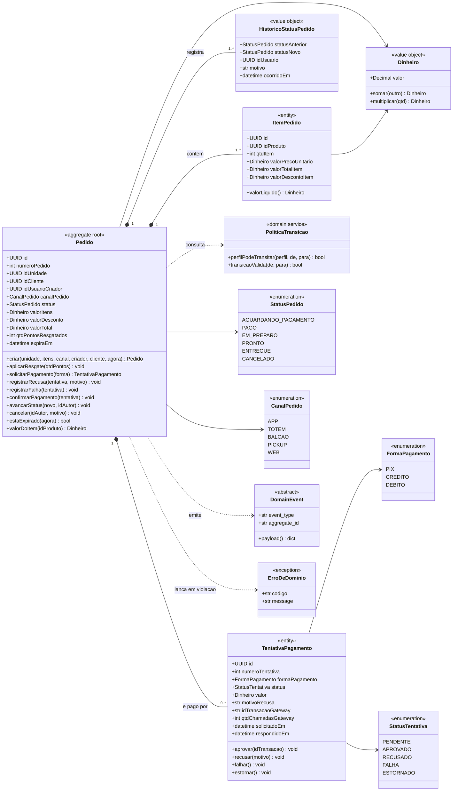
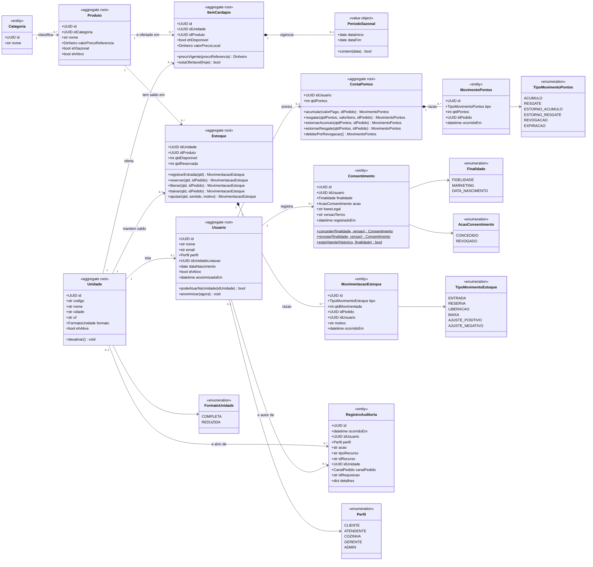

# Diagramas de classes

Legenda de origem: 🧑 humana · 🤝 conjunta (a IA propôs, o humano escolheu) · 🤖 IA (pendente de validação). Decisões em [`decisoes.md`](../uso-de-ia/decisoes.md). Requisitos em [`requisitos/README.md`](../requisitos/README.md); tabelas em [`der.md`](der.md); camadas em [`arquitetura/visao-geral.md`](../arquitetura/visao-geral.md). Este documento atende o item 4.4 do roteiro da trilha (diagrama de classes, visão de domínio) e a separação em camadas do item 4.3.

## 1. Convenção de nomes

Os nomes de **domínio** nos diagramas estão em português (D-034 🧑), coerentes com o contrato da API e com o DER: `Pedido`, `ItemPedido`, `Estoque`, `canalPedido`. No **código Python**, a convenção definida (ADR 0010, item 3) é **inglês para identificadores** (classes, funções, variáveis, atributos), como já fazem `DomainEvent`, `DomainError`, `OutboxWriter`, `SqlAlchemyOutboxWriter` e o atributo `event_type`, mapeado para a coluna `tipo_evento`. Portanto, `Pedido` aqui será, por exemplo, `Order` no código, e o ORM mapeia o atributo inglês para a coluna portuguesa. A tabela de equivalência está na seção 5 (🤖 D1: os nomes em inglês são sugestões).

Nos membros dos diagramas não há acentos nem caracteres especiais, para manter o Mermaid válido. Os atributos seguem o dicionário do DER (`qtdDisponivel` equivale a `qtd_disponivel`). Dinheiro é `Dinheiro` (objeto de valor, base `Decimal` com 2 casas em BRL) e `UUID`, `datetime` e `date` são tipos padrão.

## 2. Diagramas de classes do domínio

O domínio (`raizes.domain`) contém entidades, objetos de valor, enums e regras, **sem dependência de framework** (visão geral da arquitetura). Para ficar legível, o modelo é mostrado em duas vistas: o **núcleo do fluxo crítico** (Pedido e seus componentes) e os **demais agregados** (catálogo, estoque, identidade, fidelidade, consentimento e auditoria). Estereótipos: `<<aggregate root>>` raiz do agregado, `<<entity>>` entidade, `<<value object>>` objeto de valor, `<<enumeration>>` enum, `<<domain service>>` serviço de domínio.

### 2.1 Núcleo: Pedido, pagamento e regras de transição

Leitura rápida das regras nos métodos (todas as exceções são `ErroDeDominio`, no código `DomainError`/`BusinessRuleViolationError`):

| Método | Regra que protege | Erro |
|---|---|---|
| `Pedido.criar` | Perfil × canal (RN-14); pedido nasce AGUARDANDO_PAGAMENTO, com `canalPedido` obrigatório e imutável (RN-01, RN-11), preço congelado (RN-10), `expiraEm` = agora + 15 min (RN-07), total = itens − desconto | `canalPedido` inválido ou incompatível com o perfil: 422 |
| `Pedido.avancarStatus` | Só transições da máquina de estados (RN-03); PAGO nunca por aqui (RN-04) | 409 |
| `Pedido.cancelar` | Só de AGUARDANDO_PAGAMENTO ou PAGO (RN-02) | 409 |
| `Pedido.confirmarPagamento` | Só em AGUARDANDO_PAGAMENTO e sem tentativa já efetivada; muda para PAGO (RN-01, RN-04) | 409 |
| `Pedido.registrarRecusa` | Mantém o pedido em AGUARDANDO_PAGAMENTO e guarda o motivo (RN-01) | não há erro |
| `PoliticaTransicao.perfilPodeTransitar` | Quem faz cada transição (RN-04) | o caso de uso converte `false` em 403 |

O 403 não é regra do fluxo do pedido, é falta de permissão do ator; por isso é decidido no caso de uso (camada de aplicação) a partir da `PoliticaTransicao`, e não dentro de `Pedido.avancarStatus` (🤖 D2).

### 2.2 Demais agregados

Relações com o `Pedido` (vista 2.1), que atravessam agregados **por identificador, sem referência de objeto**: `Pedido.idUnidade`, `Pedido.idCliente`, `Pedido.idUsuarioCriador`, `ItemPedido.idProduto`, `MovimentacaoEstoque.idPedido`, `MovimentoPontos.idPedido`. É assim que o DER também as liga (chaves estrangeiras), e é a prática de agregados: um agregado referencia outro pelo identificador.

Regras nos métodos (resumo):

| Método | Regra | Erro |
|---|---|---|
| `Estoque.reservar` | Move de `qtdDisponivel` para `qtdReservada`; saldo insuficiente impede a reserva (RN-05) | `ESTOQUE_INSUFICIENTE`, 409 |
| `Estoque.ajustar` | No cancelamento de pedido PAGO, devolve ao saldo disponível com `AJUSTE_POSITIVO` e motivo "cancelamento do pedido <numero>" (RN-06) | 422 sem motivo |
| `Estoque.liberar` | Devolve a reserva (cancelamento, expiração; RN-06) | 409 se liberar mais que o reservado |
| `Estoque.baixar` | Pagamento aprovado converte reserva em baixa (RN-06) | 409 se baixar mais que o reservado |
| `Estoque.registrarEntrada` | Soma em `qtdDisponivel`; quantidade sempre positiva (UC-08) | 422 se quantidade menor ou igual a zero |
| `ItemCardapio.precoVigente` | Preço local se existir, senão o de referência (RN-10) | não há erro |
| `ItemCardapio.estaOfertavel` | Ofertado, disponível e dentro do período sazonal (RN-12) | o caso de uso converte em 422 |
| `ContaPontos.acumular` | 1 ponto por R$ 1,00 do `valor_total` pago, após o desconto, arredondado para baixo (RN-08); o caso de uso só chama se houver consentimento vigente | não há erro |
| `ContaPontos.resgatar` | Múltiplos de 100, 100 pontos = R$ 5,00, até 50% do valor dos itens, saldo suficiente (RF-18) | 422 de formato ou limite; 409 de saldo (🤖 D3) |
| `ContaPontos.estornarAcumulo`, `estornarResgate` | Cancelamento de pedido PAGO ou devolução de pontos (RN-09) | não há erro |
| `Consentimento.estaVigente` | O vigente é o último registro por usuário e finalidade; `REVOGADO` ou ausência não vale | não há erro |
| `Usuario.podeAtuarNaUnidade` | GERENTE, ATENDENTE e COZINHA só atuam na unidade de lotação; ADMIN, na rede (RF-03) | o caso de uso converte `false` em 403 |

`RegistroAuditoria` é só dados e é append-only; o objeto de valor `PeriodoSazonal` agrupa `data_inicio_sazonal` e `data_fim_sazonal` de `itens_cardapio` e garante início menor ou igual ao fim.

## 3. Diagrama da camada de aplicação e portas

A aplicação (`raizes.application`) orquestra o fluxo em **casos de uso** e declara **portas** (`Protocol` em `raizes.application.ports`), que a infraestrutura **implementa**. O diagrama mostra a **inversão de dependência**: as setas de dependência apontam para as abstrações da aplicação; as implementações concretas da infraestrutura é que apontam para elas (`<|..`, realização). Nenhuma classe de caso de uso conhece SQLAlchemy, HTTP ou o gateway real.

```mermaid
classDiagram
    direction LR

    namespace API {
        class PedidosRouter {
            +post_pedidos(corpo, idempotencyKey) Resposta
            +post_pagamentos(idPedido, corpo) Resposta
            +patch_status(idPedido, corpo) Resposta
            +post_cancelamento(idPedido, corpo) Resposta
        }
        class TradutorDeErros {
            +traduzir(erro) ErroPadrao
        }
    }

    namespace Aplicacao {
        class CriarPedido {
            +executar(comando) Pedido
        }
        class SolicitarPagamento {
            +executar(comando) TentativaPagamento
        }
        class AtualizarStatusPedido {
            +executar(comando) Pedido
        }
        class CancelarPedido {
            +executar(comando) Pedido
        }
        class RegistrarEntradaEstoque {
            +executar(comando) Estoque
        }
        class GerirConsentimento {
            +executar(comando) Consentimento
        }
        class UnidadeDeTrabalho {
            <<interface>>
            +commit() void
            +rollback() void
        }
        class RepositorioPedidos {
            <<interface>>
            +obter(id) Pedido
            +obterParaAtualizar(id) Pedido
            +adicionar(pedido) void
            +listar(filtro) list
        }
        class RepositorioEstoques {
            <<interface>>
            +obterParaAtualizar(idUnidade, idProdutos) list
            +salvar(estoque) void
        }
        class RepositorioContasPontos {
            <<interface>>
            +obterParaAtualizar(idUsuario) ContaPontos
        }
        class RepositorioConsentimentos {
            <<interface>>
            +historico(idUsuario, finalidade) list
            +adicionar(consentimento) void
        }
        class RepositorioIdempotencia {
            <<interface>>
            +reservar(chave, escopo, idUsuario, hash) EstadoChave
            +guardarResposta(chave, status, corpo) void
        }
        class GatewayPagamento {
            <<interface>>
            +solicitar(pedido, forma, token, chave) RespostaGateway
            +estornar(idTransacao, chave) RespostaGateway
        }
        class OutboxWriter {
            <<interface>>
            +add(events) void
        }
        class RegistradorAuditoria {
            <<interface>>
            +registrar(registro) void
        }
        class ApplicationError {
            <<exception>>
        }
    }

    namespace Dominio {
        class Pedido
        class Estoque
        class ContaPontos
        class TentativaPagamento
        class PoliticaTransicao
        class DomainEvent
        class RegistroAuditoria
        class ErroDeDominio
    }

    namespace Infraestrutura {
        class RepositorioPedidosSqlAlchemy
        class RepositorioEstoquesSqlAlchemy
        class RepositorioContasPontosSqlAlchemy
        class RepositorioConsentimentosSqlAlchemy
        class RepositorioIdempotenciaSqlAlchemy
        class UnidadeDeTrabalhoSqlAlchemy
        class GatewayPagamentoHttp {
            -timeout 3 s
            -novasTentativasPorTimeout 2
        }
        class SqlAlchemyOutboxWriter
        class RegistradorAuditoriaSqlAlchemy
    }

    PedidosRouter ..> CriarPedido : usa
    PedidosRouter ..> SolicitarPagamento : usa
    PedidosRouter ..> AtualizarStatusPedido : usa
    PedidosRouter ..> CancelarPedido : usa
    PedidosRouter ..> TradutorDeErros : erros
    TradutorDeErros ..> ErroDeDominio : traduz
    TradutorDeErros ..> ApplicationError : traduz

    CriarPedido ..> RepositorioPedidos
    CriarPedido ..> RepositorioEstoques
    CriarPedido ..> RepositorioContasPontos
    CriarPedido ..> RepositorioIdempotencia
    CriarPedido ..> OutboxWriter
    CriarPedido ..> RegistradorAuditoria
    CriarPedido ..> UnidadeDeTrabalho
    CriarPedido ..> Pedido
    CriarPedido ..> Estoque

    SolicitarPagamento ..> RepositorioPedidos
    SolicitarPagamento ..> RepositorioEstoques
    SolicitarPagamento ..> RepositorioContasPontos
    SolicitarPagamento ..> RepositorioConsentimentos
    SolicitarPagamento ..> RepositorioIdempotencia
    SolicitarPagamento ..> GatewayPagamento
    SolicitarPagamento ..> OutboxWriter
    SolicitarPagamento ..> RegistradorAuditoria
    SolicitarPagamento ..> UnidadeDeTrabalho
    SolicitarPagamento ..> TentativaPagamento
    SolicitarPagamento ..> ContaPontos

    AtualizarStatusPedido ..> RepositorioPedidos
    AtualizarStatusPedido ..> PoliticaTransicao
    AtualizarStatusPedido ..> OutboxWriter
    AtualizarStatusPedido ..> RegistradorAuditoria

    CancelarPedido ..> RepositorioPedidos
    CancelarPedido ..> RepositorioEstoques
    CancelarPedido ..> GatewayPagamento
    CancelarPedido ..> OutboxWriter
    CancelarPedido ..> RegistradorAuditoria

    RegistrarEntradaEstoque ..> RepositorioEstoques
    RegistrarEntradaEstoque ..> RegistradorAuditoria
    RegistrarEntradaEstoque ..> OutboxWriter

    GerirConsentimento ..> RepositorioConsentimentos
    GerirConsentimento ..> RepositorioContasPontos
    GerirConsentimento ..> RegistradorAuditoria

    RegistradorAuditoria ..> RegistroAuditoria
    OutboxWriter ..> DomainEvent

    RepositorioPedidosSqlAlchemy ..|> RepositorioPedidos
    RepositorioEstoquesSqlAlchemy ..|> RepositorioEstoques
    RepositorioContasPontosSqlAlchemy ..|> RepositorioContasPontos
    RepositorioConsentimentosSqlAlchemy ..|> RepositorioConsentimentos
    RepositorioIdempotenciaSqlAlchemy ..|> RepositorioIdempotencia
    UnidadeDeTrabalhoSqlAlchemy ..|> UnidadeDeTrabalho
    GatewayPagamentoHttp ..|> GatewayPagamento
    SqlAlchemyOutboxWriter ..|> OutboxWriter
    RegistradorAuditoriaSqlAlchemy ..|> RegistradorAuditoria
```

Como ler a inversão de dependência (ADR 0002):

- **Sentido do código-fonte.** `CriarPedido` importa `RepositorioPedidos` (uma abstração da própria camada de aplicação) e os tipos do domínio. A classe `RepositorioPedidosSqlAlchemy` importa a aplicação e o domínio. Nenhum `import` aponta de `application` ou `domain` para `infrastructure`.
- **Composição.** A injeção da classe concreta acontece apenas em `main.py` e `api/dependencies.py` (única exceção em que a API enxerga a infraestrutura), como já ocorre com `SqlAlchemyOutboxWriter` e `SqlDatabaseHealthCheck`. Testes de caso de uso usam implementações em memória das mesmas portas.
- **Verificação automática.** `tests/architecture/test_layers.py` analisa os imports e quebra a CI se a regra for violada.
- **Portas existentes e novas.** `OutboxWriter` e `DatabaseHealthCheck` (fora do diagrama) já existem em `application/ports`. As demais portas do diagrama (`RepositorioPedidos`, `GatewayPagamento` etc.) são **propostas** (🤖 D4), com nomes em inglês no código (`OrderRepository`, `PaymentGateway`, `AuditLogger` ...).
- **Porta de auditoria.** O pedido do usuário usa o nome `RegistroAuditoria` para a porta, mas esse nome já é a **entidade** do domínio. Para não haver duas coisas com o mesmo nome, a porta é `RegistradorAuditoria` e `RegistroAuditoria` é a entidade que ela grava (🤖 D5).
- **Unidade de trabalho.** A docstring de `OutboxWriter` diz que "quem controla a transação é o caso de uso (unidade de trabalho)": a porta `UnidadeDeTrabalho` torna isso explícito e é o que garante a transação única de pedido, estoque, auditoria e outbox (RNF-11). `OutboxWriter.add` e o registrador de auditoria **não fazem commit**.
- **Gateway.** `GatewayPagamentoHttp` é o adaptador do serviço HTTP mock separado (D-041): aplica o timeout de 3 s e até 2 novas chamadas só por timeout (RNF-10). Trocar por um gateway real é trocar o adaptador, sem tocar em `SolicitarPagamento`.

## 4. Por que o modelo é assim

**Entidade × objeto de valor.** Uma **entidade** tem identidade própria que persiste ao longo do tempo: dois `Pedido` com os mesmos itens e valores ainda são pedidos diferentes, porque têm `id` diferentes, e um pedido continua sendo o mesmo ao mudar de status. Por isso `Pedido`, `Usuario`, `Estoque` e `TentativaPagamento` são entidades. Um **objeto de valor** não tem identidade: é definido apenas pelos seus atributos, é imutável e intercambiável. `Dinheiro` (dois R$ 5,00 são o mesmo valor), `PeriodoSazonal` e, aqui, `HistoricoStatusPedido` (um fato imutável que só se acrescenta) são objetos de valor. A distinção orienta a persistência: entidades viram linhas com chave primária e podem ser atualizadas; objetos de valor são gravados junto de quem os possui ou como fatos append-only.

**Agregado e Pedido como raiz.** Um **agregado** é um grupo de objetos tratado como unidade de consistência, com uma **raiz** que é o único ponto de entrada para alterá-lo. `Pedido` é a raiz de `ItemPedido`, `HistoricoStatusPedido` e `TentativaPagamento` (composição, ◆): ninguém altera um item ou o status sem passar pelo `Pedido`, e é ele que protege as **invariantes**: o total é a soma dos itens menos o desconto, o canal é imutável, só há uma cobrança efetivada, e o status só muda pelas transições válidas. Fora dessa fronteira, a consistência é eventual ou garantida pelo caso de uso na mesma transação (estoque e pontos são agregados próprios, com sua própria raiz e bloqueio de linha). Agregados se referenciam por identificador, não por objeto, o que limita o tamanho do que é carregado e travado em cada transação, ponto crítico no pico (RG p. 6). O desenho mantém `Estoque` fora do `Pedido` de propósito: é uma linha disputada por muitos pedidos e precisa do bloqueio `SELECT ... FOR UPDATE` isolado.

**Regras nos métodos do domínio, não nos controllers.** Os controllers (routers) só traduzem HTTP: validam formato, chamam o caso de uso e devolvem a resposta. Se a regra "só se cancela até PAGO" morasse no controller, cada novo canal, rota ou tarefa agendada (por exemplo, a expiração de 15 min, RF-20) teria de reimplementá-la, e uma delas esqueceria. Nos métodos do domínio (`Pedido.cancelar`, `Estoque.reservar`, `ContaPontos.resgatar`), a regra existe uma vez só, é testável com testes unitários sem banco nem HTTP e não é contornada por quem chama. A camada de aplicação apenas orquestra (carregar, chamar o domínio, persistir, auditar, publicar eventos) e a API apenas traduz. É também o que dá sentido à regra de dependência: o domínio não importa framework e por isso pode ser testado e reaproveitado isolado, como exige o roteiro (item 4.3).

## 5. Mapeamento classe de domínio e DER

| Classe de domínio | Tabela(s) do DER | Observação |
|---|---|---|
| `Unidade` | `unidades` | Raiz; `FormatoUnidade` é o `CHECK` de `formato` |
| `Usuario` | `usuarios` | Um perfil por usuário e lotação por perfil (D-049); `Perfil` é o `CHECK` de `perfil`; anonimização preenche `anonimizado_em` |
| `Categoria` | `categorias` | Parte do catálogo da rede |
| `Produto` | `produtos` | Catálogo da rede; preço de referência |
| `ItemCardapio` | `itens_cardapio` | Oferta da unidade; `PeriodoSazonal` é um objeto de valor sobre `data_inicio_sazonal` e `data_fim_sazonal` |
| `Estoque` | `estoques` | Saldo (chave composta unidade e produto); linha travada na reserva |
| `MovimentacaoEstoque` | `movimentacoes_estoque` | Razão append-only; `TipoMovimentoEstoque` é o `CHECK` de `tipo` |
| `Pedido` | `pedidos` | Raiz; `CanalPedido` e `StatusPedido` são `CHECK`s; `numero_pedido` é gerado pelo banco |
| `ItemPedido` | `itens_pedido` | Parte do agregado; preço congelado |
| `HistoricoStatusPedido` | `historico_status_pedido` | Objeto de valor append-only |
| `TentativaPagamento` | `tentativas_pagamento` | Parte do agregado `Pedido`; `FormaPagamento` e `StatusTentativa` são `CHECK`s |
| `Consentimento` | `consentimentos` | Append-only; vigente = último registro por usuário e finalidade |
| `ContaPontos` | `saldos_pontos` | Saldo materializado (D-048); nome de domínio diferente da tabela (🤖 D6) |
| `MovimentoPontos` | `movimentos_pontos` | Razão append-only; `TipoMovimentoPontos` é o `CHECK` de `tipo` |
| `RegistroAuditoria` | `auditoria` | Append-only; retenção de 1 ano |
| `Dinheiro` | colunas `numeric(10,2)` | Objeto de valor sem tabela própria |
| `DomainEvent` e subclasses | `outbox_eventos` | Existe; gravado pela porta `OutboxWriter` na transação do caso de uso |
| (infraestrutura, sem classe de domínio) | `chaves_idempotencia` | Porta `RepositorioIdempotencia`; é detalhe de protocolo HTTP, não conceito de negócio (🤖 D7) |

Nomes dos elementos de código (🤖 D1, sugestões; o ORM mapeia atributo inglês para coluna portuguesa):

| Domínio (diagrama) | Código Python | Existe hoje |
|---|---|---|
| `Pedido`, `ItemPedido` | `Order`, `OrderItem` | Não |
| `Unidade`, `Usuario`, `Produto`, `ItemCardapio` | `Unit`, `User`, `Product`, `MenuItem` | Não |
| `Estoque`, `MovimentacaoEstoque` | `Stock`, `StockMovement` | Não |
| `TentativaPagamento` | `PaymentAttempt` | Não |
| `Consentimento`, `ContaPontos`, `MovimentoPontos` | `Consent`, `PointsAccount`, `PointsMovement` | Não |
| `RegistroAuditoria` | `AuditRecord` | Não |
| `DomainEvent`, `DomainError`, `NotFoundError`, `BusinessRuleViolationError` | os mesmos | Sim (`domain/shared`) |
| `OutboxWriter`, `SqlAlchemyOutboxWriter` | os mesmos | Sim |

## Decisões da IA (pendentes de validação)

- 🤖 **D1.** Nomes em inglês para as classes de código (tabela acima) e `CamelCase` em português nos diagramas. São sugestões; só `DomainEvent`, `DomainError`, `OutboxWriter` e correlatos existem.
- 🤖 **D2.** A permissão por perfil e unidade (403) fica na `PoliticaTransicao`, um serviço de domínio puro consultado pelo caso de uso, e não em `Pedido.avancarStatus`, que só valida a máquina de estados (409). Os requisitos dizem apenas "autorização por perfil".
- 🤖 **D3.** Saldo de pontos insuficiente é 409; múltiplo de 100 e limite de 50% são 422.
- 🤖 **D4.** As portas de repositório, `GatewayPagamento` e `UnidadeDeTrabalho` são propostas desta modelagem; somente `OutboxWriter` e `DatabaseHealthCheck` existem no código. Esta modelagem agrupa as portas em `application/ports`, conforme a organização por módulo, ainda em proposta (visão geral da arquitetura).
- 🤖 **D5.** A porta de auditoria chama-se `RegistradorAuditoria`, para não colidir com a entidade `RegistroAuditoria`.
- 🤖 **D6.** `saldos_pontos` é `ContaPontos` no domínio (o requisito pede "ContaPontos/MovimentoPontos").
- 🤖 **D7.** `chaves_idempotencia` não tem classe de domínio, e `TentativaPagamento`, `ItemPedido` e `HistoricoStatusPedido` foram colocadas dentro do agregado `Pedido`; `Estoque`, `ContaPontos` e `Consentimento` são agregados separados.
- 🤖 **D8.** `Dinheiro`, `PeriodoSazonal` e `PoliticaTransicao` não aparecem nos requisitos nem no DER; foram criados para dar suporte às regras RN-04, RN-10 e RN-12.
- 🤖 **D9.** O `Pedido` carrega os eventos de domínio produzidos em uma lista (estilo `DomainEvent` existente) e o caso de uso os entrega ao `OutboxWriter`; o domínio nunca grava no banco.

---

*Redigido por Claude Sonnet 5.5 sob especificação do Claude Opus 5.5, a partir das decisões do humano registradas em `docs/uso-de-ia/decisoes.md`.*
