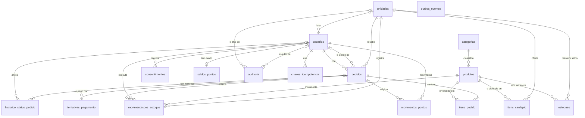
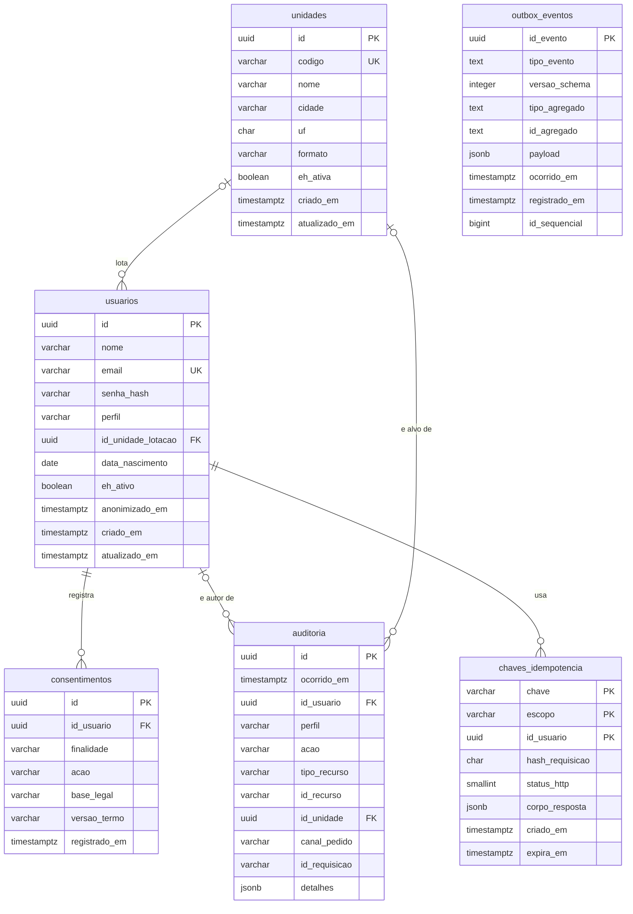
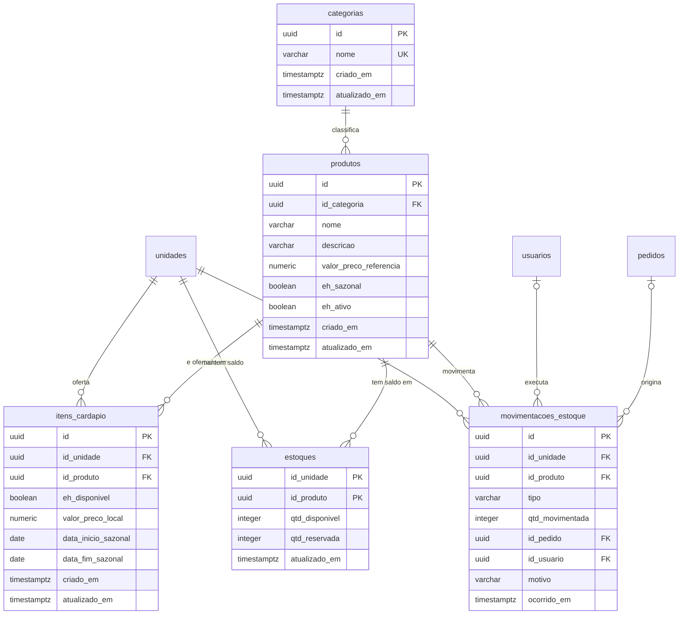
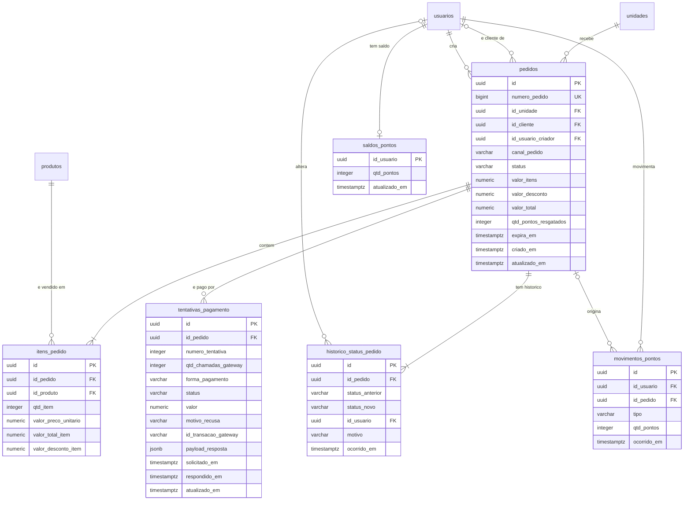

# DER: banco transacional (PostgreSQL)

Legenda de origem: 🧑 humana · 🤝 conjunta (a IA propôs, o humano escolheu) · 🤖 IA (pendente de validação). Decisões em [`decisoes.md`](../uso-de-ia/decisoes.md). Requisitos em [`requisitos/README.md`](../requisitos/README.md).

## 1. Introdução

O **DER (modelo entidade-relacionamento)** descreve as entidades do banco, seus atributos e como elas se relacionam, com cardinalidade (um-para-muitos, opcional, obrigatório). É o desenho lógico e físico que a API usa para gravar o fluxo **pedido → pagamento (mock) → status**, o estoque, a fidelidade, o consentimento (LGPD) e a auditoria.

O banco transacional é **normalizado (3FN)**: cada fato é gravado em um só lugar, sem redundância que possa divergir, e as restrições (chave, `UNIQUE`, `CHECK`) protegem a consistência durante escritas concorrentes. O DW é **dimensional** (estrela de Kimball, [matriz de barramento](../dados/matriz-de-barramento.md)): é desnormalizado de propósito para leitura e agregação. Os dois modelos têm propósitos opostos e se ligam pelo **outbox**, nunca por acesso direto.

| Aspecto | OLTP (este DER, PostgreSQL) | OLAP (DW, DuckDB/Parquet) |
|---|---|---|
| Objetivo | Registrar operações e garantir consistência em cada transação | Analisar histórico e agregados |
| Modelagem | Normalizada (3FN), muitas tabelas pequenas, FKs | Dimensional: fatos e dimensões, desnormalizada |
| Padrão de acesso | Muitas leituras e escritas curtas por chave | Poucas consultas grandes, varredura e agregação de colunas |

## 2. Diagramas

Convenções do modelo (D-051 🤖): chave primária `id` (UUID) em todas as tabelas, exceto onde indicado; dinheiro `numeric(10,2)`; instantes `timestamptz` em UTC com sufixo `_em`; enums como `varchar` + `CHECK`; `criado_em` e `atualizado_em` nas tabelas mutáveis; chaves estrangeiras `id_<entidade_no_singular>`. Nos diagramas, os tipos aparecem sem precisão (`numeric`, `varchar`); a precisão está no dicionário da seção 3. `PK` = chave primária, `FK` = chave estrangeira, `UK` = única.

### 2.1 Visão geral (entidades e relações)

A tabela `outbox_eventos` não tem chave estrangeira: guarda o identificador do agregado como texto, de propósito, para não acoplar o log de eventos ao esquema transacional.

### 2.2 Identidade, LGPD e transversais

### 2.3 Catálogo e estoque

### 2.4 Pedido, pagamento e fidelidade

## 3. Dicionário físico

Cada tabela traz o propósito, as colunas e os índices. "Nulo?" indica se a coluna aceita `NULL`. Nomes de restrições e índices seguem o padrão já usado na migração do outbox (`pk_`, `uq_`, `ck_`, `fk_`, `ix_` + tabela + colunas) (D-051 🤖). **Todas as chaves estrangeiras usam `ON DELETE RESTRICT`** (ver seção 4).

### 3.1 `unidades`

Cada unidade (loja) da rede, com formato e situação. É a raiz do escopo do GERENTE e do cardápio. Atende RF-04.

| Coluna | Tipo | Nulo? | Restrições | Descrição |
|---|---|---|---|---|
| `id` | uuid | não | PK | Identificador substituto |
| `codigo` | varchar(20) | não | UNIQUE | Código natural legível da unidade (por exemplo `REC-01`) |
| `nome` | varchar(120) | não | | Nome da unidade |
| `cidade` | varchar(80) | não | | Cidade |
| `uf` | char(2) | não | CHECK `uf ~ '^[A-Z]{2}$'` | Sigla do estado |
| `formato` | varchar(10) | não | CHECK em (`COMPLETA`, `REDUZIDA`) | Cozinha completa ou formato reduzido |
| `eh_ativa` | boolean | não | default `true` | Unidade em operação |
| `criado_em` | timestamptz | não | default `now()` | Criação |
| `atualizado_em` | timestamptz | não | default `now()` | Última alteração |

Índices: `pk_unidades (id)`; `uq_unidades_codigo (codigo)`.

### 3.2 `usuarios`

Todas as pessoas que acessam a API, em um só cadastro com **um perfil por usuário** (D-049 🤝). Clientes e colaboradores compartilham a tabela. Não guarda CPF nem telefone (minimização). Atende RF-01 a RF-03, RF-15 e RF-21.

| Coluna | Tipo | Nulo? | Restrições | Descrição |
|---|---|---|---|---|
| `id` | uuid | não | PK | Identificador substituto |
| `nome` | varchar(120) | não | | Nome do usuário (substituído na anonimização) |
| `email` | varchar(254) | não | UNIQUE em `lower(email)` | E-mail de login, único sem diferenciar maiúsculas |
| `senha_hash` | varchar(255) | não | | Hash Argon2id com salt, nunca a senha (RNF-01) |
| `perfil` | varchar(10) | não | CHECK em (`CLIENTE`, `ATENDENTE`, `COZINHA`, `GERENTE`, `ADMIN`) | Perfil de acesso |
| `id_unidade_lotacao` | uuid | sim | FK `unidades(id)` | Unidade de lotação do colaborador |
| `data_nascimento` | date | sim | | Opcional e só com consentimento `DATA_NASCIMENTO` |
| `eh_ativo` | boolean | não | default `true` | Conta ativa (desativar não apaga) |
| `anonimizado_em` | timestamptz | sim | | Instante da anonimização; nulo enquanto identificado |
| `criado_em` | timestamptz | não | default `now()` | Criação |
| `atualizado_em` | timestamptz | não | default `now()` | Última alteração |

Restrição de lotação (D-049): `CHECK ((perfil IN ('ATENDENTE','COZINHA','GERENTE') AND id_unidade_lotacao IS NOT NULL) OR (perfil IN ('CLIENTE','ADMIN') AND id_unidade_lotacao IS NULL))`.

Índices: `pk_usuarios (id)`; `uq_usuarios_email_lower` (único em `lower(email)`); `ix_usuarios_id_unidade_lotacao (id_unidade_lotacao)` (listar colaboradores da unidade e apoiar a FK).

### 3.3 `categorias`

Agrupamento do catálogo da rede (por exemplo "Salgados", "Bebidas", "Juninos"). Atende RF-05.

| Coluna | Tipo | Nulo? | Restrições | Descrição |
|---|---|---|---|---|
| `id` | uuid | não | PK | Identificador substituto |
| `nome` | varchar(80) | não | UNIQUE | Nome da categoria |
| `criado_em` | timestamptz | não | default `now()` | Criação |
| `atualizado_em` | timestamptz | não | default `now()` | Última alteração |

Índices: `pk_categorias (id)`; `uq_categorias_nome (nome)`.

### 3.4 `produtos`

Catálogo **da rede**: o que a franqueadora padroniza. O preço aqui é o de **referência**; cada unidade pode sobrepô-lo no cardápio. Atende RF-05.

| Coluna | Tipo | Nulo? | Restrições | Descrição |
|---|---|---|---|---|
| `id` | uuid | não | PK | Identificador substituto |
| `id_categoria` | uuid | não | FK `categorias(id)` | Categoria do produto |
| `nome` | varchar(120) | não | | Nome do produto |
| `descricao` | varchar(500) | sim | | Descrição |
| `valor_preco_referencia` | numeric(10,2) | não | CHECK `>= 0` | Preço de referência da rede (BRL) |
| `eh_sazonal` | boolean | não | default `false` | Produto de temporada (por exemplo junino) |
| `eh_ativo` | boolean | não | default `true` | Produto vigente no catálogo (inativar não apaga) |
| `criado_em` | timestamptz | não | default `now()` | Criação |
| `atualizado_em` | timestamptz | não | default `now()` | Última alteração |

Índices: `pk_produtos (id)`; `ix_produtos_id_categoria (id_categoria)`.

### 3.5 `itens_cardapio`

Cardápio **da unidade**: o subconjunto do catálogo que a unidade oferta, com disponibilidade, preço local opcional e período sazonal. Atende RF-06 e RN-10 e RN-12.

| Coluna | Tipo | Nulo? | Restrições | Descrição |
|---|---|---|---|---|
| `id` | uuid | não | PK | Identificador substituto |
| `id_unidade` | uuid | não | FK `unidades(id)` | Unidade que oferta |
| `id_produto` | uuid | não | FK `produtos(id)` | Produto ofertado |
| `eh_disponivel` | boolean | não | default `true` | Disponível para pedido agora |
| `valor_preco_local` | numeric(10,2) | sim | CHECK `>= 0` | Preço local; se nulo vale o de referência |
| `data_inicio_sazonal` | date | sim | | Início do período sazonal |
| `data_fim_sazonal` | date | sim | | Fim do período sazonal |
| `criado_em` | timestamptz | não | default `now()` | Criação |
| `atualizado_em` | timestamptz | não | default `now()` | Última alteração |

Restrições: `UNIQUE (id_unidade, id_produto)`; `CHECK (data_inicio_sazonal IS NULL OR data_fim_sazonal IS NULL OR data_inicio_sazonal <= data_fim_sazonal)`.

Índices: `pk_itens_cardapio (id)`; `uq_itens_cardapio_unidade_produto (id_unidade, id_produto)` (também serve à busca do cardápio por unidade); `ix_itens_cardapio_id_produto (id_produto)` (apoia a FK).

### 3.6 `estoques`

**Saldo** de estoque por produto em cada unidade (D-048 🤝): a visão materializada do estado atual. É a linha travada com `SELECT ... FOR UPDATE` durante a reserva (RNF-11). Atende RF-16.

| Coluna | Tipo | Nulo? | Restrições | Descrição |
|---|---|---|---|---|
| `id_unidade` | uuid | não | PK (composta), FK `unidades(id)` | Unidade |
| `id_produto` | uuid | não | PK (composta), FK `produtos(id)` | Produto |
| `qtd_disponivel` | integer | não | CHECK `>= 0` | Quantidade livre para reservar |
| `qtd_reservada` | integer | não | CHECK `>= 0` | Quantidade reservada por pedidos ainda não pagos |
| `atualizado_em` | timestamptz | não | default `now()` | Última alteração do saldo |

Índices: `pk_estoques (id_unidade, id_produto)`; `ix_estoques_id_produto (id_produto)` (apoia a FK).

Como cada tipo de movimento altera o saldo (🤖, ver seção 9): `ENTRADA` soma em `qtd_disponivel`; `RESERVA` move de `qtd_disponivel` para `qtd_reservada`; `LIBERACAO` faz o caminho inverso; `BAIXA` reduz `qtd_reservada` (venda confirmada); `AJUSTE_POSITIVO` soma e `AJUSTE_NEGATIVO` subtrai em `qtd_disponivel`. O cancelamento de um pedido `AGUARDANDO_PAGAMENTO` gera `LIBERACAO` (a reserva volta ao disponível); o de um pedido `PAGO`, cuja reserva já virou `BAIXA`, devolve a quantidade com `AJUSTE_POSITIVO` referenciando o pedido (D-054). Os `CHECK >= 0` fazem o banco recusar uma reserva que deixaria o saldo negativo, mesmo que a aplicação falhe.

### 3.7 `movimentacoes_estoque`

**Razão** de estoque (D-048 🤝), append-only: cada linha é um fato que explica por que o saldo mudou. Atende RF-16 e RF-22.

| Coluna | Tipo | Nulo? | Restrições | Descrição |
|---|---|---|---|---|
| `id` | uuid | não | PK | Identificador substituto |
| `id_unidade` | uuid | não | FK `unidades(id)` | Unidade |
| `id_produto` | uuid | não | FK `produtos(id)` | Produto |
| `tipo` | varchar(16) | não | CHECK em (`ENTRADA`, `RESERVA`, `LIBERACAO`, `BAIXA`, `AJUSTE_POSITIVO`, `AJUSTE_NEGATIVO`) | Tipo do movimento |
| `qtd_movimentada` | integer | não | CHECK `> 0` | Quantidade movimentada (sempre positiva; o sentido vem do `tipo`). Na API o campo equivalente continua `quantidade` |
| `id_pedido` | uuid | sim | FK `pedidos(id)` | Pedido que originou o movimento, quando houver |
| `id_usuario` | uuid | sim | FK `usuarios(id)` | Quem executou; nulo quando o sistema executa (por exemplo, expiração de pedido) |
| `motivo` | varchar(255) | sim | | Justificativa (obrigatória na aplicação para os ajustes) |
| `ocorrido_em` | timestamptz | não | default `now()` | Instante do movimento |

Índices: `pk_movimentacoes_estoque (id)`; `ix_movimentacoes_estoque_unidade_produto_ocorrido (id_unidade, id_produto, ocorrido_em)` (histórico do item); `ix_movimentacoes_estoque_id_pedido (id_pedido)`; `ix_movimentacoes_estoque_id_usuario (id_usuario)`.

### 3.8 `pedidos`

Cabeçalho do pedido, o centro do modelo e do fluxo crítico. Guarda o canal (imutável), o status atual, os valores e o resgate de pontos. Atende RF-07 a RF-10, RN-01 a RN-03, RN-11.

| Coluna | Tipo | Nulo? | Restrições | Descrição |
|---|---|---|---|---|
| `id` | uuid | não | PK | Identificador substituto (usado nas FKs) |
| `numero_pedido` | bigint | não | UNIQUE, `GENERATED ALWAYS AS IDENTITY` | Número legível e sequencial; dimensão degenerada do DW |
| `id_unidade` | uuid | não | FK `unidades(id)` | Unidade que recebeu o pedido |
| `id_cliente` | uuid | sim | FK `usuarios(id)` | Cliente; nulo no pedido de balcão de cliente não identificado (DW: membro -1) |
| `id_usuario_criador` | uuid | não | FK `usuarios(id)` | Quem criou o pedido (o próprio cliente ou o atendente) |
| `canal_pedido` | varchar(10) | não | CHECK em (`APP`, `TOTEM`, `BALCAO`, `PICKUP`, `WEB`) | Canal de origem; imutável (RN-11) |
| `status` | varchar(21) | não | CHECK em (`AGUARDANDO_PAGAMENTO`, `PAGO`, `EM_PREPARO`, `PRONTO`, `ENTREGUE`, `CANCELADO`) | Status atual |
| `valor_itens` | numeric(10,2) | não | CHECK `>= 0` | Soma dos itens |
| `valor_desconto` | numeric(10,2) | não | default `0`, CHECK `>= 0` | Desconto aplicado (resgate de pontos) |
| `valor_total` | numeric(10,2) | não | CHECK `>= 0` | Valor a pagar |
| `qtd_pontos_resgatados` | integer | não | default `0`, CHECK `>= 0` e `% 100 = 0` | Pontos usados como desconto (100 pontos = R$ 5,00) |
| `expira_em` | timestamptz | não | | Prazo de pagamento (criação + 15 min, RN-07) |
| `criado_em` | timestamptz | não | default `now()` | Criação |
| `atualizado_em` | timestamptz | não | default `now()` | Última alteração |

Restrições adicionais: `CHECK (valor_total = valor_itens - valor_desconto)`; `CHECK (qtd_pontos_resgatados = 0 OR id_cliente IS NOT NULL)` (🤖: só cliente identificado resgata pontos).

Índices: `pk_pedidos (id)`; `uq_pedidos_numero_pedido (numero_pedido)`; os três dos filtros de `GET /pedidos`: `ix_pedidos_unidade_status_criado (id_unidade, status, criado_em)`, `ix_pedidos_canal_criado (canal_pedido, criado_em)`, `ix_pedidos_cliente_criado (id_cliente, criado_em)`; sugerido (🤖): `ix_pedidos_expira_em_pendentes (expira_em) WHERE status = 'AGUARDANDO_PAGAMENTO'`, índice parcial para a tarefa de expiração (RF-20); `ix_pedidos_id_usuario_criador (id_usuario_criador)` apoia a FK.

### 3.9 `itens_pedido`

Linhas do pedido. O preço unitário é **congelado** na criação (RN-10): alterar o cardápio depois não muda pedidos já feitos. Atende RF-07 e RN-10.

| Coluna | Tipo | Nulo? | Restrições | Descrição |
|---|---|---|---|---|
| `id` | uuid | não | PK | Identificador substituto |
| `id_pedido` | uuid | não | FK `pedidos(id)` | Pedido |
| `id_produto` | uuid | não | FK `produtos(id)` | Produto vendido |
| `qtd_item` | integer | não | CHECK `> 0` | Quantidade do produto no pedido. Na API o campo continua `quantidade` (o contrato camelCase pode divergir do nome físico) |
| `valor_preco_unitario` | numeric(10,2) | não | CHECK `>= 0` | Preço unitário congelado (local ou de referência na criação) |
| `valor_total_item` | numeric(10,2) | não | CHECK `= qtd_item * valor_preco_unitario` | Total bruto da linha, gravado para evitar recálculo |
| `valor_desconto_item` | numeric(10,2) | não | default `0`, CHECK `>= 0` e `<= valor_total_item` | Rateio proporcional do desconto do cabeçalho, calculado na criação; o líquido do item é derivado (`valor_total_item - valor_desconto_item`) |

Restrição: `UNIQUE (id_pedido, id_produto)` (🤖: uma linha por produto; repetir soma a quantidade).

Índices: `pk_itens_pedido (id)`; `uq_itens_pedido_pedido_produto (id_pedido, id_produto)`; `ix_itens_pedido_id_produto (id_produto)` (produtos mais vendidos; apoia a FK).

### 3.10 `historico_status_pedido`

Histórico **append-only** de cada mudança de status. Responde a "quem mudou, quando e por quê" e alimenta o fato de ciclo de vida acumulado do DW. A recusa de pagamento **não** é mudança de status (RN-01) e fica em `tentativas_pagamento`. Atende RF-09, RF-10 e RF-13.

| Coluna | Tipo | Nulo? | Restrições | Descrição |
|---|---|---|---|---|
| `id` | uuid | não | PK | Identificador substituto |
| `id_pedido` | uuid | não | FK `pedidos(id)` | Pedido |
| `status_anterior` | varchar(21) | sim | mesmo `CHECK` de `pedidos.status` | Nulo na criação do pedido |
| `status_novo` | varchar(21) | não | mesmo `CHECK` de `pedidos.status` | Novo status |
| `id_usuario` | uuid | sim | FK `usuarios(id)` | Quem mudou; nulo quando a mudança vem do resultado do pagamento (sistema) |
| `motivo` | varchar(255) | sim | | Justificativa (por exemplo motivo do cancelamento) |
| `ocorrido_em` | timestamptz | não | default `now()` | Instante da mudança |

Restrição: `CHECK (status_anterior IS DISTINCT FROM status_novo)` (🤖).

Índices: `pk_historico_status_pedido (id)`; `ix_historico_status_pedido_pedido_ocorrido (id_pedido, ocorrido_em)`; `ix_historico_status_pedido_id_usuario (id_usuario)` (apoia a FK).

### 3.11 `tentativas_pagamento`

Cada solicitação ao gateway mock, com resultado e retorno. Preserva recusas, falhas e timeouts, e permite nova tentativa sem perder histórico. Atende RF-11, RF-12 e RNF-10.

**Cuidado de PCI.** A tabela **nunca** guarda número de cartão, validade, CVV nem o token de pagamento do cliente. No mock, o único "token" que aparece é o **nome do token de teste** (`tok_aprovado`, `tok_recusado`, `tok_timeout`), que é um dado de fixture e não identifica um meio de pagamento. Num gateway real, a tokenização acontece no provedor (o escopo PCI DSS fica com ele) e o sistema guardaria apenas o identificador da transação. O `payload_resposta` guarda só o retorno do mock, sem dados de cartão.

| Coluna | Tipo | Nulo? | Restrições | Descrição |
|---|---|---|---|---|
| `id` | uuid | não | PK | Identificador substituto |
| `id_pedido` | uuid | não | FK `pedidos(id)` | Pedido pago |
| `numero_tentativa` | integer | não | CHECK `>= 1` | Sequência da tentativa dentro do pedido |
| `qtd_chamadas_gateway` | integer | não | default `1`; CHECK entre `1` e `3` | Chamadas feitas ao gateway nesta tentativa: a primeira mais até 2 retentativas por timeout de 3 s (D-051, D-054). Uma tentativa corresponde a um `POST /pedidos/{id}/pagamentos` |
| `forma_pagamento` | varchar(7) | não | CHECK em (`PIX`, `CREDITO`, `DEBITO`) | Forma de pagamento |
| `status` | varchar(10) | não | CHECK em (`PENDENTE`, `APROVADO`, `RECUSADO`, `FALHA`, `ESTORNADO`) | Resultado da tentativa; `FALHA` = timeout esgotado (D-051) |
| `valor` | numeric(10,2) | não | CHECK `> 0` | Valor cobrado (igual ao `valor_total` do pedido) |
| `motivo_recusa` | varchar(255) | sim | | Motivo informado na recusa |
| `id_transacao_gateway` | varchar(80) | sim | | Identificador da transação no gateway |
| `payload_resposta` | jsonb | sim | | Retorno do gateway mock, sem dados de cartão |
| `solicitado_em` | timestamptz | não | default `now()` | Instante da solicitação |
| `respondido_em` | timestamptz | sim | CHECK `>= solicitado_em` | Instante da resposta; nulo se pendente ou em timeout |
| `atualizado_em` | timestamptz | não | default `now()` | Última alteração (o status muda de `PENDENTE` e pode virar `ESTORNADO`) |

Restrição: `UNIQUE (id_pedido, numero_tentativa)`.

Índices: `pk_tentativas_pagamento (id)`; `uq_tentativas_pagamento_pedido_numero (id_pedido, numero_tentativa)`; sugerido (🤖) `uq_tentativas_pagamento_pedido_efetivada (id_pedido) WHERE status IN ('APROVADO','ESTORNADO')`, índice único parcial que impede duas cobranças efetivadas no mesmo pedido, mesmo sob concorrência.

### 3.12 `consentimentos`

Histórico **append-only** de concessões e revogações por finalidade (LGPD). A revogação é um novo registro, nunca uma exclusão (seção 7 dos requisitos). O consentimento **vigente** é o último registro por (usuário, finalidade): se a `acao` dele for `CONCEDIDO`, vale; se for `REVOGADO` ou não houver registro, não vale. Atende RF-14 e RNF-04.

| Coluna | Tipo | Nulo? | Restrições | Descrição |
|---|---|---|---|---|
| `id` | uuid | não | PK | Identificador substituto |
| `id_usuario` | uuid | não | FK `usuarios(id)` | Titular |
| `finalidade` | varchar(15) | não | CHECK em (`FIDELIDADE`, `MARKETING`, `DATA_NASCIMENTO`) | Finalidade do tratamento |
| `acao` | varchar(9) | não | CHECK em (`CONCEDIDO`, `REVOGADO`) | Concessão ou revogação |
| `base_legal` | varchar(60) | não | | Base legal registrada (por exemplo `CONSENTIMENTO_ART_7_I`) |
| `versao_termo` | varchar(20) | não | | Versão do termo aceito ou revogado |
| `registrado_em` | timestamptz | não | default `now()` | Instante do registro |

Índices: `pk_consentimentos (id)`; **`ix_consentimentos_vigente (id_usuario, finalidade, registrado_em DESC) INCLUDE (acao)`** (🤖): serve à consulta do vigente (`ORDER BY registrado_em DESC LIMIT 1` por usuário e finalidade) com leitura só do índice.

### 3.13 `saldos_pontos`

**Saldo** de pontos de fidelidade por cliente (D-048 🤝), materializado a partir do razão. Atende RF-17 e RF-18.

| Coluna | Tipo | Nulo? | Restrições | Descrição |
|---|---|---|---|---|
| `id_usuario` | uuid | não | PK, FK `usuarios(id)` | Cliente dono dos pontos |
| `qtd_pontos` | integer | não | CHECK `>= 0` | Saldo atual |
| `atualizado_em` | timestamptz | não | default `now()` | Última alteração |

Índices: `pk_saldos_pontos (id_usuario)`.

### 3.14 `movimentos_pontos`

**Razão** de pontos, append-only (D-048 🤝). O saldo deve ser igual à soma de `qtd_pontos` do usuário. Atende RF-17, RF-18, RN-08 e RN-09.

| Coluna | Tipo | Nulo? | Restrições | Descrição |
|---|---|---|---|---|
| `id` | uuid | não | PK | Identificador substituto |
| `id_usuario` | uuid | não | FK `usuarios(id)` | Cliente |
| `id_pedido` | uuid | sim | FK `pedidos(id)` | Pedido que originou o movimento |
| `tipo` | varchar(16) | não | CHECK em (`ACUMULO`, `RESGATE`, `ESTORNO_ACUMULO`, `ESTORNO_RESGATE`, `REVOGACAO`, `EXPIRACAO`) | Tipo do movimento; `REVOGACAO` debita o saldo quando o consentimento de `FIDELIDADE` é revogado (D-050); `EXPIRACAO` fica reservado para evolução, sem regra no MVP |
| `qtd_pontos` | integer | não | CHECK conforme o tipo (abaixo) | Pontos com sinal: positivo credita, negativo debita |
| `ocorrido_em` | timestamptz | não | default `now()` | Instante do movimento |

Restrição de sinal por tipo (🤖): `CHECK ((tipo IN ('ACUMULO','ESTORNO_RESGATE') AND qtd_pontos > 0) OR (tipo IN ('RESGATE','ESTORNO_ACUMULO','REVOGACAO','EXPIRACAO') AND qtd_pontos < 0))`.

Índices: `pk_movimentos_pontos (id)`; `ix_movimentos_pontos_usuario_ocorrido (id_usuario, ocorrido_em)` (extrato); `ix_movimentos_pontos_id_pedido (id_pedido)`.

### 3.15 `auditoria`

Trilha **append-only** de ações sensíveis, com **retenção de 1 ano** (RNF-07). Responde "quem fez o quê, onde e quando" para controle e prestação de contas. Atende RF-13.

**Auditoria × outbox.** A **auditoria** registra *quem* fez *o quê*: é voltada ao controle, à investigação e à prestação de contas, é consultada por GERENTE e ADMIN e vence em 1 ano. O **outbox** registra *fatos de negócio* (`pedido_criado`, `pagamento_aprovado`) em formato versionado e sem dados pessoais, para integração e análise: é lido por um extrator e alimenta o DW. Os dois são gravados na mesma transação do caso de uso, mas têm leitores, conteúdo e prazo de vida diferentes.

**Minimização.** A tabela **não** guarda o endereço IP. O IP completo é dado pessoal e não é necessário ao objetivo: `id_usuario`, `perfil` e `id_requisicao` já respondem a "quem" e permitem correlacionar com os logs técnicos. Se uma investigação de fraude exigir rede de origem, o caminho é guardar um IP truncado ou com hash, com base legal e prazo próprios, e não o IP completo.

| Coluna | Tipo | Nulo? | Restrições | Descrição |
|---|---|---|---|---|
| `id` | uuid | não | PK | Identificador substituto |
| `ocorrido_em` | timestamptz | não | default `now()` | Instante da ação |
| `id_usuario` | uuid | sim | FK `usuarios(id)` | Autor; nulo quando o autor é o sistema |
| `perfil` | varchar(10) | sim | CHECK no mesmo domínio de `usuarios.perfil` | Perfil do autor **no momento da ação** (o perfil pode mudar depois) |
| `acao` | varchar(40) | não | | Ação (`PEDIDO_CRIADO`, `PEDIDO_CANCELADO`, `STATUS_ALTERADO`, `ESTOQUE_AJUSTADO`, `DADOS_PESSOAIS_ACESSADOS`, ...) |
| `tipo_recurso` | varchar(30) | não | | Tipo do recurso afetado (`pedido`, `estoque`, `usuario`, ...) |
| `id_recurso` | varchar(64) | não | | Identificador do recurso, como texto (sem FK: o recurso varia) |
| `id_unidade` | uuid | sim | FK `unidades(id)` | Unidade envolvida, para o escopo do GERENTE |
| `canal_pedido` | varchar(10) | sim | CHECK no mesmo domínio de `pedidos.canal_pedido` | Canal, quando a ação é sobre pedido |
| `id_requisicao` | varchar(64) | não | | `requestId` da requisição, o mesmo do corpo de erro e dos logs |
| `detalhes` | jsonb | não | default `'{}'` | Contexto da ação (por exemplo status anterior e novo), **sem PII** |

Restrição: `CHECK ((id_usuario IS NULL) = (perfil IS NULL))` (🤖: sistema não tem perfil, usuário sempre tem).

Índices (🤖): `pk_auditoria (id)`; `ix_auditoria_ocorrido_em (ocorrido_em)` (consulta por período e expurgo de 1 ano); `ix_auditoria_unidade_ocorrido (id_unidade, ocorrido_em)` (consulta do GERENTE); `ix_auditoria_recurso (tipo_recurso, id_recurso)`; `ix_auditoria_id_requisicao (id_requisicao)`; `ix_auditoria_id_usuario (id_usuario)` (apoia a FK).

### 3.16 `chaves_idempotencia`

Guarda a resposta de requisições `POST` que aceitam o header `Idempotency-Key` (`/pedidos` e `/pedidos/{id}/pagamentos`). Repetir a mesma chave com o mesmo corpo devolve a resposta original sem criar outro pedido nem outra cobrança (RN-13). Atende RF-07 e RNF-10.

| Coluna | Tipo | Nulo? | Restrições | Descrição |
|---|---|---|---|---|
| `chave` | varchar(255) | não | PK (composta) | Valor do header `Idempotency-Key` |
| `escopo` | varchar(60) | não | PK (composta) | Operação a que a chave pertence (por exemplo `POST /pedidos`) |
| `id_usuario` | uuid | não | PK (composta), FK `usuarios(id)` | Quem enviou; evita colisão de chaves entre usuários |
| `hash_requisicao` | char(64) | não | | SHA-256 (hexadecimal) do corpo; corpo diferente com a mesma chave gera 422 |
| `status_http` | smallint | sim | | Status da resposta guardada; nulo enquanto a requisição original ainda processa (🤖). Uma repetição que chega nesse intervalo recebe **409** (D-054) |
| `corpo_resposta` | jsonb | sim | | Corpo da resposta guardada; nulo enquanto processa |
| `criado_em` | timestamptz | não | default `now()` | Criação |
| `expira_em` | timestamptz | não | CHECK `> criado_em` | Validade (criação + 24 h) |

Índices: `pk_chaves_idempotencia (chave, escopo, id_usuario)`; `ix_chaves_idempotencia_expira_em (expira_em)` (limpeza das expiradas); `ix_chaves_idempotencia_id_usuario (id_usuario)` (apoia a FK).

### 3.17 `outbox_eventos`

**Já existe** (migração `20261102_1615_0001_cria_outbox_eventos.py`) e permanece **inalterada**. Outbox transacional de eventos de domínio: gravada na mesma transação do caso de uso e lida pelo extrator analítico, que usa `id_sequencial` como marca d'água. Contrato em [`contracts/events/`](../../contracts/README.md) e dicionário em [`dicionario-de-dados.md`](../dados/dicionario-de-dados.md). Atende RF-22.

| Coluna | Tipo | Nulo? | Restrições | Descrição |
|---|---|---|---|---|
| `id_evento` | uuid | não | PK (`pk_outbox_eventos`) | Identificador único do evento (exceção ao `id`: tabela anterior à convenção D-051) |
| `tipo_evento` | text | não | | Nome estável do evento (`pedido_criado`) |
| `versao_schema` | integer | não | | Versão do formato do payload |
| `tipo_agregado` | text | não | | Tipo do agregado (`pedido`) |
| `id_agregado` | text | não | | Identificador do agregado, como texto; nunca dado pessoal |
| `payload` | jsonb | não | | Conteúdo do evento, sem PII em claro |
| `ocorrido_em` | timestamptz | não | | Instante do fato de negócio (UTC) |
| `registrado_em` | timestamptz | não | default `now()` | Instante do registro na outbox (UTC) |
| `id_sequencial` | bigint | não | `IDENTITY ALWAYS` | Ordem de captura; marca d'água da extração |

Índices: `pk_outbox_eventos (id_evento)`; `ix_outbox_eventos_id_sequencial (id_sequencial)`.

## 4. Conceitos aplicados

**Chave substituta (UUID) × chave natural.** A PK é um UUID sem significado de negócio (`id`), estável mesmo que o dado de negócio mude. As chaves naturais ficam como `UNIQUE`: `unidades.codigo`, `usuarios.email` (em `lower(email)`) e `pedidos.numero_pedido`. O número do pedido é um `bigint identity` legível por humanos (telefone, balcão, totem) e não substitui o UUID nas FKs. Um UUID aleatório não revela volume nem ordem, ao contrário de um sequencial exposto.

**Integridade referencial e `ON DELETE`.** Toda FK usa `ON DELETE RESTRICT`: o banco recusa apagar um registro que ainda é referenciado. Não há exclusão física de cliente; há **anonimização** (`usuarios` ganha `anonimizado_em`, e nome, e-mail e data de nascimento são substituídos), o que preserva pedidos, razões e auditoria. Produtos, unidades e usuários são desativados (`eh_ativo`, `eh_ativa`), nunca apagados. `CASCADE` foi evitado porque apagar um pedido em cascata destruiria histórico financeiro.

**Normalização e desnormalização intencional.** O modelo está em 3FN, com duas exceções deliberadas. (1) `itens_pedido.valor_preco_unitario` copia o preço do cardápio: não é redundância acidental, é **preço congelado** (RN-10), pois o preço histórico precisa sobreviver a reajustes. `valor_total_item`, `valor_itens` e `valor_total` também são gravados e protegidos por `CHECK` de consistência. (2) `estoques` e `saldos_pontos` são **saldos materializados**: poderiam ser calculados somando o razão, mas ler uma linha é muito mais barato no pico.

**Saldo + razão (D-048).** Cada quantidade tem duas tabelas: o **saldo** (`estoques`, `saldos_pontos`), um estado atualizado no lugar e travável; e o **razão** (`movimentacoes_estoque`, `movimentos_pontos`), que só recebe linhas e explica cada variação. O saldo responde "quanto há agora"; o razão responde "por quê" e permite auditar e reconstruir o saldo. O paralelo com o DW é direto: o saldo é o **snapshot periódico** (`fct_saldo_estoque_diario`, semi-aditivo no tempo) e o razão é o **fato transacional** (`fct_movimentacao_estoque`, `fct_movimento_pontos`, aditivo).

**Tabelas append-only.** `movimentacoes_estoque`, `movimentos_pontos`, `historico_status_pedido`, `consentimentos` e `auditoria` só recebem `INSERT`. Correções são novas linhas (por exemplo, estorno), nunca `UPDATE` ou `DELETE`. Isso dá imutabilidade e prova histórica. A garantia é reforçada (🤖) por privilégio: o papel da aplicação não recebe `UPDATE` nem `DELETE` nessas tabelas. A única exceção é o expurgo de `auditoria` após 1 ano, executado por um papel de manutenção.

**Concorrência: bloqueio pessimista.** Na criação do pedido, a transação executa `SELECT ... FOR UPDATE` na linha de `estoques` de cada item (em ordem determinística de produto, para evitar deadlock), confere `qtd_disponivel`, reserva e grava o razão. Duas reservas concorrentes do mesmo item se serializam nessa linha; os `CHECK >= 0` são a última barreira. O bloqueio é pessimista porque a disputa por itens populares no pico é esperada, e repetir transações (otimista) custaria mais.

**Idempotência.** `chaves_idempotencia` torna o `POST` repetível: a chave é única por (chave, escopo, usuário) e o hash SHA-256 do corpo detecta reuso indevido. A inserção da chave acontece na mesma transação do pedido, então ou ambos existem ou nenhum. Com `UNIQUE` em `tentativas_pagamento (id_pedido, numero_tentativa)` e o índice parcial de tentativa efetivada, a cobrança dupla também é barrada no banco.

**LGPD no modelo.** *Minimização:* não há CPF nem telefone; `data_nascimento` é opcional e condicionada a consentimento; a auditoria não guarda IP. *Anonimização em vez de exclusão:* preserva integridade e agregados. *Consentimento versionado:* `consentimentos` guarda finalidade, base legal e `versao_termo`, com histórico completo de concessões e revogações. *Sem PII em `detalhes` (auditoria) nem em `payload` (outbox)*: o DW recebe o cliente já pseudonimizado por HMAC (D-051).

**Enums com `CHECK` × enum nativo.** O banco usa `varchar` + `CHECK (col IN (...))` (D-051). Um `CREATE TYPE ... AS ENUM` é compacto, mas é difícil de alterar: remover ou reordenar valores exige migração pesada e o tipo vive fora da tabela. O `CHECK` é alterado com `DROP/ADD CONSTRAINT`, legível no esquema e portável, ao custo de alguns bytes a mais por linha. Os valores são os mesmos do contrato da API e do DW.

## 5. Regras de negócio: banco × aplicação

| Regra | Onde é garantida | Mecanismo |
|---|---|---|
| Saldo de estoque nunca negativo (RN-05) | **Banco** (e aplicação) | `CHECK qtd_disponivel >= 0` e `qtd_reservada >= 0`; a aplicação traduz a violação em 409 |
| Um produto por unidade no cardápio | **Banco** | `UNIQUE (id_unidade, id_produto)` |
| Período sazonal com início ≤ fim | **Banco** | `CHECK` em `itens_cardapio` |
| Lotação por perfil (D-049) | **Banco** | `CHECK` em `usuarios` |
| E-mail único sem diferenciar maiúsculas | **Banco** | `UNIQUE` em `lower(email)` |
| `valor_total = valor_itens − valor_desconto ≥ 0` | **Banco** | `CHECK` em `pedidos` |
| Pontos resgatados ≥ 0 e múltiplos de 100 | **Banco** | `CHECK` em `pedidos` |
| Soma de `valor_desconto_item` dos itens = `pedidos.valor_desconto` | **Aplicação** | Rateio proporcional calculado na criação do pedido; o banco só garante `0 <= valor_desconto_item <= valor_total_item` |
| Preço congelado e total do item | **Banco** (consistência) e aplicação (valor) | `CHECK valor_total_item = qtd_item * valor_preco_unitario`; a aplicação busca o preço (RN-10) |
| Valores dos enums (canal, status, perfil...) | **Banco** | `CHECK ... IN` |
| Tentativa de pagamento única por pedido e número; só uma efetivada | **Banco** | `UNIQUE` e índice único parcial |
| Idempotência (chave única por usuário e escopo) | **Banco** | PK composta de `chaves_idempotencia` |
| Número do pedido único e sequencial | **Banco** | `IDENTITY` + `UNIQUE` |
| Saldo de pontos ≥ 0 e sinal do movimento por tipo | **Banco** | `CHECK` |
| Razões e histórico imutáveis | **Banco** (privilégios) e aplicação | Sem `UPDATE`/`DELETE` para o papel da aplicação |
| Máquina de estados do pedido (RN-01 a RN-04) | **Aplicação** | Camada de domínio valida a transição; 409 se inválida; grava `historico_status_pedido` |
| Quem faz cada transição (RN-04) | **Aplicação** | Autorização por perfil |
| Escopo do GERENTE (só a própria unidade) e do CLIENTE (só os próprios pedidos) | **Aplicação** | Filtro por `id_unidade_lotacao` e `id_cliente` do token (RF-03, RNF-03) |
| Limite de 50% do valor dos itens no resgate (RF-18, D-051) | **Aplicação** | Cálculo no caso de uso; o banco só garante múltiplos de 100 |
| Perfil × canal do pedido (RN-14, D-054) | **Aplicação** | Autorização no caso de uso de criação; combinação inválida gera 422 com `details[{field: "canalPedido", issue}]` |
| Pedido só de item ofertado, disponível e no período sazonal (RN-12) | **Aplicação** | Consulta ao `itens_cardapio` na criação |
| Acúmulo de pontos só com consentimento vigente (RN-08) | **Aplicação** | Consulta ao último registro de `consentimentos` |
| Imutabilidade do `canal_pedido` (RN-11) | **Aplicação** | Nenhum caso de uso o atualiza (pode virar gatilho no futuro) |
| Cliente do pedido ter perfil CLIENTE | **Aplicação** | Uma FK simples não expressa a condição sobre o perfil |
| Atomicidade de pedido + reserva + auditoria + outbox (RNF-11) | **Aplicação** sobre o banco | Uma transação única e bloqueio de linha |
| Retenção de 1 ano da auditoria | **Aplicação/operação** | Rotina de expurgo por `ocorrido_em` |

## 6. Rastreabilidade

Eventos de outbox: `pedido_criado` e `pagamento_aprovado` têm contrato em [`contracts/events/`](../../contracts/README.md); `estoque_movimentado` é citado em RF-22; os demais nomes são **sugestões** (🤖) no padrão `<entidade>_<particípio>`, a formalizar nos contratos. Os fatos são os da [matriz de barramento](../dados/matriz-de-barramento.md).

| Tabela | RFs/RNs atendidos | Eventos de outbox emitidos | Fato do DW alimentado |
|---|---|---|---|
| `unidades` | RF-04, RF-03 | Não emite | Dimensão `dim_unidade` (snapshot, não é fato) |
| `usuarios` | RF-01 a RF-03, RF-15, RF-21, RNF-01, RNF-04 | Não emite (o DW recebe só o identificador pseudonimizado) | Dimensões `dim_cliente` e `dim_colaborador` |
| `categorias` | RF-05 | Não emite | Dimensão `dim_produto` |
| `produtos` | RF-05 | Não emite | Dimensão `dim_produto` |
| `itens_cardapio` | RF-06, RN-10, RN-12 | Não emite | Nenhum; o DW registra o que foi vendido (sazonalidade em `dim_produto`) |
| `estoques` | RF-16, RN-05, RN-06, RNF-11 | Sem evento próprio; o saldo diário deriva do razão | `fct_saldo_estoque_diario` |
| `movimentacoes_estoque` | RF-16, RN-05, RN-06 | `estoque_movimentado` | `fct_movimentacao_estoque` |
| `pedidos` | RF-07 a RF-10, RN-01 a RN-03, RN-11 | `pedido_criado`, `pedido_cancelado` (🤖) | `fct_pedido`, `fct_ciclo_pedido` e, no cancelamento, `fct_operacao_sensivel` |
| `itens_pedido` | RF-07, RN-10 | Dentro do payload de `pedido_criado` | `fct_item_pedido` |
| `historico_status_pedido` | RF-09, RF-10, RN-04 | `pedido_status_alterado` (🤖) | `fct_ciclo_pedido` |
| `tentativas_pagamento` | RF-11, RF-12, RNF-10 | `pagamento_aprovado`, `pagamento_recusado`, `pagamento_estornado` (🤖) | `fct_tentativa_pagamento` |
| `consentimentos` | RF-14, RN-08, RNF-04 | `consentimento_registrado` (🤖) | `fct_consentimento_diario` |
| `saldos_pontos` | RF-17, RF-18 | Sem evento próprio | Nenhum direto (derivado do razão) |
| `movimentos_pontos` | RF-17, RF-18, RN-08, RN-09 | `pontos_movimentados` (🤖) | `fct_movimento_pontos` |
| `auditoria` | RF-13, RNF-07 | Não emite (a trilha é consultada no OLTP) | Indiretamente `fct_operacao_sensivel`, alimentado pelos eventos de cancelamento, desconto e ajuste |
| `chaves_idempotencia` | RF-07, RN-13, RNF-10 | Não emite | Nenhum |
| `outbox_eventos` | RF-22 | É o próprio mecanismo | Origem de todos os fatos acima |

## 7. Entidade conceitual: Campanhas

**Campanhas** (RF-19, Could, D-038 🤝) é uma entidade **conceitual, sem tabela no MVP**: está descrita aqui e fora do diagrama físico. O roteiro aceita "ao menos como regra/documentação", e implementá-la exigiria um motor de regras.

Atributos conceituais: identificação e nome; **tipo** (desconto percentual, desconto em valor, pontos em dobro); **vigência** (início e fim); **unidades participantes** (todas ou uma lista); **público** (por exemplo clientes com consentimento `MARKETING`); e a **regra de aplicação** ao pedido.

Relações conceituais: uma campanha vale em **muitas unidades** (N:N, por uma tabela de regras por unidade e período) e pode ser aplicada a **muitos pedidos**. Numa evolução, `pedidos` receberia `id_campanha` (opcional) e o desconto da campanha entraria em `valor_desconto`; o DW já tem a dimensão `dim_campanha` e o `fct_item_pedido`, `fct_pedido`, `fct_movimento_pontos` e `fct_operacao_sensivel` já a referenciam (membro -1 sem campanha). Segmentar por data de nascimento só é permitido com consentimento `DATA_NASCIMENTO`.

## 8. Pontos em aberto resolvidos (D-052)

Pontos levantados na primeira redação e resolvidos pela IA por boas práticas, a pedido do humano (D-052 🤖, validada pelo humano em D-056):

- **Ajuste de estoque:** `AJUSTE` foi dividido em `AJUSTE_POSITIVO` e `AJUSTE_NEGATIVO`; a quantidade continua positiva e o sentido vem do tipo.
- **Executor do movimento de estoque:** `movimentacoes_estoque.id_usuario` é nulo quando o sistema executa, como em `historico_status_pedido`.
- **Pontos:** `movimentos_pontos.tipo` ganhou `REVOGACAO` (debita o saldo na revogação de `FIDELIDADE`) e `EXPIRACAO` (reservado para evolução, sem regra no MVP).
- **Nomes de quantidade:** seguem o dicionário (`qtd_*`): `qtd_movimentada` em `movimentacoes_estoque` e `qtd_item` em `itens_pedido`. Na API o campo continua `quantidade`.
- **Desconto por item:** `itens_pedido.valor_desconto_item` guarda o rateio proporcional do desconto do cabeçalho, alinhado à medida `valor_desconto` de `fct_item_pedido`.
- **Exceção histórica:** `outbox_eventos` mantém `id_evento`, `text` e a ausência de `CHECK`, por ser anterior à convenção D-051.

Não restam pendências estruturais; o restante é validação das premissas da seção 9.

## 9. Premissas de implementação (🤖)

Tamanhos de `varchar`, nomes de restrições e índices, `UNIQUE (id_pedido, id_produto)` em `itens_pedido`, o índice parcial de pagamento efetivado e a semântica de `qtd_disponivel` (livre para reservar, fora a parte reservada) são definições da IA, validadas com a D-051 (D-056). O dinheiro usa `numeric(10,2)` (D-051); o DW usa `numeric(12,2)`, e o extrator converte sem perda (apenas uma nota: a precisão difere por convenção de cada camada).

---

*Entidades, relações e padrões estruturais decididos pelo humano a partir de opções da IA (D-047 a D-049); tipos, constraints e índices definidos pela IA (D-051, validada pelo humano em D-056). Redigido por Claude Sonnet 5.5 sob especificação do Claude Opus 5.5.*
