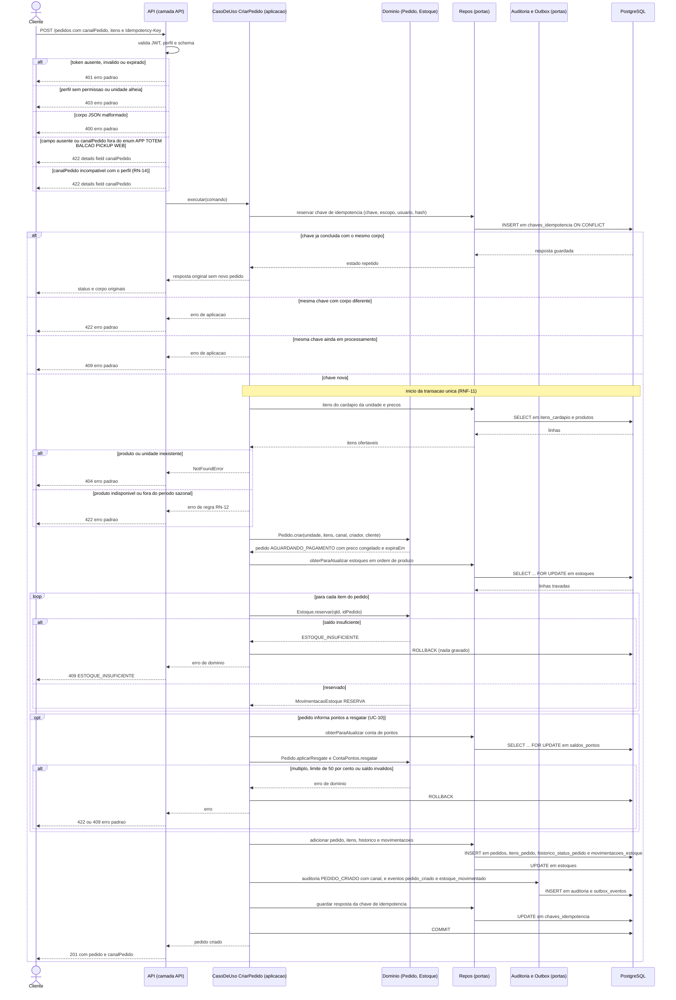
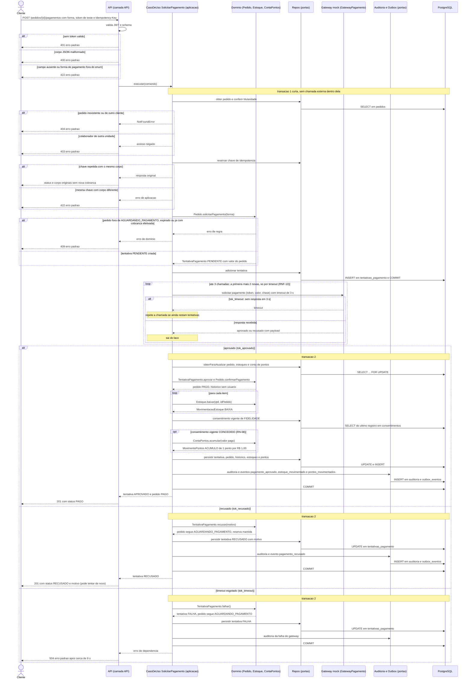
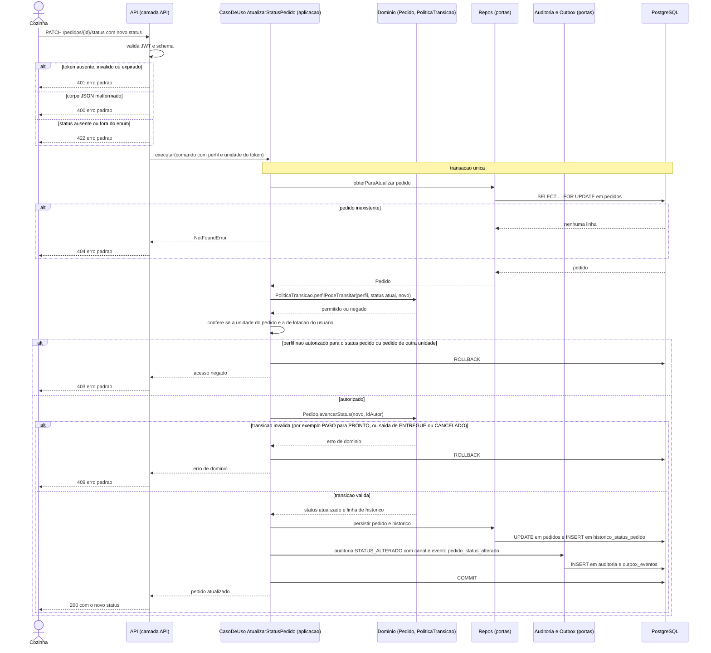

# Diagramas de sequência

Legenda de origem: 🧑 humana · 🤝 conjunta (a IA propôs, o humano escolheu) · 🤖 IA (pendente de validação). Decisões em [`decisoes.md`](../uso-de-ia/decisoes.md). Requisitos em [`requisitos/README.md`](../requisitos/README.md); casos de uso em [`casos-de-uso.md`](casos-de-uso.md); classes e portas em [`classes.md`](classes.md); tabelas em [`der.md`](der.md). Atende o item 4.4 do roteiro da trilha (sequência do fluxo crítico: pedido, pagamento externo e atualização de status).

## Convenções

Os participantes têm o nome da **camada** e, entre parênteses no texto, a classe. Os diagramas seguem a regra de dependência: a API só fala com o caso de uso (aplicação); o caso de uso orquestra o domínio e as **portas**; a infraestrutura implementa as portas e fala com o PostgreSQL.

| Participante | Camada | Papel |
|---|---|---|
| Cliente / Cozinha | Ator | Origem da requisição HTTP |
| API | `raizes.api` | Router, validação de schema, JWT, tradução de erros para o erro padrão |
| CasoDeUso | `raizes.application` | `CriarPedido`, `SolicitarPagamento`, `AtualizarStatusPedido`; controla a transação |
| Dominio | `raizes.domain` | `Pedido`, `Estoque`, `ContaPontos`, `PoliticaTransicao` |
| Repos | portas da aplicação | `RepositorioPedidos`, `RepositorioEstoques` etc., implementados em `raizes.infrastructure` |
| Auditoria e Outbox | portas da aplicação | `RegistradorAuditoria` e `OutboxWriter`, gravados na transação do caso de uso |
| Gateway | infraestrutura | `GatewayPagamento` (adaptador HTTP do serviço mock, ator externo) |
| BD | infraestrutura | PostgreSQL |

Todo erro sai no formato padrão `{error, message, details[{field, issue}], timestamp, path, requestId}` (RNF-13). Os valores de `error` além de `ESTOQUE_INSUFICIENTE` são propostas (🤖 D1). `Repos` agrupa os repositórios para simplificar; a transação é única e é controlada pelo `CasoDeUso` (porta `UnidadeDeTrabalho`).

## 1. Realizar Pedido (UC-04)

Cobre: canal (`canalPedido`) obrigatório e validado (422), idempotência, transação única com reserva de estoque e `SELECT ... FOR UPDATE`, auditoria e outbox na mesma transação, caminho de 409 por saldo insuficiente (RN-05, RNF-11).

Pontos de atenção:

- **Quem decide o quê.** O 422 de `canalPedido` (ausente, fora do enum ou incompatível com o perfil, RN-14) sai da validação da API e do caso de uso antes de abrir transação alguma; o 400 é só para JSON malformado (D-054). O 409 sai do **domínio** (`Estoque.reservar`) e a API só o traduz.
- **Ordem do bloqueio.** As linhas de `estoques` são travadas em ordem determinística de produto para evitar *deadlock* entre dois pedidos concorrentes (DER, seção 4). A segunda transação concorrente espera o `COMMIT` ou o `ROLLBACK` da primeira e, então, lê o saldo atualizado.
- **Atomicidade.** Em qualquer falha (409, 422 de regra, erro de gravação), o `ROLLBACK` desfaz pedido, reserva, auditoria, outbox e a chave de idempotência (a chave só existe se o pedido existir).
- **Idempotência.** O retorno da mesma chave com o mesmo corpo devolve a resposta original sem nova reserva (RN-13); corpo diferente é 422 (DER 3.16); requisição concorrente ainda em processamento é 409 (RN-13, D-054).

## 2. Solicitar Pagamento (UC-05)

Cobre: aprovado (PAGO, baixa do estoque, acúmulo de pontos com consentimento), recusado (continua AGUARDANDO_PAGAMENTO), timeout com até 2 novas chamadas e 504 (RN-01, RN-06, RN-08, RNF-10).

Pontos de atenção:

- **Duas transações curtas.** A chamada ao gateway pode levar até cerca de 9 s no pior caso (3 chamadas de 3 s). Por isso ela acontece **fora** da transação, para não segurar bloqueios de linha de estoque e de pedido; o pedido fica em AGUARDANDO_PAGAMENTO nesse intervalo, e a tentativa PENDENTE o torna rastreável (🤖 D3).
- **Recusa mantém o pedido.** Recusa não repete automaticamente: só o timeout é repetido. Para tentar de novo, o cliente chama o endpoint outra vez (UC-20, RF-12), e a nova tentativa recebe o `numeroTentativa` seguinte (🤖 D4).
- **Idempotência da cobrança.** A chave vai também ao gateway; no banco, o índice único parcial de tentativa efetivada impede duas cobranças aprovadas no mesmo pedido (DER 3.11).
- **Pontos.** Sem consentimento vigente de FIDELIDADE, o bloco `opt` não ocorre e o pagamento termina normalmente (RN-08).
- **Registro das chamadas.** A quantidade de chamadas feitas ao gateway nessa tentativa (1 a 3) é gravada em `qtd_chamadas_gateway`, junto do resultado.
- **Fora de escopo do MVP.** O webhook assíncrono é evolução documentada; aqui o fluxo é síncrono (D-041).

## 3. Atualizar Status pela COZINHA (UC-06)

Cobre: transição válida (PAGO → EM_PREPARO → PRONTO), 403 por perfil ou unidade, 409 por transição inválida, 404 pedido inexistente, histórico, auditoria e outbox (RN-03, RN-04).

Pontos de atenção:

- **403 antes de 409.** A permissão (perfil e unidade) é checada antes da máquina de estados: quem não pode pedir aquele status recebe 403 mesmo que a transição fosse inválida. Exemplos: COZINHA pedindo ENTREGUE é 403; COZINHA pedindo PRONTO sobre um pedido PAGO (pulando EM_PREPARO) é permitido para o perfil, mas é 409 pela máquina de estados (🤖 D5).
- **PAGO nunca por aqui.** Pedir PAGO por qualquer perfil é 403 (RN-04), pois só o resultado do pagamento leva a PAGO.
- **Unidade.** COZINHA, ATENDENTE e GERENTE só atuam na unidade de lotação (RF-03); o ADMIN não faz transição de status. A mesma checagem vale no GERENTE de outra unidade.
- **Mesma estrutura para ATENDENTE.** PRONTO → ENTREGUE pelo ATENDENTE segue o mesmo diagrama, trocando o ator.

## Decisões da IA (pendentes de validação)

- 🤖 **D1.** Os valores de `error` (exceto `ESTOQUE_INSUFICIENTE`) e os nomes de eventos além dos já contratados (`pedido_criado`, `pagamento_aprovado`) são propostas.
- ✅ **D2.** Resolvida na D-054 (RN-13): chave em processamento é 409; corpo diferente é 422.
- ✅ **D3.** Adotada na D-054: pagamento em duas transações curtas, chamada ao gateway fora da transação.
- ✅ **D4.** Resolvida na D-054: uma linha de `tentativas_pagamento` por `POST` do cliente; as até 2 novas chamadas por timeout ficam dentro dela (`qtd_chamadas_gateway`).
- 🤖 **D5.** A permissão é decidida pelo status solicitado e pela unidade, antes da máquina de estados. Os requisitos não definem a ordem entre 403 e 409; propôs-se 403 primeiro.
- 🤖 **D6.** Recusa e criação respondem 201 (a tentativa é um recurso criado); a recusa é um resultado, não um erro. Resposta 504 só no timeout esgotado.
- 🤖 **D7.** Auditoria da falha de gateway (timeout esgotado) é registrada; os requisitos listam as ações auditáveis sem incluir esse caso.

---

*Redigido por Claude Sonnet 5.5 sob especificação do Claude Opus 5.5, a partir das decisões do humano registradas em `docs/uso-de-ia/decisoes.md`.*
