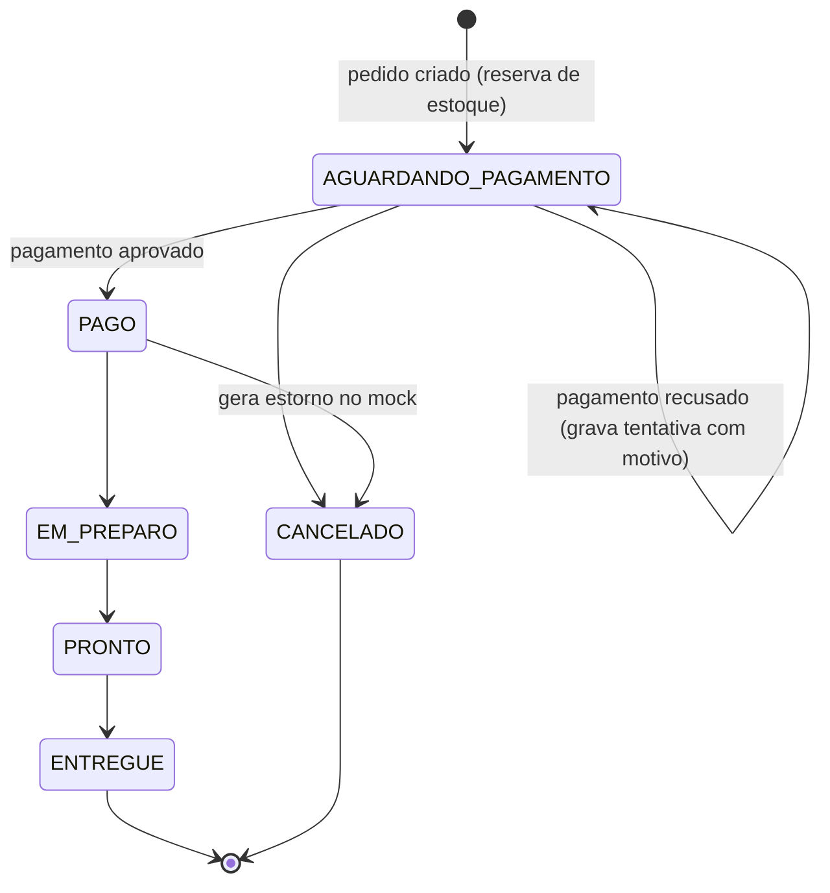
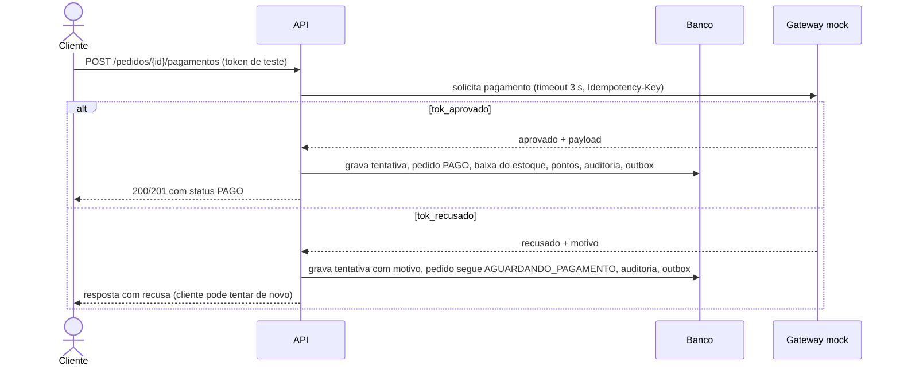

# Requisitos: API Back-end da Raízes do Nordeste

Legenda de origem das decisões: 🧑 humana · 🤝 conjunta (a IA propôs, o humano escolheu) · 🤖 IA (pendente de validação). O log completo está em [`decisoes.md`](../uso-de-ia/decisoes.md). Referências ao roteiro da trilha aparecem como `trilha L<n>` e ao estudo de caso como `caso L<n>`.

## 1. Contexto e objetivo

A Raízes do Nordeste é uma rede de lanchonetes nordestinas em expansão, com **matriz (franqueadora) e unidades** em diferentes cidades ([caso L91](../../init/roteiro.md#L91)). O cliente pode pedir por **múltiplos canais** (aplicativo, totem, balcão e retirada rápida), esperando ver o cardápio da unidade, pedir, acompanhar o status e receber o pedido corretamente ([caso L72](../../init/roteiro.md#L72)). As unidades não são idênticas: há formatos diferentes e produtos sazonais, especialmente no período junino. A matriz precisa de padronização, rastreabilidade e auditoria de operações sensíveis ([caso L110](../../init/roteiro.md#L110)). A empresa quer um programa de **fidelização** com consentimento explícito e conformidade com a **LGPD** ([caso L116](../../init/roteiro.md#L116)), e o sistema **não pode falhar nos horários de pico** ([caso L155](../../init/roteiro.md#L155)). O pagamento é processado por serviço externo; o sistema apenas solicita, registra o resultado e atualiza o pedido.

O objetivo do back-end é oferecer uma **API REST** que feche o fluxo crítico **pedido → pagamento (mock) → status**, com estoque integrado, controle de acesso por perfil, rastreabilidade por canal, trilha de auditoria e tratamento mínimo de LGPD. A API também publica eventos de domínio (outbox) que alimentam o Data Warehouse analítico do projeto, sem expor dados pessoais identificados. Este documento traduz o estudo de caso em requisitos de back-end (dados, regras, integrações e segurança, não telas) e separa o que será **implementado (MVP)** do que ficará **documentado como evolução**.

## 2. Atores e perfis

Cinco perfis (D-039 🤝). A autorização é verificada por perfil e, para o GERENTE, também pela unidade.

| Perfil | Escopo | O que pode fazer |
|---|---|---|
| CLIENTE | Os próprios dados | Cadastrar-se; fazer login; consultar cardápio; criar pedido; consultar e cancelar o próprio pedido (em AGUARDANDO_PAGAMENTO); solicitar pagamento e nova tentativa nos próprios pedidos; consultar saldo e extrato de pontos; registrar e revogar consentimentos; consultar os próprios dados pessoais |
| ATENDENTE | Unidade de lotação | Criar pedido em nome do cliente (BALCAO, TOTEM); consultar pedidos da unidade; marcar PRONTO → ENTREGUE; cancelar pedido PAGO |
| COZINHA | Unidade de lotação | Consultar pedidos da unidade; avançar PAGO → EM_PREPARO → PRONTO |
| GERENTE | **Somente a própria unidade** | Tudo o que ATENDENTE e COZINHA fazem; gerir o cardápio da unidade (oferta, disponibilidade, período sazonal, preço local); registrar entrada de estoque; cancelar pedido PAGO; consultar a auditoria da unidade |
| ADMIN | **Rede inteira** | Cadastrar e alterar unidades; gerir o catálogo da rede (produtos, categorias, preço de referência); consultar pedidos, estoque e auditoria de qualquer unidade; gerir usuários e perfis |

## 3. Requisitos funcionais

MoSCoW: M = Must, S = Should, C = Could. "MVP (implementado)" entra na API entregue; "Conceitual (documentado)" é descrito na documentação, sem código. Rotas são indicativas; o contrato completo é outra fase.

| ID | Requisito | MoSCoW | Entrega | Justificativa | Rastreabilidade | Decisão |
|---|---|---|---|---|---|---|
| RF-01 | **Cadastro de cliente** (`POST /usuarios`). Nome, e-mail e senha obrigatórios; data de nascimento opcional e só com consentimento; não há CPF nem telefone | M | MVP (implementado) | Obrigatório do roteiro; minimização de dados por LGPD | [trilha L95](../../init/roteiro_trilha_backend.md#L95), [trilha L252](../../init/roteiro_trilha_backend.md#L252) | D-044 🤝 |
| RF-02 | **Login com emissão de JWT** (`POST /auth/login`) | M | MVP (implementado) | Autenticação por token é mínimo do MVP | [trilha L95](../../init/roteiro_trilha_backend.md#L95), [trilha L310](../../init/roteiro_trilha_backend.md#L310) | D-038 🤝 |
| RF-03 | **Autorização por perfil**, com escopo de unidade para GERENTE | M | MVP (implementado) | O MVP exige ao menos uma regra de autorização por perfil | [trilha L483](../../init/roteiro_trilha_backend.md#L483), [trilha L200](../../init/roteiro_trilha_backend.md#L200) | D-039 🤝 |
| RF-04 | **Gestão de unidades** (`/unidades`): ADMIN cadastra e altera; os demais consultam | M | MVP (implementado) | Rede com matriz e unidades é o núcleo do caso | [trilha L91](../../init/roteiro_trilha_backend.md#L91), [caso L91](../../init/roteiro.md#L91) | D-038 🤝 |
| RF-05 | **Catálogo da rede** (`/produtos`): produtos, categorias, preço de referência e indicação de produto sazonal | M | MVP (implementado) | Padronização da franquia com variação controlada | [caso L91](../../init/roteiro.md#L91), [trilha L96](../../init/roteiro_trilha_backend.md#L96) | D-043 🤝 |
| RF-06 | **Cardápio por unidade** (`/unidades/{id}/cardapio`): oferta, disponibilidade, período sazonal e preço local opcional | M | MVP (implementado) | Cada unidade oferta um subconjunto do catálogo, com sazonalidade | [trilha L96](../../init/roteiro_trilha_backend.md#L96), [caso L91](../../init/roteiro.md#L91) | D-043 🤝 |
| RF-07 | **Criar pedido** (`POST /pedidos`) com `canalPedido` obrigatório (APP, TOTEM, BALCAO, PICKUP, WEB). Ausente ou inválido: 400/422 no erro padrão. Aceita o header `Idempotency-Key` | M | MVP (implementado) | Multicanalidade é requisito de domínio obrigatório; idempotência evita pedido duplicado em retentativa | [trilha L110](../../init/roteiro_trilha_backend.md#L110), [trilha L111](../../init/roteiro_trilha_backend.md#L111), [trilha L222](../../init/roteiro_trilha_backend.md#L222) | D-035 🤝, D-046 🤖 |
| RF-08 | **Listar e consultar pedidos** (`GET /pedidos`, `GET /pedidos/{id}`) com filtros `canalPedido`, `status` e unidade, com paginação. O CLIENTE vê só os próprios pedidos | M | MVP (implementado) | Filtro por canal é requisito mínimo; paginação e isolamento de dados | [trilha L112](../../init/roteiro_trilha_backend.md#L112), [trilha L247](../../init/roteiro_trilha_backend.md#L247) | D-034 🧑, D-039 🤝 |
| RF-09 | **Atualizar status do pedido** (`PATCH /pedidos/{id}/status`) conforme a máquina de estados da [seção 5](#5-regras-de-negócio) | M | MVP (implementado) | Parte do fluxo crítico; garante transições válidas | [trilha L98](../../init/roteiro_trilha_backend.md#L98), [trilha L97](../../init/roteiro_trilha_backend.md#L97) | D-042 🤝 |
| RF-10 | **Cancelar pedido** (`POST /pedidos/{id}/cancelamento`) | M | MVP (implementado) | Operação sensível, auditável; devolve reserva e estorna pagamento | [trilha L98](../../init/roteiro_trilha_backend.md#L98), [caso L110](../../init/roteiro.md#L110) | D-042 🤝 |
| RF-11 | **Solicitar pagamento** ao gateway mock (`POST /pedidos/{id}/pagamentos`) e registrar a tentativa e o payload de retorno | M | MVP (implementado) | Obrigatório: representar o envio e o retorno (status e payload) | [trilha L102](../../init/roteiro_trilha_backend.md#L102) | D-041 🤝 |
| RF-12 | **Nova tentativa de pagamento** após recusa, mantendo o pedido em AGUARDANDO_PAGAMENTO | M | MVP (implementado) | Cobre o cenário de falha do mock e evita perder a venda | [trilha L102](../../init/roteiro_trilha_backend.md#L102), [trilha L479](../../init/roteiro_trilha_backend.md#L479) | D-042 🤝 |
| RF-13 | **Trilha de auditoria** de ações sensíveis (criação, cancelamento, mudança de status, ajuste de estoque, acesso a dados pessoais), com consulta por ADMIN e por GERENTE (este só da sua unidade) (`GET /auditoria`) | M | MVP (implementado) | Registro de ações sensíveis é critério de avaliação e requisito da matriz | [trilha L500](../../init/roteiro_trilha_backend.md#L500), [caso L110](../../init/roteiro.md#L110) | D-038 🤝 |
| RF-14 | **Registrar e revogar consentimento** por finalidade (`/consentimentos`), guardando finalidade, base legal, data e versão do termo | M | MVP (implementado) | Exigência explícita de LGPD do roteiro | [trilha L252](../../init/roteiro_trilha_backend.md#L252), [trilha L100](../../init/roteiro_trilha_backend.md#L100) | D-038 🤝 |
| RF-15 | **Consultar os próprios dados pessoais** (titular) | S | MVP (implementado) | Direito de acesso do titular (LGPD, art. 18) | [trilha L252](../../init/roteiro_trilha_backend.md#L252) | D-050 🧑 |
| RF-16 | **Estoque** (`/estoques`): saldo por produto × unidade; entrada pelo GERENTE; reserva na criação do pedido; baixa e devolução; 409 quando o saldo for insuficiente; consulta de saldo | S | MVP (implementado) | Restrição de venda por indisponibilidade; evita vender o que não existe no pico | [trilha L99](../../init/roteiro_trilha_backend.md#L99), [caso L155](../../init/roteiro.md#L155) | D-038 🤝, D-040 🤝 |
| RF-17 | **Fidelidade** (`/fidelidade/...`): acúmulo automático no pagamento aprovado (1 ponto por R$ 1,00), só para cliente com consentimento da finalidade FIDELIDADE; saldo e extrato | S | MVP (implementado) | Fidelização com consentimento é requisito do caso | [trilha L100](../../init/roteiro_trilha_backend.md#L100), [caso L116](../../init/roteiro.md#L116) | D-038 🤝, D-046 🤖 |
| RF-18 | **Resgate de pontos** como desconto no pedido: múltiplos de 100 pontos (100 pontos = R$ 5,00), até 50% do valor dos itens; débito na criação do pedido e devolução em cancelamento ou expiração | S | MVP (implementado) | O roteiro lista "pontos e resgate simples" entre os obrigatórios | [trilha L100](../../init/roteiro_trilha_backend.md#L100) | D-047 🤝, D-051 🤖 |
| RF-19 | **Campanhas e promoções** como regra documentada: tipos, vigência, unidades, público e como se aplicam ao pedido | C | Conceitual (documentado) | O roteiro aceita "ao menos como regra/documentação" | [trilha L101](../../init/roteiro_trilha_backend.md#L101), [caso L120](../../init/roteiro.md#L120) | D-038 🤝 |
| RF-20 | **Expiração de pedido não pago** após 15 min, com devolução da reserva. A regra fica documentada; a tarefa agendada é evolução | C | Conceitual (documentado) | Libera estoque reservado; a tarefa agendada não pontua diretamente | [trilha L99](../../init/roteiro_trilha_backend.md#L99) | D-040 🤝, D-046 🤖 |
| RF-21 | **Anonimização de cliente inativo** há 2 anos | C | Conceitual (documentado) | Estratégia de retenção/anonimização "quando aplicável" | [trilha L252](../../init/roteiro_trilha_backend.md#L252) | D-046 🤖 |
| RF-22 | **Publicação de eventos de domínio no outbox transacional** (por exemplo `pedido_criado`, `pagamento_aprovado`, `estoque_movimentado`), que alimentam o DW. A tabela `outbox_eventos` já existe | S | MVP (implementado) | Sustenta a visão analítica do autor sem acoplar a API ao DW; também serve à auditoria | [caso L110](../../init/roteiro.md#L110) | D-017 🧑, D-019 🤝 |

Os eventos esperados pelo DW (processos de pedidos, itens, ciclo de vida, pagamentos, estoque, fidelidade, operações sensíveis e consentimentos) estão na [matriz de barramento](../dados/matriz-de-barramento.md); este documento não a repete.

## 4. Requisitos não funcionais

| ID | Categoria | Requisito | Métrica/critério de aceite | MoSCoW | Como será verificado | Rastreabilidade | Decisão |
|---|---|---|---|---|---|---|---|
| RNF-01 | Segurança | Senha armazenada com hash **Argon2id** | Nenhuma senha em claro no banco; hash com salt e parâmetros configurados | M | Teste unitário do serviço de hash; inspeção do banco no teste de integração | [trilha L120](../../init/roteiro_trilha_backend.md#L120), [trilha L252](../../init/roteiro_trilha_backend.md#L252) | D-046 🤖 |
| RNF-02 | Segurança | **JWT de acesso** com 60 min de validade; segredo em variável de ambiente; refresh token apenas conceitual | Token expirado retorna 401; segredo ausente no repositório (só em `.env`, com `.env.example` fictício) | M | Teste de integração com token expirado; verificação de segredos na CI | [trilha L120](../../init/roteiro_trilha_backend.md#L120), [trilha L180](../../init/roteiro_trilha_backend.md#L180) | D-046 🤖 |
| RNF-03 | Segurança | **401 e 403 corretos** | Sem token ou token inválido: 401; perfil sem permissão ou unidade alheia: 403 | M | Cenários negativos na coleção Postman e em testes de integração | [trilha L200](../../init/roteiro_trilha_backend.md#L200), [trilha L483](../../init/roteiro_trilha_backend.md#L483) | D-039 🤝 |
| RNF-04 | LGPD | **Minimização, finalidade, base legal e consentimento** por dado pessoal | Só os dados da [seção 7](#7-lgpd-mínimo-técnico) são coletados; sem CPF nem telefone; consentimento versionado | M | Revisão do esquema do banco; testes de consentimento (registro e revogação) | [trilha L252](../../init/roteiro_trilha_backend.md#L252) | D-044 🤝 |
| RNF-05 | Segurança | **Respostas sem exposição indevida** de dados | Nenhuma resposta traz hash de senha; CLIENTE nunca recebe dados de outro cliente | M | Testes de contrato nas respostas; cenário negativo (cliente A lê pedido do cliente B) | [trilha L499](../../init/roteiro_trilha_backend.md#L499) | D-044 🤝 |
| RNF-06 | Observabilidade | **Logs estruturados** (JSON) com `requestId`, sem dados pessoais | 100% das requisições com `requestId`, o mesmo do corpo de erro; nenhum e-mail, nome ou senha nos logs | M | Teste que captura logs; revisão por busca de padrões de PII | [trilha L120](../../init/roteiro_trilha_backend.md#L120), [trilha L500](../../init/roteiro_trilha_backend.md#L500) | D-035 🤝 |
| RNF-07 | Auditoria | **Auditoria** de ações sensíveis com **retenção de 1 ano** | Registro com autor, ação, alvo, unidade, canal, instante e `requestId`; sem exclusão antes de 1 ano | M | Teste de integração por ação auditada; política de retenção documentada | [trilha L120](../../init/roteiro_trilha_backend.md#L120), [trilha L500](../../init/roteiro_trilha_backend.md#L500) | D-038 🤝, D-046 🤖 |
| RNF-08 | Desempenho | **p95 < 300 ms a 50 req/s** em criação e consulta de pedido | Medição do p95 no k6, com seed de dados, em ambiente Docker Compose. Vale para o caminho normal; respostas com timeout do gateway (RNF-10) ficam fora da meta e são tratadas como falha de dependência | S | Script k6 versionado e relatório do resultado | [trilha L120](../../init/roteiro_trilha_backend.md#L120), [caso L155](../../init/roteiro.md#L155) | D-045 🤝 |
| RNF-09 | Disponibilidade | **99,5% no horário de funcionamento**; healthchecks `/health/live` e `/health/ready`; API stateless, escalável horizontalmente | Meta documentada (não medida no MVP); healthchecks respondem 200; nenhum estado de sessão em memória | S | Teste dos healthchecks; `healthcheck` no Compose; revisão da arquitetura | [trilha L120](../../init/roteiro_trilha_backend.md#L120), [caso L155](../../init/roteiro.md#L155) | D-046 🤖 |
| RNF-10 | Tolerância a falhas | **Pagamento**: timeout de 3 s, até 2 novas tentativas **só em caso de timeout**, idempotência; o pedido nunca fica em estado inconsistente | Com `tok_timeout`, a resposta sai em até cerca de 9 s e o pedido continua em AGUARDANDO_PAGAMENTO; repetir a chamada não duplica a cobrança | M | Teste de integração com o mock (aprovado, recusado, timeout); cenário Postman | [trilha L102](../../init/roteiro_trilha_backend.md#L102), [trilha L120](../../init/roteiro_trilha_backend.md#L120) | D-041 🤝, D-046 🤖 |
| RNF-11 | Consistência | **Transação única**: pedido + reserva de estoque + auditoria + outbox, com bloqueio de linha | Falha em qualquer etapa desfaz tudo; duas reservas concorrentes nunca deixam saldo negativo | M | Teste de integração com concorrência; verificação das 4 tabelas após falha induzida | [trilha L99](../../init/roteiro_trilha_backend.md#L99) | D-040 🤝, D-019 🤝 |
| RNF-12 | Documentação | **OpenAPI/Swagger** refletindo os endpoints reais | Todos os endpoints expostos aparecem no `/docs`, com exemplos e códigos de status | M | Geração automática pelo framework; conferência do `/docs` contra as rotas | [trilha L120](../../init/roteiro_trilha_backend.md#L120), [trilha L273](../../init/roteiro_trilha_backend.md#L273) | D-006 🤝 |
| RNF-13 | Contrato | **Erro padrão**: `error, message, details[{field, issue}], timestamp, path, requestId` | 100% das respostas de erro (4xx e 5xx) no formato | M | Testes de contrato sobre cada status de erro | [trilha L222](../../init/roteiro_trilha_backend.md#L222), [trilha L653](../../init/roteiro_trilha_backend.md#L653) | D-035 🤝 |
| RNF-14 | Reprodutibilidade | **Docker Compose e README** | Do clone ao Swagger funcionando com poucos comandos, sem segredos no repositório | M | Execução limpa do zero na CI e pelo examinador | [trilha L264](../../init/roteiro_trilha_backend.md#L264), [trilha L326](../../init/roteiro_trilha_backend.md#L326) | D-010 🧑, D-011 🤖 |
| RNF-15 | Qualidade | **Testes**: unitários, de integração e coleção Postman com 10 ou mais cenários | Mínimo 6 positivos e 4 negativos; cobre 401/403, 400/422, 409 e pagamento recusado | M | Execução da suíte na CI; coleção Postman versionada | [trilha L345](../../init/roteiro_trilha_backend.md#L345), [trilha L545](../../init/roteiro_trilha_backend.md#L545) | D-038 🤝 |

## 5. Regras de negócio

### 5.1 Máquina de estados do pedido



### 5.2 Regras

| ID | Regra | Decisão |
|---|---|---|
| RN-01 | O pedido nasce em AGUARDANDO_PAGAMENTO. Uma **recusa** de pagamento mantém o pedido nesse estado e grava a tentativa com o motivo. | D-042 🤝 |
| RN-02 | CANCELADO só é possível a partir de AGUARDANDO_PAGAMENTO ou de PAGO. A partir de PAGO, o cancelamento **gera estorno** no mock. Depois do preparo (EM_PREPARO em diante), não se cancela. | D-042 🤝 |
| RN-03 | **Qualquer outra transição** retorna **409** (conflito de regra de negócio) no erro padrão. ENTREGUE e CANCELADO são estados finais. | D-035 🤝 |
| RN-04 | **Quem faz cada transição** (proposta pela IA, validada pelo humano): **PAGO** só pelo resultado do pagamento, nunca por chamada manual; **COZINHA**: PAGO → EM_PREPARO → PRONTO; **ATENDENTE**: PRONTO → ENTREGUE; **CLIENTE** cancela o próprio pedido em AGUARDANDO_PAGAMENTO; **ATENDENTE e GERENTE** cancelam em PAGO. O GERENTE só atua na própria unidade. | D-050 🧑 |
| RN-05 | **Reserva de estoque:** na criação do pedido, na mesma transação e com bloqueio de linha, reserva-se a quantidade de cada item na unidade. Saldo insuficiente: **409** e nenhum pedido é criado. | D-040 🤝 |
| RN-06 | **Devolução da reserva** em cancelamento, recusa definitiva (pedido cancelado) e expiração. Pagamento aprovado converte a reserva em baixa. | D-040 🤝 |
| RN-07 | **Expiração:** pedido não pago em 15 min é cancelado e devolve a reserva (regra documentada; tarefa agendada como evolução). | D-046 🤖 |
| RN-08 | **Pontos:** acúmulo de 1 ponto por R$ 1,00 pago, só no pagamento aprovado e só se o cliente tiver consentimento ativo da finalidade FIDELIDADE. Sem consentimento, não acumula. | D-038 🤝, D-046 🤖 |
| RN-09 | **Estorno de pontos** no cancelamento de pedido PAGO que já os gerou; pontos resgatados no pedido são devolvidos no cancelamento ou na expiração. | D-050 🧑, D-051 🤖 |
| RN-10 | **Preço:** usa-se o preço local da unidade, se existir; senão, o preço de referência da rede. O preço é **congelado no item do pedido** (`precoUnitario`) no momento da criação. | D-043 🤝 |
| RN-11 | **Canal:** `canalPedido` é obrigatório na criação e **imutável** depois dela. | trilha L110 |
| RN-12 | Só se pede produto **ofertado e disponível** no cardápio da unidade e dentro do período sazonal, quando houver. | D-043 🤝 |
| RN-13 | `Idempotency-Key` repetida com o mesmo corpo devolve o resultado original, sem novo pedido nem nova cobrança. | D-046 🤖 |

## 6. Multicanalidade

`canalPedido` é um dado de domínio do pedido ([trilha L110](../../init/roteiro_trilha_backend.md#L110)), com a mesma lista de valores do dicionário e de `dim_canal.nome_canal` no DW.

| Aspecto | Como é tratado |
|---|---|
| Registro | Campo obrigatório no corpo de `POST /pedidos`, persistido no pedido. Imutável (RN-11). |
| Validação | Enum fechado: `APP`, `TOTEM`, `BALCAO`, `PICKUP`, `WEB`. Ausente ou inválido: 400/422 no erro padrão, com `details[{field: "canalPedido", issue}]` ([trilha L222](../../init/roteiro_trilha_backend.md#L222)). |
| Filtro | `GET /pedidos?canalPedido=...` combinável com `status`, unidade e paginação ([trilha L112](../../init/roteiro_trilha_backend.md#L112)). |
| Rastreabilidade | O canal acompanha o pedido em todo o ciclo e consta na trilha de auditoria (criação, mudança de status, cancelamento) e no payload dos eventos do outbox. |
| Análise | O DW lê o canal dos eventos e o conforma na dimensão `dim_canal` (tipo digital ou presencial), compartilhada por pedidos, itens, pagamentos e consentimentos. |

Exemplo de consulta (CLIENTE vê só os próprios; ATENDENTE, COZINHA e GERENTE veem a unidade; ADMIN vê a rede):

```http
GET /pedidos?canalPedido=TOTEM&status=AGUARDANDO_PAGAMENTO&page=1&limit=10
Authorization: Bearer <token>
```

## 7. LGPD (mínimo técnico)

Base normativa: Lei 13.709/2018, art. 7º ([trilha L252](../../init/roteiro_trilha_backend.md#L252)). As bases e prazos abaixo são o desenho técnico do projeto (validado pelo humano, D-050); numa implantação real, seriam confirmados com o jurídico da rede.

| Dado pessoal | Finalidade | Base legal | Obrigatório? | Retenção |
|---|---|---|---|---|
| Nome | Identificar o cliente e atender o pedido | Execução de contrato (art. 7º, V) | Sim | Enquanto a conta existir; anonimizado após 2 anos de inatividade (D-046 🤖) |
| E-mail | Login e comunicação sobre o pedido | Execução de contrato (art. 7º, V) | Sim | Igual ao nome |
| Hash da senha (Argon2id) | Autenticação | Execução de contrato (art. 7º, V) | Sim | Enquanto a conta existir; nunca exposto |
| Data de nascimento | Campanhas segmentadas por perfil | Consentimento (art. 7º, I), finalidade própria | **Não** | Até a revogação ou a anonimização |
| Histórico de pedidos | Prestação do serviço, garantia, obrigações fiscais e contábeis da rede | Execução de contrato e cumprimento de obrigação legal (art. 7º, V e II) | Sim, se houver pedido | Conforme obrigação legal vigente; no DW, só pseudonimizado (D-050 🧑) |
| Pontos de fidelidade | Programa de fidelização | Consentimento (art. 7º, I), finalidade FIDELIDADE | **Não** | Enquanto houver consentimento; zerados ou anonimizados na revogação (D-050 🧑) |
| Registros de auditoria de acesso | Segurança, rastreabilidade e prevenção a fraude | Legítimo interesse (art. 7º, IX) e cumprimento de obrigação legal | Sim (gerado pelo sistema) | 1 ano (D-046 🤖) |

**Consentimento.** `POST /consentimentos` registra, por finalidade (FIDELIDADE, MARKETING, DATA_NASCIMENTO e outras que vierem a existir), a **finalidade, a base legal, a data e a versão do termo**. A revogação (`DELETE`/`PATCH` em `/consentimentos`) é tão simples quanto a concessão: grava um novo registro de revogação, sem apagar o histórico. O acúmulo de pontos e o uso da data de nascimento consultam o consentimento vigente. Finalidades validadas pelo humano (D-050).

**Logs de acesso a dados sensíveis.** Consultas a dados pessoais de terceiros (por ATENDENTE, GERENTE ou ADMIN) e as ações sensíveis entram na trilha de auditoria (RF-13) com autor, alvo, instante e `requestId`. Os logs técnicos não carregam dados pessoais (RNF-06).

**Retenção e anonimização.** Auditoria retida por 1 ano. Cliente inativo há 2 anos tem nome e e-mail anonimizados (RF-21, conceitual), preservando agregados de pedidos. Pedidos e movimentos financeiros seguem a obrigação legal aplicável.

**Pseudonimização no DW.** O identificador do cliente é transformado por **HMAC** com chave guardada fora do repositório antes de chegar ao DW; payloads do outbox não carregam nome, e-mail nem data de nascimento. O cliente **nunca aparece identificado no DW**; existem membros especiais para cliente não identificado e anonimizado (D-029 🤝, D-031 🤖). Algoritmo HMAC-SHA256, com a chave `ANALYTICS_PSEUDONYM_KEY` só no `.env` (D-051 🤖).

## 8. Integração com pagamento (mock)

O pagamento real é externo; o sistema só solicita, registra o resultado e atualiza o pedido ([caso L140](../../init/roteiro.md#L140)). Não há pagamento real ([trilha L102](../../init/roteiro_trilha_backend.md#L102)).

- **Serviço HTTP separado** no Docker Compose, simulando um gateway (D-041 🤝).
- **Tokens de teste** determinam o resultado: `tok_aprovado` (aprova), `tok_recusado` (recusa, com motivo) e `tok_timeout` (não responde dentro do prazo).
- **Fluxo síncrono** com **timeout de 3 s**; até **2 novas tentativas, apenas em caso de timeout** (D-046 🤖). Esgotadas, a tentativa fica com status FALHA, o pedido permanece em AGUARDANDO_PAGAMENTO e a API responde **504** no erro padrão (D-051 🤖).
- **Idempotência:** `Idempotency-Key` em `POST /pedidos` e `POST /pedidos/{id}/pagamentos`; uma repetição não gera cobrança nem pedido duplicados.
- **Nova tentativa após recusa:** novo `POST /pedidos/{id}/pagamentos` com outro token/forma, enquanto o pedido estiver em AGUARDANDO_PAGAMENTO (RF-12).
- **Webhook assíncrono:** evolução documentada, não implementada.



## 9. Priorização e escopo do MVP

**Lógica do MoSCoW (D-038 🤝).** Must é o que, sem ele, o fluxo crítico, a segurança ou a LGPD deixam de existir; Should agrega valor e é implementado de forma mínima porque está integrado ao fluxo; Could é documentado como regra ou evolução. O **fluxo crítico escolhido** é **pedido → pagamento mock → status**, por ser o fluxo que concentra as exigências do roteiro (canal, validação, erro padrão, integração com mock com sucesso e falha, auditoria) e um dos dois fluxos aceitos como MVP ([trilha L484](../../init/roteiro_trilha_backend.md#L484)). O **estoque entra integrado** a ele (reserva na mesma transação), o que também cobre o caminho alternativo do roteiro e responde ao risco do pico.

**Trade-offs (o que ficou conceitual e por quê):**

| Item | Situação | Motivo |
|---|---|---|
| Campanhas (RF-19) | Conceitual | O roteiro aceita regra documentada; implementar exigiria motor de regras |
| Expiração agendada (RF-20) | Regra documentada | Exige tarefa agendada e infraestrutura extra; o risco é baixo no MVP |
| Anonimização (RF-21) | Conceitual | Sem base real de clientes inativos para demonstrar; custo alto para peso baixo |
| Refresh token, webhook de pagamento, CDC (Debezium) | Evolução | Prazo e risco; as versões síncronas atendem ao roteiro |
| DW e Lakehouse | Base pronta, congelada até fechar a API | O DW não pontua diretamente (D-036 🤖, validada) |

Critérios usados: **prazo** (cota e tempo limitados), **peso na avaliação** (implementação da API vale 25 pontos; segurança e LGPD, 15) e **risco** (cada integração extra amplia a superfície de falha).

**Won't (fora do escopo):**
- Front-end (app, totem e web);
- entrega e logística;
- emissão fiscal (NF-e);
- gateway de pagamento real;
- gestão financeira de franquias;
- multi-idioma.

## 10. Rastreabilidade com os critérios de avaliação

Item "1) Análise do Problema e Requisitos" da [tabela consolidada](../../init/roteiro_trilha_backend.md#L545) (20 pontos):

| Evidência essencial do critério | Onde está neste documento |
|---|---|
| Contexto (rede/franquia; matriz e unidades) | [Seção 1](#1-contexto-e-objetivo), [Seção 2](#2-atores-e-perfis), RF-04 a RF-06 |
| RF/RNF de back-end (API, dados, integrações, segurança) | [Seção 3](#3-requisitos-funcionais), [Seção 4](#4-requisitos-não-funcionais), [Seção 5](#5-regras-de-negócio) |
| Fidelização, pagamento mock e LGPD (mínimo) | RF-11, RF-12, RF-14, RF-17, RF-18; [Seção 7](#7-lgpd-mínimo-técnico); [Seção 8](#8-integração-com-pagamento-mock) |
| Multicanalidade (`canalPedido` e rastreabilidade) | RF-07, RF-08, RN-11, [Seção 6](#6-multicanalidade) |
| Priorização (implementado × proposto) com justificativa | Colunas MoSCoW, Entrega e Justificativa da [Seção 3](#3-requisitos-funcionais) e da [Seção 4](#4-requisitos-não-funcionais); [Seção 9](#9-priorização-e-escopo-do-mvp) |
| Trade-offs e visão sistêmica (faixa Excelente) | [Seção 9](#9-priorização-e-escopo-do-mvp), RF-22 e a [matriz de barramento](../dados/matriz-de-barramento.md) |

## Pontos em aberto

As propostas da IA listadas aqui na primeira versão foram validadas pelo humano em 2026-11-21 (D-050). Os detalhes restantes (regra de resgate, timeout esgotado, HMAC) foram definidos pela IA na D-051 e aguardam validação. A meta de 99,5% de disponibilidade (RNF-09) fica documentada, sem medição no MVP.

---

*Escopo decidido pelo humano a partir de opções da IA (D-038 a D-045, D-047); detalhes técnicos definidos pela IA a pedido do humano (D-046, validada na D-050; D-051, pendente). Documento redigido por IA (Claude Sonnet 5.5) sob especificação do Claude Opus 5.5.*
